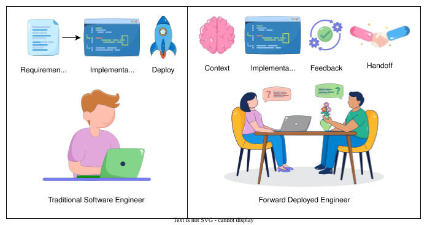

# Understanding_the_Forward_Deployed_Engineer_Role_in_AI_Systems

Source: https://www.educative.io/courses/forward-deployed-engineer/who-is-a-forward-deployed-engineer

---

[Home](https://www.educative.io/)

[Courses](https://www.educative.io/search?tab=courses)

[Forward Deployed Engineer for AI Systems](https://www.educative.io/courses/forward-deployed-engineer)

# Who Is a Forward Deployed Engineer?

Explore the essential role of Forward Deployed Engineers who embed directly within customer organizations to design and deploy AI systems that operate reliably under real-world conditions. Understand how FDEs bridge gaps between AI model potential and enterprise workflows, handling constraints and making critical deployment decisions. This lesson equips you to grasp why this role is vital for moving AI from pilot projects to dependable production systems.

We'll cover the following...

- [How the FDE role began](https://www.educative.io/courses/forward-deployed-engineer/who-is-a-forward-deployed-engineer#How-the-FDE-role-began)
  - [What FDEs do in practice](https://www.educative.io/courses/forward-deployed-engineer/who-is-a-forward-deployed-engineer#What-FDEs-do-in-practice)
- [Why AI revived this model](https://www.educative.io/courses/forward-deployed-engineer/who-is-a-forward-deployed-engineer#Why-AI-revived-this-model)
  - [The gap in a product release cannot be closed](https://www.educative.io/courses/forward-deployed-engineer/who-is-a-forward-deployed-engineer#The-gap-in-a-product-release-cannot-be-closed)
  - [What the industry’s response revealed](https://www.educative.io/courses/forward-deployed-engineer/who-is-a-forward-deployed-engineer#What-the-industrys-response-revealed)
- [How AI systems changed the FDE role](https://www.educative.io/courses/forward-deployed-engineer/who-is-a-forward-deployed-engineer#How-AI-systems-changed-the-FDE-role)

Many organizations now have access to capable AI models and experienced engineering teams. That gives them a solid starting point. Even so, many enterprise AI projects never move from a working pilot into production. The problem is often not the model itself. It usually appears when a working demo has to become a system that fits the organization’s workflows, connects to production data, handles operational constraints, and gives users enough confidence to rely on it.

Closing that gap takes more than technical ability. It requires someone who can work inside the customer environment, understand the business context directly, and deliver software that holds up in conditions that no specification document fully describes.

The **Forward Deployed Engineer**, commonly abbreviated as an **FDE**, is the role built around that kind of work. Understanding where the model came from makes it much easier to understand what it demands today.

## How the FDE role began

The Forward Deployed Engineer model was created at Palantir to solve a delivery problem its earliest customers could not solve through conventional means. Those customers operated in government and defense environments. Their data environments were highly sensitive and tightly tied to mission-specific workflows, so an off-the-shelf or remotely designed product would not fit. Requirements could not be captured through standard discovery, feedback, or procurement channels. A product developed only through standard release cycles was unlikely to match those environments’ operational needs.

Palantir’s answer was to embed engineers directly inside those environments. FDEs worked on-site, wrote production code against real systems, and adapted based on what they found. The software fit because it was built where it would run.

### What FDEs do in practice

The role spans the path from problem definition to production. FDEs understand the customer’s workflow, design the technical approach, write and ship code, and iterate with end users. The work requires the ability to handle ambiguity and adapt when production conditions differ from the initial assumptions. There is often no large internal team to rely on. The FDE stays close to the problem, and that context shapes technical decisions.

An FDE workflow

FDEs working across many deployments also noticed consistent patterns. The same problems appeared in different organizations under different names. An issue that looked specific to one customer often turned out to be a shared constraint across several. Those patterns fed back into Palantir’s core product over time. The embedded engineer was simultaneously delivering for the customer and generating insight for the company.

This dual function is part of what made the model durable. The FDE was not just a delivery mechanism. Each engagement produced learning that improved the next one. By the mid-2010s, Palantir employed more FDEs than traditional software engineers. The model was the company’s engine for growth.

Other companies working in complex, compliance-heavy, or domain-specific contexts began adopting the same model. For a long time, it remained largely associated with enterprise data and government work. That changed when AI systems brought the same delivery problem to every industry at once.

## Why AI revived this model

The deployment challenge Palantir originally solved for government data platforms has become the central challenge of enterprise AI. With the evolution of generative AI and agentic systems, that challenge reached every industry at once. Modern AI models can reason across large knowledge bases, generate working code, and operate as autonomous agents that pursue a goal across multiple steps without requiring human direction at each one. For organizations, this opened the possibility of redesigning workflows that had always depended on manual effort.

The structural problem is the same. A capable technology still requires someone inside the customer context to make it work reliably in that specific environment.

### The gap in a product release cannot be closed

Every organization that tries to bring AI into a real workflow quickly discovers that the model is only part of the work. The system also has to connect to the right data, respect access controls, fit into existing processes, handle edge cases cleanly, and earn the confidence of the people relying on it. A model may work well in a controlled environment and still fail in production because access rules are incomplete, source data is stale, or the surrounding workflow has no clear owner.

These are not model problems. They are deployment problems. And they differ in every organization. A product team working remotely cannot anticipate that surface. Someone has to be close to the environment to see it clearly. The market tends to produce a dedicated role for it. That is what happened here.

**Exercise:**

Take the exercise below to apply your understanding of the difference between model failures and deployment failures.

### What the industry’s response revealed

In May 2026, OpenAI launched DeployCo, its enterprise deployment company, to help organizations move frontier AI systems into production and operational workflows. In the same month, Anthropic announced a new enterprise AI services company with Blackstone, Hellman & Friedman, and Goldman Sachs. Together, these moves show that leading AI labs are investing directly in deployment. Deployment is becoming a core product and engineering capability, not a handoff that happens after model development.

The demand for engineers capable of closing the deployment gap grew sharply. FDE postings rose more than 800% in 2025. Organizations that succeed with AI today tend to have someone in the customer environment who can bridge the gap between model capability and operational fit. That demand also changed what the FDE role itself looks like.

## How AI systems changed the FDE role

The original FDE model at Palantir was built around data platforms. The same embedded delivery model now applies to AI systems, and those systems span a wide range. FDEs do not exclusively build agentic systems. They build whatever fits the problem. The right choice depends on the problem, the data available, and what the operating environment can actually support.

The table below shows the range of systems FDEs commonly build across enterprise engagements:

|  |  |
| --- | --- |
| **System Type** | **What It Does** |
| Document Q&A tool | Answers questions from a curated knowledge base using retrieval and a language model. |
| Classification pipeline | Routes or labels incoming items such as support tickets or contracts based on their content. |
| Knowledge synthesis system | Queries multiple data sources and produces a structured answer across them. |
| Agentic workflow | Takes a goal, reasons across steps, calls tools, and completes a task without step-by-step direction. |

The technical skills needed to build these AI systems form the foundation: working with LLM APIs, designing agent pipelines, running evaluations, and managing production deployments are baseline expectations. What the FDE adds to that foundation is the ability to operate inside a customer environment, navigate organizational constraints, make sound decisions under ambiguity, and deliver reliably in conditions that were never fully specified in advance.

The agent frameworks and model APIs needed to build these systems already exist. The FDE’s contribution is the judgment to select the right architecture for the right problem, and the ability to deploy it reliably inside a specific customer environment with all of its constraints in place. It requires a clear understanding of the environment the system will operate in, the failure modes that carry real risk, and the conditions under which a human should step in. That judgment comes from being close to the customer, not from the technology itself.

The role sits at the intersection of technical depth and operational judgment. Both sides matter. Strong technical skills without customer proximity produce systems that work in isolation. Customer proximity without technical depth produces recommendations that never ship. The FDE holds both at once, and that is what makes the role difficult to fill and valuable when filled well.

**Exercise:**

Take the exercise below to apply your understanding of what makes FDE work distinct from adjacent engineering roles.

The FDE role was created to close the gap between capability and dependable deployment. That gap exists in every organization trying to move AI from a demo into a system people actually rely on. The skills the role requires go beyond building AI systems. They include the ability to work inside a customer environment, earn trust under real conditions, make sound decisions without a complete picture, and deliver something that holds up long after the engagement ends.