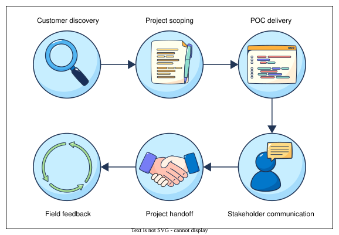

# Begin_Your_Journey_as_a_Forward_Deployed_Engineer_in_AI

Source: https://www.educative.io/courses/forward-deployed-engineer/getting-started-with-this-course

---

[Home](https://www.educative.io/)

[Courses](https://www.educative.io/search?tab=courses)

[Forward Deployed Engineer for AI Systems](https://www.educative.io/courses/forward-deployed-engineer)

# Getting Started with This Course

Explore what it means to be a Forward Deployed Engineer in AI. Learn to scope problems, deliver under real-world constraints, and master the entire engagement from discovery to handoff. Understand how this course prepares you for both the practical work and the interview process at leading AI companies.

We'll cover the following...

- [How the course is organized](https://www.educative.io/courses/forward-deployed-engineer/getting-started-with-this-course#How-the-course-is-organized)
- [Hands-on work across the course](https://www.educative.io/courses/forward-deployed-engineer/getting-started-with-this-course#Hands-on-work-across-the-course)
- [What this course assumes](https://www.educative.io/courses/forward-deployed-engineer/getting-started-with-this-course#What-this-course-assumes)
- [How the environment changes the work](https://www.educative.io/courses/forward-deployed-engineer/getting-started-with-this-course#How-the-environment-changes-the-work)
- [Building judgment on a solid foundation](https://www.educative.io/courses/forward-deployed-engineer/getting-started-with-this-course#Building-judgment-on-a-solid-foundation)

This course is for engineers who already build AI systems and want to apply their skills within customer organizations. Forward-deployed work keeps the same technical skills and adds a different kind of judgment. We scope the right problem, deliver under constraints we do not control, earn the trust of people with different priorities, and leave behind a system that holds up after we leave.

The FDE engagement lifecycle

The course has two goals. The first is doing the FDE job well, from the first discovery conversation to the final handoff. The second is getting hired into the role, which means passing interview loops that test that same judgment under time pressure. Every chapter serves one or both of those goals.

## How the course is organized[#](https://www.educative.io/courses/forward-deployed-engineer/getting-started-with-this-course#How-the-course-is-organized)

The course moves from the work itself to the interviews that lead to it, and closes with the skills that keep growing across a career.

- **The FDE role and its lifecycle:** What forward deployed engineers do, and how an engagement runs from discovery and scoping through the proof of concept (POC), the pilot, the handoff, and field feedback.
- **AI systems architecture:** The LLM-based and agentic systems FDEs build, with harness engineering, orchestration patterns, and how to choose a framework.
- **FDE interviews and system design:** How FDE interview loops work, a repeatable approach to the system design round, and the integration patterns that come up in it.
- **Case studies:** Complete systems, from a financial knowledge assistant to a customer service agent, each decomposed, designed, and defended under interview questions.
- **Top AI companies interview prep:** Dedicated preparation for the FDE loops at Anthropic, Google Cloud, OpenAI, and Palantir, covering each company’s stack, its interview rounds, and what its interviewers look for.
- **Take-home masterclass:** How FDE take-home assignments are scored, and how to scope, build, document, and defend one.
- **Growing as an FDE:** The skills that compound across every engagement, from navigating enterprise constraints to communicating with each type of stakeholder.

Reading about these topics is only part of the course. Most of the learning happens by building and practicing.

## Hands-on work across the course[#](https://www.educative.io/courses/forward-deployed-engineer/getting-started-with-this-course#Hands-on-work-across-the-course)

The course is built around practice. In the company chapters, we learn each company’s stack by building with it, from Claude with the Agent SDK and MCP to OpenAI’s Responses API and Agents SDK and Gemini with the Agent Development Kit, along with runnable Python practice for Palantir’s coding rounds. Projects give experience taking a system from a design to working code with a production framework. Cloud labs provide experience working inside a real cloud environment, where a model is trained, deployed, and tested. Mock interviews let us rehearse complete rounds under realistic conditions, so the real interview feels familiar.

All of this practice builds on a technical foundation we bring into the course.

## What this course assumes[#](https://www.educative.io/courses/forward-deployed-engineer/getting-started-with-this-course#What-this-course-assumes)

The course starts from practical experience building AI systems in code. Five areas matter most.

- **Python:** Writing, running, and debugging Python programs comfortably.
- **LLM APIs and prompting:** Calling a model API in code, writing system prompts, and getting structured output from a model.
- **RAG and agents:** Having built at least one retrieval pipeline and one agent that uses tools.
- **Evaluation:** Measuring model output quality with a repeatable approach.
- **Integration basics:** Working with REST APIs, authentication, and common data formats such as JSON and CSV.

With that foundation in place, the remaining shift happens in the environment where the work takes place.

## How the environment changes the work[#](https://www.educative.io/courses/forward-deployed-engineer/getting-started-with-this-course#How-the-environment-changes-the-work)

Working on an internal or personal AI project gives full control. The data is familiar, access is immediate, the timeline is internal, and success is defined by whoever is building the system. Customer environments add a different layer of conditions on top of the same technical work.

The technical work stays the same when we build for a customer. What changes is the judgment layer on top of it, such as what to scope, what to simplify, what to flag early, and how to keep a stakeholder confident when the environment turns out to be more complicated than it first appeared.

The timeline dimension deserves specific attention. In a customer project, the timeline belongs to the customer. A missed demo date leaves the deadline in place and damages trust. FDEs develop an instinct for scoping to the time available rather than scoping to the ideal solution. The first deliverable is rarely the complete vision. It is the smallest working system that demonstrates the core value and earns the right to build more.

## Building judgment on a solid foundation[#](https://www.educative.io/courses/forward-deployed-engineer/getting-started-with-this-course#Building-judgment-on-a-solid-foundation)

The technical foundation is what we bring. The course builds the judgment to use it inside customer environments, and the practice to prove that judgment in an interview. Each chapter adds one piece, from how an engagement runs to how a specific company tests for the role. By the end, the goal is an engineer who can walk into an unfamiliar organization, find the problem worth solving, and deliver a system that the people depending on it can trust.

Who Is a Forward Deployed Engineer?

Running Customer Discovery

Ask

[How the course is organized](https://www.educative.io/courses/forward-deployed-engineer/getting-started-with-this-course#How-the-course-is-organized)

[Hands-on work across the course](https://www.educative.io/courses/forward-deployed-engineer/getting-started-with-this-course#Hands-on-work-across-the-course)

[What this course assumes](https://www.educative.io/courses/forward-deployed-engineer/getting-started-with-this-course#What-this-course-assumes)

[How the environment changes the work](https://www.educative.io/courses/forward-deployed-engineer/getting-started-with-this-course#How-the-environment-changes-the-work)

[Building judgment on a solid foundation](https://www.educative.io/courses/forward-deployed-engineer/getting-started-with-this-course#Building-judgment-on-a-solid-foundation)