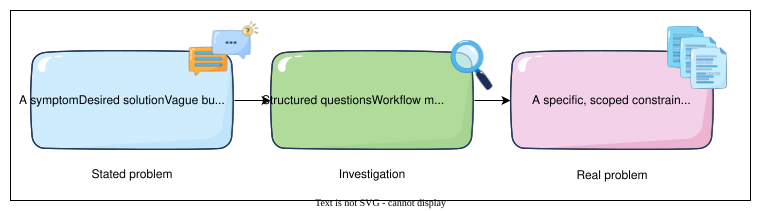

# Running_Customer_Discovery_for_Effective_AI_Project_Scoping

Source: https://www.educative.io/courses/forward-deployed-engineer/running-customer-discovery

---

[Home](https://www.educative.io/)

[Courses](https://www.educative.io/search?tab=courses)

[Forward Deployed Engineer for AI Systems](https://www.educative.io/courses/forward-deployed-engineer)

# Running Customer Discovery

Explore how to run customer discovery sessions that accurately define AI project problems and scope solutions. Learn to identify key stakeholders, gather comprehensive data, and avoid common pitfalls. This lesson helps you develop the discipline to investigate before designing, ensuring your AI system addresses true operational pain and is technically feasible.

We'll cover the following...

- [Discovery as technical investigation](https://www.educative.io/courses/forward-deployed-engineer/running-customer-discovery#Discovery-as-technical-investigation)
- [Anatomy of a discovery session](https://www.educative.io/courses/forward-deployed-engineer/running-customer-discovery#Anatomy-of-a-discovery-session)
  - [Who to get in the room](https://www.educative.io/courses/forward-deployed-engineer/running-customer-discovery#Who-to-get-in-the-room)
  - [How to open the session](https://www.educative.io/courses/forward-deployed-engineer/running-customer-discovery#How-to-open-the-session)
  - [What to listen for](https://www.educative.io/courses/forward-deployed-engineer/running-customer-discovery#What-to-listen-for)
  - [The 5-column note framework](https://www.educative.io/courses/forward-deployed-engineer/running-customer-discovery#The-5-column-note-framework)
  - [Closing the session well](https://www.educative.io/courses/forward-deployed-engineer/running-customer-discovery#Closing-the-session-well)
- [Recognizing real AI opportunities](https://www.educative.io/courses/forward-deployed-engineer/running-customer-discovery#Recognizing-real-AI-opportunities)
- [What goes wrong in discovery](https://www.educative.io/courses/forward-deployed-engineer/running-customer-discovery#What-goes-wrong-in-discovery)
- [Challenge: Manufacturing company procurement](https://www.educative.io/courses/forward-deployed-engineer/running-customer-discovery#Challenge-Manufacturing-company-procurement)

Many enterprise AI projects start to fail during problem definition, before implementation begins. The failure often starts during discovery and scoping, when the team defines the wrong problem or never establishes clear success criteria.

Discovery is the FDE’s first responsibility on every customer project. It is a structured technical investigation carried out through customer conversations with one goal: to understand the problem precisely enough to scope a viable solution. Getting it right determines whether the work that follows creates value or burns time. If discovery is wrong, the team may build the wrong system, scope the project too broadly, or discover six weeks later that the required data does not exist in the expected format.

This lesson covers the mindset, the structure, the filters, and the failure patterns that define strong discovery practice.

## Discovery as technical investigation

**Discovery** is a structured technical investigation conducted as a conversation. The FDE is not selling, advising, or designing during this phase. The only goal is to understand the problem with enough precision to scope a solution.

Customers rarely describe their real constraint in the first conversation. They describe a symptom (“our team wastes hours every week on this”), a solution they have already decided on (“we want a chatbot for this”), or a high-level outcome (“we want AI to make us more efficient”). The FDE works backward from that description to the actual workflow problem underneath it.

The discovery mindset requires deliberate restraint. The moment the FDE starts proposing architecture in a discovery session, the session stops being an investigation and starts being a pitch. Architecture decisions made before the problem is understood produce the wrong system. Every design question belongs after the problem is clear.

The output of discovery is not a solution. It is a clear enough picture of the problem, the data, the stakeholders, and the constraints to write a scope document.

Customer discovery

The structure of the session determines how much of the real picture actually surfaces.

The goal of a discovery session is to understand the problem, not to demonstrate how the FDE would solve it.

## Anatomy of a discovery session

A discovery session has a predictable structure. Each part serves a specific purpose, and the order matters. Getting the setup, the opening, and the note-taking right determines how much of the real picture the FDE leaves with.

### Who to get in the room

A strong discovery group brings together three types of people, each contributing a different layer of the picture.

- **Executive sponsor:** Owns the problem, controls the budget, and anchors the conversation to real organizational priorities. Their presence connects the session to what the organization will actually fund and act on.
- **Ops person or domain expert:** Performs the actual work today and knows where the workflow breaks in practice. This is often the most informative person in the room, because they describe the system as it actually runs rather than as it is designed to run.
- **Technical contact:** Knows which systems are involved, where the data lives, and what access actually looks like. Essential for evaluating whether the project is technically feasible before the scope document is written.

If only two of the three are available, note which perspective is missing and plan a targeted follow-up before finalizing the scope.

### How to open the session

Open by asking for a complete account of how the workflow breaks down: what triggers the failure, who gets involved, what work gets stuck, and how the team recovers. That kind of narrative reveals systems, handoffs, manual steps, and failure modes that a direct question about pain points rarely surfaces.

**Ask about the workaround:**

After the team describes the official process, ask what they actually do when that process breaks down. The workaround is often the clearest signal of where the real operational pain is.

### What to listen for

Three categories of signals matter most during a discovery session.

- **Data signals:** Every system name, file type, or data source the customer mentions is a building block of the technical scope. Note them all without interrupting.
- **Volume and frequency:** Ask how often the task is performed and how long a typical run takes. Volume and frequency convert vague pain into a measurable baseline. Without those numbers, there is no basis for estimating the value of the project.
- **Ownership gaps:** When no one can say who owns a step in the workflow, that step is a risk. It will surface again during the build, usually at the worst possible moment.

### The 5-column note framework

Capture every observation in five columns: the stated pain, the current workflow steps, the data available, a candidate success metric, and the blockers to accessing what is needed. This structure forces completeness and converts discovery notes directly into the building blocks of a scope document.

### Closing the session well

Before leaving, summarize back what was heard: here is the core problem, here is the data involved, and here is what success would look like. Misalignments surface immediately when the FDE speaks the problem back. Finding them in the session is far better than finding them after the scope document is written.

Use the closing to confirm that the session produced enough to move forward. A session that ends without answers to these four checks carries unresolved risk into the scope document.

**Checklist: Before leaving the session**

- Does the data required for the system exist, and is it accessible within the project timeline?
- Is there a specific, measurable success criterion that can be verified before the project ends?
- Is the customer’s timeline realistic given what actually needs to be built?
- Is there one person inside the organization who owns the problem, has authority to clear blockers, and will be the main contact throughout?

With a clear picture of the problem in hand, the next question is whether the problem is actually an AI problem.

## Recognizing real AI opportunities

Not every workflow problem is an AI problem. The FDE that treats every customer request as a candidate for AI ends up building systems that deliver little value, or solving problems a simpler tool would have handled in a day.

Modern AI systems, including generative models that produce language and code and agentic systems that execute multi-step tasks using tools, open a much wider range of use cases than earlier automation approaches. The question is whether the workflow problem actually benefits from what these systems do well.

Four signals indicate a use case is genuinely AI-addressable:

- **Document-heavy synthesis and extraction:** The task involves reading, summarizing, extracting, or comparing information across large volumes of contracts, reports, emails, or policy documents. Generative models handle this at a scale no human team can match without high cost.
- **Knowledge retrieval at scale:** The task requires answering questions from large knowledge bases, applying criteria from policy documents to incoming requests, or routing inputs based on content. Retrieval-augmented systems are a direct fit.
- **Multi-step workflows with conditional logic:** The task involves a sequence of dependent steps with conditional decisions at each stage, for example, gathering inputs, applying rules, and routing the output. Agentic systems can coordinate this kind of workflow end to end, reducing what was previously a chain of manual handoffs.
- **Repetitive judgment at throughput:** The task follows a consistent decision pattern, the criteria are relatively stable, and the value of automation scales with volume. Classification, prioritization, and routing problems fall here.

Recognizing real AI opportunities

For high-volume use cases, factor in inference costs early: running thousands of requests per day against a frontier model adds up, and that cost needs to be part of the justification for the project from the start.

**Warning: Establish the baseline first**

Always determine what the current process costs in time or error rate before proposing a solution. If the customer cannot answer this question, establishing that baseline is the first step. Without it, there is no way to demonstrate that the system improved anything.

Identifying a genuine AI opportunity is one part of discovery. The other is running the session well enough to surface the real picture. The patterns below are where that falls apart.

## What goes wrong in discovery

These patterns appear across industries and customer types. Recognizing them before they take hold is the difference between a session that produces a usable scope document and one built on assumptions.

- **Solutioning too early:** Proposing architecture during a discovery session closes down the investigation. The customer stops describing their problem and starts reacting to the proposed solution. All design decisions belong after the problem is understood.
- **The HiPPO problem:** The “Highest-Paid Person’s Opinion” dominates discovery sessions. Senior stakeholders describe their vision of what AI should do rather than the actual operational pain. Redirect toward the people who do the work, without alienating the executive in the room.
- **Scope creep in discovery:** Customers add requirements in real time. Close the session with a summary of what was captured, not an open invitation for additions. New requirements belong in a separate conversation after the scope document is drafted.
- **Discovery theater:** Going through the motions of a session without uncovering real constraints: asking surface-level questions, accepting vague answers, and leaving without a clear picture of the data or the workflow. The output is a scope document built on assumptions rather than facts.
- **Skipping the baseline:** Scoping an AI solution without knowing what the current process costs in time, error rate, and projected token cost at the expected volume makes it impossible to build a credible business case. Establish the baseline in discovery, before proposing anything.

When discovery is done well, it produces a specific, testable problem definition, a clear view of the available data, dependencies, and constraints, and an informed decision about whether to proceed. Every later phase depends on that foundation. A strong discovery is not just a good start; it is what makes the rest of the project possible.

## Challenge: Manufacturing company procurement

An FDE meets with a VP of Operations and a procurement manager at a manufacturing company. The company has asked for help applying AI to its procurement process. Read the conversation and identify the specific workflow bottleneck that emerges, the data the workflow depends on, and the manual work the team does today.

AI Powered

Saved

2 attempts left

Reset

Identify the problem

**Task:** The company described its problem as needing to improve procurement with AI. Based on the conversation, describe the actual workflow problem that a system should address.

You have 2 attempts to answer.