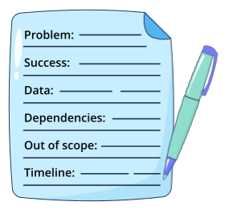

# Scoping_and_Solution_Architecture_for_AI_Projects

Source: https://www.educative.io/courses/forward-deployed-engineer/scoping-and-solution-architecture

---

[Home](https://www.educative.io/)

[Courses](https://www.educative.io/search?tab=courses)

[Forward Deployed Engineer for AI Systems](https://www.educative.io/courses/forward-deployed-engineer)

# Scoping and Solution Architecture

Explore how to develop a clear scope document that aligns customer expectations and FDE goals. Learn to translate business problems into AI components, select architectures fitting constraints, and identify risks early for successful AI system builds.

We'll cover the following...

- [What a scope document does](https://www.educative.io/courses/forward-deployed-engineer/scoping-and-solution-architecture#What-a-scope-document-does)
- [Translating the problem into a solution](https://www.educative.io/courses/forward-deployed-engineer/scoping-and-solution-architecture#Translating-the-problem-into-a-solution)
  - [Scenario: Contract review for a legal firm](https://www.educative.io/courses/forward-deployed-engineer/scoping-and-solution-architecture#Scenario-Contract-review-for-a-legal-firm)
- [Selecting the right AI architecture](https://www.educative.io/courses/forward-deployed-engineer/scoping-and-solution-architecture#Selecting-the-right-AI-architecture)
  - [Practical constraints to consider](https://www.educative.io/courses/forward-deployed-engineer/scoping-and-solution-architecture#Practical-constraints-to-consider)
    - [Token budget and cost](https://www.educative.io/courses/forward-deployed-engineer/scoping-and-solution-architecture#Token-budget-and-cost)
    - [Communication with technical contact](https://www.educative.io/courses/forward-deployed-engineer/scoping-and-solution-architecture#Communication-with-technical-contact)
    - [Enterprise integration context](https://www.educative.io/courses/forward-deployed-engineer/scoping-and-solution-architecture#Enterprise-integration-context)
- [The technical risk register](https://www.educative.io/courses/forward-deployed-engineer/scoping-and-solution-architecture#The-technical-risk-register)

Discovery ends with a clear problem definition. Scoping converts that definition into a proposal. The proposal answers the following questions: what to build, which architecture fits the problem, and which risks need to be addressed before implementation begins. The scope document records those decisions and gives the FDE and the customer a concrete baseline to agree on before work starts.

Getting the scope right before the build begins is far cheaper than correcting it mid-sprint. A project with a well-written scope document rarely fails because of misalignment. It fails for other reasons, and those are far easier to address.

## What a scope document does

A **scope document** is a shared agreement between the FDE and the customer. Its purpose is alignment. Both parties need to understand the same problem, the same success condition, and the same boundaries before the build begins. Without that agreement in writing, every conversation about progress introduces a new layer of interpretation.

A scope document is not a product specification. A **product specification** describes a future vision across months or quarters. A scope document describes what will be built in the next two to four weeks, what it will demonstrate, and how success will be measured. The scope document covers the **proof of concept (POC)** phase. A typical proof of concept runs for two weeks and ends ...

Six elements belong in every scope document. Each one answers a question that will ...