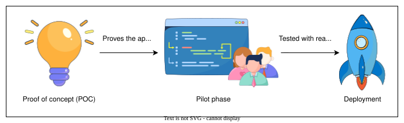

# Understanding_the_Pilot_Phase_in_Forward_Deployed_Engineer_Projects

Source: https://www.educative.io/courses/forward-deployed-engineer/the-pilot-phase

---

[Home](https://www.educative.io/)

[Courses](https://www.educative.io/search?tab=courses)

[Forward Deployed Engineer for AI Systems](https://www.educative.io/courses/forward-deployed-engineer)

# The Pilot Phase

Explore the pilot phase in AI system development, where a more complete version of the system is tested with real users and live data. Learn how to define pilot scope, gather and respond to user feedback, evaluate system reliability, adoption, and trust, and prepare for a successful handoff to full deployment. This lesson helps you connect technical validation to organizational readiness and make informed decisions for project success.

We'll cover the following...

- [What is the pilot phase?](https://www.educative.io/courses/forward-deployed-engineer/the-pilot-phase#What-is-the-pilot-phase)
- [The pilot scope](https://www.educative.io/courses/forward-deployed-engineer/the-pilot-phase#The-pilot-scope)
- [Working with real users](https://www.educative.io/courses/forward-deployed-engineer/the-pilot-phase#Working-with-real-users)
  - [Setting expectations](https://www.educative.io/courses/forward-deployed-engineer/the-pilot-phase#Setting-expectations)
  - [Capturing user feedback](https://www.educative.io/courses/forward-deployed-engineer/the-pilot-phase#Capturing-user-feedback)
  - [Iterating within scope](https://www.educative.io/courses/forward-deployed-engineer/the-pilot-phase#Iterating-within-scope)
- [Evaluating pilot performance](https://www.educative.io/courses/forward-deployed-engineer/the-pilot-phase#Evaluating-pilot-performance)
- [Closing the pilot](https://www.educative.io/courses/forward-deployed-engineer/the-pilot-phase#Closing-the-pilot)
  - [The pilot readout](https://www.educative.io/courses/forward-deployed-engineer/the-pilot-phase#The-pilot-readout)
  - [The two main outcomes](https://www.educative.io/courses/forward-deployed-engineer/the-pilot-phase#The-two-main-outcomes)
  - [Deployment prerequisites](https://www.educative.io/courses/forward-deployed-engineer/the-pilot-phase#Deployment-prerequisites)

The POC sprint answered one question: Does the approach work? The pilot answers the next question: Does a more complete version of the system work for its end users, in their day-to-day workflows, under production-like operational conditions?

These are genuinely different questions. A test set reveals technical performance under controlled conditions. Real users reveal organizational fit, unexpected input patterns, and whether the output is trustworthy enough to change how people work. A system that performs at 91% accuracy on a curated test set may still fail to gain adoption if users do not understand it, do not trust it, or find that the workflow integration creates friction. The pilot is where those questions get answered.

The pilot is also the phase that directly precedes full deployment to all users. What the FDE learns here directly shapes what the customer needs to have in place before the system goes live for everyone.

## What is the pilot phase?[#](https://www.educative.io/courses/forward-deployed-engineer/the-pilot-phase#What-is-the-pilot-phase)

The pilot is a more complete build of the system. It handles a broader range of inputs, integrates more deeply with the customer’s live systems and workflows, and covers the edge cases that the proof of concept deliberately excluded. The system built during the pilot runs with real users, processes live data, and produces outputs that people actually act on.

Three things the pilot adds that the proof of concept did not include:

- **Broader input coverage:** The full distribution of what users will send to the system, including the unexpected and the messy cases that were absent from the curated test set.
- **Live system integrations:** Real authentication, live data feeds, and write-back to the systems the users already work in. These are the connections that make the system usable in practice rather than in isolation.
- **Error handling and edge case logic:** The cases acknowledged as out of scope during the proof of concept are now addressed with the depth required for operational use.

The pilot explicitly excludes production-grade monitoring infrastructure, complete compliance and audit documentation, data governance approvals, and the scaling work required for organization-wide rollout. These are explicit exclusions, not deferred pilot tasks. The pilot confirms that the system works for a defined user group in a controlled operational setting. The handoff phase prepares the system for full deployment. Keeping that boundary clear makes the pilot useful and contained.

With a clear picture of what the pilot builds, the next step is defining the scope before work begins.

## The pilot scope[#](https://www.educative.io/courses/forward-deployed-engineer/the-pilot-phase#The-pilot-scope)

The pilot scope document defines what the team will build and what the pilot must prove. The FDE and the customer agree on it before work begins, which creates a shared standard for what done looks like and helps the FDE manage scope expansion during the pilot.

The pilot scope covers:

- **Capabilities:** The expanded set of capabilities to build, covering the input types and workflows, which the proof of concept excluded.
- **Integrations:** The live system integrations required for users to work with the system in their actual environment.
- **Users:** Who the pilot users are, what role they play, and what they will do with the system daily.
- **Timeline:** How many weeks for the initial build, how often feedback cycles will run, and when the readout will happen.
- **Success criteria:** What the pilot needs to demonstrate across three dimensions: metric performance under real conditions, adoption rate, and user trust signals.

The timeline and feedback cadence deserve specific attention. A pilot with no structured check-ins produces feedback too late to act on. A weekly or bi-weekly rhythm of structured user check-ins, combined with ongoing error logging, gives the FDE the information needed to improve the system before the readout rather than discovering problems at it.

A common approach at the start of a pilot is **shadow mode.** In this mode, the AI system processes the same incoming requests as the existing process, but its outputs are captured in the background and not shown to end users. The existing process continues to drive all decisions. The FDE and the customer’s technical team review both sets of outputs side by side to compare accuracy and identify failure patterns before the pilot user group begins relying on the AI directly. Once the shadow outputs are consistently reliable, the pilot moves into its active phase: the defined pilot user group starts working with the AI outputs as part of their actual workflow.

With the scope defined and shadow mode as an optional starting point, the next priority is how to work with the users who will participate in the pilot.

## Working with real users[#](https://www.educative.io/courses/forward-deployed-engineer/the-pilot-phase#Working-with-real-users)

Real users produce qualitative feedback that no test set generates. That feedback is the most valuable signal in the pilot, but only if the FDE has structures in place to collect it and respond to it.

### Setting expectations[#](https://www.educative.io/courses/forward-deployed-engineer/the-pilot-phase#Setting-expectations)

Before users start, communicate three things: what the system does, what it does not do, and how to report a problem. Users who enter the pilot without clear expectations will either over-reliance on the system after a few strong results or dismiss it after the first error. Both responses waste the phase. A brief orientation session covering the system’s purpose, its known limitations, and the feedback channel takes less than an hour and significantly improves the quality of what the pilot produces.

### Capturing user feedback[#](https://www.educative.io/courses/forward-deployed-engineer/the-pilot-phase#Capturing-user-feedback)

Set up a simple mechanism for users to report issues: a shared form, a dedicated Slack or Teams channel, or a brief weekly check-in. Useful feedback includes the user’s input, the system’s output, and what was wrong or unexpected. Vague feedback is not actionable; feedback tied to a specific failure pattern is. The FDE should review this feedback throughout the pilot, not only at the end.

### Iterating within scope[#](https://www.educative.io/courses/forward-deployed-engineer/the-pilot-phase#Iterating-within-scope)

Pilot users will request changes and additions. Some are legitimate improvements within the agreed scope. Some are new requirements that belong in a later phase. Address what is within scope, log and defer what is not. Expanding the scope mid-pilot delays the phase and distorts the evaluation by changing what is being tested while the test is running.

Working with users

**Exercise:**

Take the exercise below to apply your understanding of the judgment calls that determine how a pilot phase progresses.

Supporting users while keeping the scope contained makes the pilot evaluation meaningful. Readiness signals come from consistent observation throughout the pilot.

## Evaluating pilot performance[#](https://www.educative.io/courses/forward-deployed-engineer/the-pilot-phase#Evaluating-pilot-performance)

Metric performance is one part of the evaluation. Three signals together determine whether the system is ready for full deployment:

- **Reliability:** Does the system behave consistently under real operational conditions? This means stable latency, predictable output quality across different input types, and no silent failures. Average metrics can look strong while hiding concentrated failure patterns in specific input categories. Reviewing the distribution of results, not just the mean, reveals whether reliability is real.
- **Adoption:** Are users incorporating the system into their workflow? Adopted systems show up in behavior: users stop checking the manual alternative, usage patterns become regular, and the team starts organizing work around the system’s outputs. Low adoption alongside strong metrics typically points to a trust or usability issue rather than a technical one. Both are solvable during the pilot, but only if identified early.
- **Trust:** Do users act on the system’s output, or do they re-verify everything independently? High re-verification rates signal that users have not built confidence in the output, even when accuracy numbers look strong. Trust builds through consistent performance over time and through the absence of unexpected failures.

Evaluating pilot performance

When all three signals are positive, the pilot has produced sufficient evidence to recommend full deployment. When one is weak, the FDE identifies the specific cause before making a recommendation. Low adoption with strong metrics points somewhere different than strong adoption with low trust, and each has a different path to resolution.

**Exercise:**

Take the exercise below to apply your understanding of how to classify pilot observations by the signal they represent.

Match The Answer

Statement

Match With

A

7 of 8 users stopped checking the manual process and now work primarily with AI outputs.

Reliability

B

Users are consistently reviewing every output before submitting, even when it looks correct.

Adoption

C

Response latency increased 4x on high-volume days without any change to the system.

Trust

---

## Closing the pilot[#](https://www.educative.io/courses/forward-deployed-engineer/the-pilot-phase#Closing-the-pilot)

The pilot closes with a structured readout, a decision, and a clear set of prerequisites for the team that takes ownership of the system next.

### The pilot readout[#](https://www.educative.io/courses/forward-deployed-engineer/the-pilot-phase#The-pilot-readout)

The **pilot readout** covers operational behavior. It reports who the pilot users were and how long the pilot ran, the metric results under real conditions, adoption data (usage patterns and how often users reverted to the manual process), trust signals (override rates and notable feedback themes), and the recommendation.

### The two main outcomes[#](https://www.educative.io/courses/forward-deployed-engineer/the-pilot-phase#The-two-main-outcomes)

By the time a project reaches the pilot phase, the core approach has already been validated. The pilot is not the stage where the fundamental question of whether the approach works gets revisited. The two outcomes that typically emerge are:

- **Proceed to full deployment:** All three signals are positive, and the customer is ready to operate the system independently. Define the deployment prerequisites before leaving the readout meeting.
- **Extend the pilot:** One or more signals need more time or a specific intervention. Define what needs to change and agree on a timeline before the meeting ends.

In rare cases, a fundamental constraint that was not visible during the proof of concept or early pilot work may surface: a governance restriction, a data access change, or an organizational decision that affects the feasibility of the system. When that happens, the FDE surfaces it clearly and works with the customer to determine the path forward. This is uncommon, but it is part of the FDE’s responsibility to recognize it honestly when it occurs.

### Deployment prerequisites[#](https://www.educative.io/courses/forward-deployed-engineer/the-pilot-phase#Deployment-prerequisites)

Before handoff begins, confirm that the customer has three operational commitments in place: a named system owner, a support channel for users who encounter issues, and a plan for monitoring system performance after the FDE exits the engagement. These are customer commitments, not FDE deliverables. They determine whether full rollout is operationally viable.

The pilot phase connects the technical proof to the organizational reality. A system that works in a controlled test proves the approach. A system that works for real users, adopted into how the team actually operates, proves it is ready to become part of how work gets done. The judgment the FDE applies during the pilot (reading adoption signals, managing scope under pressure, deciding when the evidence is sufficient) is the judgment that makes the final handoff succeed.

The Proof of Concept (POC) Sprint

The Project Handoff

Ask

[What is the pilot phase?](https://www.educative.io/courses/forward-deployed-engineer/the-pilot-phase#What-is-the-pilot-phase)

[The pilot scope](https://www.educative.io/courses/forward-deployed-engineer/the-pilot-phase#The-pilot-scope)

[Working with real users](https://www.educative.io/courses/forward-deployed-engineer/the-pilot-phase#Working-with-real-users)

[Setting expectations](https://www.educative.io/courses/forward-deployed-engineer/the-pilot-phase#Setting-expectations)

[Capturing user feedback](https://www.educative.io/courses/forward-deployed-engineer/the-pilot-phase#Capturing-user-feedback)

[Iterating within scope](https://www.educative.io/courses/forward-deployed-engineer/the-pilot-phase#Iterating-within-scope)

[Evaluating pilot performance](https://www.educative.io/courses/forward-deployed-engineer/the-pilot-phase#Evaluating-pilot-performance)

[Closing the pilot](https://www.educative.io/courses/forward-deployed-engineer/the-pilot-phase#Closing-the-pilot)

[The pilot readout](https://www.educative.io/courses/forward-deployed-engineer/the-pilot-phase#The-pilot-readout)

[The two main outcomes](https://www.educative.io/courses/forward-deployed-engineer/the-pilot-phase#The-two-main-outcomes)

[Deployment prerequisites](https://www.educative.io/courses/forward-deployed-engineer/the-pilot-phase#Deployment-prerequisites)