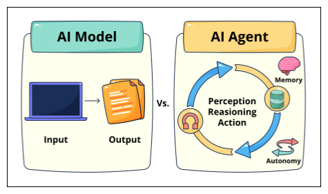

# Understanding_AI_System_Types_and_Agentic_Architecture

Source: https://www.educative.io/courses/forward-deployed-engineer/the-ai-system-landscape

---

[Home](https://www.educative.io/)

[Courses](https://www.educative.io/search?tab=courses)

[Forward Deployed Engineer for AI Systems](https://www.educative.io/courses/forward-deployed-engineer)

# The AI System Landscape

Understand the two main categories of AI systems: LLM-based non-agentic and agentic systems. Learn how agentic systems operate autonomously through multi-step reasoning and the critical role of harness engineering. This lesson helps you evaluate, scope, and design AI systems by focusing on runtime behavior, system components, and production readiness to ensure effective deployment and handoff.

We'll cover the following...

- [Two categories of AI systems](https://www.educative.io/courses/forward-deployed-engineer/the-ai-system-landscape#Two-categories-of-AI-systems)
  - [LLM-based non-agentic systems](https://www.educative.io/courses/forward-deployed-engineer/the-ai-system-landscape#LLM-based-non-agentic-systems)
  - [Agentic systems](https://www.educative.io/courses/forward-deployed-engineer/the-ai-system-landscape#Agentic-systems)
- [What makes a system agentic](https://www.educative.io/courses/forward-deployed-engineer/the-ai-system-landscape#What-makes-a-system-agentic)
- [Components of an agentic system](https://www.educative.io/courses/forward-deployed-engineer/the-ai-system-landscape#Components-of-an-agentic-system)
  - [The reasoning model](https://www.educative.io/courses/forward-deployed-engineer/the-ai-system-landscape#The-reasoning-model)
  - [Harness engineering](https://www.educative.io/courses/forward-deployed-engineer/the-ai-system-landscape#Harness-engineering)

FDEs encounter a wide range of AI systems across customer environments. Some are straightforward: a model receives an input and produces an output within a single processing cycle. Others operate across multiple steps, calling external tools, maintaining context across a session, and taking autonomous actions toward a goal. These two types of systems are architecturally distinct, and they require different approaches to scope, evaluate, and hand off.

The system type that the FDE recommends during scoping shapes everything that follows. A simpler, non-agentic system has a shorter build cycle, more contained evaluation criteria, and a handoff that the customer’s team can take ownership of quickly. An agentic system introduces coordination complexity, a broader failure surface, and production requirements that go well beyond what a simple pipeline demands. Matching the system type to the problem is one of the most consequential decisions an FDE makes during scoping.

This lesson establishes the landscape: two categories of AI systems, what makes each one distinct, and the structural concept that defines how agentic systems actually work in production.

## Two categories of AI systems[#](https://www.educative.io/courses/forward-deployed-engineer/the-ai-system-landscape#Two-categories-of-AI-systems)

AI systems are divided into two broad categories:

- LLM-based non-agentic systems
- Agentic systems

The distinction lies not in the capability of the underlying model but in how the system operates at runtime.

### LLM-based non-agentic systems[#](https://www.educative.io/courses/forward-deployed-engineer/the-ai-system-landscape#LLM-based-non-agentic-systems)

An LLM-based non-agentic system takes an input, passes it through a language model, and returns an output. The processing path is fixed. The same input type produces the same sequence of operations every time, and the system does not take autonomous actions based on what it observes mid-process.

Common enterprise use cases include document classification, information extraction, text summarization, structured question answering, and content generation. A contract analysis system that reads a document and returns a structured clause summary is an LLM-based system. A support routing system that reads a customer email and assigns it to the correct queue is an LLM-based system. A knowledge retrieval system that fetches relevant documents and generates a concise answer from them is an LLM-based system.

For the FDE, these systems carry practical advantages. They are faster to scope, their evaluation criteria are straightforward to define, and they are simpler to hand off. The customer’s engineering team can trace a wrong output back to its source and iterate without needing to reason about multi-step execution or tool coordination.

### Agentic systems[#](https://www.educative.io/courses/forward-deployed-engineer/the-ai-system-landscape#Agentic-systems)

An agentic system reasons across multiple steps. After receiving an input or a goal, the system decides what action to take next, executes it, observes the result, incorporates it into its next decision, and continues until the goal is reached or the task is abandoned. The number of steps and the specific path through them are not fixed in advance.

Common enterprise use cases include multi-step research and synthesis, autonomous workflow execution, systems that interact with external APIs and databases to complete a task, and document processing pipelines that apply conditional logic at each step depending on what earlier steps produced.

The FDE’s work changes accordingly. An agentic system requires a more thorough evaluation framework, careful failure mode analysis, and a handoff that explicitly covers what happens when the system fails partway through a task.

## What makes a system agentic[#](https://www.educative.io/courses/forward-deployed-engineer/the-ai-system-landscape#What-makes-a-system-agentic)

**An agent** is a system that perceives its environment, reasons toward a goal, selects and executes actions, observes the results of those actions, and repeats this cycle until the goal is reached or the task is abandoned. The defining property is autonomous multi-step operation: the system determines its own next action based on what it observes, without requiring a human to direct each step.

This distinction shapes everything the FDE has to plan. An agentic system requires the FDE to scope which tools the agent can call, how it handles a failed tool call, and what it does when an intermediate step returns an ambiguous or incomplete result. A non-agentic system requires none of that. Getting the category right before writing the scope document prevents significant mid-build rework.

A widespread pattern in enterprise AI is applying the label agentic to any system built using an agent framework. Whether a system actually operates agentically depends on whether it takes autonomous actions across steps based on what it observes. An FDE who draws that line accurately will scope the right system and set honest expectations throughout the project.

Every agentic system is built from two structural components. Understanding both is what allows the FDE to build, evaluate, and hand off these systems with confidence.

## Components of an agentic system[#](https://www.educative.io/courses/forward-deployed-engineer/the-ai-system-landscape#Components-of-an-agentic-system)

Every agentic system consists of two structural parts:

- Reasoning model
- Harness engineering

### The reasoning model[#](https://www.educative.io/courses/forward-deployed-engineer/the-ai-system-landscape#The-reasoning-model)

The reasoning model is the large language model at the center of the system. It perceives the current state of the task, decides what action to take next, and generates the output or instruction that drives the system forward at each step of the reasoning cycle.

In recent years, a class of models optimized specifically for multi-step reasoning has emerged alongside general-purpose language models. These reasoning models apply more deliberate, step-by-step inference before producing an output, which makes them better suited for tasks that require planning, decomposition, or working through conditional logic. For the FDE, the choice between a general-purpose model and a reasoning model is a scoping decision driven by the complexity of the task the system needs to perform. The model choice alone, however, does not determine whether the system works reliably in production. That depends on the second component.

### Harness engineering[#](https://www.educative.io/courses/forward-deployed-engineer/the-ai-system-landscape#Harness-engineering)

**Harness engineering** is the discipline of designing the operational environment that surrounds the reasoning model. The harness gives the model the infrastructure it needs to function in a real environment: the tools it can call, the memory it reads from and writes to, the context it carries across steps, the guardrails that define its safe operating boundaries, and the observability layer that records what it did and why.

Two agentic systems using the same reasoning model will perform very differently in production if one operates inside a well-designed harness and the other does not. A reasoning model generates plausible next actions. The harness determines whether those actions are safe, whether failed actions are caught and handled, whether costs stay within agreed limits, and whether the customer’s team can understand what the agent did after the fact. In most enterprise deployments, production failures originate in the harness, not the model.

The harness consists of the following components. Each addresses a specific operational requirement the reasoning model cannot fulfill on its own.

- **Tools:** The functions the agent can call to interact with external systems, including APIs, databases, search engines, code execution environments, and internal enterprise services. Tools are how the agent takes actions beyond generating text. The FDE defines which tools the agent has access to during scoping, since broader tool access increases capability and the surface area for failure in equal measure.
- **Memory:** What the agent retains within a session and what it can retrieve across sessions. Short-term memory is the active context within a single session. Long-term memory is stored externally and retrieved when relevant, typically using vector stores or structured databases.
- **Context management:** The decisions about what information is included in each model call, how it is prioritized as the session grows, and how context is compressed when the window limit approaches. Context window overflow is a consistent production failure mode that the FDE validates during the pilot.
- **Guardrails:** The boundaries that define what the agent can and cannot do: which tools it can access, what actions it can take, what outputs it can return, and what cost or token limits apply per session. Guardrails are a design decision made before the build, not a retrofit after a production incident.
- **Observability:** The logging and tracing layer that records every action the agent takes, every tool call it makes, every decision point it reaches, and every cost it incurs. Without observability, the customer’s team has no way to understand or diagnose the system’s behavior after the FDE leaves the project.
- **AI review loops:** An evaluation step inserted between the agent’s output and its delivery. The agent evaluates its own output against defined criteria (self-reflection), or a separate model evaluates it independently (critic model). Outputs that fail the check are sent back for regeneration. Cases that exceed the retry limit route to human review.
- **Orchestration:** The coordination layer that becomes relevant when a system involves multiple agents. Orchestration patterns define whether agents run sequentially, in parallel, in loops, or under a central coordinating agent. Each agent in the system retains its own harness; orchestration determines how they connect, pass state, and handle failures across agent boundaries.

When a customer shows the FDE an agentic system they built internally, the productive questions are about the harness: which tools the agent can call, how context is managed across long sessions, what happens when a tool call fails, and where the team can see a record of what the agent did. A system without an observable harness is one that the customer cannot safely own.

The split between LLM-based and agentic systems is the first distinction the FDE draws when evaluating a problem during scoping. Each category carries different build requirements, evaluation criteria, and handoff complexity. For agentic systems, the harness determines whether a working demo becomes a system people can actually rely on. How each component is designed and what production readiness looks like for each are examined in depth in subsequent lessons.

The Field Feedback Loop

LLM-Based Systems

Ask

[Two categories of AI systems](https://www.educative.io/courses/forward-deployed-engineer/the-ai-system-landscape#Two-categories-of-AI-systems)

[LLM-based non-agentic systems](https://www.educative.io/courses/forward-deployed-engineer/the-ai-system-landscape#LLM-based-non-agentic-systems)

[Agentic systems](https://www.educative.io/courses/forward-deployed-engineer/the-ai-system-landscape#Agentic-systems)

[What makes a system agentic](https://www.educative.io/courses/forward-deployed-engineer/the-ai-system-landscape#What-makes-a-system-agentic)

[Components of an agentic system](https://www.educative.io/courses/forward-deployed-engineer/the-ai-system-landscape#Components-of-an-agentic-system)

[The reasoning model](https://www.educative.io/courses/forward-deployed-engineer/the-ai-system-landscape#The-reasoning-model)

[Harness engineering](https://www.educative.io/courses/forward-deployed-engineer/the-ai-system-landscape#Harness-engineering)