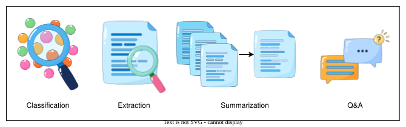
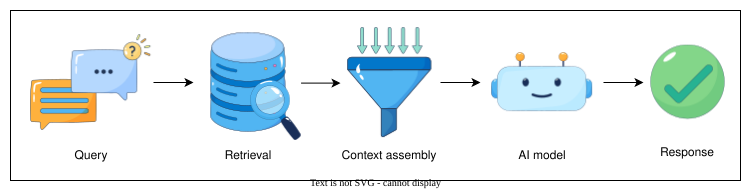

# LLM-Based_AI_Systems_Design_for_Enterprise_Solutions

Source: https://www.educative.io/courses/forward-deployed-engineer/llm-based-systems

---

[Home](https://www.educative.io/)

[Courses](https://www.educative.io/search?tab=courses)

[Forward Deployed Engineer for AI Systems](https://www.educative.io/courses/forward-deployed-engineer)

# LLM-Based Systems

Explore how to design and scope LLM-based systems for enterprise AI applications. Learn the four primary patterns—classification, extraction, summarization, and question answering—and when to use retrieval-augmented generation or fine-tuning. Understand key evaluation criteria and maintenance considerations for delivering scalable, maintainable AI solutions aligned with customer needs.

We'll cover the following...

- [Patterns of LLM-based systems](https://www.educative.io/courses/forward-deployed-engineer/llm-based-systems#Patterns-of-LLM-based-systems)
- [RAG-based knowledge systems](https://www.educative.io/courses/forward-deployed-engineer/llm-based-systems#RAG-based-knowledge-systems)
  - [When RAG is the right choice](https://www.educative.io/courses/forward-deployed-engineer/llm-based-systems#When-RAG-is-the-right-choice)
  - [What the FDE evaluates in a RAG system](https://www.educative.io/courses/forward-deployed-engineer/llm-based-systems#What-the-FDE-evaluates-in-a-RAG-system)
- [Fine-tuning for domain-specific tasks](https://www.educative.io/courses/forward-deployed-engineer/llm-based-systems#Fine-tuning-for-domain-specific-tasks)
  - [When fine-tuning is the right choice](https://www.educative.io/courses/forward-deployed-engineer/llm-based-systems#When-fine-tuning-is-the-right-choice)
  - [Fine-tuning approaches](https://www.educative.io/courses/forward-deployed-engineer/llm-based-systems#Fine-tuning-approaches)
  - [FDE scoping considerations](https://www.educative.io/courses/forward-deployed-engineer/llm-based-systems#FDE-scoping-considerations)
- [When to recommend an LLM-based system](https://www.educative.io/courses/forward-deployed-engineer/llm-based-systems#When-to-recommend-an-LLM-based-system)

LLM-based systems form the backbone of enterprise AI deployments. Many of the highest-value workflows an FDE encounters are addressable without multi-step reasoning, tool orchestration, or autonomous action. A well-scoped LLM-based system delivers measurable value faster and with less operational overhead than a more complex alternative.

These systems follow a small set of recurring patterns. The FDE who recognizes those patterns during discovery can move from problem to architecture to scope document without rebuilding the approach from scratch on every project.

This lesson covers the core patterns, the two architectural extensions that most commonly appear alongside them, and the signals that tell the FDE this is the right system type for the problem.

## Patterns of LLM-based systems[#](https://www.educative.io/courses/forward-deployed-engineer/llm-based-systems#Patterns-of-LLM-based-systems)

LLM-based systems fall into four patterns in enterprise deployments. Each has a distinct input type, a distinct output type, and a distinct evaluation approach the FDE defines before the build begins.

- **Classification:** Takes an input and assigns it to a predefined category. A support ticket routing system that reads an incoming message and directs it to the relevant team follows this pattern. The FDE defines the category schema and labeled test set during scoping, which makes evaluation straightforward: precision and recall against the agreed test set.
- **Extraction:** Pulls structured data from unstructured text. A contract analysis system that reads incoming agreements and returns named parties, effective dates, and key payment terms follows this pattern. Evaluation requires a gold-standard set of correctly extracted outputs built from real examples of the customer’s documents, which the FDE defines before the build begins.
- **Summarization and synthesis:** Compresses or combines source material into a shorter, structured output. A system that condenses lengthy research reports into executive briefs, or aggregates findings across multiple documents into a single summary, follows this pattern. Evaluation requires the FDE to specify coverage requirements, factual accuracy thresholds, and output format criteria before work begins.
- **Question answering and generation:** Returns a natural language answer or generates content from a prompt. A system that answers employee policy questions from a knowledge base, or drafts email responses based on product information, follows this pattern. Both factual accuracy and output format need defined criteria, and whether a human review step belongs in the workflow is a scoping decision the FDE makes before the build.

Classification and extraction lend themselves to clean, measurable evaluation. Summarization and generation require a more deliberate upfront definition of what a good output looks like. In both cases, evaluation design happens during scoping, not after the build.

Most enterprise problems fit one of these four patterns, and a base model handles them reliably. Some businesses, however, need the system to draw from a large internal knowledge base specific to the organization. Retrieval augmentation addresses that need.

## RAG-based knowledge systems[#](https://www.educative.io/courses/forward-deployed-engineer/llm-based-systems#RAG-based-knowledge-systems)

**RAG (retrieval-augmented generation)** is an architectural pattern that adds a retrieval layer before generation. Documents are chunked, embedded, and indexed in a vector store ahead of time so the system can retrieve relevant content by semantic similarity. When a query arrives, the system fetches the most relevant chunks from that store, assembles them into context, and passes that context alongside the query to the model. The model generates its answer from the retrieved content.

### When RAG is the right choice[#](https://www.educative.io/courses/forward-deployed-engineer/llm-based-systems#When-RAG-is-the-right-choice)

RAG fits when the knowledge base is too large to fit in a single context window, when it is updated frequently and needs to reflect the latest information, or when the output must trace back to source documents for legal, compliance, or audit purposes. It also fits naturally when the customer already maintains a structured document repository the system can connect to directly.

### What the FDE evaluates in a RAG system[#](https://www.educative.io/courses/forward-deployed-engineer/llm-based-systems#What-the-FDE-evaluates-in-a-RAG-system)

Retrieval quality is the first thing the FDE checks. A capable model on top of poor retrieval produces poor answers. The FDE validates that the right documents are being retrieved for real queries during the POC before attributing output quality problems to the model.

Four specific areas deserve attention during scoping and evaluation.

- **Chunking strategy:** How documents are split for indexing affects retrieval quality significantly. A poor chunking strategy means relevant information gets split across chunks that are never retrieved together. The FDE asks about this during scoping and validates it against real queries during the POC.
- **Data freshness:** How often the knowledge store is updated and how staleness in the index affects accuracy for time-sensitive queries.
- **Context window fit:** Whether retrieved documents fit within the model’s context window for the most complex queries the system will handle. Overflow here is a silent failure mode that surfaces only under real production load.
- **Ingestion pipeline ownership:** Who owns the process of adding new documents to the knowledge store, and what triggers a re-index? If no one owns this after the FDE leaves, the system degrades silently as the knowledge base grows.

RAG gives the system access to domain-specific content at query time. When the task itself requires the model to behave differently, such as producing a consistent specialized output structure or performing reliably on highly specific inputs, fine-tuning is the option to consider.

## Fine-tuning for domain-specific tasks[#](https://www.educative.io/courses/forward-deployed-engineer/llm-based-systems#Fine-tuning-for-domain-specific-tasks)

Fine-tuning adapts a pre-trained model on a labeled dataset of domain-specific examples to shift its behavior toward a specific task. The model’s weights are updated on that training data, producing a model that performs better on the targeted task than the general model does out of the box.

### When fine-tuning is the right choice[#](https://www.educative.io/courses/forward-deployed-engineer/llm-based-systems#When-fine-tuning-is-the-right-choice)

Fine-tuning is appropriate when the base model consistently underperforms on domain-specific inputs or output formats that prompt engineering cannot close. It also fits when the task requires a consistent output structure the general model does not sustain reliably across input variation, or when token cost and latency at projected volume make a leaner model more practical than long system prompts at scale.

### Fine-tuning approaches[#](https://www.educative.io/courses/forward-deployed-engineer/llm-based-systems#Fine-tuning-approaches)

Fine-tuning methods fall into two types based on how much of the model they update. That choice affects compute requirements, training time, storage, and how much labeled data the customer needs to provide.

- **Full fine-tuning:** Updates all model weights on the domain-specific dataset. It offers the highest degree of adaptation but requires significant compute, storage, and data volume. Most enterprise deployments avoid full fine-tuning unless the task genuinely requires it.
- **PEFT (parameter-efficient fine-tuning):** Updates only a small subset of parameters rather than the full model, significantly reducing compute and storage requirements. PEFT is the practical category under which most enterprise fine-tuning falls today. Two techniques within PEFT appear most often: LoRA (low-rank adaptation), which inserts small trainable matrices into the model’s layers and achieves close to full fine-tuning quality at a fraction of the cost, and QLoRA (quantized LoRA), which applies LoRA to a quantized model to reduce memory requirements further and enable fine-tuning on smaller hardware.

The FDE does not need to run fine-tuning jobs directly. Understanding which approach the customer’s team is using informs how the FDE scopes the build timeline, the data requirements, and what the maintenance burden looks like after handoff.

### FDE scoping considerations[#](https://www.educative.io/courses/forward-deployed-engineer/llm-based-systems#FDE-scoping-considerations)

Fine-tuning is scoped only when POC evidence shows the base model cannot close the performance gap. It adds build complexity and a maintenance burden that the customer’s team owns after the FDE leaves: dataset curation, retraining triggers, and model version management. The handoff document for a fine-tuned system covers dataset ownership, evaluation cadence, and how the model is updated when the domain evolves.

## When to recommend an LLM-based system[#](https://www.educative.io/courses/forward-deployed-engineer/llm-based-systems#When-to-recommend-an-LLM-based-system)

The FDE recommends an LLM-based system when the problem fits its operating model. Five signals appear consistently across enterprise use cases where this category is the right fit.

- The task produces a meaningful output from a single or a small number of model calls, with no need for the system to take autonomous actions mid-process.
- The input type is consistent and well-defined, making evaluation criteria straightforward to specify before the build begins.
- The workflow does not require the system to interact with external services or coordinate across multiple steps.
- The customer’s team needs a system they can debug and maintain without reasoning about multi-step execution, tool coordination, or session state.
- Latency or cost is a constraint: LLM-based systems are faster and cheaper than agentic alternatives at the same class of problem.

The most common scoping error in enterprise AI is recommending an agentic system for a problem an LLM-based system solves reliably. The FDE starts with the simplest architecture that addresses the problem and adds complexity only when the use case clearly requires it.

|  |  |  |
| --- | --- | --- |
| **Signal** | **LLM-Based System** | **Agentic System** |
| Output type | Single-step output | Multi-step output |
| External interactions | No tool calls required | Tool calls required |
| Latency profile | Low and predictable | Variable |
| Maintenance complexity | Straightforward | Observability required |

LLM-based systems address the widest range of real enterprise AI use cases. The FDE who can identify the right pattern quickly, choose between a base model, a retrieval-augmented architecture, or a fine-tuned variant based on what the problem and data require, and hand off a system the customer’s team can own, delivers consistent value without reaching for unnecessary complexity.

The AI System Landscape

Harness Engineering: Tools, Memory, and Context

Ask

[Patterns of LLM-based systems](https://www.educative.io/courses/forward-deployed-engineer/llm-based-systems#Patterns-of-LLM-based-systems)

[RAG-based knowledge systems](https://www.educative.io/courses/forward-deployed-engineer/llm-based-systems#RAG-based-knowledge-systems)

[When RAG is the right choice](https://www.educative.io/courses/forward-deployed-engineer/llm-based-systems#When-RAG-is-the-right-choice)

[What the FDE evaluates in a RAG system](https://www.educative.io/courses/forward-deployed-engineer/llm-based-systems#What-the-FDE-evaluates-in-a-RAG-system)

[Fine-tuning for domain-specific tasks](https://www.educative.io/courses/forward-deployed-engineer/llm-based-systems#Fine-tuning-for-domain-specific-tasks)

[When fine-tuning is the right choice](https://www.educative.io/courses/forward-deployed-engineer/llm-based-systems#When-fine-tuning-is-the-right-choice)

[Fine-tuning approaches](https://www.educative.io/courses/forward-deployed-engineer/llm-based-systems#Fine-tuning-approaches)

[FDE scoping considerations](https://www.educative.io/courses/forward-deployed-engineer/llm-based-systems#FDE-scoping-considerations)

[When to recommend an LLM-based system](https://www.educative.io/courses/forward-deployed-engineer/llm-based-systems#When-to-recommend-an-LLM-based-system)