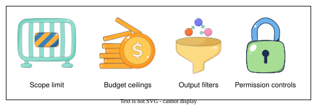

# Harness_Engineering_for_AI_Systems_with_Guardrails_and_Observability

Source: https://www.educative.io/courses/forward-deployed-engineer/harness-engineering-guardrails-observability-and-review

---

[Home](https://www.educative.io/)

[Courses](https://www.educative.io/search?tab=courses)

[Forward Deployed Engineer for AI Systems](https://www.educative.io/courses/forward-deployed-engineer)

# Harness Engineering: Guardrails, Observability, and Review

Explore how to design AI system harnesses that include guardrails to constrain agent actions, observability for tracing behaviors, AI review loops for quality control, and human escalation workflows. Understand how these components ensure system reliability, safety, and operability under real-world constraints, preparing you to build and hand off robust AI solutions to customers.

We'll cover the following...

- [Guardrails](https://www.educative.io/courses/forward-deployed-engineer/harness-engineering-guardrails-observability-and-review#Guardrails)
- [Observability and tracing](https://www.educative.io/courses/forward-deployed-engineer/harness-engineering-guardrails-observability-and-review#Observability-and-tracing)
- [AI review loops](https://www.educative.io/courses/forward-deployed-engineer/harness-engineering-guardrails-observability-and-review#AI-review-loops)
- [Human escalation](https://www.educative.io/courses/forward-deployed-engineer/harness-engineering-guardrails-observability-and-review#Human-escalation)

Tools, memory, and context management define what an agent can do and what it carries into each reasoning step. They make the reasoning loop functional. A loop that functions is not the same as a loop that operates safely and reliably under real conditions.

Getting to production reliability requires addressing several additional concerns. Guardrails, observability, and AI review loops are harness components: they constrain behavior, record it, and evaluate it from within the system. Human escalation is a different kind of concern: it is an operational workflow that the FDE designs alongside the system, for cases that require human judgment before an action is taken or an output is delivered. It sits outside the harness but is defined as part of the same scoping and handoff work.

For the FDE, all of these are production and handoff concerns as much as build concerns. When they are absent or underdefined, the system becomes difficult to own: behavior is hard to predict, failures are hard to trace, and the customer’s team has no reliable path for intervention when something goes wrong.

## Guardrails[#](https://www.educative.io/courses/forward-deployed-engineer/harness-engineering-guardrails-observability-and-review#Guardrails)

**Guardrails** are the constraints that define what the agent is permitted to do at runtime. They establish the safe operating boundaries of the system before the build begins.

The need for guardrails follows directly from what tools make possible. An agent with write access to production systems can take consequential, irreversible actions. An agent handling user-facing queries can generate responses at a high cost per session. Without explicit constraints, the only limit on the agent’s behavior is the reasoning model’s judgment at each step, which is not a reliable safety mechanism at production scale.

Four types of guardrails address the most common failure modes in enterprise deployments:

- **Scope limits:** Define which tools and actions the agent is permitted to call. Without scope limits, an agent tasked with researching a topic may call a write tool it was never meant to access. Scope limits prevent the agent from taking actions outside its defined function.
- **Budget ceilings:** Set token and cost limits per session or per day. A single runaway session can consume a month’s API budget if no ceiling is in place. Budget ceilings cap cost exposure before a session starts.
- **Output filters:** Validate content and format before output reaches the user. Without output filters, PII or hallucinated content can surface directly in a user-facing response. Filters enforce format requirements, strip disallowed content, and flag outputs that exceed defined risk thresholds.
- **Permission controls:** Define which data the agent can read from and write to. In enterprise deployments, agents often have access to data stores containing sensitive records well beyond what the task requires. Permission controls limit data access to what the specific workflow needs.

Guardrail configuration is a scoping artifact, not a post-build checklist. The FDE defines the agreed configuration in the scope document, verifies it holds against edge-case inputs during the pilot, and includes it in the handoff documentation with clear guidance on how the customer’s team adjusts the configuration as the system evolves.

## Observability and tracing[#](https://www.educative.io/courses/forward-deployed-engineer/harness-engineering-guardrails-observability-and-review#Observability-and-tracing)

**Observability** is the logging and tracing layer that records what the agent did at every step of the reasoning loop and why. It is what makes failures diagnosable after they occur rather than invisible.

The importance of observability is amplified by how agentic failures actually behave. A wrong output in a multi-step system often did not originate at the step where it surfaced. It originated several steps earlier: when a tool returned an unexpected result, when context was assembled incorrectly, or when the model reasoned from an incomplete picture. Without a trace, the customer’s team cannot find that origin point.

Execution tracing captures a complete step-by-step record of an agent session in sequence. For each iteration of the reasoning loop, the trace records what the model received, what it decided, what tool it called, and what the tool returned. That record allows the team to reconstruct exactly what happened and in what order.

A well-instrumented harness logs across six dimensions:

- Tool calls and their results, including error responses and any retry attempts.
- Model inputs and outputs at each reasoning step.
- Memory reads and writes, including what was retrieved from long-term storage and what was written back.
- Token usage and cost per step and per session.
- Error states, timeout events, and the retry behavior that followed.
- Confidence scores where the system surfaces them at decision points.

The diagnostic test the FDE applies before closing the pilot is direct: if this agent produces a wrong output next week, can the customer’s team reconstruct exactly what happened? If the answer is no, the harness is not ready for handoff. The FDE confirms the observability layer is producing readable traces and that the customer’s team can interpret them before the pilot ends.

## AI review loops[#](https://www.educative.io/courses/forward-deployed-engineer/harness-engineering-guardrails-observability-and-review#AI-review-loops)

An AI review loop inserts an evaluation step between the agent’s output and its delivery. After the agent produces an output, a review step checks it against defined criteria. If the output passes, it is delivered. If it fails, the agent regenerates, adjusting its approach based on the review feedback. If it still fails after a defined number of retries, the case escalates to human review.

Two forms appear in practice:

- **Self-reflection:** The agent is prompted to evaluate its own output before returning it. The review prompt specifies the criteria: is the answer grounded in the retrieved documents, does it satisfy the format requirements, and have all required steps been completed? The agent identifies failures and regenerates.
- **Critic model:** A separate model instance or dedicated critic prompt evaluates the output independently of the reasoning agent. The critic decides whether to accept the output, send it back for regeneration with specific feedback, or route it to human review.

AI review loops fit when output quality is critical on verifiable dimensions, such as format compliance, factual grounding, or constraint satisfaction, and human review at every step would create unacceptable latency. They add token cost and latency per output, so the FDE estimates the cost of the review step at projected volume before including it in the scope document. The review criteria must be defined precisely during scoping: vague criteria produce unreliable review decisions. The FDE also sets the retry limit during pilot configuration, defining how many regeneration attempts occur before the case escalates.

AI review loops reduce the volume of cases that require human review. They do not eliminate human oversight. When outputs exceed the retry limit or cannot be resolved automatically, they move to the human escalation workflow.

## Human escalation[#](https://www.educative.io/courses/forward-deployed-engineer/harness-engineering-guardrails-observability-and-review#Human-escalation)

Human escalation is the operational process the FDE designs for cases that require human judgment before an output is delivered or an action is taken. It sits outside the harness but is defined alongside it, because a system without a functioning escalation path is not safe to hand off.

**Confidence thresholds** define the point at which the agent routes a case for human review rather than acting autonomously. When an output or action falls below the defined threshold, the agent does not continue. The threshold value is calibrated during the pilot against the distribution of outputs the system produces on real inputs. Setting it too high creates review burden. Setting it too low allows the system to act on cases where it should not.

The escalation path has four components, each of which the FDE defines and documents before the system goes live:

- **Who receives it:** The named role or team responsible for reviewing escalated outputs; this cannot remain a general reference without a specific owner
- **What accompanies it:** The original input, the agent’s reasoning trace for that session, and the confidence score or review failure that triggered the escalation; reviewers cannot make useful decisions without this context
- **How the decision is recorded:** The reviewer’s response is logged; patterns in escalated cases over time inform threshold calibration and surface recurring failure modes
- **What the agent does while waiting:** Whether it pauses and holds the task open, falls back to a default output, or routes the case to an existing manual process; the right behavior depends on whether the workflow can tolerate a delay

The FDE defines the escalation path during the pilot, documents it in the handoff package, and confirms the customer’s team can operate it independently before the project closes.

A system the customer’s team can own is one where guardrails are documented, the observability layer produces readable traces, and the escalation path is tested and understood before the FDE leaves. A harness missing any of those components does not fail visibly. It fails silently, at an unpredictable point after the engagement ends, in a way no one is equipped to diagnose or fix.

Guardrails, observability, AI review loops, and a defined human escalation path are not features added to a working system. They are what make the system ownable rather than fragile. When they are designed before the build, verified during the pilot, and documented in the handoff package, the customer's team takes on something they can actually operate rather than a system that will fail in ways no one is equipped to diagnose.

Harness Engineering: Tools, Memory, and Context

Multi-Agent Orchestration Patterns

Ask

[Guardrails](https://www.educative.io/courses/forward-deployed-engineer/harness-engineering-guardrails-observability-and-review#Guardrails)

[Observability and tracing](https://www.educative.io/courses/forward-deployed-engineer/harness-engineering-guardrails-observability-and-review#Observability-and-tracing)

[AI review loops](https://www.educative.io/courses/forward-deployed-engineer/harness-engineering-guardrails-observability-and-review#AI-review-loops)

[Human escalation](https://www.educative.io/courses/forward-deployed-engineer/harness-engineering-guardrails-observability-and-review#Human-escalation)