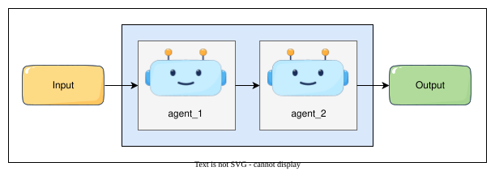

# Multi-Agent_Orchestration_Patterns_in_AI_Systems_Architecture

Source: https://www.educative.io/courses/forward-deployed-engineer/multi-agent-orchestration-patterns

---

[Home](https://www.educative.io/)

[Courses](https://www.educative.io/search?tab=courses)

[Forward Deployed Engineer for AI Systems](https://www.educative.io/courses/forward-deployed-engineer)

# Multi-Agent Orchestration Patterns

Explore how multi-agent orchestration patterns—sequential, parallel, loop, hierarchical, and handoff—structure AI systems to coordinate multiple agents. Understand when and why to use each pattern based on task requirements, coordination complexity, and reliability. Learn to manage context, failures, costs, and observability to build maintainable systems the customer can operate and debug after deployment.

We'll cover the following...

- [When multi-agent is the right architecture](https://www.educative.io/courses/forward-deployed-engineer/multi-agent-orchestration-patterns#When-multi-agent-is-the-right-architecture)
- [Orchestration patterns](https://www.educative.io/courses/forward-deployed-engineer/multi-agent-orchestration-patterns#Orchestration-patterns)
  - [Sequential orchestration](https://www.educative.io/courses/forward-deployed-engineer/multi-agent-orchestration-patterns#Sequential-orchestration)
  - [Parallel orchestration](https://www.educative.io/courses/forward-deployed-engineer/multi-agent-orchestration-patterns#Parallel-orchestration)
  - [Loop orchestration](https://www.educative.io/courses/forward-deployed-engineer/multi-agent-orchestration-patterns#Loop-orchestration)
  - [Hierarchical orchestration](https://www.educative.io/courses/forward-deployed-engineer/multi-agent-orchestration-patterns#Hierarchical-orchestration)
- [Agent handoff](https://www.educative.io/courses/forward-deployed-engineer/multi-agent-orchestration-patterns#Agent-handoff)
- [Coordination and reliability](https://www.educative.io/courses/forward-deployed-engineer/multi-agent-orchestration-patterns#Coordination-and-reliability)

Single-agent systems handle a wide range of enterprise tasks. Some problems exceed what one agent can address within a single session: the task requires parallel workstreams running simultaneously, different sub-tasks need genuinely different tools and capabilities, or the total context required exceeds what one agent can hold. Multi-agent systems distribute work across multiple agents that coordinate toward a shared goal.

Each agent in a multi-agent system retains its own reasoning model and harness: its own tools, memory, context management, and guardrails. What changes is the coordination layer on top. That layer introduces concerns that single-agent systems do not face: how context and state move between agents, how failures in one agent affect the rest, and how the combined system is observed and debugged.

Multi-agent is not automatically the right recommendation. The FDE proposes it only when the use case genuinely justifies the coordination cost. The orchestration pattern chosen before the build begins determines build complexity, cost per task, and what the customer’s team inherits when the engagement ends.

## When multi-agent is the right architecture[#](https://www.educative.io/courses/forward-deployed-engineer/multi-agent-orchestration-patterns#When-multi-agent-is-the-right-architecture)

Multi-agent architecture is justified when one or more of the following conditions hold:

- The task breaks down into sub-tasks that can run independently, where parallelism meaningfully reduces completion time.
- Different sub-tasks require distinct tool sets or specialized capabilities that a single agent cannot carry efficiently.
- The total context required exceeds what one agent’s context window can hold, even with compression.

When none of these apply, a single-agent system with a well-designed harness handles the problem at lower cost, with simpler debugging and easier handoff. Multi-agent adds coordination complexity, multiplies token consumption, and makes failures harder to trace. The FDE estimates cost and latency at projected volume before recommending the architecture and presents the tradeoff honestly during scoping.

With those conditions clear, the next question is which coordination structure fits the problem.

## Orchestration patterns[#](https://www.educative.io/courses/forward-deployed-engineer/multi-agent-orchestration-patterns#Orchestration-patterns)

**Orchestration patterns** define how agents in a multi-agent system are structured and how they coordinate. Four patterns cover the majority of enterprise use cases. The right choice depends on whether sub-tasks are independent, sequential, iterative, or require central coordination.

### Sequential orchestration[#](https://www.educative.io/courses/forward-deployed-engineer/multi-agent-orchestration-patterns#Sequential-orchestration)

In sequential orchestration, agents run one after another in a fixed pipeline. Each agent completes its task and passes its output to the next. The pipeline runs in a defined order, with each step depending on what the previous step produced.

Sequential orchestration

This pattern suits workflows where each step transforms the output of the previous one: a research agent extracts key information, an analysis agent interprets it, a drafting agent produces a structured output. Each agent specializes in one transformation and hands its result forward.

Sequential orchestration is the most predictable multi-agent pattern to debug. A failure in the pipeline is localized to one agent’s step, and the execution trace shows exactly where the wrong output originated.

### Parallel orchestration[#](https://www.educative.io/courses/forward-deployed-engineer/multi-agent-orchestration-patterns#Parallel-orchestration)

In parallel orchestration, multiple agents run simultaneously on independent sub-tasks. Each agent works within its own scope. When all agents complete, their outputs are aggregated into a combined result.

Parallel orchestration

This pattern suits tasks that decompose cleanly, without dependencies between sub-tasks: processing multiple documents simultaneously, researching multiple data sources simultaneously, or running evaluation pipelines across a large batch.

Parallel orchestration reduces wall-clock time, but multiplies token consumption proportionally to the number of agents running simultaneously. The FDE estimates cost at projected volume before recommending it and confirms that the aggregation logic handles partial failures gracefully. When one agent in a parallel group fails, the system should recover rather than discard all results.

### Loop orchestration[#](https://www.educative.io/courses/forward-deployed-engineer/multi-agent-orchestration-patterns#Loop-orchestration)

In loop orchestration, an agent or a set of agents runs repeatedly until an exit condition is met. The loop continues until the output meets defined quality criteria, a maximum iteration count is reached, or a review step marks the task complete.

Loop orchestration

Common uses include iterative refinement (generate, evaluate, revise), research loops where an agent searches, assesses completeness, and searches again if gaps remain, and retry patterns where earlier steps need re-execution based on what later steps reveal.

The exit condition must be defined precisely before the build. A loop without a well-specified termination condition runs indefinitely. The FDE sets a maximum iteration count and a token budget ceiling during scoping and validates that both hold under adversarial inputs during the pilot.

### Hierarchical orchestration[#](https://www.educative.io/courses/forward-deployed-engineer/multi-agent-orchestration-patterns#Hierarchical-orchestration)

In hierarchical orchestration, an orchestrator agent handles planning and coordination while subagents handle execution. The orchestrator decides which subagent to invoke, passes the relevant context, receives the result, and determines the next step. Subagents do not communicate directly with each other.

Hierarchical orchestration

This pattern suits complex workflows with sequential dependencies between sub-tasks, systems where planning and execution are meaningfully separate, and tasks requiring central state management across all sub-task results before the next decision. The pattern can extend to multiple levels: orchestrators directing orchestrators directing workers, for tasks with layered decomposition.

The orchestrator is where most multi-agent failures originate. When a subagent returns an unexpected result or fails entirely, the orchestrator must decide how to continue. The FDE evaluates how the orchestrator handles subagent errors, retries, and partial results during the pilot before recommending the system for production.

Each of these four patterns structures agents around a coordination model. Agent handoff is a different kind of structure entirely: rather than coordinating agents simultaneously, it transfers control from one agent to another.

## Agent handoff[#](https://www.educative.io/courses/forward-deployed-engineer/multi-agent-orchestration-patterns#Agent-handoff)

In agent handoff, one agent transfers control to another, which takes over and continues the task from where the first left off. The first agent stops when the handoff occurs. There is no central orchestrator managing both agents simultaneously.

What transfers at a handoff point is the accumulated task context: the original goal, what has been completed so far, relevant memory, and any constraints the receiving agent needs to operate within. The receiving agent begins from that context rather than from scratch.

Agent handoff

Handoff suits workflows with distinct phases that require genuinely different capabilities or tool sets. A customer intake agent who qualifies the issue hands off to a technical resolution agent. A research agent that gathers raw information hands off to a structured analysis agent. Each agent in the chain specializes and then passes control forward.

Context validation at the handoff point is a design requirement, not an implementation detail. If the context passed from the first agent is incomplete or malformed, the receiving agent cannot perform reliably. The failure manifests in the second agent but originates in the first, which makes it difficult to trace without a well-instrumented handoff boundary. The FDE defines what constitutes a valid handoff payload during scoping and validates it under realistic inputs during the pilot.

With orchestration patterns and handoff understood, the remaining question is how to design a multi-agent system that holds together reliably under real conditions.

## Coordination and reliability[#](https://www.educative.io/courses/forward-deployed-engineer/multi-agent-orchestration-patterns#Coordination-and-reliability)

Multi-agent systems introduce coordination concerns that do not exist in single-agent systems. Each pattern handles them differently, and the FDE accounts for all of them before the build begins.

Four challenges appear consistently across multi-agent deployments:

- **State management:** What context gets passed between agents and how it is validated before the receiving agent acts on it. In hierarchical and handoff patterns, incomplete or stale context at a transfer point causes failures that the receiving agent cannot self-diagnose.
- **Failure isolation:** When one agent fails, whether and how the system recovers without cascading. Parallel orchestration handles this naturally because agents are independent. Sequential and hierarchical patterns require explicit fallback logic at each coordination point.
- **Multi-agent observability:** Debugging a failure in a multi-agent system requires correlated traces across agent boundaries, not just within one agent. Each agent produces its own execution trace. Those traces must be linkable to the overall session so the customer’s team can follow a failure from its origin to where it surfaced. This is an extension of single-agent observability applied at the system level.
- **Cost and latency:** Multiple agents running in parallel or across loops multiply token consumption and response time at every coordination step. The FDE estimates both the projected task volume before recommending the architecture and includes per-task cost estimates in the scope document.

The FDE accounts for all four during scoping, sets clear expectations with the customer before the build begins, and documents how each concern is handled in the handoff package.

Choosing the wrong orchestration pattern before the build begins is expensive to correct mid-sprint. A loop pattern chosen for a task that consistently terminates in two steps burns tokens on every run. A sequential pipeline chosen for two independent steps doubles the wall-clock time unnecessarily. The FDE identifies which pattern fits during discovery by mapping the task structure to the pattern’s coordination model, not after the pilot makes the mismatch visible.

Multi-agent orchestration extends the single-agent system into a coordination layer. Each agent retains its own harness: its tools, memory, context management, guardrails, and observability. The orchestration pattern determines how those agents connect, how context moves between them, and how failures in one part of the system propagate. The FDE who understands these patterns recommends the right architecture during scoping, estimates the coordination cost honestly, and hands off a system the customer’s team can trace, debug, and operate after the engagement ends.

Harness Engineering: Guardrails, Observability, and Review

Choosing an Agentic Framework

Ask

[When multi-agent is the right architecture](https://www.educative.io/courses/forward-deployed-engineer/multi-agent-orchestration-patterns#When-multi-agent-is-the-right-architecture)

[Orchestration patterns](https://www.educative.io/courses/forward-deployed-engineer/multi-agent-orchestration-patterns#Orchestration-patterns)

[Sequential orchestration](https://www.educative.io/courses/forward-deployed-engineer/multi-agent-orchestration-patterns#Sequential-orchestration)

[Parallel orchestration](https://www.educative.io/courses/forward-deployed-engineer/multi-agent-orchestration-patterns#Parallel-orchestration)

[Loop orchestration](https://www.educative.io/courses/forward-deployed-engineer/multi-agent-orchestration-patterns#Loop-orchestration)

[Hierarchical orchestration](https://www.educative.io/courses/forward-deployed-engineer/multi-agent-orchestration-patterns#Hierarchical-orchestration)

[Agent handoff](https://www.educative.io/courses/forward-deployed-engineer/multi-agent-orchestration-patterns#Agent-handoff)

[Coordination and reliability](https://www.educative.io/courses/forward-deployed-engineer/multi-agent-orchestration-patterns#Coordination-and-reliability)