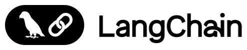

# Choosing_the_Right_Agentic_Framework_for_AI_Systems

Source: https://www.educative.io/courses/forward-deployed-engineer/choosing-an-agentic-framework

---

[Home](https://www.educative.io/)

[Courses](https://www.educative.io/search?tab=courses)

[Forward Deployed Engineer for AI Systems](https://www.educative.io/courses/forward-deployed-engineer)

# Choosing an Agentic Framework

Explore how to identify, compare, and recommend agentic frameworks that support orchestration, tool binding, and observability in AI systems. Understand the fit based on design philosophy, model affinity, implementation speed, and team ownership to ensure durable, maintainable solutions in enterprise settings.

We'll cover the following...

- [What frameworks provide](https://www.educative.io/courses/forward-deployed-engineer/choosing-an-agentic-framework#What-frameworks-provide)
- [The framework landscape](https://www.educative.io/courses/forward-deployed-engineer/choosing-an-agentic-framework#The-framework-landscape)
  - [LangChain](https://www.educative.io/courses/forward-deployed-engineer/choosing-an-agentic-framework#LangChain)
  - [LangGraph](https://www.educative.io/courses/forward-deployed-engineer/choosing-an-agentic-framework#LangGraph)
  - [CrewAI](https://www.educative.io/courses/forward-deployed-engineer/choosing-an-agentic-framework#CrewAI)
  - [AutoGen](https://www.educative.io/courses/forward-deployed-engineer/choosing-an-agentic-framework#AutoGen)
  - [OpenAI Agents SDK](https://www.educative.io/courses/forward-deployed-engineer/choosing-an-agentic-framework#OpenAI-Agents-SDK)
  - [Google ADK](https://www.educative.io/courses/forward-deployed-engineer/choosing-an-agentic-framework#Google-ADK)
  - [Claude Agent SDK](https://www.educative.io/courses/forward-deployed-engineer/choosing-an-agentic-framework#Claude-Agent-SDK)
- [When the FDE recommends from scratch](https://www.educative.io/courses/forward-deployed-engineer/choosing-an-agentic-framework#When-the-FDE-recommends-from-scratch)
- [When the customer has already chosen](https://www.educative.io/courses/forward-deployed-engineer/choosing-an-agentic-framework#When-the-customer-has-already-chosen)

Agentic frameworks implement the orchestration patterns, tool binding, memory integration, and observability hooks that make a production agentic system buildable in practice. Most enterprise teams reach for a framework rather than building coordination logic from scratch. The FDE encounters two situations in the field: the customer already has a framework in their stack, or they are starting from scratch and need a recommendation. Both situations require the same foundation: a working knowledge of what each framework provides, where it fits, and what it will cost the customer’s team to maintain after the engagement ends.

Framework selection is a discovery-phase question. A wrong choice surfaces later as a maintenance problem, after the FDE has moved to the next project. Selecting the right framework is not about identifying the most capable option in the abstract. It is about matching a framework to the problem, the orchestration pattern, and the team that will own the system when the engagement ends.

## What frameworks provide[#](https://www.educative.io/courses/forward-deployed-engineer/choosing-an-agentic-framework#What-frameworks-provide)

Frameworks supply orchestration primitives (loop management, branching logic, conditional execution), tool binding conventions, memory integration patterns, and tracing and logging hooks. Using an established framework reduces implementation time significantly and provides community-maintained scaffolding for components the team would otherwise build and own independently. For most enterprise agentic builds, this is the practical starting point.

What frameworks do not supply are the design decisions. The FDE still determines which orchestration pattern fits the problem, how guardrails are configured at each agent boundary, what the handoff payload contains between agents, and how cross-agent observability is instrumented. A framework makes those decisions faster to implement. It does not substitute for making them.

That distinction shapes how the FDE evaluates frameworks during discovery: not which one has the most features, but which one supports the design decisions already made and produces a system the customer’s team can own.

## The framework landscape[#](https://www.educative.io/courses/forward-deployed-engineer/choosing-an-agentic-framework#The-framework-landscape)

Among the most widely used frameworks in enterprise agentic work today, the following appear consistently across production deployments. Each has a distinct design philosophy, orchestration model, and model affinity. The FDE develops enough familiarity with the current landscape to match one to the problem during discovery.

### LangChain[#](https://www.educative.io/courses/forward-deployed-engineer/choosing-an-agentic-framework#LangChain)

LangChain is one of the most widely adopted frameworks in the ecosystem. It provides a broad integration layer: connections to a large range of LLMs, vector stores, retrieval pipelines, and external APIs. Teams use it to build RAG-augmented workflows, tool-calling pipelines, and multi-step chains where each step passes its output to the next.

Its primary strength is ecosystem breadth. If a customer’s stack includes a specific vector database or API, LangChain likely has an existing integration. Its limitation for complex orchestration is that managing conditional logic, cycles, and persistent state across steps requires additional tooling. For workflows with significant branching or state management requirements, LangGraph is the more appropriate choice.

### LangGraph[#](https://www.educative.io/courses/forward-deployed-engineer/choosing-an-agentic-framework#LangGraph)

LangGraph extends LangChain with a graph-based execution model. Workflows are defined as directed graphs where nodes are agents or processing functions and edges define the transitions between them. This model natively supports sequential pipelines, conditional branching, cycles, and persistent state across steps.

LangGraph suits workflows that require loop orchestration, hierarchical orchestration with complex state management, or conditional routing between agents based on intermediate results. It gives the FDE explicit control over execution flow and makes the system’s logic inspectable at each step. The learning curve is steeper than that of simpler frameworks, which the FDE factors into the onboarding estimate for the customer’s team.

### CrewAI[#](https://www.educative.io/courses/forward-deployed-engineer/choosing-an-agentic-framework#CrewAI)

CrewAI is built around the concept of roles. Agents are defined as specialists with explicit roles, goals, and tool sets. The framework coordinates multiple agents through built-in task assignment, delegation, and collaboration patterns, without requiring the developer to define the graph structure manually.

CrewAI suits workflows where different specialist agents collaborate toward a shared output and the coordination pattern is role-based rather than state-graph-based. It produces a more readable definition of the multi-agent system, which can help non-technical stakeholders understand what the system does. The tradeoff is less granular control over execution flow compared to LangGraph.

### AutoGen[#](https://www.educative.io/courses/forward-deployed-engineer/choosing-an-agentic-framework#AutoGen)

AutoGen is Microsoft’s framework for building conversational multi-agent systems. Agents communicate through structured turn-taking: each agent receives a message, processes it, and produces a response that becomes the input for the next agent. The framework supports automated pipelines and workflows where a human participant joins the conversation at defined points.

AutoGen suits tasks where iterative reasoning across agents produces better results than a single-pass approach. It fits workflows that benefit from back-and-forth refinement: code generation and review, document drafting and critique, and problem-solving pipelines where different agents challenge each other’s outputs. The conversational structure is explicit and auditable, which makes the system’s behavior easier to trace.

### OpenAI Agents SDK[#](https://www.educative.io/courses/forward-deployed-engineer/choosing-an-agentic-framework#OpenAI-Agents-SDK)

The OpenAI Agents SDK is purpose-built for tool-calling agents using OpenAI models. It provides a harness-first design with built-in tracing, handoff primitives, and native support for structured coordination between agents. The SDK wraps OpenAI’s tool use and function calling APIs with orchestration scaffolding built on top.

The primary consideration is model affinity. The framework is designed around OpenAI’s model API and integrates tightly with it. Teams using GPT reasoning models get a well-supported, natively integrated implementation path. Teams that need model flexibility or plan to evaluate alternative model providers will find this framework constraining.

### Google ADK[#](https://www.educative.io/courses/forward-deployed-engineer/choosing-an-agentic-framework#Google-ADK)

Google ADK (Agent Development Kit) is Google’s framework for building multi-agent systems. It provides orchestration primitives, tool integration, and native support for Gemini models. The framework is designed to operate within Google Cloud infrastructure and integrates with Google’s suite of APIs and data services.

ADK suits teams already operating within the Google Cloud ecosystem or those committed to Gemini as their reasoning model. Teams with no existing Google Cloud presence face both a model affinity constraint and an infrastructure onboarding cost. The FDE evaluates whether the customer’s existing infrastructure makes ADK a natural fit or an added dependency that complicates the handoff.

### Claude Agent SDK[#](https://www.educative.io/courses/forward-deployed-engineer/choosing-an-agentic-framework#Claude-Agent-SDK)

The Claude Agent SDK is Anthropic’s SDK for building tool-calling agents and multi-agent systems using Claude models. It provides agent definition, tool binding, handoff primitives, and tracing support. Like the OpenAI Agents SDK, it is designed for use with its associated model family: Claude Sonnet and Claude Opus.

Claude Agent SDK suits teams using Claude as their primary reasoning model who want a supported, well-integrated implementation path. The model affinity is explicit. The tradeoff the FDE evaluates is the same as with the OpenAI Agents SDK: depth of native integration versus flexibility in model selection.

With each framework characterized, a direct comparison helps the FDE communicate the options clearly during discovery.

|  |  |  |
| --- | --- | --- |
| **Framework** | **Orchestration Model** | **Best Fit** |
| LangChain | Chain-based pipelines | RAG workflows, tool-augmented pipelines |
| LangGraph | Graph-based with persistent state | Complex branching, loops, hierarchical orchestration |
| CrewAI | Role-based coordination | Specialist multi-agent collaboration |
| AutoGen | Conversational turn-taking | Iterative refinement, critique loops |
| OpenAI Agents SDK | Tool-calling, agent handoff | Agentic pipelines on GPT models |
| Google ADK | Multi-agent orchestration | Google Cloud-native deployments |
| Claude Agent SDK | Tool-calling, agent handoff | Agentic pipelines on Claude Sonnet or Opus |

## When the FDE recommends from scratch[#](https://www.educative.io/courses/forward-deployed-engineer/choosing-an-agentic-framework#When-the-FDE-recommends-from-scratch)

When the customer has no existing framework and no prior agentic system, the FDE makes the recommendation. The decision draws on five criteria, applied in combination rather than in isolation.

- **Design philosophy fit:** Frameworks differ in how workflows are expressed rather than in which patterns they support. LangGraph represents workflows as directed graphs, which suits teams who prefer explicit control over state and execution flow. CrewAI expresses workflows through agent roles and collaboration tasks, which suits teams that think about problems in terms of specialist coordination. AutoGen uses conversational turn-taking, which suits iterative refinement tasks. The FDE matches the framework’s expression model to how the team naturally reasons about the problem.
- **Model affinity and vendor flexibility:** If the customer has committed to a specific model provider, a framework aligned to that provider offers better native integration and support. If the customer wants to evaluate models or maintain flexibility across providers, a model-agnostic framework reduces lock-in.
- **Observability built in:** Frameworks differ in how much tracing and logging they provide natively. A framework with limited built-in observability requires the FDE to instrument traces manually, which adds build time and leaves the customer’s team maintaining custom tooling.
- **Implementation speed:** A framework the team can get productive with quickly matters when the sprint is two to three weeks. The FDE weighs the learning curve against the orchestration gains.
- **Post-handoff ownership:** A framework the customer’s team cannot operate confidently after the FDE leaves is a worse choice than a simpler alternative they can own. The FDE estimates onboarding burden and factors it into the recommendation explicitly.

## When the customer has already chosen[#](https://www.educative.io/courses/forward-deployed-engineer/choosing-an-agentic-framework#When-the-customer-has-already-chosen)

The more common scenario is that the customer’s engineering team already uses a framework. The FDE works within it. Three situations arise, each calling for a different response.

- **The framework fits the use case:** Work within it productively. Get up to speed on the team’s existing patterns and conventions before proposing changes. A framework the team already knows reduces ramp time and produces a system they can maintain without additional support after handoff.
- **The framework is suboptimal but workable:** Work within it. Note the tradeoff in the handoff document with a clear explanation of what constraint was accepted and what the customer’s team should monitor over time. Do not advocate for a switch when the technical case does not justify one.
- **The framework genuinely blocks the use case:** Recommend a switch, framed in terms of delivery risk. The FDE presents the specific technical constraint, the impact on the project timeline, and the cost of switching versus the cost of continuing. The decision belongs to the customer.

Framework selection is an early technical decision with long-term consequences. A framework well-matched to the use case, the orchestration pattern, and the team’s capabilities produces a system the customer can maintain, extend, and debug independently. A mismatch surfaces slowly, after the FDE has moved on, as build complexity, brittle observability, or a team that cannot keep up with the system they inherited. The FDE who understands the landscape and applies clear criteria during discovery gives the customer something durable rather than something that merely worked at demo time.

Multi-Agent Orchestration Patterns

How FDE Interviews Work

Ask

[What frameworks provide](https://www.educative.io/courses/forward-deployed-engineer/choosing-an-agentic-framework#What-frameworks-provide)

[The framework landscape](https://www.educative.io/courses/forward-deployed-engineer/choosing-an-agentic-framework#The-framework-landscape)

[LangChain](https://www.educative.io/courses/forward-deployed-engineer/choosing-an-agentic-framework#LangChain)

[LangGraph](https://www.educative.io/courses/forward-deployed-engineer/choosing-an-agentic-framework#LangGraph)

[CrewAI](https://www.educative.io/courses/forward-deployed-engineer/choosing-an-agentic-framework#CrewAI)

[AutoGen](https://www.educative.io/courses/forward-deployed-engineer/choosing-an-agentic-framework#AutoGen)

[OpenAI Agents SDK](https://www.educative.io/courses/forward-deployed-engineer/choosing-an-agentic-framework#OpenAI-Agents-SDK)

[Google ADK](https://www.educative.io/courses/forward-deployed-engineer/choosing-an-agentic-framework#Google-ADK)

[Claude Agent SDK](https://www.educative.io/courses/forward-deployed-engineer/choosing-an-agentic-framework#Claude-Agent-SDK)

[When the FDE recommends from scratch](https://www.educative.io/courses/forward-deployed-engineer/choosing-an-agentic-framework#When-the-FDE-recommends-from-scratch)

[When the customer has already chosen](https://www.educative.io/courses/forward-deployed-engineer/choosing-an-agentic-framework#When-the-customer-has-already-chosen)