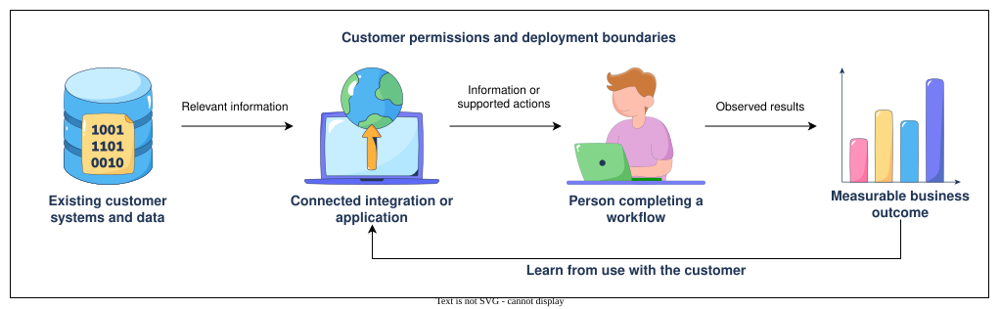

# Understanding_FDE_System_Design_Rounds_and_Integration_Challenges

Source: https://www.educative.io/courses/forward-deployed-engineer/how-fde-system-design-rounds-work

---

[Home](https://www.educative.io/)

[Courses](https://www.educative.io/search?tab=courses)

[Forward Deployed Engineer for AI Systems](https://www.educative.io/courses/forward-deployed-engineer)

# How FDE System Design Rounds Work

Explore how FDE System Design rounds differ from traditional System Design interviews. Learn how to turn an ambiguous customer request into a scoped first proposal by asking questions whose answers could change the design. Understand what interviewers can observe and what to confirm about a specific interview process.

We'll cover the following...

- [How FDE work connects systems to outcomes](https://www.educative.io/courses/forward-deployed-engineer/how-fde-system-design-rounds-work#How-FDE-work-connects-systems-to-outcomes)
- [Questions that come before components](https://www.educative.io/courses/forward-deployed-engineer/how-fde-system-design-rounds-work#Questions-that-come-before-components)
- [FDE from traditional System Design](https://www.educative.io/courses/forward-deployed-engineer/how-fde-system-design-rounds-work#FDE-from-traditional-System-Design)
- [Open problems vs. named systems](https://www.educative.io/courses/forward-deployed-engineer/how-fde-system-design-rounds-work#Open-problems-vs-named-systems)
- [What interviewers can observe](https://www.educative.io/courses/forward-deployed-engineer/how-fde-system-design-rounds-work#What-interviewers-can-observe)
- [Why an impressive architecture first falls short](https://www.educative.io/courses/forward-deployed-engineer/how-fde-system-design-rounds-work#Why-an-impressive-architecture-first-falls-short)
- [Confirming the round format with the recruiter](https://www.educative.io/courses/forward-deployed-engineer/how-fde-system-design-rounds-work#Confirming-the-round-format-with-the-recruiter)
- [Practice: Opening a warehouse conversation](https://www.educative.io/courses/forward-deployed-engineer/how-fde-system-design-rounds-work#Practice-Opening-a-warehouse-conversation)

A **Forward Deployed Engineer (FDE)** works alongside customers to understand important workflows and connect relevant systems and information. They build solutions and bring them into production with measurable business outcomes.

FDE System Design turns that work into a technical proposal grounded in the customer’s tools, data, and operating constraints. In an interview, it usually appears as the integration-heavy version of the technical deep dive covered earlier in the course. The hard part is rarely choosing a model or framework; it is connecting to systems the customer already runs, under rules the candidate did not write, while explaining the reasoning clearly.

AI is one application of this work. Many integration problems need no AI at all, and the design round treats them the same way.

## How FDE work connects systems to outcomes[#](https://www.educative.io/courses/forward-deployed-engineer/how-fde-system-design-rounds-work#How-FDE-work-connects-systems-to-outcomes)

An FDE starts with people doing consequential work: dispatching repairs, reconciling orders, or answering customer questions. Existing systems hold parts of the information those people need, but the connections and workflows may be incomplete.

The engineer investigates with the customer, builds a connected solution, puts it into use, and learns whether it improves the outcome. Permissions determine which information and actions are available; deployment boundaries determine where software can run and which systems it can reach.

Iteratively integrating systems for measurable outcomes

The application in this flow could be a simple operational screen, an integration service, or an AI-assisted tool. Its value comes from helping someone complete a workflow better. Resolving ambiguity is engineering work because the answers determine what is useful and technically feasible.

## Questions that come before components[#](https://www.educative.io/courses/forward-deployed-engineer/how-fde-system-design-rounds-work#Questions-that-come-before-components)

Suppose a maintenance team asks:

“Help dispatchers assign urgent repair jobs faster.”

They already have a job tracker and a technician roster. That is enough information to start a conversation, but not enough to choose an architecture. Before reading further, try writing one opening question, then review the memo below for unsupported claims about what to build.

Before proposing components

Your task

You are the FDE speaking with a maintenance team that asks, “Help dispatchers assign urgent repair jobs faster.” They already have a job tracker and a technician roster. Your immediate task is to ask one opening question that could change the scope or feasibility of your proposal.

Tap any claim to classify it, and click on References to verify authorities.

TOCustomer discovery teamFROMDesign review teamDATEOctober 26, 2026SUBJECTClarifying the maintenance request before choosing components

Background

The maintenance team wants dispatchers to assign urgent repair jobs faster. Its existing tools include a job tracker and a technician roster.

Issue

What question should we ask before deciding what to build?

Analysis

The customer has named both systems, so we can conclude that connecting them through an automatic assignment service is feasible.

The guide *The Decomposition Round: What Candidates Under-Prepare For* recommends choosing components before asking about the user's current process.

A mandatory Maintenance Dispatch Standard requires every opening question to name a database or message broker.

Conclusion

An opening question is useful when its answer could change the proposal, rather than merely decorate a component choice already made.

Recommendation

Ask one question about the customer or existing environment before proposing components.

Do you find this helpful?

A useful question could change the proposal. “What causes the delay today?” might reveal that dispatchers cannot find the right technician; “What access is available?” might reveal that the proposed integration cannot update jobs.

The interviewer supplies these answers:

- The current median time from an urgent job appearing to dispatcher assignment is 30 minutes.
- The desired median is 10 minutes.
- Job-tracker access is read-only.
- Technician availability arrives as an hourly export.
- Dispatchers must approve assignments.

These answers give “faster” a measurable meaning and put limits on the solution. The target concerns assignment time, so improving repair completion time alone would miss it. Read access supports viewing jobs; it does not establish permission to change them. An hourly roster offers a recent snapshot, not proof of current availability. Required approval preserves the dispatcher’s decision-making role.

## FDE from traditional System Design[#](https://www.educative.io/courses/forward-deployed-engineer/how-fde-system-design-rounds-work#FDE-from-traditional-System-Design)

Traditional System Design interviews and FDE System Design rounds share the same engineering foundation, but they reward different starting points. A traditional round usually begins with a product to build at scale. An FDE round usually begins with one customer, the systems that customer already runs, and a workflow that needs to improve.

The table below summarizes where the emphasis shifts:

## Traditional System Design vs. FDE System Design

|  |  |  |
| --- | --- | --- |
| **Dimension** | **Traditional System Design** | **FDE System Design** |
| Starting point | A product to build, such as a URL shortener or a chat service | One customer’s workflow that needs to improve |
| Main constraint | Scale, latency, and availability | Existing systems, access rules, data quality, and deadlines |
| Data | Designed from scratch | Already exists in client systems and formats |
| Typical hard part | Sharding, caching, and replication | Authentication mismatches, rate limits, and messy or late data |
| Success measure | The system handles the target load | A workflow improves by a measurable amount |
| Expected first answer | A high-level architecture | Clarifying questions, then a scoped first version |

The classic concerns do not disappear. Scale, storage, and reliability still matter; they simply stop being the starting point. FDE design prompts reported by candidates tend to fall into five types: connecting systems that were never designed to work together, loading messy or legacy data, designing under strict API limits, solving an open-ended operational problem, and building an AI agent for a business workflow. The case studies later in the course work through each of these types.

Across all five types, knowing a mechanism such as streaming is different from knowing whether a customer’s interfaces and freshness needs justify it. That judgment is what the round tests.

## Open problems vs. named systems[#](https://www.educative.io/courses/forward-deployed-engineer/how-fde-system-design-rounds-work#Open-problems-vs-named-systems)

Compare these openings:

- Design a repair-job tracking service.
- Help dispatchers assign urgent jobs faster using their current tools.

The first names a system to design. The second leaves part of the problem definition open: Perhaps dispatchers need a better view across existing tools rather than a replacement tracking service. An FDE decomposition-style interview can start with this kind of ambiguous operational problem, making clarification and the choice of what to build part of the assessment.

The difference from traditional System Design is one of emphasis. FDE scenarios foreground workflows, existing interfaces, access restrictions, and deployment constraints. Traditional System Design interviews can also contain ambiguity, and in both formats, clarifying questions still need to lead to a technical design.

Labels such as “decomposition,” “customer scenario,” “case study,” and “architecture” can overlap. A label alone does not reveal exactly what the interviewer expects.

## What interviewers can observe[#](https://www.educative.io/courses/forward-deployed-engineer/how-fde-system-design-rounds-work#What-interviewers-can-observe)

Here is a bounded opening using the maintenance facts:

The goal is to reduce median urgent-job assignment time from 30 minutes to 10. I would first explore showing urgent jobs alongside the latest available technician roster for dispatcher review, while leaving approval with dispatchers. With read-only job access and hourly availability exports, I would not claim live availability or automatic writes. Is read access sufficient for a first useful version in which dispatchers continue assigning jobs through their current workflow?

This is a direction to investigate, not an achieved improvement. It connects a proposed first version to established capabilities and identifies a question that could invalidate it.

The reasoning becomes visible through specific actions:

- **Define the benefit:** Asking what “faster” means produces an assignment-time target.
- **Test feasibility:** Asking about access checks whether a connection can support the intended action.
- **Expose uncertainty:** Calling the roster “latest available” acknowledges its freshness limit.
- **Respect the workflow:** Keeping dispatcher approval avoids silently changing operational policy.
- **Separate facts from assumptions:** Asking whether a read-only first version is useful leaves that judgment open.

Relevant questions, explicit assumptions, a buildable breakdown, useful initial scope, and attention to obstacles are practical preparation criteria, not a universal scoring rubric published by employers. An interviewer can assess these actions because the candidate explains them instead of silently drawing components.

**Common rejection signals:**Proposing components before asking what the customer needs or what the existing systems allow.  
Treating named systems as proof that an integration is feasible.  
Claiming live data, write access, or outcomes that the facts do not support.  
Ignoring an established constraint, such as a required human approval step.

## Why an impressive architecture first falls short[#](https://www.educative.io/courses/forward-deployed-engineer/how-fde-system-design-rounds-work#Why-an-impressive-architecture-first-falls-short)

Consider a different response to the same facts:

I’ll stream technician locations into an automatic assignment engine and write the selected technician back to each urgent job. That should get assignment time down to 10 minutes.

Inspect that proposal against the supplied evidence before accepting its technical detail.

Check your reasoning

1.

Which critique best explains why the streaming and automatic assignment proposal is premature?

A.

The only missing detail is storage capacity for technician-location events; once that is sized, streaming and automatic assignment are justified.

B.

It assumes a live data feed and write permission that the facts do not support, bypasses the required dispatcher approval, and treats the 10-minute target as a proven outcome.

C.

Streaming is always inappropriate for maintenance workflows, so the candidate should reject it regardless of the available interfaces or permissions.

---

1 / 1

These three problems require different responses. Live data and write access remain unverified capabilities; dispatcher approval is an established constraint the proposal must respect. The 10-minute target is a hypothesis to test through use, not a result that architecture alone can guarantee.

Streaming and automation can be sensible when suitable interfaces, permissions, and operating rules exist. Here, adding infrastructure would not supply the missing evidence.

A better response starts by withdrawing unsupported claims:

I assumed live data and write access that we have not established. Given the hourly roster and required approval, I would start with dispatcher review of urgent jobs and the latest roster. I still need to confirm whether that view addresses the actual delay and whether it can fit into the existing assignment workflow.

The stronger answer earns its scope through the customer’s facts. It has fewer components, but a clearer connection between capability and intended benefit.

## Confirming the round format with the recruiter[#](https://www.educative.io/courses/forward-deployed-engineer/how-fde-system-design-rounds-work#Confirming-the-round-format-with-the-recruiter)

Public candidate accounts and preparation guides provide examples rather than a universal interview loop. Round types, order, and expectations vary by company and team, so each process is worth confirming directly.

Ask about four concrete categories:

- **Format:** “Does the round begin with an open business problem or a specified system? How collaborative is it?”
- **Timing:** “How long does it last, and does that include a presentation?”
- **Artifacts and tools:** “Should I produce a diagram, verbal proposal, written plan, code, or a combination? Which tools are permitted?”
- **Evaluation guidance:** “Which competencies should I demonstrate, and are there preparation materials you can share?”

The employer may not disclose its full rubric. These questions still help a candidate prepare for the work they will actually be asked to show, without assuming a universal duration or sequence.

## Practice: Opening a warehouse conversation[#](https://www.educative.io/courses/forward-deployed-engineer/how-fde-system-design-rounds-work#Practice-Opening-a-warehouse-conversation)

Consider a separate request:

A warehouse wants pickers to spend less time walking. Inventory data is split across two tools, both provide daily exports, pickers use an existing handheld application, and replacing that application is out of scope.

Before reviewing the proposed opening below, try writing two clarifying questions, naming one unverified assumption, and explaining in two sentences why choosing infrastructure now would be premature. The goal is to make the intended outcome and the uncertain interfaces visible, not to produce a complete architecture. Then inspect the memo for claims that go beyond the warehouse facts.

Warehouse Discovery Opening

Your task

You are the FDE preparing a warehouse discovery conversation. The customer wants pickers to spend less time walking, but the useful first outcome and feasible interfaces are not yet established. Review this proposed opening before relying on it.

Tap any claim to classify it, and click on References to verify authorities.

TOWarehouse discovery teamFROMDiscovery preparation teamDATEOctober 26, 2026SUBJECTQuestions and assumptions before infrastructure selection

Background

The warehouse wants pickers to spend less time walking. Inventory data is split across two tools, both provide daily exports, and pickers use an existing handheld application. Replacing that application is out of scope.

Issue

Before selecting infrastructure, we need to understand the walking problem and determine how a useful intervention could fit the existing tools.

Analysis

The lesson's maintenance example establishes that this warehouse needs dispatcher approval for every pick-order recommendation.

A mandatory Warehouse Handheld Integration Standard guarantees that the existing handheld application accepts externally generated route recommendations.

Daily exports are enough evidence to select live inventory streaming immediately; that infrastructure choice will reduce walking regardless of the current picking workflow.

Conclusion

The current facts support a discovery conversation, not a complete architecture. Keep unknown capabilities separate from confirmed constraints.

Recommendation

Draft two clarifying questions: one about the actual workflow or measurable outcome, and another about a relevant interface or data constraint. Name one explicitly unverified assumption consistent with daily exports and retaining the handheld application. In exactly two sentences, explain how missing answers could change the design and why choosing infrastructure now would be premature.

Do you find this helpful?

One possible answer asks, “Which parts of a picking trip cause the most unnecessary walking, and what reduction would count as success?” and “Can the handheld application receive recommendations from another system?” Whether it can receive recommendations remains an unverified assumption.

A two-sentence explanation could be: “We do not yet know which workflow change would reduce walking or whether the existing handheld application can support it. Daily exports do not establish live inventory access, so choosing streaming infrastructure now would assume an interface we have not confirmed.” Other wording works if it shows how the answers could change the design.

FDE System Design rounds reward the same habit that FDE work does: letting the customer’s facts decide the design. A strong candidate asks the questions whose answers could change the proposal, states assumptions out loud, and scopes a first version the existing systems can actually support. With that habit established, the next lesson turns it into a repeatable method: the CLIENT approach.

The Four Interview Rounds

The CLIENT Approach for FDE System Design

Ask

[How FDE work connects systems to outcomes](https://www.educative.io/courses/forward-deployed-engineer/how-fde-system-design-rounds-work#How-FDE-work-connects-systems-to-outcomes)

[Questions that come before components](https://www.educative.io/courses/forward-deployed-engineer/how-fde-system-design-rounds-work#Questions-that-come-before-components)

[FDE from traditional System Design](https://www.educative.io/courses/forward-deployed-engineer/how-fde-system-design-rounds-work#FDE-from-traditional-System-Design)

[Open problems vs. named systems](https://www.educative.io/courses/forward-deployed-engineer/how-fde-system-design-rounds-work#Open-problems-vs-named-systems)

[What interviewers can observe](https://www.educative.io/courses/forward-deployed-engineer/how-fde-system-design-rounds-work#What-interviewers-can-observe)

[Why an impressive architecture first falls short](https://www.educative.io/courses/forward-deployed-engineer/how-fde-system-design-rounds-work#Why-an-impressive-architecture-first-falls-short)

[Confirming the round format with the recruiter](https://www.educative.io/courses/forward-deployed-engineer/how-fde-system-design-rounds-work#Confirming-the-round-format-with-the-recruiter)

[Practice: Opening a warehouse conversation](https://www.educative.io/courses/forward-deployed-engineer/how-fde-system-design-rounds-work#Practice-Opening-a-warehouse-conversation)