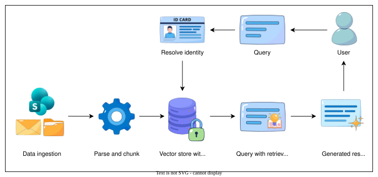

# Designing_a_RAG_System_for_Secure_Financial_Document_Access

Source: https://www.educative.io/courses/forward-deployed-engineer/system-design-the-rag-system

---

[Home](https://www.educative.io/)

[Courses](https://www.educative.io/search?tab=courses)

[Forward Deployed Engineer for AI Systems](https://www.educative.io/courses/forward-deployed-engineer)

# System Design: The RAG System

Explore how to design a Retrieval-Augmented Generation (RAG) system tailored for secure question answering on a bank's internal documents. Understand the architecture, ingestion and query pipelines, embedding models, vector stores, permission handling, and evaluation strategies that ensure private, permission-aware access to sensitive financial data.

We'll cover the following...

- [Architecture overview](https://www.educative.io/courses/forward-deployed-engineer/system-design-the-rag-system#Architecture-overview)
- [Document ingestion](https://www.educative.io/courses/forward-deployed-engineer/system-design-the-rag-system#Document-ingestion)
  - [SharePoint connector](https://www.educative.io/courses/forward-deployed-engineer/system-design-the-rag-system#SharePoint-connector)
  - [Email archive connector](https://www.educative.io/courses/forward-deployed-engineer/system-design-the-rag-system#Email-archive-connector)
  - [File server connector](https://www.educative.io/courses/forward-deployed-engineer/system-design-the-rag-system#File-server-connector)
- [Parsing and preprocessing](https://www.educative.io/courses/forward-deployed-engineer/system-design-the-rag-system#Parsing-and-preprocessing)
- [Chunking strategy](https://www.educative.io/courses/forward-deployed-engineer/system-design-the-rag-system#Chunking-strategy)
- [Embedding model](https://www.educative.io/courses/forward-deployed-engineer/system-design-the-rag-system#Embedding-model)
- [Vector store](https://www.educative.io/courses/forward-deployed-engineer/system-design-the-rag-system#Vector-store)
- [Query pipeline and retrieval](https://www.educative.io/courses/forward-deployed-engineer/system-design-the-rag-system#Query-pipeline-and-retrieval)
- [Answer generation](https://www.educative.io/courses/forward-deployed-engineer/system-design-the-rag-system#Answer-generation)
- [Evaluation](https://www.educative.io/courses/forward-deployed-engineer/system-design-the-rag-system#Evaluation)
- [Private deployment](https://www.educative.io/courses/forward-deployed-engineer/system-design-the-rag-system#Private-deployment)

The decomposition lesson established what we are building and why. This lesson designs the actual system. Each component is configured for this specific use case, and every major decision connects back to a constraint we surfaced during decomposition. Before designing individual components, we start with an architectural overview of the full system.

## Architecture overview[#](https://www.educative.io/courses/forward-deployed-engineer/system-design-the-rag-system#Architecture-overview)

To meet the bank’s requirement of private, permission-aware question answering over internal documents, we implement a retrieval system. RAG is the appropriate pattern because the bank’s document corpus is too large to fit in any model’s context window, too frequently updated to justify retraining, and too sensitive to send to an external model API. The system retrieves relevant document sections on demand and uses them to generate a grounded answer.

The system has two distinct pipelines. The ingestion pipeline runs on a schedule and populates the vector index with document chunks, embeddings, and ACL metadata. The query pipeline runs in real time: it embeds the user’s question, filters the index to permitted documents, retrieves the most relevant chunks, and generates a cited answer. Every component in both pipelines runs within the bank’s private cloud.

Architectural diagram for financial knowledge assistant

These two pipelines share the embedding model and the vector store. The sections below design each component in pipeline order, starting with ingestion.

## Document ingestion[#](https://www.educative.io/courses/forward-deployed-engineer/system-design-the-rag-system#Document-ingestion)

Three connectors pull documents from SharePoint, the email archive, and the file server on a schedule. Beyond the document content, each connector also reads the document’s ACL (access control list) from the source system at ingestion time. The ACL records which users and groups are permitted to access that document. It is stored as metadata on every chunk derived from that document and travels through the rest of the pipeline alongside the content.

 from the source system at ingestion time. ")

Three connectors pull documents from SharePoint, the email archive, and the file server on a schedule. It process the document content and reads the document’s ACL (access control list) from the source system at ingestion time.

### SharePoint connector[#](https://www.educative.io/courses/forward-deployed-engineer/system-design-the-rag-system#SharePoint-connector)

The connector authenticates via OAuth and calls the Microsoft Graph API to pull files from configured site collections. Each API response includes both the file content and the document’s permission settings. The connector fetches Word files, PDFs, and Excel spreadsheets, each packaged with its ACL, and queues them for parsing.

### Email archive connector[#](https://www.educative.io/courses/forward-deployed-engineer/system-design-the-rag-system#Email-archive-connector)

The connector reads message threads and attachments from the archive system. It reconstructs thread order from message headers so each conversation is treated as one logical document. Attachments are extracted and linked to the originating thread by document ID. The archive’s permission model provides the ACL for each thread before it moves to parsing.

### File server connector[#](https://www.educative.io/courses/forward-deployed-engineer/system-design-the-rag-system#File-server-connector)

A scheduled crawler walks the directory structure, identifies files that are new or changed since the last run, and queues them for processing. Scanned PDFs are flagged at this stage so the parser knows to run optical character recognition (OCR) before extracting text. Folder-level permissions from the file server serve as the ACL for each document.

All three connectors feed a central processing queue. The next step is parsing, where each file type is handled differently before it can be chunked.

## Parsing and preprocessing[#](https://www.educative.io/courses/forward-deployed-engineer/system-design-the-rag-system#Parsing-and-preprocessing)

Each file type requires different parsing logic before a chunk can be produced. Four document types appear across the three sources.

- **Word and Excel files:** Text and structure are extracted directly. Headings are preserved in the extracted output to support semantic chunking downstream.
- **Text-extractable PDFs:** A PDF parsing library extracts the text layer. Formatting artifacts from the PDF renderer are cleaned before the content moves to chunking.
- **Scanned PDFs:** These pass through OCR first. The recognized text is then treated the same as any other extracted PDF content.
- **Email threads:** The message body is extracted and cleaned of repeated quoted-reply chains. Attachments are processed separately and linked back to their thread by document ID.

For every document, the parser also produces a metadata record containing the source system, document type, last modified date, and the ACL from the connector. This metadata travels into the chunking stage alongside the cleaned text, where each document is split into retrievable units.

## Chunking strategy[#](https://www.educative.io/courses/forward-deployed-engineer/system-design-the-rag-system#Chunking-strategy)

A chunk too large dilutes retrieval precision; a chunk too small loses the context needed to generate a useful answer. The five document types in this corpus have different natural structures, and the chunking strategy follows each one.

|  |  |  |
| --- | --- | --- |
| **Document Type** | **Strategy** | **Reasoning** |
| Research reports | Semantic chunking at paragraph boundaries | Each paragraph is a coherent analytical unit |
| Compliance policies | Hierarchical: section as parent, paragraph as child | Policies use numbered section references; both levels are needed for retrieval |
| Deal memos | Semantic chunking | Variable length but structured; paragraph boundaries preserve context |
| Email threads | One chunk per message | Thread reconstruction already isolates individual messages |
| Earnings transcripts and PDFs | Fixed-size with overlap | No natural paragraph structure; overlap preserves context at chunk boundaries |

Every chunk produced by this stage carries three things: the document text, the source metadata, and the ACL. These travel together into the embedding step and are stored as a single record in the vector store.

## Embedding model[#](https://www.educative.io/courses/forward-deployed-engineer/system-design-the-rag-system#Embedding-model)

An open-weight embedding model converts each chunk’s text into a dense vector representation. The model runs on a GPU-enabled host within the bank’s private cloud. No document content leaves the environment at this step. Three criteria drive model selection.

- The model must run on bank-managed infrastructure with no outbound API calls.
- Its context window must accommodate the longest chunk the chunking strategies above produce.
- It must perform well on financial domain text, where terminology and document structure differ from general-purpose training data.

Open-weight models such as BGE-large-en or E5-large satisfy all three. The model is served as a local API endpoint that both the ingestion pipeline and the query pipeline call. Using the same model for document embedding at ingestion and question embedding at query time ensures both representations live in the same vector space, which is required for meaningful similarity matching. With embeddings produced for every chunk, the vector store provides the persistent index where those embeddings and their ACL metadata are stored and searched.

## Vector store[#](https://www.educative.io/courses/forward-deployed-engineer/system-design-the-rag-system#Vector-store)

The vector store is the shared component between the two pipelines. It holds every chunk record produced by ingestion and supports the filtered hybrid search the query pipeline requires. Three capabilities are needed for this use case.

- **Metadata filtering:** The ACL pre-filter scopes the search to the requesting user’s permitted documents.
- **Self-hosted deployment:** The vector store must run within the bank’s private cloud.
- **Scale and speed:** Several million chunks across three sources, with low query latency.

Self-hosted options such as Qdrant or Weaviate satisfy all three. Both use HNSW (Hierarchical Navigable Small World), an indexing algorithm for approximate nearest-neighbor search that maintains fast query performance as the index grows to millions of records.

Vector store with embeddings

Each record in the store contains four fields: the chunk text, the embedding vector, source metadata (document ID, type, source system, last modified date), and ACL metadata listing the permitted groups for that document. The stored ACL is what makes permission-scoped search possible without hitting the source systems at query time. With the index populated, the query pipeline can search it in real time whenever a user submits a question.

## Query pipeline and retrieval[#](https://www.educative.io/courses/forward-deployed-engineer/system-design-the-rag-system#Query-pipeline-and-retrieval)

When a user submits a question, the query pipeline runs the following steps.

1. The question is embedded using the same model as the ingestion pipeline, producing a query vector.
2. The system calls the bank’s identity provider to resolve the requesting user’s current group memberships.
3. A metadata filter is constructed from those group memberships. It matches chunks where the ACL metadata includes at least one of the user’s groups.
4. The vector store runs a hybrid search with the ACL filter applied. Hybrid search combines two retrieval methods.

   1. **Dense retrieval:** It searches by vector similarity, finding chunks semantically related to the question even when the exact words differ.
   2. **Sparse retrieval:** It uses BM25 (Best Match 25), a keyword ranking algorithm that scores chunks based on term frequency and document frequency. BM25 is effective for precise queries such as regulatory citation numbers, exact ticker symbols, and deal names that benefit from exact-match scoring rather than semantic proximity.
   3. A weighted combination of both scores produces the final ranked list of permitted chunks.
5. The top-K chunks from the ranked list are passed to an optional reranking step, where a cross-encoder model re-scores each chunk against the question with higher precision than the first-pass retrieval.

Hybrid retrieval fits this corpus because the three user groups have different query patterns. Research analysts ask conceptual questions that benefit from dense semantic search. Compliance officers often search for specific regulatory references by citation number or exact phrase, which benefit from BM25 keyword scoring. Combining both methods serves both patterns without requiring separate retrieval pipelines for each user group.

A background permission sync job runs separately from the ingestion pipeline. It re-fetches ACLs from each source system on a schedule and updates the metadata on affected chunks when permissions change, keeping the stored ACL current without requiring a full re-index. The retrieved chunks move from this stage into answer generation, where the language model produces a grounded response.

Query pipeline and retrieval

## Answer generation[#](https://www.educative.io/courses/forward-deployed-engineer/system-design-the-rag-system#Answer-generation)

The retrieved chunks are passed to a self-hosted open-weight LLM running on a GPU-enabled host within the private cloud. Three decisions shape how this component is configured.

- **Model selection:** The model needs a context window large enough to hold the retrieved chunks and the question together. Instruction-tuned open-weight models such as Llama 3 are appropriate and can be deployed entirely on private infrastructure.
- **Prompt design:** The system prompt instructs the model to answer only from the retrieved context, to cite the source document for each claim, and to state explicitly when the context does not contain enough information to answer.
- **Citation format:** Each answer includes the document name and source location so the user can verify the answer against the original. This is especially important for compliance users whose answers may need to be traceable to a specific policy or regulatory document.

Generating a correct answer is only part of the delivery. The system also needs a process for measuring how accurately it performs across the three user groups.

## Evaluation[#](https://www.educative.io/courses/forward-deployed-engineer/system-design-the-rag-system#Evaluation)

Three dimensions are measured to determine whether the system works correctly for each user group.

- **Faithfulness:** Does the answer contain only claims the retrieved chunks support? An LLM-as-judge approach evaluates each answer against the retrieved context without requiring a labeled dataset upfront.
- **Retrieval relevance:** Are the retrieved chunks relevant to the question? A golden question set, built from known document-answer pairs across the three user groups, provides offline ground truth for both the dense and sparse retrieval components.
- **Completeness per user group:** Does the answer cover what the user needed, or did retrieval miss relevant content? This requires periodic human review from a sample of each group, because the acceptable threshold differs: a compliance officer needs a complete answer; an analyst doing background research can tolerate a partial one.

With evaluation criteria defined for each user group, the remaining question is how every component in both pipelines is hosted within the bank’s private cloud.

## Private deployment[#](https://www.educative.io/courses/forward-deployed-engineer/system-design-the-rag-system#Private-deployment)

Every component runs within the bank’s private cloud. No component makes outbound calls beyond the bank’s private network boundary.

|  |  |  |
| --- | --- | --- |
| **Component** | **Infrastructure** | **Key Note** |
| Embedding model server | GPU-enabled host | Shared between ingestion and query pipelines |
| LLM server | Larger GPU-enabled host | VRAM sized to the chosen generation model |
| Vector store | CPU host with persistent storage | Self-hosted Qdrant or Weaviate with HNSW index |
| BM25 index | CPU host or colocated with vector store | Sparse keyword index over the same chunk corpus |
| Ingestion pipeline | Scheduled job runner | Credentials for all three source connectors |
| Permission sync job | Scheduled job runner | Read access to each source’s permission API |

With every component mapped to its infrastructure requirement, the full system is ready to be designed against a delivery timeline.

Each decision in this design traces back to a constraint from the decomposition. The private deployment requirement determines which models are viable. The access control requirement drives ACL indexing and the permission sync design. The heterogeneous document sources drive the ingestion pipeline structure. The mixed query patterns of the three user groups drive the hybrid retrieval approach. A system designed this way is easier to explain to the customer, easier to hand off, and easier to extend when requirements change.

Decomposing the Problem: The RAG System

FDE Interview Questions: The RAG System

Ask

[Architecture overview](https://www.educative.io/courses/forward-deployed-engineer/system-design-the-rag-system#Architecture-overview)

[Document ingestion](https://www.educative.io/courses/forward-deployed-engineer/system-design-the-rag-system#Document-ingestion)

[SharePoint connector](https://www.educative.io/courses/forward-deployed-engineer/system-design-the-rag-system#SharePoint-connector)

[Email archive connector](https://www.educative.io/courses/forward-deployed-engineer/system-design-the-rag-system#Email-archive-connector)

[File server connector](https://www.educative.io/courses/forward-deployed-engineer/system-design-the-rag-system#File-server-connector)

[Parsing and preprocessing](https://www.educative.io/courses/forward-deployed-engineer/system-design-the-rag-system#Parsing-and-preprocessing)

[Chunking strategy](https://www.educative.io/courses/forward-deployed-engineer/system-design-the-rag-system#Chunking-strategy)

[Embedding model](https://www.educative.io/courses/forward-deployed-engineer/system-design-the-rag-system#Embedding-model)

[Vector store](https://www.educative.io/courses/forward-deployed-engineer/system-design-the-rag-system#Vector-store)

[Query pipeline and retrieval](https://www.educative.io/courses/forward-deployed-engineer/system-design-the-rag-system#Query-pipeline-and-retrieval)

[Answer generation](https://www.educative.io/courses/forward-deployed-engineer/system-design-the-rag-system#Answer-generation)

[Evaluation](https://www.educative.io/courses/forward-deployed-engineer/system-design-the-rag-system#Evaluation)

[Private deployment](https://www.educative.io/courses/forward-deployed-engineer/system-design-the-rag-system#Private-deployment)