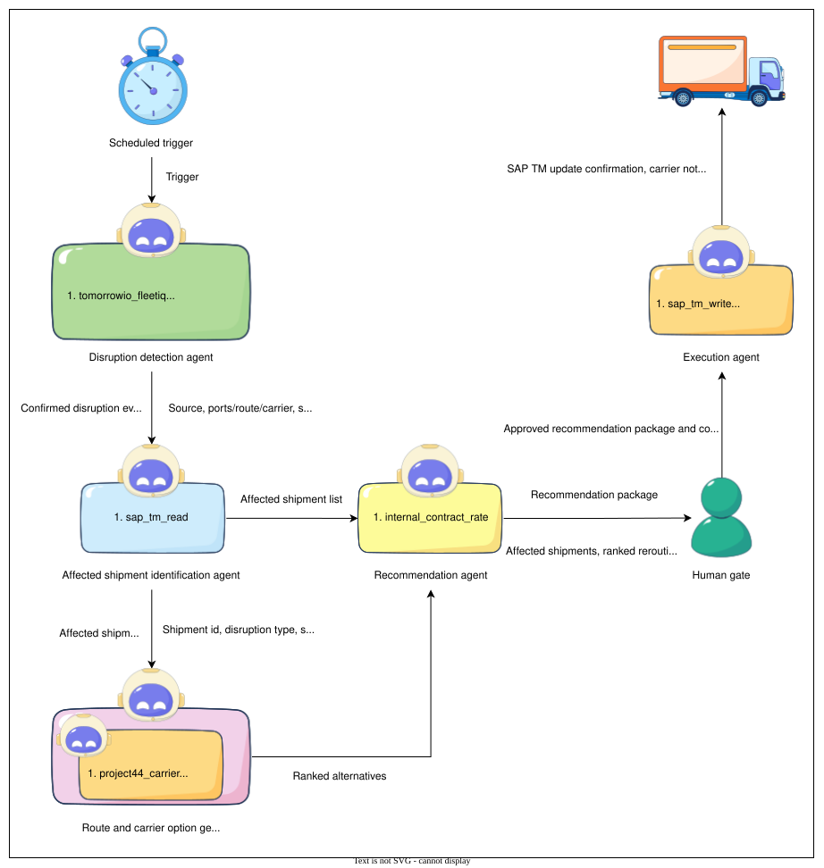

# Designing_Multi-Agent_Systems_for_Logistics_Disruption_Management

Source: https://www.educative.io/courses/forward-deployed-engineer/system-design-multi-agent-system

---

[Home](https://www.educative.io/)

[Courses](https://www.educative.io/search?tab=courses)

[Forward Deployed Engineer for AI Systems](https://www.educative.io/courses/forward-deployed-engineer)

# System Design: Multi-Agent System

Explore how to design a multi-agent system for logistics disruption management by decomposing subproblems, defining specialized agents, and orchestrating their interactions. Understand agent roles including disruption detection, shipment identification, alternative route generation, recommendations, and execution with human approval. Discover integration protocols and evaluation metrics to build a practical, auditable AI system that meets operational constraints.

We'll cover the following...

- [Data sources](https://www.educative.io/courses/forward-deployed-engineer/system-design-multi-agent-system#Data-sources)
- [Agent design](https://www.educative.io/courses/forward-deployed-engineer/system-design-multi-agent-system#Agent-design)
  - [Disruption detection agent](https://www.educative.io/courses/forward-deployed-engineer/system-design-multi-agent-system#Disruption-detection-agent)
  - [Affected shipment identification agent](https://www.educative.io/courses/forward-deployed-engineer/system-design-multi-agent-system#Affected-shipment-identification-agent)
  - [Route and carrier option generation agent](https://www.educative.io/courses/forward-deployed-engineer/system-design-multi-agent-system#Route-and-carrier-option-generation-agent)
  - [Recommendation agent](https://www.educative.io/courses/forward-deployed-engineer/system-design-multi-agent-system#Recommendation-agent)
  - [Execution agent](https://www.educative.io/courses/forward-deployed-engineer/system-design-multi-agent-system#Execution-agent)
- [Orchestration](https://www.educative.io/courses/forward-deployed-engineer/system-design-multi-agent-system#Orchestration)
- [MCP and A2A integration](https://www.educative.io/courses/forward-deployed-engineer/system-design-multi-agent-system#MCP-and-A2A-integration)
- [Evaluation](https://www.educative.io/courses/forward-deployed-engineer/system-design-multi-agent-system#Evaluation)
- [Deployment](https://www.educative.io/courses/forward-deployed-engineer/system-design-multi-agent-system#Deployment)

The decomposition gave us six subproblems, three architectural constraints, and a clear boundary between what the system can automate and what requires a coordinator to decide. In this lesson, we design the actual system. Each agent maps to one subproblem, and every major design decision we make connects back to a constraint the case study surfaced. The system has two layers.

- A set of specialized agents, each responsible for one subproblem.
- An orchestration layer that coordinates how those agents are triggered, sequenced, and run in parallel.

Before we design individual agents, we establish what data is available to the system.

## Data sources[#](https://www.educative.io/courses/forward-deployed-engineer/system-design-multi-agent-system#Data-sources)

There are five data sources the agents draw on. The table below identifies each one and what it provides.

|  |  |  |
| --- | --- | --- |
| **Source** | **Role** | **Access Pattern** |
| **Tomorrow.io**  **FleetIQ** | Route-level weather risk scores and severe-event alerts | REST API, scheduled polling |
| **Portcast Port Congestion API** | Berth wait times, vessel queue depth, and terminal-level congestion scores for contracted ports | REST API, scheduled polling |
| **project44** | Carrier exception signals from EDI (Electronic Data Interchange, the standard protocol carriers use for structured status updates) feeds; also exposes carrier slot availability and rate quotes | REST API, polled and on-demand |
| **SAP TM REST API** | System of record for all active shipments; supports read for shipment lookup and write for rerouting execution | REST API; write operations require a human approval signal |
| **Approved-carrier database** | Approved carrier lists per shipment type, maintained by the operations team | Relational database, read-only |

The SAP TM write is the only interaction that requires a gating step before the system can call it. Every other source is read-only from the agent layer’s perspective. With the data landscape established, we can design each agent and specify which sources it uses.

## Agent design[#](https://www.educative.io/courses/forward-deployed-engineer/system-design-multi-agent-system#Agent-design)

Five agents carry the system’s core logic. The first four run automatically. The fifth holds for a human approval signal before it can write to SAP TM. The diagram below shows the full agent pipeline with the tools each agent calls and the human gate that separates automated execution from coordinator-approved action.

Agent design diagram for shipment rerouting agent

### Disruption detection agent[#](https://www.educative.io/courses/forward-deployed-engineer/system-design-multi-agent-system#Disruption-detection-agent)

This agent fetches signals from Tomorrow.io FleetIQ, the Portcast Port Congestion API, and the project44 carrier exception feed on a schedule. It normalizes outputs from three different schemas into a shared disruption event format, then removes duplicate signals that reference the same port, route, or carrier from different sources. After removing duplicates, it applies the disruption threshold agreed on during the engagement. Signals below the threshold are logged but do not trigger a downstream chain.

- **Input:** Scheduled trigger.
- **Tools:** There are five tools this agent uses. Three connect to external disruption sources; two are internal function tools that process the collected signals.

  - **Tomorrow.io FleetIQ API:** Fetches route-level weather risk scores and severe-event alerts. Returns a severity score the agent applies against the disruption threshold.
  - **Portcast Port Congestion API:** Fetches berth wait times, vessel queue depth, and terminal-level congestion scores at the contracted ports the company routes through.
  - **project44 Carrier Exception Feed:** Retrieves normalized carrier exception events aggregated from EDI feeds, carrier APIs, and telematics. This is the source of carrier-side disruptions such as capacity failures and service interruptions, which are separate from port congestion.
  - **Normalization function:** Converts raw outputs from all three sources into a single shared disruption event format so signals can be compared and processed consistently.
  - **Remove duplicates function:** Identifies and removes duplicate events where signals from different sources point to the same disruption before the threshold check runs.
- **Output:** Confirmed disruption event record containing source, affected port, route or carrier, severity score, and event timestamp.

### Affected shipment identification agent[#](https://www.educative.io/courses/forward-deployed-engineer/system-design-multi-agent-system#Affected-shipment-identification-agent)

This agent receives a confirmed disruption event and queries SAP TM for all active shipments routed through the affected port, route, or carrier. The query checks transit ports across all route legs. Many disruptions affect intermediate ports rather than a shipment’s origin or final destination, so a query limited to those two fields would miss affected loads.

- **Input:** Confirmed disruption event record
- **Tools:** There is one tool this agent uses to retrieve shipment records from the system of record.

  - **SAP TM Read API:** Queries active shipment records by affected port, route, or carrier. Checks transit ports across all route legs to ensure mid-route shipments are not missed.
- **Output:** List of affected shipment IDs with disruption type, severity, and estimated delay per shipment

### Route and carrier option generation agent[#](https://www.educative.io/courses/forward-deployed-engineer/system-design-multi-agent-system#Route-and-carrier-option-generation-agent)

This agent uses a router pattern. The parent receives the affected shipment list and spawns one sub-agent instance per shipment. All instances run in parallel. When all have returned results, the parent assembles them into a ranked output by shipment.

**Parent agent**

- **Input:** Affected shipment list
- **Output:** Ranked alternatives per shipment, collected from all sub-agent instances

**Sub-agent (one instance per shipment)**

- **Input:** Single shipment ID and disruption event context
- **Tools:** There are two tools each sub-agent instance uses to find and validate carrier alternatives for the assigned shipment.

  - **project44 Carrier API:** Queries carrier slot availability and rate quotes for the affected route of the assigned shipment.
  - **Approved-carrier database:** Returns the approved carrier list for the shipment type. Used to filter candidates before any ranking runs; non-approved carriers are removed from the set before scoring.
- **Output:** Ranked alternatives for the assigned shipment, filtered to approved carriers only

### Recommendation agent[#](https://www.educative.io/courses/forward-deployed-engineer/system-design-multi-agent-system#Recommendation-agent)

This agent receives the ranked alternatives per shipment and the affected shipment list with estimated delay per shipment. It calculates the cost of each rerouting option against the estimated cost of leaving the shipment on its delayed path. Where neither option produces a clearly better outcome, it flags that shipment for escalation. After calculating costs, it assembles the full coordinator-readable recommendation package. Escalated shipments appear at the top. Each entry covers the affected shipment, the recommended rerouting option, the cost comparison, and the reasoning behind it in plain language that a non-technical operations coordinator can act on without querying any underlying system directly.

- **Input:** Ranked alternatives per shipment (from the option generation agent) and affected shipment list with estimated delay per shipment (from the identification agent)
- **Tools:** There is one tool this agent uses to retrieve the cost parameters needed for comparison.

  - **Internal contract rate table:** Returns contracted rates and SLA cost parameters for the affected shipment. Used to calculate the difference between each rerouting option and leaving the shipment on its delayed path.
- **Output:** Plain-language recommendation package covering affected shipments, ranked rerouting options, cost comparisons, and a decision signal per shipment, with escalated items surfaced at the top

### Execution agent[#](https://www.educative.io/courses/forward-deployed-engineer/system-design-multi-agent-system#Execution-agent)

This agent holds the recommendation open after delivery and does not proceed until a structured approval signal arrives from the coordinator. The signal contains the coordinator’s identity, a timestamp, and a decision value. After an approval is received, the agent writes the rerouting record to SAP TM and sends carrier notifications through project44. Every SAP TM write is logged alongside the approval identity and timestamp. That log is the audit record the company’s IT security and compliance policy requires.

The agent accepts three decision values. Approve triggers the SAP TM write and the carrier notifications. Escalate routes the package to a manager queue. Defer holds the package open in the coordinator queue without closing the event.

- **Input:** Approved recommendation package and coordinator approval signal
- **Tools:** There are two tools this agent uses to execute the approved decision and close the audit record.

  - **SAP TM Write API:** Writes the rerouting decision to the active shipment record in SAP TM. Only called after the coordinator's approval signal is received; the approval identity and timestamp are logged alongside every write.
  - **project44 Notification API:** Sends carrier notifications for the rerouted shipment through the company’s existing project44 integration.
- **Output:** SAP TM update confirmation, carrier notification status per carrier, and a complete audit record for the disruption event

With all five agents defined, the orchestration layer determines how they connect and how concurrent events are handled.

## Orchestration[#](https://www.educative.io/courses/forward-deployed-engineer/system-design-multi-agent-system#Orchestration)

The orchestration layer coordinates four execution patterns across the agent chain. The diagram below shows all of them as one coherent system from polling trigger to SAP TM write.

- **Sequential:** The five agents run in order. Each agent starts only after the preceding one returns a structured result.
- **Parallel:** Parallelism appears in two places. Within the option generation agent, one sub-agent instance per affected shipment runs concurrently. At the orchestration layer, when multiple disruptions arrive simultaneously, each confirmed event spawns an independent chain. Those chains share no state. A slow or failed chain for one event does not delay recommendations for another.
- **Scheduled loop:** The disruption detection agent runs on a continuous schedule. Each cycle evaluates all three disruption sources freshly. This is a recurring execution pattern, not a retry loop.

With the execution patterns defined, the next question is how the agents connect to their tools and to each other through standard protocols.

## MCP and A2A integration[#](https://www.educative.io/courses/forward-deployed-engineer/system-design-multi-agent-system#MCP-and-A2A-integration)

Two protocols connect the layers of this system.

- **Model Context Protocol (MCP):** A standard for connecting agents to external tools through defined interfaces. We wrap each external integration as a named MCP tool with a fixed input and output schema. Every tool call is logged through the MCP layer with a request identifier, input parameters, and the response received. That log is what makes the system auditable at the tool level, not only at the level of agent outputs.
- **Agent-to-Agent protocol (A2A):** A communication standard for delegation and result collection between agents. The orchestration layer uses A2A to dispatch confirmed disruption events to the agent chain and to spawn independent chains for concurrent events. The option generation router uses A2A to spawn its per-shipment sub-agents and collect their outputs when all instances complete.

MCP handles what each agent can call. A2A handles how agents delegate work and return results. The two protocols operate at separate layers and do not overlap. With the integration layer defined, we can specify how we measure whether the system is performing correctly once deployed.

## Evaluation[#](https://www.educative.io/courses/forward-deployed-engineer/system-design-multi-agent-system#Evaluation)

There are three dimensions we use to measure whether the deployed system is working correctly.

- **Disruption precision and recall:** Measures whether the detection agent catches real disruption events above the agreed threshold and suppresses noise below it. We measure this against a labeled set of historical disruption events from all three sources, scored against the decisions the operations team made at the time.
- **Recommendation accuracy:** Measures whether the rerouting options the system generates match what an experienced coordinator would have selected. Early in deployment, coordinators flag recommendations they would not have followed, and those cases expand the evaluation set over time.
- **Audit completeness:** Checks that every SAP TM write has a corresponding approval record containing coordinator identity and timestamp. Any write without a complete record is a system failure.

With evaluation criteria defined, the final step is mapping each component to its infrastructure within the company’s AWS environment.

## Deployment[#](https://www.educative.io/courses/forward-deployed-engineer/system-design-multi-agent-system#Deployment)

All components run within the company's AWS-hosted private cloud environment, where the existing polling jobs and data source integrations are already established.

|  |  |  |
| --- | --- | --- |
| **Component** | **Infrastructure** | **Key Note** |
| **Three polling jobs** | Scheduled job runner | One per disruption source; credentials stored in the environment’s secret manager |
| **Orchestration layer** | Always-on service | Receives confirmed events and manages agent chain dispatch and concurrent event isolation |
| **Five agents** | Container-based compute | Option generation agent scales sub-agent instances dynamically based on the affected shipment count |
| **Coordinator interface and approval queue** | Persistent queue with a web interface | Open events persist across coordinator sessions until a decision is recorded |
| **Audit log store** | Append-only database | Retention period set by the company’s compliance team |

Every design decision in this system traces back to a constraint the case study surfaced. That grounding is what makes the system defensible to present to the customer, practical to hand off to their engineering team, and straightforward to extend as the scope grows beyond the initial disruption types.

Decomposing the Problem: Multi-Agent System

FDE Interview Questions: Multi-Agent System

Ask

[Data sources](https://www.educative.io/courses/forward-deployed-engineer/system-design-multi-agent-system#Data-sources)

[Agent design](https://www.educative.io/courses/forward-deployed-engineer/system-design-multi-agent-system#Agent-design)

[Disruption detection agent](https://www.educative.io/courses/forward-deployed-engineer/system-design-multi-agent-system#Disruption-detection-agent)

[Affected shipment identification agent](https://www.educative.io/courses/forward-deployed-engineer/system-design-multi-agent-system#Affected-shipment-identification-agent)

[Route and carrier option generation agent](https://www.educative.io/courses/forward-deployed-engineer/system-design-multi-agent-system#Route-and-carrier-option-generation-agent)

[Recommendation agent](https://www.educative.io/courses/forward-deployed-engineer/system-design-multi-agent-system#Recommendation-agent)

[Execution agent](https://www.educative.io/courses/forward-deployed-engineer/system-design-multi-agent-system#Execution-agent)

[Orchestration](https://www.educative.io/courses/forward-deployed-engineer/system-design-multi-agent-system#Orchestration)

[MCP and A2A integration](https://www.educative.io/courses/forward-deployed-engineer/system-design-multi-agent-system#MCP-and-A2A-integration)

[Evaluation](https://www.educative.io/courses/forward-deployed-engineer/system-design-multi-agent-system#Evaluation)

[Deployment](https://www.educative.io/courses/forward-deployed-engineer/system-design-multi-agent-system#Deployment)