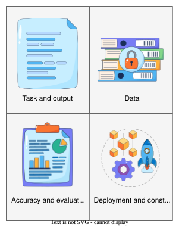

# Fine-Tuning_AI_Models_for_Accurate_Hospital_Billing_Systems

Source: https://www.educative.io/courses/forward-deployed-engineer/decomposing-the-problem-fine-tuning-the-model

---

[Home](https://www.educative.io/)

[Courses](https://www.educative.io/search?tab=courses)

[Forward Deployed Engineer for AI Systems](https://www.educative.io/courses/forward-deployed-engineer)

# Decomposing the Problem: Fine-Tuning the Model

Explore the process of decomposing a hospital billing accuracy problem to design a fine-tuning pipeline for an AI model. Understand how to address HIPAA constraints, train on labeled data, evaluate performance, and integrate AI suggestions into the coder's workflow for review and confirmation.

We'll cover the following...

- [The case study](https://www.educative.io/courses/forward-deployed-engineer/decomposing-the-problem-fine-tuning-the-model#The-case-study)
- [Clarifying questions](https://www.educative.io/courses/forward-deployed-engineer/decomposing-the-problem-fine-tuning-the-model#Clarifying-questions)
  - [Task and output questions](https://www.educative.io/courses/forward-deployed-engineer/decomposing-the-problem-fine-tuning-the-model#Task-and-output-questions)
  - [Data questions](https://www.educative.io/courses/forward-deployed-engineer/decomposing-the-problem-fine-tuning-the-model#Data-questions)
  - [Accuracy and evaluation questions](https://www.educative.io/courses/forward-deployed-engineer/decomposing-the-problem-fine-tuning-the-model#Accuracy-and-evaluation-questions)
  - [Deployment and constraint questions](https://www.educative.io/courses/forward-deployed-engineer/decomposing-the-problem-fine-tuning-the-model#Deployment-and-constraint-questions)
- [Problem decomposition](https://www.educative.io/courses/forward-deployed-engineer/decomposing-the-problem-fine-tuning-the-model#Problem-decomposition)
- [Choosing the right approach](https://www.educative.io/courses/forward-deployed-engineer/decomposing-the-problem-fine-tuning-the-model#Choosing-the-right-approach)
  - [Why prompting hits a ceiling](https://www.educative.io/courses/forward-deployed-engineer/decomposing-the-problem-fine-tuning-the-model#Why-prompting-hits-a-ceiling)
  - [Why retrieval does not fit](https://www.educative.io/courses/forward-deployed-engineer/decomposing-the-problem-fine-tuning-the-model#Why-retrieval-does-not-fit)
  - [Why fine-tuning fits this case](https://www.educative.io/courses/forward-deployed-engineer/decomposing-the-problem-fine-tuning-the-model#Why-fine-tuning-fits-this-case)
- [Constraints that shape the design](https://www.educative.io/courses/forward-deployed-engineer/decomposing-the-problem-fine-tuning-the-model#Constraints-that-shape-the-design)
- [Refined problem statement](https://www.educative.io/courses/forward-deployed-engineer/decomposing-the-problem-fine-tuning-the-model#Refined-problem-statement)

This lesson works through a case study from a regional hospital that wants to improve the accuracy of its medical billing process using AI. We start by reading the full case study, then work through it step by step.

## The case study[#](https://www.educative.io/courses/forward-deployed-engineer/decomposing-the-problem-fine-tuning-the-model#The-case-study)

This is the complete case study. Read it once before we begin decomposing it.

> **The case study**
>
> - **The organization:** A large regional hospital in the Midwest with multiple outpatient clinics. A team of medical coders assigns billing codes across all facilities.
> - **The problem:** After each patient visit, a physician writes a clinical note describing what the patient presented with, what was assessed, and what was done. Medical coders read those notes and assign two types of billing codes:
>
>   - ICD-10 codes (International Classification of Diseases, 10th revision) identify the patient’s diagnosis.
>   - CPT codes (Current Procedural Terminology) identify the procedures and services the physician performed.
>   - Insurance companies use these codes to determine how much to reimburse the hospital. If the codes are wrong, the insurer denies the claim. The coder must then review the original note, identify the error, correct the codes, and resubmit. The hospital’s first-pass acceptance rate, the percentage of claims the insurer accepts on the first submission without denial, currently sits at 81%. The industry benchmark is 95%.
> - **The systems:** Physicians write clinical notes inside Epic, the hospital’s Electronic Health Record (EHR) system. Coders access physician notes through Epic and enter their code assignments in the same platform. Finalized codes flow from Epic into the billing system, which submits claims to insurers. All systems run on the hospital’s private on-premises servers.
> - **The requirements:** Two constraints apply to any solution:
>
>   - Patient records and clinical notes cannot leave the hospital’s private environment. The Health Insurance Portability and Accountability Act (HIPAA) prohibits sending patient information to external services without authorization the hospital does not hold for this use case.
>   - A certified medical coder must review and confirm every AI-generated code assignment before it reaches the insurer. The coder’s role shifts from reading the full note and assigning codes from scratch to reviewing the AI suggestion and confirming or correcting it.
> - **The ask:** The hospital ran an internal test using an open-weight model on 200 completed encounters from the past year. The model reached 61% first-pass accuracy without any adaptation. The coding director believes the gap exists for two reasons.
>
>   - The hospital’s physicians write notes in styles shaped by their individual training backgrounds and local documentation conventions, which differ from the patterns the base model learned during pretraining.
>   - The hospital also applies modifier codes (additional codes that add detail to a primary code, such as whether a procedure was performed on both sides of the body or on a new versus established patient) following internal billing guidelines rather than standard defaults.
>
> The coding director wants to close the gap to the 95% target and wants to understand what a solution would look like inside their existing environment and whether it is feasible to build and operate.

With the case study in hand, we can begin working through the clarifying questions.

## Clarifying questions[#](https://www.educative.io/courses/forward-deployed-engineer/decomposing-the-problem-fine-tuning-the-model#Clarifying-questions)

The case study gives us a 61% baseline, a 95% accuracy target, and a HIPAA constraint that rules out external services. Each of these details leaves open questions that determine what the right solution is. The four categories below organize the questions by what each one reveals.

### Task and output questions[#](https://www.educative.io/courses/forward-deployed-engineer/decomposing-the-problem-fine-tuning-the-model#Task-and-output-questions)

Understanding exactly what the AI must produce tells us how to build the coder review interface and what counts as a correct result.

- What does the AI output look like for one patient encounter? Does it return a single suggested code set or a ranked list of options the coder chooses from?
- How many codes does a typical encounter require? Is it usually one diagnosis code and one procedure code, or do most encounters involve several codes across both types?
- When a coder corrects an AI suggestion, does the system log that correction, or does only the final approved code set get recorded?
- Does the 95% first-pass target apply to each code in a claim, or to the full claim where every code must be correct for it to count?

The answers shape the output format the model must produce and what the evaluation framework treats as correct.

### Data questions[#](https://www.educative.io/courses/forward-deployed-engineer/decomposing-the-problem-fine-tuning-the-model#Data-questions)

The data the hospital has available shapes what approaches are feasible and what the system can realistically learn from.

- How many completed encounters with confirmed correct codes are available from past years to use as training examples?
- Do physicians across different departments write notes in similar styles, or does note style vary significantly by specialty?
- Are clinical notes typed directly into Epic, or are they dictated and then automatically transcribed? Transcribed notes often contain different sentence structure and formatting than typed notes.
- Have the hospital’s billing guidelines or modifier code rules changed significantly over the past two years? Training on historical data that reflects outdated guidelines could teach the model patterns that no longer apply.

The answers determine whether enough consistent labeled data exists and how much the data preparation step will require before training can begin.

### Accuracy and evaluation questions[#](https://www.educative.io/courses/forward-deployed-engineer/decomposing-the-problem-fine-tuning-the-model#Accuracy-and-evaluation-questions)

The 61% figure establishes the starting point but does not explain where the errors come from. Understanding the error pattern matters as much as knowing the result.

- Which departments or note types produced the most errors in the 61% baseline test?
- Are the most common errors in diagnosis codes, procedure codes, or modifier codes?
- Is the 95% target the same across all departments, or are some specialties considered higher priority for accuracy?
- What happens downstream when a claim is denied? Who reworks it, and how long does the correction process take?

The answers reveal whether the gap comes from the model’s general capability, its unfamiliarity with the hospital’s documentation style, or the complexity of the modifier code rules. Each cause points toward a different solution.

### Deployment and constraint questions[#](https://www.educative.io/courses/forward-deployed-engineer/decomposing-the-problem-fine-tuning-the-model#Deployment-and-constraint-questions)

The HIPAA constraint eliminates external APIs before any design work begins. The remaining questions determine what the solution can realistically run on inside the hospital’s environment.

- What computing hardware does the hospital currently have on-premises that could run an AI model?
- Where in the coder’s Epic workflow would the AI suggestion appear? Does the coder see it before or after they begin their own review?
- How often do billing guidelines and modifier code rules change, and does the model need to be updated each time?
- What does the hospital’s IT team require before an AI system can connect to and read patient notes from Epic?

With these four categories mapped, the problem separates into its distinct engineering subproblems.

## Problem decomposition[#](https://www.educative.io/courses/forward-deployed-engineer/decomposing-the-problem-fine-tuning-the-model#Problem-decomposition)

With the clarifying questions mapped, the problem breaks into six discrete subproblems. Each requires different inputs, produces different outputs, and carries its own engineering complexity.

- **Labeled data preparation:** Identifying completed encounters with confirmed correct codes, establishing annotation guidelines that produce consistent labeling across coders, and measuring agreement between labelers before any training begins. Annotation quality is a prerequisite because inconsistently labeled data teaches the model inconsistent behavior.
- **Approach decision:** Determining whether the accuracy gap is best closed through a trained model, improved prompting, or another method. This decision depends on what the 61% baseline reveals about where errors come from.
- **Model selection:** Choosing an open-weight model that runs within the hospital’s on-premises hardware, handles the length and structure of physician notes, and provides a strong instruction-following foundation to adapt from.
- **Model adaptation:** Training the selected model on the hospital’s coded encounter history using a method that fits within available hardware and reduces the risk of the model overfitting on a limited training set.
- **Evaluation methodology:** Defining what counts as a correct output at the code level and the claim level, building a test set of encounters the model never sees during training, and measuring the result against the 61% baseline and the 95% target.
- **Coder review and Epic integration:** Building the workflow that surfaces the AI suggestion inside the coder’s existing Epic interface, with each suggested code attributed to the relevant section of the physician note and flagged for coder confirmation before submission.

The approach decision shapes every subproblem that follows, so we address it before designing anything else.

## Choosing the right approach[#](https://www.educative.io/courses/forward-deployed-engineer/decomposing-the-problem-fine-tuning-the-model#Choosing-the-right-approach)

The 61% baseline tells us where we start. Before choosing a direction, we evaluate three candidates against what the result tells us about where the gap actually comes from.

### Why prompting hits a ceiling[#](https://www.educative.io/courses/forward-deployed-engineer/decomposing-the-problem-fine-tuning-the-model#Why-prompting-hits-a-ceiling)

The hospital’s physicians write notes in documentation styles shaped by their individual training and local conventions. Prompting can describe the target codes and the format they should appear in, but it cannot teach a model to recognize how a given physician phrases a specific diagnosis or how the hospital applies modifier codes across different procedure types. Further prompt improvements narrow the gap incrementally but cannot close it to 95%. The next candidate addresses a different aspect of the problem.

### Why retrieval does not fit[#](https://www.educative.io/courses/forward-deployed-engineer/decomposing-the-problem-fine-tuning-the-model#Why-retrieval-does-not-fit)

RAG (Retrieval-Augmented Generation) adds content retrieved from an external document corpus to the model’s input. In a coding task, the physician note is already in the model’s context. Retrieving content from other notes or billing references does not help the model read and interpret the note in front of it. The gap is a pattern recognition problem, and retrieval does not address it.

### Why fine-tuning fits this case[#](https://www.educative.io/courses/forward-deployed-engineer/decomposing-the-problem-fine-tuning-the-model#Why-fine-tuning-fits-this-case)

Fine-tuning is the right fit here for reasons that come directly from the case study:

- The gap is behavioral. The base model does not know how physicians at this hospital write. That kind of pattern is learned from examples, not corrected with better instructions.
- Labeled examples exist. The hospital has coded encounters from the past year with confirmed correct code assignments. Those become the training data.
- HIPAA rules out commercial APIs, so the solution must run on a self-hosted open-weight model. That model scored 61% without any adaptation. Fine-tuning on the hospital's own encounter history closes the documentation pattern gap and compensates for the capability difference between a self-hosted model and a commercial API.

Prompt engineering vs. RAG vs. fine-tuning

## Constraints that shape the design[#](https://www.educative.io/courses/forward-deployed-engineer/decomposing-the-problem-fine-tuning-the-model#Constraints-that-shape-the-design)

Three constraints determine what the system can and cannot include.

- **HIPAA requires on-premises deployment:** Patient notes cannot be sent to any external API. The model, the notes, and all outputs must stay within the hospital’s private servers. Open-weight models are the only viable foundation.
- **Training data quality is a prerequisite:** Fine-tuning on inconsistently labeled encounters teaches the model wrong patterns. Annotation guidelines and a measurement of labeler agreement must be established and verified before training data is collected.
- **Coder review gates every submission:** Every AI-generated code set requires a coder to review and confirm it before the claim reaches the insurer. The integration surfaces a reviewable suggestion attributed to its source in the physician note, with each code flagged for coder confirmation before submission.

These three constraints define what the refined problem statement must account for.

## Refined problem statement[#](https://www.educative.io/courses/forward-deployed-engineer/decomposing-the-problem-fine-tuning-the-model#Refined-problem-statement)

The original ask described an accuracy gap with a target threshold and a privacy constraint. After decomposition, the statement is specific enough to design from.

We need to design a fine-tuning pipeline that trains an open-weight model on labeled coded encounters from past years, evaluates it at the code level and the claim level against a held-out test set, and surfaces suggestions inside the coder’s Epic workflow with each code attributed to the relevant section of the physician note and flagged for coder confirmation before the claim is submitted.

A refined problem statement is the output an FDE delivers from this kind of working session with the customer. It converts an ambiguous ask into an agreed-upon scope. Every design decision that follows traces back to something surfaced here, whether a constraint, a data reality, or a clarifying question that revealed a hidden assumption. That traceability is what makes the design defensible when stakeholders push back.

Develop a Multi-Agent Research Assistant Using AutoGen

System Design: Fine-Tuning the Model

Ask

[The case study](https://www.educative.io/courses/forward-deployed-engineer/decomposing-the-problem-fine-tuning-the-model#The-case-study)

[Clarifying questions](https://www.educative.io/courses/forward-deployed-engineer/decomposing-the-problem-fine-tuning-the-model#Clarifying-questions)

[Task and output questions](https://www.educative.io/courses/forward-deployed-engineer/decomposing-the-problem-fine-tuning-the-model#Task-and-output-questions)

[Data questions](https://www.educative.io/courses/forward-deployed-engineer/decomposing-the-problem-fine-tuning-the-model#Data-questions)

[Accuracy and evaluation questions](https://www.educative.io/courses/forward-deployed-engineer/decomposing-the-problem-fine-tuning-the-model#Accuracy-and-evaluation-questions)

[Deployment and constraint questions](https://www.educative.io/courses/forward-deployed-engineer/decomposing-the-problem-fine-tuning-the-model#Deployment-and-constraint-questions)

[Problem decomposition](https://www.educative.io/courses/forward-deployed-engineer/decomposing-the-problem-fine-tuning-the-model#Problem-decomposition)

[Choosing the right approach](https://www.educative.io/courses/forward-deployed-engineer/decomposing-the-problem-fine-tuning-the-model#Choosing-the-right-approach)

[Why prompting hits a ceiling](https://www.educative.io/courses/forward-deployed-engineer/decomposing-the-problem-fine-tuning-the-model#Why-prompting-hits-a-ceiling)

[Why retrieval does not fit](https://www.educative.io/courses/forward-deployed-engineer/decomposing-the-problem-fine-tuning-the-model#Why-retrieval-does-not-fit)

[Why fine-tuning fits this case](https://www.educative.io/courses/forward-deployed-engineer/decomposing-the-problem-fine-tuning-the-model#Why-fine-tuning-fits-this-case)

[Constraints that shape the design](https://www.educative.io/courses/forward-deployed-engineer/decomposing-the-problem-fine-tuning-the-model#Constraints-that-shape-the-design)

[Refined problem statement](https://www.educative.io/courses/forward-deployed-engineer/decomposing-the-problem-fine-tuning-the-model#Refined-problem-statement)