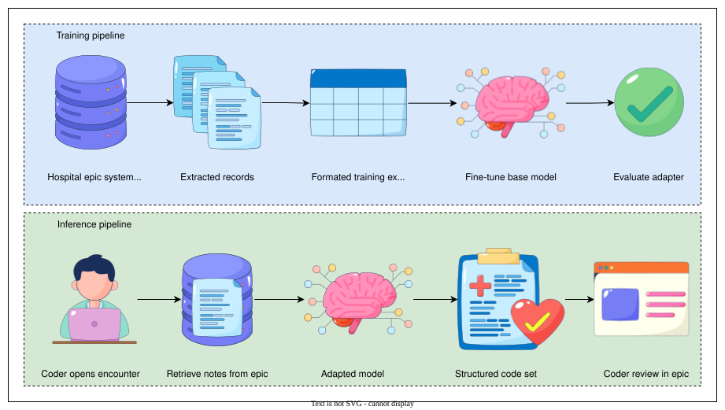

# System_Design_for_AI_Model_Fine-Tuning_in_Hospital_Billing

Source: https://www.educative.io/courses/forward-deployed-engineer/system-design-fine-tuning-the-model

---

[Home](https://www.educative.io/)

[Courses](https://www.educative.io/search?tab=courses)

[Forward Deployed Engineer for AI Systems](https://www.educative.io/courses/forward-deployed-engineer)

# System Design: Fine-Tuning the Model

Explore the process of designing and fine-tuning AI models specifically for hospital billing. Understand how to prepare training data from Epic records, select and adapt open-weight base models using techniques like QLoRA, and evaluate model accuracy. Learn how the inference pipeline integrates with coders' workflows, ensuring that AI-assisted code suggestions are confirmed and audit-ready. This lesson equips you with practical knowledge to build AI systems that meet real-world constraints in a clinical setting.

We'll cover the following...

- [Architecture overview](https://www.educative.io/courses/forward-deployed-engineer/system-design-fine-tuning-the-model#Architecture-overview)
- [Training data](https://www.educative.io/courses/forward-deployed-engineer/system-design-fine-tuning-the-model#Training-data)
  - [Extracting records from Epic](https://www.educative.io/courses/forward-deployed-engineer/system-design-fine-tuning-the-model#Extracting-records-from-Epic)
  - [Preparing training examples](https://www.educative.io/courses/forward-deployed-engineer/system-design-fine-tuning-the-model#Preparing-training-examples)
- [Model selection](https://www.educative.io/courses/forward-deployed-engineer/system-design-fine-tuning-the-model#Model-selection)
- [Fine-tuning approach](https://www.educative.io/courses/forward-deployed-engineer/system-design-fine-tuning-the-model#Fine-tuning-approach)
- [Evaluation](https://www.educative.io/courses/forward-deployed-engineer/system-design-fine-tuning-the-model#Evaluation)
- [Inference pipeline](https://www.educative.io/courses/forward-deployed-engineer/system-design-fine-tuning-the-model#Inference-pipeline)
- [Coder review and Epic integration](https://www.educative.io/courses/forward-deployed-engineer/system-design-fine-tuning-the-model#Coder-review-and-Epic-integration)
- [Deployment](https://www.educative.io/courses/forward-deployed-engineer/system-design-fine-tuning-the-model#Deployment)

The decomposition established that the right approach is to adapt an open-weight model on the hospital's own coded encounter history and integrate the result into the coder's Epic workflow. This lesson designs that system. Every major decision connects back to a constraint or finding the case study surfaced. We start with an overview of the full system before designing each component.

## Architecture overview[#](https://www.educative.io/courses/forward-deployed-engineer/system-design-fine-tuning-the-model#Architecture-overview)

The two pipelines share the adapted model as their common point. The training pipeline produces it. The inference pipeline uses it.

1. The training pipeline runs on a schedule and moves through four stages. The hospital’s Epic system is the source of both physician notes and confirmed code assignments. Those records are extracted, cleaned, and formatted as training examples. An open-weight base model is then adapted on those examples. The resulting adapter is evaluated against a held-out test set before it is promoted to the inference server.
2. The inference pipeline runs each time a coder opens a new encounter. The physician note is retrieved from Epic and passed to the adapted model on the hospital’s inference server. The model returns a structured code set. The result is formatted, attributed back to the relevant phrases in the note, and surfaced inside the coder’s Epic coding screen for review and confirmation.

Architectural diagram of training and inference pipeline

The sections below design each component in pipeline order, starting with the training data.

## Training data[#](https://www.educative.io/courses/forward-deployed-engineer/system-design-fine-tuning-the-model#Training-data)

The training pipeline begins with the hospital’s existing coded encounter records. Before any model training starts, we establish what data is available and prepare it into a form the model can learn from.

### Extracting records from Epic[#](https://www.educative.io/courses/forward-deployed-engineer/system-design-fine-tuning-the-model#Extracting-records-from-Epic)

We query Epic for completed encounters from the past year where a certified coder confirmed the final code assignments. Each record contains two things: the full text of the physician note and the confirmed set of ICD-10 and CPT codes including any modifier codes applied. Records where the code assignment was revised multiple times or flagged as disputed are excluded. Such records introduce inconsistency from which a model cannot learn reliable patterns.

The extraction produces a dataset where every input has exactly one verified output. That consistency is what the training step depends on.

### Preparing training examples[#](https://www.educative.io/courses/forward-deployed-engineer/system-design-fine-tuning-the-model#Preparing-training-examples)

Each record is formatted as a structured training example. The physician's note is the input. The confirmed code set, formatted to show ICD-10 codes, CPT codes, and modifier codes in a consistent structure, is the output. Annotation guidelines specify how to handle edge cases such as notes that are dictated and transcribed rather than typed, and encounters where the note and the confirmed codes come from different authors.

We divide the full dataset into three non-overlapping sets before any training begins.

1. The training set is what the model learns from.
2. The validation set monitors training progress and signals when the model stops improving.
3. The held-out test set is set aside at the start and never used until final evaluation.

Preparing training examples

Keeping the test set locked from the beginning is the only way to produce an accuracy measurement the hospital can trust as evidence for deployment. With data prepared, we select the base model to adapt.

## Model selection[#](https://www.educative.io/courses/forward-deployed-engineer/system-design-fine-tuning-the-model#Model-selection)

We select an open-weight base model before fine-tuning begins. Three criteria drive that choice.

- **Context window length:** Physician notes vary significantly in length across departments. The model must handle the longest notes in the dataset without truncating content. A truncated note produces unreliable codes because the model cannot see the full clinical picture.
- **Parameter count:** The model must fit within the GPU memory available on the hospital’s on-premises hardware. A model that exceeds available memory cannot be deployed regardless of benchmark performance.
- **Instruction-following quality:** A model already trained to produce structured outputs provides a better starting point for adaptation. The fine-tuning step teaches the model this hospital’s specific coding patterns. The base model supplies the general language capability those patterns build on.

Open-weight instruction-tuned models such as Llama 3, Mistral, Phi-4, and Gemma 2 satisfy all three criteria and deploy entirely on private infrastructure. With a base model selected, we decide how to adapt it.

## Fine-tuning approach[#](https://www.educative.io/courses/forward-deployed-engineer/system-design-fine-tuning-the-model#Fine-tuning-approach)

The adaptation this hospital needs is targeted. The base model already understands language and clinical documentation. What it lacks is familiarity with this hospital's specific coding patterns, and that comes from exposure to labeled examples.

Fine-tuning techniques fall into several categories. Full fine-tuning updates every parameter in the model. Partial fine-tuning updates only selected layers. Additive methods add new trainable components on top of a frozen base model. LoRA (Low-Rank Adaptation) is an additive method that injects small trainable weight matrices into the model’s existing attention layers and trains only those matrices while the rest of the model stays frozen.

Types of fine-tuning

We use QLoRA, which combines LoRA with quantization of the base model's weights during training. Quantization converts the model's high-precision weight values to a lower-precision format, reducing memory usage with minimal accuracy loss. Three properties make this the right fit for this engagement.

- The adapter is small and stored separately from the base model. When billing guidelines change, we retrain only the adapter without touching the base model.
- LoRA on a small dataset carries significantly lower overfitting risk than full or partial fine-tuning because far fewer parameters are updated.
- Quantization of the base model during training reduces GPU memory requirements to a level the hospital’s on-premises hardware can meet.

Working of LoRA

With the adapter trained and stored, the evaluation step determines whether it meets the 95% target before it moves to production.

## Evaluation[#](https://www.educative.io/courses/forward-deployed-engineer/system-design-fine-tuning-the-model#Evaluation)

We measure the adapted model across three dimensions before it moves to the inference server.

- **Field-level accuracy:** The percentage of individual codes the model assigns correctly across the held-out test set. We measure ICD-10 codes, CPT codes, and modifier codes separately. A model that performs well on diagnosis codes but poorly on modifier codes points to a specific training data or annotation problem that a single overall accuracy number would hide.
- **Claim-level first-pass rate:** The percentage of complete encounter code sets where every code is correct. A claim is either fully correct or it results in a denial. This is the metric that maps directly to the 95% target and to the hospital’s business problem.
- **Baseline comparison:** The fine-tuned result is measured against three reference points. The first is the 61% zero-shot open-weight result from the case study. The second is a few-shot prompting baseline, where confirmed examples are added to the prompt without any training, to show how much prompting alone can contribute. The third is the intermediate fine-tuning checkpoints, to show how much training contributed beyond prompting.

We stop training when the validation set loss stops improving rather than when the training loss reaches its minimum. Training past that point produces a model that memorizes the training examples rather than learning the patterns that generalize to new notes. Once the evaluation confirms the model meets the target, it is promoted to the inference server.

## Inference pipeline[#](https://www.educative.io/courses/forward-deployed-engineer/system-design-fine-tuning-the-model#Inference-pipeline)

When a coder opens an encounter in Epic, the inference pipeline runs. The physician note text is retrieved from Epic and passed to the adapted model on the hospital’s inference server. The model returns a structured code set covering ICD-10 codes, CPT codes, and applicable modifier codes for that encounter.

Before the output reaches the coder’s screen, a formatting step attributes each suggested code to the specific phrase or sentence in the physician note that supports it. This attribution is what lets the coder verify a suggestion without rereading the full note. The formatted suggestion is then written back into Epic’s coding screen alongside the note.

Inference pipeline

The pipeline completes in seconds. The coder does not wait for inference to finish before the encounter loads. The suggestion appears as the coder begins reviewing the note. With the suggestion surfaced, the coder’s review step is where the system produces its regulated output.

## Coder review and Epic integration[#](https://www.educative.io/courses/forward-deployed-engineer/system-design-fine-tuning-the-model#Coder-review-and-Epic-integration)

The coder review step is the point at which every AI output becomes a human-confirmed record. Four requirements govern this step.

- Every suggested code is marked as AI-generated until the coder confirms it. An unconfirmed suggestion cannot progress to the billing system.
- When the coder confirms a code, the confirmed assignment replaces the suggestion in the record. When the coder corrects a code, the corrected value is recorded alongside the original AI suggestion so the correction history is preserved.
- Only the coder-confirmed code set is submitted to the billing system and used to generate the claim.
- Every AI suggestion, every coder action, and the final submitted code set are written to an append-only audit log. That log provides the traceability the hospital needs if a payer challenges a claim or a compliance review requires documentation of how a code was assigned.

The suggestions surface inside the coder’s existing Epic coding workflow. Integration with Epic uses the platform’s standard application programming interface, which the hospital’s IT team already manages for other clinical integrations. No new interface is required for coders to start using the system. With the integration layer defined, we can map every component to its infrastructure.

## Deployment[#](https://www.educative.io/courses/forward-deployed-engineer/system-design-fine-tuning-the-model#Deployment)

All components run on the hospital’s private on-premises servers. No component makes outbound calls beyond the hospital’s internal network.

|  |  |  |
| --- | --- | --- |
| **Component** | **Infrastructure** | **Key Note** |
| **Training job** | GPU server, batch job | Runs offline on demand when billing guidelines change or enough new labeled examples accumulate to warrant a refresh |
| **Inference server** | GPU server, always-on | Serves the adapted model to the Epic integration layer on demand |
| **Epic integration layer** | Application server | Reads notes from Epic, calls the inference server, and writes suggestions back |
| **Audit log store** | Append-only database | Retains every AI suggestion and coder decision for compliance review |

A system design grounded in the customer's actual constraints is defensible in ways a generic architecture is not. Every component here exists because the case study required it. That traceability is what makes the design practical to hand off and straightforward to explain when stakeholders push back.

Decomposing the Problem: Fine-Tuning the Model

FDE Interview Questions: Fine-Tuning the Model

Ask

[Architecture overview](https://www.educative.io/courses/forward-deployed-engineer/system-design-fine-tuning-the-model#Architecture-overview)

[Training data](https://www.educative.io/courses/forward-deployed-engineer/system-design-fine-tuning-the-model#Training-data)

[Extracting records from Epic](https://www.educative.io/courses/forward-deployed-engineer/system-design-fine-tuning-the-model#Extracting-records-from-Epic)

[Preparing training examples](https://www.educative.io/courses/forward-deployed-engineer/system-design-fine-tuning-the-model#Preparing-training-examples)

[Model selection](https://www.educative.io/courses/forward-deployed-engineer/system-design-fine-tuning-the-model#Model-selection)

[Fine-tuning approach](https://www.educative.io/courses/forward-deployed-engineer/system-design-fine-tuning-the-model#Fine-tuning-approach)

[Evaluation](https://www.educative.io/courses/forward-deployed-engineer/system-design-fine-tuning-the-model#Evaluation)

[Inference pipeline](https://www.educative.io/courses/forward-deployed-engineer/system-design-fine-tuning-the-model#Inference-pipeline)

[Coder review and Epic integration](https://www.educative.io/courses/forward-deployed-engineer/system-design-fine-tuning-the-model#Coder-review-and-Epic-integration)

[Deployment](https://www.educative.io/courses/forward-deployed-engineer/system-design-fine-tuning-the-model#Deployment)