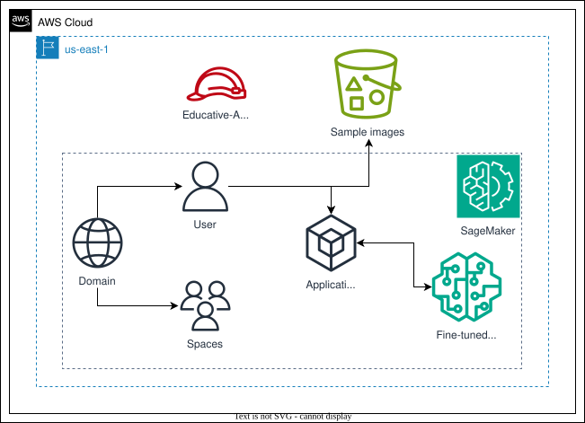

# Fine-Tune_a_SageMaker_JumpStart_Model_for_Image_Classification

Source: https://www.educative.io/courses/forward-deployed-engineer/g708YmyVKLj/cloudlab

---

[Home](https://www.educative.io/)

[Courses](https://www.educative.io/search?tab=courses)

[Forward Deployed Engineer for AI Systems](https://www.educative.io/courses/forward-deployed-engineer)

# Fine-Tune a SageMaker JumpStart Model for Image Classification

Takes 120 mins

Amazon SageMaker JumpStart provides an easy and efficient way to access, customize, and deploy pretrained machine learning models for various use cases, including image classification, natural language processing, and more. These models are pretrained on extensive datasets, enabling users to accelerate development by leveraging state-of-the-art architectures without starting from scratch.

JumpStart models simplify the machine learning workflow by offering easy deployment, integration with SageMaker pipelines, and fine-tuning capabilities. They reduce the time, effort, and cost of model development, making them ideal for businesses and developers seeking rapid deployment and scalability in their AI solutions.

In this Cloud Lab, you’ll train a JumpStart model for image classification and run inference to verify the model. You’ll create an IAM role to perform tasks in the Amazon SageMaker Studio to achieve this. You’ll create a SageMaker Domain, private space (a collaborative environment for JupyterLab), and a user profile; then train a JumpStart model on a custom dataset (data on which the model is not pretrained), and deploy it by creating an endpoint. You’ll upload the sample images to the Amazon S3 bucket and run inference on these images.

After completing this Cloud Lab, you’ll have enough understanding of working with JumpStart models and fine-tuning them on custom datasets. Here’s a high-level architecture diagram of the infrastructure that you’ll create in this Cloud Lab:

Fine-tuning an Amazon SageMaker JumpStart model for image classification