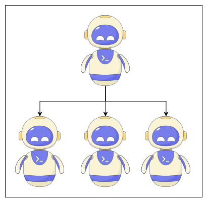

# Defending_Sub-Agent_Designs_in_Anthropic_AI_Interviews

Source: https://www.educative.io/courses/forward-deployed-engineer/defending-a-sub-agent-design

---

[Home](https://www.educative.io/)

[Courses](https://www.educative.io/search?tab=courses)

[Forward Deployed Engineer for AI Systems](https://www.educative.io/courses/forward-deployed-engineer)

# Defending a Sub-Agent Design

Explore how to defend multi-agent AI system designs by understanding the role and boundaries of sub-agents. Learn to explain isolated context, scoped tool usage, cost trade-offs, and failure handling. Gain skills in using Agent SDK features like AgentDefinition and policy hooks to enforce boundaries and trace agent actions. This lesson helps you prepare solid defenses for sub-agent designs in technical interviews at Anthropic.

We'll cover the following...

- [When a sub-agent earns its place](https://www.educative.io/courses/forward-deployed-engineer/defending-a-sub-agent-design#When-a-sub-agent-earns-its-place)
- [Defining a sub-agent in the SDK](https://www.educative.io/courses/forward-deployed-engineer/defending-a-sub-agent-design#Defining-a-sub-agent-in-the-SDK)
- [Containment through scoping](https://www.educative.io/courses/forward-deployed-engineer/defending-a-sub-agent-design#Containment-through-scoping)
- [Tracing which agent did what](https://www.educative.io/courses/forward-deployed-engineer/defending-a-sub-agent-design#Tracing-which-agent-did-what)
- [Answering “why not one agent?”](https://www.educative.io/courses/forward-deployed-engineer/defending-a-sub-agent-design#Answering-why-not-one-agent)
- [Delegating with a clear boundary](https://www.educative.io/courses/forward-deployed-engineer/defending-a-sub-agent-design#Delegating-with-a-clear-boundary)

Designs with more than one agent draw some of the sharpest pushback in Anthropic’s technical rounds. An interviewer looks at the diagram and asks a short question: “Why not one agent?” A candidate who added agents because the design looked more advanced has no good answer. A candidate who added one for a specific reason can name the reason, show the boundary it creates, and state what it costs.

That answer rests on three ideas: isolated context, scoped tools, and contained failure. Each one is easier to defend when we have built it. The examples extend the expense-audit scenario, where a coordinator decides what happens to each report and a sub-agent checks each report against its scanned receipt.

## When a sub-agent earns its place[#](https://www.educative.io/courses/forward-deployed-engineer/defending-a-sub-agent-design#When-a-sub-agent-earns-its-place)

A **sub-agent** is a specialized agent that a main agent, the coordinator, hands part of a task to. The sub-agent works in its own context window with its own instructions and tools, then reports a result back. The coordinator sees that result and nothing else from the sub-agent’s work.



Sub-agent

A sub-agent earns its place in a Claude design for four reasons.

- **Isolated context:** A noisy subtask, such as reading long receipts or search results, stays in the sub-agent’s context, and the coordinator receives only the finding.
- **A narrower tool set:** A role that only needs to read data gets read tools only, so it cannot take actions even when it makes a mistake.
- **Parallel work:** Independent checks, such as one receipt check per report, can run at the same time.
- **A cheaper model:** A focused task often runs well on a smaller, faster model than the coordinator needs.

Every sub-agent also adds cost. Each one starts its own conversation, rereads its instructions, and spends tokens the coordinator would not have spent. Strong candidates state that cost before the interviewer raises it.

Those reasons only hold up when the design matches them in code, so the next step is building the sub-agent itself.

## Defining a sub-agent in the SDK[#](https://www.educative.io/courses/forward-deployed-engineer/defending-a-sub-agent-design#Defining-a-sub-agent-in-the-SDK)

The Agent SDK defines sub-agents with `AgentDefinition`, passed through the `agents` option. Each definition sets four main fields.

- `description`**:** When the coordinator should use this sub-agent. Claude reads it the way it reads a tool description.
- `prompt`**:** The sub-agent’s own instructions.
- `tools`**:** The only tools this sub-agent can call.
- `model`**:** The model the sub-agent runs on, such as `"haiku"` for a smaller, faster model.

The coordinator delegates through a built-in tool named `Agent`. Each call to `Agent` names a sub-agent in its `subagent_type` field and passes it a task.

The program below defines a `receipt-checker` sub-agent with two read-only tools and asks the coordinator to audit one report.

Please provide values for the following:

ANTHROPIC\_API\_KEY

Import Values from JSON

Python 3.14.0

```
import asyncio

import json

from claude_agent_sdk import (

AgentDefinition,

AssistantMessage,

ClaudeAgentOptions,

ResultMessage,

ToolUseBlock,

create_sdk_mcp_server,

query,

tool,

)

# In-memory data stands in for the expense system and the receipt archive.

REPORTS = {"EXP-3002": {"employee": "Lee Chen", "category": "lodging", "amount_usd": 298.00, "receipt_id": "R-882"}}

RECEIPTS = {"R-882": {"vendor": "Midtown Hotel", "total_usd": 249.00, "date": "2026-10-05"}}

def as_result(data, is_error=False):

"""Wrap a Python value as a tool result."""

return {"content": [{"type": "text", "text": json.dumps(data)}], "is_error": is_error}

@tool("get_expense_report", "Look up one expense report by its ID.", {"report_id": str})

async def get_expense_report(args):

if args["report_id"] not in REPORTS:

return as_result(f"No expense report with ID {args['report_id']}.", is_error=True)

return as_result(REPORTS[args["report_id"]])

@tool("get_receipt_details", "Look up the scanned receipt behind an expense by its receipt ID.", {"receipt_id": str})

async def get_receipt_details(args):

if args["receipt_id"] not in RECEIPTS:

return as_result(f"No receipt on file with ID {args['receipt_id']}.", is_error=True)

return as_result(RECEIPTS[args["receipt_id"]])

server = create_sdk_mcp_server(name="expenses", version="1.0.0", tools=[get_expense_report, get_receipt_details])

options = ClaudeAgentOptions(

model="claude-sonnet-5-5",

system_prompt="You coordinate expense audits. Send each report to receipt-checker and summarize its finding in one line.",

env={"ANTHROPIC_API_KEY": "{{ANTHROPIC_API_KEY}}"},

mcp_servers={"expenses": server},

tools=["Agent"],

allowed_tools=["Agent", "mcp__expenses__*"],

agents={

"receipt-checker": AgentDefinition(

description="Checks one expense report against its scanned receipt.",

prompt="Look up the report and its receipt, then report the claimed amount, the receipt total, and whether they match.",

tools=["mcp__expenses__get_expense_report", "mcp__expenses__get_receipt_details"],

model="haiku",

maxTurns=6,

),

},

max_turns=10,

)

async def main():

async for message in query(prompt="Audit report EXP-3002.", options=options):

if isinstance(message, AssistantMessage):

for block in message.content:

if isinstance(block, ToolUseBlock) and block.name == "Agent":

print("Delegated to:", block.input.get("subagent_type"))

elif isinstance(message, ResultMessage):

print("\n" + message.result)

asyncio.run(main())
```

⋯

Delegating one expense report to a read-only receipt-checker sub-agent running on Haiku

- **Lines 16–17:** We created one expense report and its scanned receipt. The claimed amount and the receipt total do not match.
- **Lines 25–36:** We defined two read-only tools, one for the report and one for the receipt.
- **Lines 46–47:** We gave the coordinator the built-in `Agent` tool so it can delegate, and approved our expense tools with a wildcard.
- **Lines 48–56:** We defined `receipt-checker` with a description, its own prompt, exactly two tools, the `haiku` model, and a `maxTurns` cap of 6.
- **Lines 62–66:** We ran the audit and printed the name of each sub-agent the coordinator delegated to.
- **Lines 67–68:** We printed the coordinator’s final summary.

Below is the output from one run:

Ace Editor

1

2

3

4

Delegated to: receipt-checker

EXP-3002 doesn't match its receipt. Lee Chen claimed $298.00 for lodging, but receipt R-882 from Midtown Hotel (2026-10-05) totals $249.00, so the claim is $49.00 over. The report has no vendor or date field, so I couldn't compare those.

הההההההההההההההההההההההההההההההההההההההההההההההההההההההההההההההההההההההההההההההההההההההההההההההההההההההההההההההההההההההההההההההההההההההההההההההההההההההההההההההההההההההההההההההההההההההההההההההההההההההההההההההההההההההההההההההההההההההההההההההההההההההההההההההההההההההההההההההההההההההההההההההההההההההההההההההההההההההההההההההההההההההההההההההההההההההההההההההההההההההההההההההההההההההההההההההההההההההההההההההההההההההההההההההההההההההההההההההההההההההההההההההההההההההההההההההההההההההההההההההההההההההההההההההההההההההההההההההה

XXXXXXXXXXXXXXXXXXXXXXXXXXXXXXXXXXXXXXXXXXXXXXXXXXXXXXXXXXXXXXXXXXXXXXXXXXXXXXXXXXXXXXXXXXXXXXXXXXXXXXXXXXXXXXXXXXXXXXXXXXXXXXXXXXXXXXXXXXXXXXXXXXXXXXXXXXXXXXXXXXXXXXXXXXXXXXXXXXXXXXXXXXXXXXXXXXXXXXXXXXXXXXXXXXXXXXXXXXXXXXXXXXXXXXXXXXXXXXXXXXXXXXXXXXXXXXXXXXXXXXXXXXXXXXXXXXXXXXXXXXXXXXXXXXXXXXXXXXXXXXXXXXXXXXXXXXXXXXXXXXXXXXXXXXXXXXXXXXXXXXXXXXXXXXXXXXXXXXXXXXXXXXXXXXXXXXXXXXXXXXXXXXXXXXXXXXXXXXXXXXXXXXXXXXXXXXXXXXXXXXXXXXXXXXXXXXXXXXXXXXXXXXXXXXXXXXXXXXXXXXXXXXXXXXXXXXXXXXXXXXXXXXXXXXXXXXXXXXXXXXXXXXXXXXXX

The coordinator never read the receipt itself. The sub-agent did the lookup work on a smaller model and returned only the finding, which kept the coordinator’s context short.

Working delegation answers how the design runs. Interviewers then ask what happens when one part of it goes wrong.

## Containment through scoping[#](https://www.educative.io/courses/forward-deployed-engineer/defending-a-sub-agent-design#Containment-through-scoping)

**Containment** limits what an agent can access or change, reducing the impact of mistakes outside its assigned responsibilities. In this design, the receipt checker has read-only access and reports its findings. The coordinator can approve reports or flag them for review. Two controls maintain this separation:

1. **Agent tool restrictions:** The `tools` field in `AgentDefinition` restricts the receipt checker to read-only tools, excluding approval and flagging tools from its available tool set.
2. **Policy hook:** A `PreToolUse` hook checks attempted tool calls against the permissions assigned to each agent and rejects unauthorized operations. This provides an additional check if a later configuration change accidentally exposes a restricted tool.

When a subagent invokes a tool, the SDK includes `agent_type` in the hook input to identify the subagent's role. In this example, calls without subagent attribution are treated as coordinator calls. The hook should verify that assumption against the application's configuration.

The design also needs to handle incorrect, incomplete, or missing results from the receipt checker. The coordinator considers approval only when the checker returns a verified match and all other required policy checks pass. Failed lookups, missing evidence, or unclear findings result in a flag for human review.

The following example gives the coordinator approval and flagging tools, processes three expense reports, and uses a shared hook to enforce role-specific tool permissions and log attempted calls.

Please provide values for the following:

ANTHROPIC\_API\_KEY

Import Values from JSON

Python 3.14.0

```
import asyncio

import json

from claude_agent_sdk import AgentDefinition, ClaudeAgentOptions, HookMatcher, ResultMessage, create_sdk_mcp_server, query, tool

REPORTS = {

"EXP-3001": {"employee": "Dana Ruiz", "category": "meals", "amount_usd": 68.40, "receipt_id": "R-881"},

"EXP-3002": {"employee": "Lee Chen", "category": "lodging", "amount_usd": 298.00, "receipt_id": "R-882"},

"EXP-3003": {"employee": "Sam Okafor", "category": "meals", "amount_usd": 52.00, "receipt_id": "R-883"},

}

RECEIPTS = {

"R-881": {"vendor": "Harbor Grill", "total_usd": 68.40, "date": "2026-10-02"},

"R-882": {"vendor": "Midtown Hotel", "total_usd": 249.00, "date": "2026-10-05"},

}

DECISIONS = {}

TRACE = []

def as_result(data, is_error=False):

"""Wrap a Python value as a tool result."""

return {"content": [{"type": "text", "text": json.dumps(data)}], "is_error": is_error}

@tool("get_expense_report", "Look up one expense report by its ID.", {"report_id": str})

async def get_expense_report(args):

if args["report_id"] not in REPORTS:

return as_result(f"No expense report with ID {args['report_id']}.", is_error=True)

return as_result(REPORTS[args["report_id"]])

@tool("get_receipt_details", "Look up the scanned receipt behind an expense by its receipt ID.", {"receipt_id": str})

async def get_receipt_details(args):

if args["receipt_id"] not in RECEIPTS:

return as_result(f"No receipt on file with ID {args['receipt_id']}.", is_error=True)

return as_result(RECEIPTS[args["receipt_id"]])

@tool("approve_report", "Approve an expense report whose receipt was verified.", {"report_id": str})

async def approve_report(args):

DECISIONS[args["report_id"]] = "approved"

return as_result({"report_id": args["report_id"], "status": "approved"})

@tool("flag_report", "Send an expense report to a finance reviewer with the reason.", {"report_id": str, "reason": str})

async def flag_report(args):

DECISIONS[args["report_id"]] = f"flagged: {args['reason']}"

return as_result({"report_id": args["report_id"], "status": "flagged"})

# Which tools each agent may call. Only the coordinator can act on a report.

ALLOWED = {

"coordinator": {"Agent", "approve_report", "flag_report"},

"receipt-checker": {"get_expense_report", "get_receipt_details"},

}

async def trace_and_contain(input_data, tool_use_id, context):

"""Record which agent made each tool call, and deny calls outside that agent's role."""

agent = input_data.get("agent_type", "coordinator")

tool_name = input_data["tool_name"].removeprefix("mcp__expenses__")

allowed = tool_name in ALLOWED.get(agent, set())

TRACE.append(f"{agent:<16} {tool_name:<20} {'allowed' if allowed else 'DENIED'}")

if not allowed:

return {

"hookSpecificOutput": {

"hookEventName": input_data["hook_event_name"],

"permissionDecision": "deny",

"permissionDecisionReason": f"{agent} is not allowed to call {tool_name}.",

}

}

return {}

TOOLS = [get_expense_report, get_receipt_details, approve_report, flag_report]

options = ClaudeAgentOptions(

model="claude-sonnet-5-5",

system_prompt=(

"You coordinate expense audits. Send each report to receipt-checker. Approve a report only when "

"its checker confirms the receipt total matches the claimed amount. Otherwise, flag it with the reason."

),

env={"ANTHROPIC_API_KEY": "{{ANTHROPIC_API_KEY}}"},

mcp_servers={"expenses": create_sdk_mcp_server(name="expenses", version="1.0.0", tools=TOOLS)},

tools=["Agent"],

allowed_tools=["Agent", "mcp__expenses__*"],

agents={

"receipt-checker": AgentDefinition(

description="Checks one expense report against its scanned receipt.",

prompt="Look up the report and its receipt, then report the claimed amount, the receipt total, and whether they match.",

tools=["mcp__expenses__get_expense_report", "mcp__expenses__get_receipt_details"],

model="haiku",

maxTurns=6,

),

},

hooks={"PreToolUse": [HookMatcher(hooks=[trace_and_contain])]},

max_budget_usd=1.00,

)

async def main():

reports = ["EXP-3001", "EXP-3002", "EXP-3003"]

final = None

async for message in query(prompt=f"Audit these reports: {', '.join(reports)}.", options=options):

if isinstance(message, ResultMessage):

final = message  # Sub-agents can report in the background, so keep the last result.

print("Trace:")

for line in TRACE:

print("  " + line)

print(f"\nTurns: {final.num_turns}, cost: ${final.total_cost_usd:.4f}")

print("Decisions:")

for report_id in reports:

print(f"  {report_id}: {DECISIONS.get(report_id, 'no decision, send to human review')}")

asyncio.run(main())
```

⋯

Auditing three expense reports with a coordinator, a receipt-checker sub-agent, and a per-agent policy hook

- **Lines 6–14:** We created three reports. EXP-3001 matches its receipt, EXP-3002 claims more than its receipt shows, and EXP-3003 points to a receipt that is not on file.
- **Lines 38–47:** We added two action tools, `approve_report` and `flag_report`, which record each decision in `DECISIONS`.
- **Lines 51–54:** We created `ALLOWED`, which lists the tools each agent may call. Only the coordinator can act on a report.
- **Lines 57–71:** We wrote `trace_and_contain`. It reads `agent_type` to find the calling agent, records the call in `TRACE`, and denies any tool outside that agent’s role.
- **Lines 78–81:** We told the coordinator to approve a report only when its checker confirms a match, and to flag it otherwise.
- **Line 95:** We attached the hook to every tool call with a `HookMatcher` that has no matcher, so it covers every agent and every tool.
- **Lines 102–105:** We ran the audit and kept the last `ResultMessage`, because sub-agents can report back after the coordinator’s first result.
- **Lines 107–113:** We printed the trace, the turn count, the cost, and the decision for each report. A report with no decision falls back to human review.

Running the program gives the output below.

Ace Editor

1

2

3

4

5

6

7

8

9

10

11

12

13

14

15

16

17

18

19

20

Trace:

coordinator Agent allowed

coordinator Agent allowed

receipt-checker get\_expense\_report allowed

coordinator Agent allowed

receipt-checker get\_expense\_report allowed

receipt-checker get\_receipt\_details allowed

receipt-checker get\_expense\_report allowed

receipt-checker get\_receipt\_details allowed

receipt-checker get\_receipt\_details allowed

coordinator approve\_report allowed

coordinator flag\_report allowed

coordinator flag\_report allowed

Turns: 7, cost: $0.0265

Decisions:

EXP-3001: approved

EXP-3002: flagged: Claimed amount $298.00 does not match receipt R-882 total of $249.00 (Midtown Hotel); claim is $49.00 higher.

EXP-3003: flagged: Receipt could not be verified: receipt R-883 is not on file. Claimed $52.00. Needs correct receipt ID or upload.

הההההההההההההההההההההההההההההההההההההההההההההההההההההההההההההההההההההההההההההההההההההההההההההההההההההההההההההההההההההההההההההההההההההההההההההההההההההההההההההההההההההההההההההההההההההההההההההההההההההההההההההההההההההההההההההההההההההההההההההההההההההההההההההההההההההההההההההההההההההההההההההההההההההההההההההההההההההההההההההההההההההההההההההההההההההההההההההההההההההההההההההההההההההההההההההההההההההההההההההההההההההההההההההההההההההההההההההההההההההההההההההההההההההההההההההההההההההההההההההההההההההההההההההההההההההההההההההההה

XXXXXXXXXXXXXXXXXXXXXXXXXXXXXXXXXXXXXXXXXXXXXXXXXXXXXXXXXXXXXXXXXXXXXXXXXXXXXXXXXXXXXXXXXXXXXXXXXXXXXXXXXXXXXXXXXXXXXXXXXXXXXXXXXXXXXXXXXXXXXXXXXXXXXXXXXXXXXXXXXXXXXXXXXXXXXXXXXXXXXXXXXXXXXXXXXXXXXXXXXXXXXXXXXXXXXXXXXXXXXXXXXXXXXXXXXXXXXXXXXXXXXXXXXXXXXXXXXXXXXXXXXXXXXXXXXXXXXXXXXXXXXXXXXXXXXXXXXXXXXXXXXXXXXXXXXXXXXXXXXXXXXXXXXXXXXXXXXXXXXXXXXXXXXXXXXXXXXXXXXXXXXXXXXXXXXXXXXXXXXXXXXXXXXXXXXXXXXXXXXXXXXXXXXXXXXXXXXXXXXXXXXXXXXXXXXXXXXXXXXXXXXXXXXXXXXXXXXXXXXXXXXXXXXXXXXXXXXXXXXXXXXXXXXXXXXXXXXXXXXXXXXXXXXXXX

Each report took a different path. EXP-3001 matched, and the coordinator approved it. EXP-3002 failed the match and was flagged with the exact difference. EXP-3003’s receipt lookup failed inside the checker, and that failure became a flag at the coordinator rather than a guess.

The trace in this output also answers the next question interviewers ask: how we would debug this design.

## Tracing which agent did what[#](https://www.educative.io/courses/forward-deployed-engineer/defending-a-sub-agent-design#Tracing-which-agent-did-what)

A multi-agent run is hard to debug without a record of who did what. The trace above gives that record. Every line names the agent, the tool, and the hook’s decision, so a reviewer can confirm in seconds that the checker only read data and the coordinator alone acted.

The trace also shows the coordinator’s three `Agent` calls before any checker lookups, followed by interleaved lookups from three checker runs. The coordinator started all three checks in parallel, which is why the lookups appear mixed together. When three runs share the name `receipt-checker`, the hook input’s `agent_id` field separates one run from another, and a production trace records it alongside `agent_type`.

In an interview, this record turns “How would you debug this?” into a concrete answer. We point to the trace, find the first call that went wrong, and name the agent that made it. With the design built, contained, and traced, the original challenge is ready for an answer.

## Answering “why not one agent?”[#](https://www.educative.io/courses/forward-deployed-engineer/defending-a-sub-agent-design#Answering-why-not-one-agent)

A strong answer to the challenge follows four steps:

1. **The need:** Name the specific reason for the sub-agent, such as isolated context or a narrower tool set.
2. **The boundary:** Show what the sub-agent can and cannot do, and where that limit is enforced.
3. **The cost:** State the extra tokens and latency honestly.
4. **The fallback:** Explain what happens when the sub-agent fails or returns something unclear.

For the expense audit design, the answer sounds like this.

One agent could do it, and for a handful of reports, I would start there. I split out the receipt checker for two reasons. Receipt lookups are noisy, and keeping them in a separate context keeps the coordinator’s context focused on decisions. The checker also runs on Haiku with read-only tools, so even a bad check can’t approve anything. That costs a few extra calls per report, which the faster model mostly offsets. If a check fails or comes back unclear, the coordinator flags the report for a person instead of approving it.

Each sentence maps to one step, and every claim points to something visible in the code or the trace.

## Delegating with a clear boundary[#](https://www.educative.io/courses/forward-deployed-engineer/defending-a-sub-agent-design#Delegating-with-a-clear-boundary)

A sub-agent design is easy to draw and harder to defend. The defense rests on a specific reason for the split, a boundary that holds in code, an honest cost, and a fallback for bad results. On Claude, those pieces map directly to the Agent SDK, with `AgentDefinition` for the role, a scoped tool list and a policy hook for the boundary, and `agent_type` in the trace for accountability. A candidate who can show all four turns the panel’s sharpest question into a chance to prove judgment.

When to Reach for the Claude Agent SDK

MCP for the Technical Use Case Screen

Ask

[When a sub-agent earns its place](https://www.educative.io/courses/forward-deployed-engineer/defending-a-sub-agent-design#When-a-sub-agent-earns-its-place)

[Defining a sub-agent in the SDK](https://www.educative.io/courses/forward-deployed-engineer/defending-a-sub-agent-design#Defining-a-sub-agent-in-the-SDK)

[Containment through scoping](https://www.educative.io/courses/forward-deployed-engineer/defending-a-sub-agent-design#Containment-through-scoping)

[Tracing which agent did what](https://www.educative.io/courses/forward-deployed-engineer/defending-a-sub-agent-design#Tracing-which-agent-did-what)

[Answering “why not one agent?”](https://www.educative.io/courses/forward-deployed-engineer/defending-a-sub-agent-design#Answering-why-not-one-agent)

[Delegating with a clear boundary](https://www.educative.io/courses/forward-deployed-engineer/defending-a-sub-agent-design#Delegating-with-a-clear-boundary)