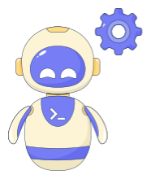

# Agent_Skills_and_Managed_Agents_for_AI_System_Deployment

Source: https://www.educative.io/courses/forward-deployed-engineer/packaging-and-hosting-agent-skills-and-managed-agents

---

[Home](https://www.educative.io/)

[Courses](https://www.educative.io/search?tab=courses)

[Forward Deployed Engineer for AI Systems](https://www.educative.io/courses/forward-deployed-engineer)

# Packaging and Hosting: Agent Skills and Managed Agents

Explore the concepts of packaging reusable agent skills and deploying AI agents with Claude Managed Agents. Understand how to design and document workflows that can be reused across customers and decide between Anthropic-hosted or self-hosted agent runtimes. This lesson helps you develop deployment strategies that balance customer needs, infrastructure management, and compliance considerations.

We'll cover the following...

- [What an agent skill is](https://www.educative.io/courses/forward-deployed-engineer/packaging-and-hosting-agent-skills-and-managed-agents#What-an-agent-skill-is)
- [Using skills from the Agent SDK](https://www.educative.io/courses/forward-deployed-engineer/packaging-and-hosting-agent-skills-and-managed-agents#Using-skills-from-the-Agent-SDK)
- [Managed Agents or self-hosting](https://www.educative.io/courses/forward-deployed-engineer/packaging-and-hosting-agent-skills-and-managed-agents#Managed-Agents-or-self-hosting)
- [Answering the deployment questions](https://www.educative.io/courses/forward-deployed-engineer/packaging-and-hosting-agent-skills-and-managed-agents#Answering-the-deployment-questions)
- [Turning one deployment into many](https://www.educative.io/courses/forward-deployed-engineer/packaging-and-hosting-agent-skills-and-managed-agents#Turning-one-deployment-into-many)

Anthropic's FDE job posting lists agent skills among the technical deliverables and emphasizes documenting reusable deployment patterns. These responsibilities raise two architectural questions beyond implementing a single agent. The first concerns reuse: "How would you package this workflow for another customer?" The second concerns deployment: "Where should the agent run?"

Claude provides options for addressing both concerns. Agent Skills package reusable instructions, workflows, and supporting resources. Claude Managed Agents provides an Anthropic-hosted agent runtime, reducing the need to operate the agent loop and its supporting infrastructure.

The following examples continue the expense audit scenario. First, we package the audit checklist as a reusable skill. Then, we deploy an expense audit agent using Claude Managed Agents.

## What an agent skill is[#](https://www.educative.io/courses/forward-deployed-engineer/packaging-and-hosting-agent-skills-and-managed-agents#What-an-agent-skill-is)

An **agent skill** is a folder that packages instructions and supporting resources for one kind of task. Its core is a `SKILL.md` file with two parts.

- **Frontmatter:** A short YAML header with the skill’s `name` and a `description` of when to use it.
- **Instructions:** Markdown text that tells Claude how to do the task, such as a checklist and an output format.

A skill folder can also hold scripts, templates, and reference files that the instructions point to.

Claude loads skills in stages. At the start of a session, it sees only each skill’s name and description. When a request matches a description, Claude invokes the skill and loads its full instructions. This keeps many skills available without filling the context window, which is why the description deserves the same care as a tool description.



A skill differs from a system prompt in reach. A system prompt shapes one deployment, while a skill can move between projects and customers unchanged. That portability is what turns one engagement’s lessons into a reusable pattern.

The structure is simple, and the Agent SDK expects a specific layout before it can find a skill.

## Using skills from the Agent SDK[#](https://www.educative.io/courses/forward-deployed-engineer/packaging-and-hosting-agent-skills-and-managed-agents#Using-skills-from-the-Agent-SDK)

The Agent SDK reads skills from files on disk and has no API for registering them in code. A project skill lives at `.claude/skills/<name>/SKILL.md` inside the agent’s working directory. Three options make it available.

- `cwd`**:** The agent’s working directory, where the SDK looks for `.claude/skills/`.
- `setting_sources`**:** Which filesystem settings to load. Including `"project"` loads the project’s skills.
- `skills`**:** Which discovered skills Claude may invoke, as a list of names or `"all"`. Setting it adds the Skill tool to the agent automatically.

The SDK also reports what it loaded. The first message in the stream is a system message with the subtype `init`, and its `skills` list names every skill the session can use.

> **Explicit setting sources:**
>
> With default options, the SDK loads skills from both the user’s and the project’s settings. Setting `setting_sources` explicitly limits loading to the sources listed, so a list without `"project"` hides project skills. Listing only `"project"` keeps a deployment from picking up skills installed on the host machine.

The program below writes the audit checklist as a skill, then asks an agent to audit one report with it.

Please provide values for the following:

ANTHROPIC\_API\_KEY

Import Values from JSON

Python 3.14.0

```
import asyncio

from pathlib import Path

from claude_agent_sdk import AssistantMessage, ClaudeAgentOptions, ResultMessage, SystemMessage, ToolUseBlock, query

# A skill is a folder with a SKILL.md file inside the project's .claude/skills directory.

PROJECT = Path("expense_project")

SKILL_DIR = PROJECT / ".claude" / "skills" / "expense-audit"

SKILL_DIR.mkdir(parents=True, exist_ok=True)

(SKILL_DIR / "SKILL.md").write_text("""---

name: expense-audit

description: Audit one employee expense report against company policy. Use when asked to audit, review, or approve an expense report.

---

Check the report in this order.

1. The amount is within the category limit (meals 75 USD, lodging 350 USD, airfare 2500 USD).

2. A receipt is attached.

3. The receipt was submitted within 30 days of its date.

Reply in exactly this format.

DECISION: APPROVE or FLAG

CHECKS: one short line per check, marked PASS or FAIL

REASON: one sentence

""")

options = ClaudeAgentOptions(

model="claude-sonnet-5-5",

env={"ANTHROPIC_API_KEY": "{{ANTHROPIC_API_KEY}}"},

cwd=str(PROJECT),

setting_sources=["project"],

skills=["expense-audit"],

tools=["Skill"],

max_turns=5,

)

REPORT = "Audit this expense report. Lodging, 312 USD, receipt attached, receipt dated 2026-09-02, submitted 2026-10-15."

async def main():

async for message in query(prompt=REPORT, options=options):

if isinstance(message, SystemMessage) and message.subtype == "init":

print("expense-audit skill loaded:", "expense-audit" in message.data.get("skills", []))

elif isinstance(message, AssistantMessage):

for block in message.content:

if isinstance(block, ToolUseBlock):

print("Tool call:", block.name, block.input)

elif isinstance(message, ResultMessage):

print("\n" + message.result)

asyncio.run(main())
```

⋯

Packaging an expense audit checklist as an agent skill and running an agent that invokes it

- **Lines 7–9:** We created the skill folder at `expense_project/.claude/skills/expense-audit`.
- **Lines 10–24:** We wrote `SKILL.md`. The frontmatter on lines 11–12 names the skill and says when to use it, and the instructions list three checks and an exact reply format.
- **Lines 29–30:** We pointed the agent at the project folder and loaded only project settings.
- **Lines 31–32:** We allowed only the `expense-audit` skill and gave the agent the Skill tool, with no other tools.
- **Lines 41–42:** We read the `init` message and printed whether the skill loaded.
- **Lines 43–48:** We printed each tool call and the final answer.

Here is the output from one run.

Ace Editor

1

2

3

4

5

6

7

8

9

10

11

expense-audit skill loaded: True

Tool call: Skill {'skill': 'expense-audit', 'args': 'Lodging, 312 USD, receipt attached, receipt dated 2026-09-02, submitted 2026-10-15'}

DECISION: FLAG

CHECKS:

1. Amount within category limit: PASS (312 USD is under the 350 USD lodging limit)

2. Receipt attached: PASS

3. Submitted within 30 days of receipt date: FAIL (43 days from 2026-09-02 to 2026-10-15)

REASON: The report was submitted 43 days after the receipt date, which is past the 30-day window.

הההההההההההההההההההההההההההההההההההההההההההההההההההההההההההההההההההההההההההההההההההההההההההההההההההההההההההההההההההההההההההההההההההההההההההההההההההההההההההההההההההההההההההההההההההההההההההההההההההההההההההההההההההההההההההההההההההההההההההההההההההההההההההההההההההההההההההההההההההההההההההההההההההההההההההההההההההההההההההההההההההההההההההההההההההההההההההההההההההההההההההההההההההההההההההההההההההההההההההההההההההההההההההההההההההההההההההההההההההההההההההההההההההההההההההההההההההההההההההההההההההההההההההההההההההההההההההההההה

XXXXXXXXXXXXXXXXXXXXXXXXXXXXXXXXXXXXXXXXXXXXXXXXXXXXXXXXXXXXXXXXXXXXXXXXXXXXXXXXXXXXXXXXXXXXXXXXXXXXXXXXXXXXXXXXXXXXXXXXXXXXXXXXXXXXXXXXXXXXXXXXXXXXXXXXXXXXXXXXXXXXXXXXXXXXXXXXXXXXXXXXXXXXXXXXXXXXXXXXXXXXXXXXXXXXXXXXXXXXXXXXXXXXXXXXXXXXXXXXXXXXXXXXXXXXXXXXXXXXXXXXXXXXXXXXXXXXXXXXXXXXXXXXXXXXXXXXXXXXXXXXXXXXXXXXXXXXXXXXXXXXXXXXXXXXXXXXXXXXXXXXXXXXXXXXXXXXXXXXXXXXXXXXXXXXXXXXXXXXXXXXXXXXXXXXXXXXXXXXXXXXXXXXXXXXXXXXXXXXXXXXXXXXXXXXXXXXXXXXXXXXXXXXXXXXXXXXXXXXXXXXXXXXXXXXXXXXXXXXXXXXXXXXXXXXXXXXXXXXXXXXXXXXXXXX

The prompt never mentioned the checklist or the format. Claude matched the request to the skill’s description, invoked the skill, and followed its checks and output format exactly. The same folder would work unchanged at another customer, with only the limits edited.

A skill answers the packaging question. The hosting question asks who runs the agent loop at all.

## Managed Agents or self-hosting[#](https://www.educative.io/courses/forward-deployed-engineer/packaging-and-hosting-agent-skills-and-managed-agents#Managed-Agents-or-self-hosting)

**Claude Managed Agents** is Anthropic’s hosted agent harness. Anthropic runs the agent loop and the sandbox where tools execute, and our application sends messages in and receives events back. The service is in beta, and its endpoints use the `managed-agents-2026-04-01` beta header, which the Python SDK adds automatically. It is built from four objects.

- **Agent:** The model, system prompt, tools, MCP servers, and skills, defined once and reused.
- **Environment:** Where sessions run, either an Anthropic cloud sandbox or a self-hosted sandbox on our own infrastructure.
- **Session:** One running instance of an agent in an environment, working on one task.
- **Events:** The messages between our application and the agent, such as user turns, tool calls, and status updates.

Agents on Managed Agents can also use custom tools, which our own code runs. When Claude calls one, the session pauses and waits for our code to send the result back.

In the code below, we define an expense agent with one custom tool, run one question in a cloud sandbox, and clean up afterward.

Please provide values for the following:

ANTHROPIC\_API\_KEY

Import Values from JSON

Python 3.14.0

```
import json

import anthropic

client = anthropic.Anthropic(api_key="{{ANTHROPIC_API_KEY}}")

POLICY_LIMITS_USD = {"meals": 75.00, "lodging": 350.00, "airfare": 2500.00}

# Step 1. Define the agent with its model, instructions, and one custom tool our code runs.

agent = client.beta.agents.create(

name="Expense Auditor",

model="claude-sonnet-5-5",

system="You check expense reports against company policy. Use the policy tool for category limits.",

tools=[

{

"type": "custom",

"name": "get_policy_limit",

"description": "Look up the per-expense limit in US dollars for one category: meals, lodging, or airfare.",

"input_schema": {

"type": "object",

"properties": {"category": {"type": "string", "enum": ["meals", "lodging", "airfare"]}},

"required": ["category"],

},

}

],

)

print("Agent created:", agent.id)

# Step 2. Define the environment where sessions run, here an Anthropic-managed cloud sandbox.

environment = client.beta.environments.create(

name="expense-audit-env",

config={"type": "cloud", "networking": {"type": "limited"}},

)

print("Environment created:", environment.id)

# Step 3. Start a session that runs the agent in that environment.

session = client.beta.sessions.create(agent=agent.id, environment_id=environment.id, title="EXP-2002 review")

print("Session started:", session.id)

tool_calls = {}

with client.beta.sessions.events.stream(session.id) as stream:

question = "Report EXP-2002 claims 412 USD for lodging. Is it within policy?"

client.beta.sessions.events.send(

session.id,

events=[{"type": "user.message", "content": [{"type": "text", "text": question}]}],

)

for event in stream:

if event.type == "agent.message":

for block in event.content:

if block.type == "text":

print(block.text, end="")

elif event.type == "agent.custom_tool_use":

tool_calls[event.id] = event

print(f"\n[Custom tool call: {event.name} {event.input}]")

elif event.type == "session.status_idle":

if event.stop_reason.type == "requires_action":

# The session pauses until our code returns a result for each custom tool call.

for event_id in event.stop_reason.event_ids:

category = tool_calls[event_id].input["category"]

result = {"category": category, "limit_usd": POLICY_LIMITS_USD[category]}

client.beta.sessions.events.send(

session.id,

events=[{

"type": "user.custom_tool_result",

"custom_tool_use_id": event_id,

"content": [{"type": "text", "text": json.dumps(result)}],

}],

)

elif event.stop_reason.type == "end_turn":

print("\n\nSession idle, review finished.")

break

# Step 4. Clean up the session, the environment, and the agent definition.

client.beta.sessions.delete(session.id)

client.beta.environments.delete(environment.id)

client.beta.agents.archive(agent.id)

print("Cleaned up.")
```

⋯

Running a one-tool expense agent on Claude Managed Agents, with our code answering its custom tool call

- **Line 5:** We created the same `anthropic` client used for the Messages API. Managed Agents lives under `client.beta`.
- **Lines 10–26:** We defined the agent once, with its model, instructions, and one custom tool, `get_policy_limit`.
- **Lines 30–33:** We created a cloud environment with limited networking.
- **Line 37:** We started a session that runs the agent in that environment.
- **Lines 41–46:** We opened the event stream first, then sent the question as a `user.message` event.
- **Lines 48–54:** We printed Claude’s text and recorded each custom tool call by its event ID.
- **Lines 55–68:** When the session went idle with `requires_action`, we looked up the limit for each pending call and sent it back as a `user.custom_tool_result`.
- **Lines 69–71:** When the session went idle with `end_turn`, we stopped reading.
- **Lines 74–76:** We deleted the session and environment and archived the agent.

The run printed the steps below:

Ace Editor

1

2

3

4

5

6

7

8

9

10

11

12

Agent created: agent\_019y1MM6haEfKdSHsv6eqmzD

Environment created: env\_01PVufGQXVt7jvuvipa3QDBb

Session started: sesn\_013ovTaHTg7eZDjYuWf3nDiw

[Custom tool call: get\_policy\_limit {'category': 'lodging'}]

No, EXP-2002 is not within policy. It claims $412 for lodging, and the per-expense lodging limit is $350. That is $62 over the limit.

The tool only gives me the per-expense limit. I can't tell from it whether the report has an approved exception, or whether the $412 covers several nights that should be checked separately. If either applies, that could change the outcome.

Session idle, review finished.

Cleaned up.

הההההההההההההההההההההההההההההההההההההההההההההההההההההההההההההההההההההההההההההההההההההההההההההההההההההההההההההההההההההההההההההההההההההההההההההההההההההההההההההההההההההההההההההההההההההההההההההההההההההההההההההההההההההההההההההההההההההההההההההההההההההההההההההההההההההההההההההההההההההההההההההההההההההההההההההההההההההההההההההההההההההההההההההההההההההההההההההההההההההההההההההההההההההההההההההההההההההההההההההההההההההההההההההההההההההההההההההההההההההההההההההההההההההההההההההההההההההההההההההההההההההההההההההההההההההההההההההההה

XXXXXXXXXXXXXXXXXXXXXXXXXXXXXXXXXXXXXXXXXXXXXXXXXXXXXXXXXXXXXXXXXXXXXXXXXXXXXXXXXXXXXXXXXXXXXXXXXXXXXXXXXXXXXXXXXXXXXXXXXXXXXXXXXXXXXXXXXXXXXXXXXXXXXXXXXXXXXXXXXXXXXXXXXXXXXXXXXXXXXXXXXXXXXXXXXXXXXXXXXXXXXXXXXXXXXXXXXXXXXXXXXXXXXXXXXXXXXXXXXXXXXXXXXXXXXXXXXXXXXXXXXXXXXXXXXXXXXXXXXXXXXXXXXXXXXXXXXXXXXXXXXXXXXXXXXXXXXXXXXXXXXXXXXXXXXXXXXXXXXXXXXXXXXXXXXXXXXXXXXXXXXXXXXXXXXXXXXXXXXXXXXXXXXXXXXXXXXXXXXXXXXXXXXXXXXXXXXXXXXXXXXXXXXXXXXXXXXXXXXXXXXXXXXXXXXXXXXXXXXXXXXXXXXXXXXXXXXXXXXXXXXXXXXXXXXXXXXXXXXXXXXXXXXXXX

Anthropic ran the loop, and our code only answered the tool call that needed company data. The alternative is **self-hosting**, where the customer runs the Agent SDK inside its own environment and owns the loop, the tools, and the session state.

The table below compares the two on the factors a customer weighs:

|  |  |  |
| --- | --- | --- |
| **Factor** | **Managed Agents** | **Self-Hosted Agent SDK** |
| Who runs the loop | Anthropic | The customer |
| Where tools run | Anthropic’s cloud sandbox, or a self-hosted sandbox | The customer’s own servers |
| Data location | Inference geography can be pinned per agent, and stored data follows the workspace’s geography | Wherever the customer deploys, within the model provider’s options |
| Operations after handoff | Anthropic handles the runtime, and the customer manages agents and sessions | The customer’s team owns the runtime, upgrades, and monitoring |
| Change risk | Beta, so features and headers can change | SDK options change between releases, so the version stays pinned |

With both options built, the two interview questions have answers grounded in what we just ran.

## Answering the deployment questions[#](https://www.educative.io/courses/forward-deployed-engineer/packaging-and-hosting-agent-skills-and-managed-agents#Answering-the-deployment-questions)

A strong answer explains how each option meets the customer's requirements rather than relying on personal preference. For the packaging question, explain how Agent Skills support the job posting's emphasis on documenting reusable implementation patterns.

I’d package the audit checklist and output format as an expense-audit skill. The next customer gets the same folder, with only the limits and categories edited, and their agent picks it up through the same Skill tool. Each engagement then improves one shared skill instead of starting over.

For the hosting question, the answer starts from data and ownership:

If the customers team is small and wants Anthropic to run the agent infrastructure, Managed Agents removes that work, with custom tools keeping their data lookups in their own code. If they need tool execution and session data inside their own environment, or have a platform team that wants full control, I’d self-host the Agent SDK. Managed Agents is still in beta, so for a regulated workload, I’d confirm its current data handling with the customer’s compliance team first.

Both answers name a reason the customer would recognize, and both state the trade-off.

## Turning one deployment into many[#](https://www.educative.io/courses/forward-deployed-engineer/packaging-and-hosting-agent-skills-and-managed-agents#Turning-one-deployment-into-many)

Skills and hosting answer two sides of the same FDE responsibility. A skill carries what an engagement taught into the next one, and the hosting choice decides who keeps the agent running after the FDE leaves. Interviewers listen for both, because together they show a candidate who plans beyond the first deployment. A clear skill, a deliberate hosting decision, and an honest note about beta status make that plan easy to defend.

MCP for the Technical Use Case Screen

Cost and Long-Context Reasoning on the Spot

Ask

[What an agent skill is](https://www.educative.io/courses/forward-deployed-engineer/packaging-and-hosting-agent-skills-and-managed-agents#What-an-agent-skill-is)

[Using skills from the Agent SDK](https://www.educative.io/courses/forward-deployed-engineer/packaging-and-hosting-agent-skills-and-managed-agents#Using-skills-from-the-Agent-SDK)

[Managed Agents or self-hosting](https://www.educative.io/courses/forward-deployed-engineer/packaging-and-hosting-agent-skills-and-managed-agents#Managed-Agents-or-self-hosting)

[Answering the deployment questions](https://www.educative.io/courses/forward-deployed-engineer/packaging-and-hosting-agent-skills-and-managed-agents#Answering-the-deployment-questions)

[Turning one deployment into many](https://www.educative.io/courses/forward-deployed-engineer/packaging-and-hosting-agent-skills-and-managed-agents#Turning-one-deployment-into-many)