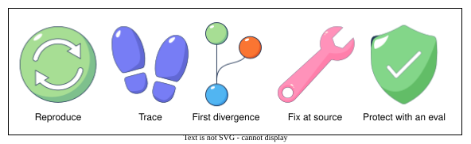

# Live_Debugging_AI_Pipelines_in_the_Anthropic_FDE_Interview

Source: https://www.educative.io/courses/forward-deployed-engineer/live-debugging-an-almost-right-pipeline

---

[Home](https://www.educative.io/)

[Courses](https://www.educative.io/search?tab=courses)

[Forward Deployed Engineer for AI Systems](https://www.educative.io/courses/forward-deployed-engineer)

# Live Debugging an Almost-Right Pipeline

Explore how to methodically debug nearly correct AI pipelines during customer deployments and interviews. Learn to reproduce failures, trace tool inputs and outputs, identify the first point of error, apply fixes at the root cause, and safeguard with evaluation cases. This lesson provides a practical example debugging an expense audit agent and highlights how to narrate your reasoning effectively in technical interviews.

We'll cover the following...

- [Why almost-right bugs are hard](https://www.educative.io/courses/forward-deployed-engineer/live-debugging-an-almost-right-pipeline#Why-almost-right-bugs-are-hard)
- [A five-step method for Claude pipelines](https://www.educative.io/courses/forward-deployed-engineer/live-debugging-an-almost-right-pipeline#A-five-step-method-for-Claude-pipelines)
- [Debugging an expense pipeline end to end](https://www.educative.io/courses/forward-deployed-engineer/live-debugging-an-almost-right-pipeline#Debugging-an-expense-pipeline-end-to-end)
  - [Step 1: Reproducing the failure](https://www.educative.io/courses/forward-deployed-engineer/live-debugging-an-almost-right-pipeline#Step-1-Reproducing-the-failure)
  - [Step 2: Tracing every tool call](https://www.educative.io/courses/forward-deployed-engineer/live-debugging-an-almost-right-pipeline#Step-2-Tracing-every-tool-call)
  - [Step 3: Finding the first divergence](https://www.educative.io/courses/forward-deployed-engineer/live-debugging-an-almost-right-pipeline#Step-3-Finding-the-first-divergence)
  - [Step 4: Fixing the parser at the source](https://www.educative.io/courses/forward-deployed-engineer/live-debugging-an-almost-right-pipeline#Step-4-Fixing-the-parser-at-the-source)
  - [Step 5: Protecting the fix with an eval](https://www.educative.io/courses/forward-deployed-engineer/live-debugging-an-almost-right-pipeline#Step-5-Protecting-the-fix-with-an-eval)
- [Narrating the method out loud](https://www.educative.io/courses/forward-deployed-engineer/live-debugging-an-almost-right-pipeline#Narrating-the-method-out-loud)
- [Debugging with evidence instead of guesses](https://www.educative.io/courses/forward-deployed-engineer/live-debugging-an-almost-right-pipeline#Debugging-with-evidence-instead-of-guesses)

Forward-deployed work often starts with a customer system that mostly works. The demo passed, most outputs look fine, and a few decisions are quietly wrong. Technical interviews test the same skill, and an interviewer watching a candidate debug learns more from the method than from the speed of the fix.

A candidate who guesses, edits the prompt, and reruns once can get lucky. A candidate who reproduces the failure, traces it, and fixes it at its source shows the judgment a customer deployment needs. The examples follow one bug through an expense audit agent, from the first complaint to the eval case that keeps it fixed.

## Why almost-right bugs are hard[#](https://www.educative.io/courses/forward-deployed-engineer/live-debugging-an-almost-right-pipeline#Why-almost-right-bugs-are-hard)

An **almost-right bug** is a defect that leaves most outputs correct and makes the wrong ones look reasonable. Claude pipelines produce this kind of bug often for three reasons.

- **Outputs vary between runs:** The same input can produce different results, so one good run proves little, and one bad run can look like noise.
- **Errors look plausible:** Claude writes a fluent, confident reason around whatever input it receives. A wrong input produces a wrong decision with a convincing explanation.
- **The cause sits upstream:** The symptom appears at the final decision, while the cause often lives in a tool, a data format, or a prompt several steps earlier.

The third reason matters most. Looking at the final answer and editing the prompt treats the symptom, so a reliable method has to walk back to where the problem started.

## A five-step method for Claude pipelines[#](https://www.educative.io/courses/forward-deployed-engineer/live-debugging-an-almost-right-pipeline#A-five-step-method-for-Claude-pipelines)

The method below works on any pipeline where Claude calls tools. Each step answers one question before the next step begins.

1. **Reproduce:** Run the failing input several times and count the wrong results, which separates a consistent bug from run-to-run variation.
2. **Trace:** Record every tool input and output exactly as they passed between Claude and the tools.
3. **Find the first divergence:** Walk the trace from the start and stop at the first value that differs from the source data.
4. **Fix at the source:** Change the component that produced the wrong value, instead of a later step that only reacted to it.
5. **Protect with an eval:** Add the failing cases to an eval set so the bug cannot return without a test failing.



A five-step method for almost-right bugs

On Claude, a trace has a few places that explain most failures. These are where we look first.

- **Stop reasons:** A response cut off by `max_tokens` or ending with `refusal` can read like a short, complete answer.
- **Tool inputs as Claude sent them:** Claude may pass an argument in a different shape than the tool expects.
- **Tool outputs as Claude received them:** Claude reasons only from what the tool returned, whatever the source system holds.
- **The system prompt actually sent:** Edits and templates drift, so we check the prompt in the request rather than the one in the design document.
- **Data formats at each hand-off:** Dates, currencies, units, and IDs change shape as they move between systems.

The expense pipeline below has a bug of exactly this kind, and we work through it one step at a time.

## Debugging an expense pipeline end to end[#](https://www.educative.io/courses/forward-deployed-engineer/live-debugging-an-almost-right-pipeline#Debugging-an-expense-pipeline-end-to-end)

A finance team reports that the expense audit agent sometimes approves late receipts. Their policy allows a receipt dated no more than 30 days before the report’s submission date. The agent reads each receipt through a tool, counts the days with a second tool, and then approves or flags the report.

### Step 1: Reproducing the failure[#](https://www.educative.io/courses/forward-deployed-engineer/live-debugging-an-almost-right-pipeline#Step-1-Reproducing-the-failure)

The first goal is a failure we can see on demand. Let’s start by writing `expense_pipeline.py`. This file holds the audit agent, four test reports, and a `reproduce` function that runs each report five times and compares every decision with the one a finance reviewer expects.

Please provide values for the following:

ANTHROPIC\_API\_KEY

Import Values from JSON

```
import asyncio
import json
from datetime import date, datetime

from claude_agent_sdk import ClaudeAgentOptions, create_sdk_mcp_server, query, tool

API_KEY = "{{ANTHROPIC_API_KEY}}"

POLICY = "Approve a report only if its receipt is dated no more than 30 days before the submission date. Otherwise, flag it."

# Every report was submitted on 2026-10-28.
REPORTS = {
    "EXP-6001": {"employee": "Dana Ruiz", "amount_usd": 68.40, "submitted": "2026-10-28", "receipt_id": "R-901"},
    "EXP-6002": {"employee": "Lee Chen", "amount_usd": 249.00, "submitted": "2026-10-28", "receipt_id": "R-902"},
    "EXP-6003": {"employee": "Sam Okafor", "amount_usd": 52.00, "submitted": "2026-10-28", "receipt_id": "R-903"},
    "EXP-6004": {"employee": "Ana Silva", "amount_usd": 31.50, "submitted": "2026-10-28", "receipt_id": "R-904"},
}
# The receipt archive stores scanned dates as day/month/year text.
RECEIPTS = {
    "R-901": {"vendor": "Harbor Grill", "date": "21/10/2026"},
    "R-902": {"vendor": "Midtown Hotel", "date": "10/09/2026"},
    "R-903": {"vendor": "Cafe Lune", "date": "15/09/2026"},
    "R-904": {"vendor": "City Taxi", "date": "03/10/2026"},
}
# The right decision for each report, from a finance reviewer's manual check.
EXPECTED = {"EXP-6001": "approved", "EXP-6002": "flagged", "EXP-6003": "flagged", "EXP-6004": "approved"}

def parse_receipt_date(text: str) -> date:
    """Turn a scanned receipt date into a date, trying common formats in order."""
    for fmt in ("%Y-%m-%d", "%m/%d/%Y", "%d/%m/%Y"):
        try:
            return datetime.strptime(text, fmt).date()
        except ValueError:
            continue
    raise ValueError(f"Unrecognized date: {text}")

def as_result(data):
    return {"content": [{"type": "text", "text": json.dumps(data)}]}

async def audit(report_id: str, hooks: dict | None = None) -> str:
    """Run the audit agent on one report and return its decision."""
    decision = {"value": "no decision"}

    @tool("get_receipt", "Look up a scanned receipt by its ID. Dates are returned as YYYY-MM-DD.", {"receipt_id": str})
    async def get_receipt(args):
        receipt = RECEIPTS[args["receipt_id"]]
        return as_result({"vendor": receipt["vendor"], "date": parse_receipt_date(receipt["date"]).isoformat()})

    @tool("days_between", "Count the days from a start date to a later end date, both YYYY-MM-DD.", {"start": str, "end": str})
    async def days_between(args):
        return as_result({"days": (date.fromisoformat(args["end"]) - date.fromisoformat(args["start"])).days})

    @tool("approve_report", "Approve an expense report.", {"report_id": str})
    async def approve_report(args):
        decision["value"] = "approved"
        return as_result("approved")

    @tool("flag_report", "Flag an expense report for a finance reviewer.", {"report_id": str, "reason": str})
    async def flag_report(args):
        decision["value"] = "flagged"
        return as_result("flagged")

    tools = [get_receipt, days_between, approve_report, flag_report]
    options = ClaudeAgentOptions(
        model="claude-sonnet-5-5",
        system_prompt=f"You audit expense reports. {POLICY} Use days_between for date math. "
                      "Call approve_report or flag_report exactly once.",
        env={"ANTHROPIC_API_KEY": API_KEY},
        mcp_servers={"expenses": create_sdk_mcp_server(name="expenses", version="1.0.0", tools=tools)},
        tools=[],
        allowed_tools=["mcp__expenses__*"],
        permission_mode="dontAsk",
        hooks=hooks or {},
        max_turns=8,
    )
    async for _ in query(prompt=f"Audit report {report_id}: {REPORTS[report_id]}", options=options):
        pass  # The decision is recorded by the action tools.
    return decision["value"]

async def reproduce(runs: int = 5):
    """Run every report several times and count the decisions that differ from the expected one."""
    for report_id, expected in EXPECTED.items():
        decisions = await asyncio.gather(*[audit(report_id) for _ in range(runs)])
        wrong = sum(decision != expected for decision in decisions)
        print(f"{report_id}: expected {expected:<8} wrong {wrong}/{runs}")

if __name__ == "__main__":
    asyncio.run(reproduce())
```

Implementing an expense audit agent and running each report five times against its expected decision

- **Line 9:** We wrote the 30-day receipt policy that goes into the system prompt.
- **Lines 12–24:** We created four reports submitted on 2026-10-28 and a receipt archive that stores each date as day/month/year text.
- **Line 26:** We recorded the decision a finance reviewer expects for each report, so every run can be checked against it.
- **Lines 29–36:** We wrote `parse_receipt_date`, which tries three date formats in order and returns the first one that works.
- **Lines 47–50:** We defined `get_receipt`, which converts the archive’s date to `YYYY-MM-DD` before Claude sees it.
- **Lines 52–54:** We defined `days_between`, so date math happens in code instead of in the model.
- **Lines 56–64:** We defined two action tools that record the agent’s decision.
- **Lines 66–81:** We configured the agent with the policy, the four tools, and an optional `hooks` setting, then ran it on one report and returned its decision.
- **Lines 84–89:** We wrote `reproduce`, which runs each report five times at once with `asyncio.gather` and counts the decisions that differ from the expected one.
- **Lines 92–93:** We ran `reproduce` inside `if __name__ == "__main__":`. This line runs the code only when we run this file directly, so other files can import `audit` without starting an audit.

Let’s run the code:

Ace Editor

1

2

3

4

5

EXP-6001: expected approved wrong 0/5

EXP-6002: expected flagged wrong 5/5

EXP-6003: expected flagged wrong 0/5

EXP-6004: expected approved wrong 5/5

הההההההההההההההההההההההההההההההההההההההההההההההההההההההההההההההההההההההההההההההההההההההההההההההההההההההההההההההההההההההההההההההההההההההההההההההההההההההההההההההההההההההההההההההההההההההההההההההההההההההההההההההההההההההההההההההההההההההההההההההההההההההההההההההההההההההההההההההההההההההההההההההההההההההההההההההההההההההההההההההההההההההההההההההההההההההההההההההההההההההההההההההההההההההההההההההההההההההההההההההההההההההההההההההההההההההההההההההההההההההההההההההההההההההההההההההההההההההההההההההההההההההההההההההההההההההההההההההה

XXXXXXXXXXXXXXXXXXXXXXXXXXXXXXXXXXXXXXXXXXXXXXXXXXXXXXXXXXXXXXXXXXXXXXXXXXXXXXXXXXXXXXXXXXXXXXXXXXXXXXXXXXXXXXXXXXXXXXXXXXXXXXXXXXXXXXXXXXXXXXXXXXXXXXXXXXXXXXXXXXXXXXXXXXXXXXXXXXXXXXXXXXXXXXXXXXXXXXXXXXXXXXXXXXXXXXXXXXXXXXXXXXXXXXXXXXXXXXXXXXXXXXXXXXXXXXXXXXXXXXXXXXXXXXXXXXXXXXXXXXXXXXXXXXXXXXXXXXXXXXXXXXXXXXXXXXXXXXXXXXXXXXXXXXXXXXXXXXXXXXXXXXXXXXXXXXXXXXXXXXXXXXXXXXXXXXXXXXXXXXXXXXXXXXXXXXXXXXXXXXXXXXXXXXXXXXXXXXXXXXXXXXXXXXXXXXXXXXXXXXXXXXXXXXXXXXXXXXXXXXXXXXXXXXXXXXXXXXXXXXXXXXXXXXXXXXXXXXXXXXXXXXXXXXXX

The failure is real and consistent. EXP-6002 has a late receipt and was approved on every run, which matches the complaint. EXP-6004 shows a second failure the finance team never reported: a recent receipt flagged as late. Two reports fail every time and two pass every time, so the cause is almost certainly in code or data rather than in run-to-run variation. The counts tell us which reports fail. They do not yet tell us why.

### Step 2: Tracing every tool call[#](https://www.educative.io/courses/forward-deployed-engineer/live-debugging-an-almost-right-pipeline#Step-2-Tracing-every-tool-call)

A trace shows what each tool received and returned during a run. For this, we create a new file, `trace_hook.py`, with a `trace_tool_call` function that the Agent SDK calls after every tool call. It prints the input Claude sent and the output Claude got back.

Python 3.14.0

```
import asyncio

from claude_agent_sdk import HookMatcher

from expense_pipeline import RECEIPTS, audit

async def trace_tool_call(input_data, tool_use_id, context):

"""Print each tool call's input and output exactly as they passed between Claude and the tool."""

name = input_data["tool_name"].removeprefix("mcp__expenses__")

output = input_data["tool_response"][0]["text"]

print(f"  {name:<15} in: {input_data['tool_input']}\n  {'':<15} out: {output}")

return {}

TRACE_HOOKS = {"PostToolUse": [HookMatcher(hooks=[trace_tool_call])]}

async def main():

for report_id, receipt_id in [("EXP-6002", "R-902"), ("EXP-6004", "R-904")]:

print(f"{report_id} (archive date for {receipt_id}: {RECEIPTS[receipt_id]['date']})")

decision = await audit(report_id, hooks=TRACE_HOOKS)

print(f"  Decision: {decision}\n")

if __name__ == "__main__":

asyncio.run(main())
```

⋯

Tracing each tool’s input and output with a PostToolUse hook on the two failing reports

- **Line 5:** We imported the receipt archive and the `audit` function from `expense_pipeline.py`.
- **Lines 8–13:** We wrote `trace_tool_call`, which reads the tool name, the input, and the output from the hook input and prints them.
- **Line 16:** We attached the function as a `PostToolUse` hook, which runs after each tool call, so the tool’s output is available.
- **Lines 19–23:** We audited the two failing reports with the hook attached and printed each receipt’s archive date first so we can compare it with the trace.

Running the program gives the output below:

Ace Editor

1

2

3

4

5

6

7

8

9

10

11

12

13

14

15

16

17

18

EXP-6002 (archive date for R-902: 10/09/2026)

get\_receipt in: {'receipt\_id': 'R-902'}

out: {"vendor": "Midtown Hotel", "date": "2026-10-09"}

days\_between in: {'start': '2026-10-09', 'end': '2026-10-28'}

out: {"days": 19}

approve\_report in: {'report\_id': 'EXP-6002'}

out: "approved"

Decision: approved

EXP-6004 (archive date for R-904: 03/10/2026)

get\_receipt in: {'receipt\_id': 'R-904'}

out: {"vendor": "City Taxi", "date": "2026-03-10"}

days\_between in: {'start': '2026-03-10', 'end': '2026-10-28'}

out: {"days": 232}

flag\_report in: {'report\_id': 'EXP-6004', 'reason': 'Receipt R-904 (City Taxi) is dated 2026-03-10, which is 232 days before the 2026-10-28 submission date. The limit is 30 days.'}

out: "flagged"

Decision: flagged

הההההההההההההההההההההההההההההההההההההההההההההההההההההההההההההההההההההההההההההההההההההההההההההההההההההההההההההההההההההההההההההההההההההההההההההההההההההההההההההההההההההההההההההההההההההההההההההההההההההההההההההההההההההההההההההההההההההההההההההההההההההההההההההההההההההההההההההההההההההההההההההההההההההההההההההההההההההההההההההההההההההההההההההההההההההההההההההההההההההההההההההההההההההההההההההההההההההההההההההההההההההההההההההההההההההההההההההההההההההההההההההההההההההההההההההההההההההההההההההההההההההההההההההההההההההההההההההההה

XXXXXXXXXXXXXXXXXXXXXXXXXXXXXXXXXXXXXXXXXXXXXXXXXXXXXXXXXXXXXXXXXXXXXXXXXXXXXXXXXXXXXXXXXXXXXXXXXXXXXXXXXXXXXXXXXXXXXXXXXXXXXXXXXXXXXXXXXXXXXXXXXXXXXXXXXXXXXXXXXXXXXXXXXXXXXXXXXXXXXXXXXXXXXXXXXXXXXXXXXXXXXXXXXXXXXXXXXXXXXXXXXXXXXXXXXXXXXXXXXXXXXXXXXXXXXXXXXXXXXXXXXXXXXXXXXXXXXXXXXXXXXXXXXXXXXXXXXXXXXXXXXXXXXXXXXXXXXXXXXXXXXXXXXXXXXXXXXXXXXXXXXXXXXXXXXXXXXXXXXXXXXXXXXXXXXXXXXXXXXXXXXXXXXXXXXXXXXXXXXXXXXXXXXXXXXXXXXXXXXXXXXXXXXXXXXXXXXXXXXXXXXXXXXXXXXXXXXXXXXXXXXXXXXXXXXXXXXXXXXXXXXXXXXXXXXXXXXXXXXXXXXXXXXXXX

Every call is now visible, with the exact values that moved between Claude and the tools. The next job is to find where those values first went wrong.

### Step 3: Finding the first divergence[#](https://www.educative.io/courses/forward-deployed-engineer/live-debugging-an-almost-right-pipeline#Step-3-Finding-the-first-divergence)

We read the trace from the top and compare each value with the source data. The archive stores R-902’s date as `10/09/2026`, which in day/month/year is 10 September. The first call, `get_receipt`, returned `2026-10-09`, which is 9 October. That is the first divergence.

Everything after it was correct for the input it received. `days_between` counted 19 days correctly from the wrong date, and Claude approved a report that looked 19 days old. EXP-6004 follows the same path, with 3 October turned into 10 March. Both misread dates have a day of 12 or lower, which points to the date parser. A quick check in a new file, `check_parser.py`, confirms the cause in isolation before we change anything.

Please provide values for the following:

ANTHROPIC\_API\_KEY

Import Values from JSON

Python 3.14.0

```
from expense_pipeline import parse_receipt_date

# One archive date that was misread and one that was read correctly.

for text in ["10/09/2026", "15/09/2026"]:

print(f"{text} -> {parse_receipt_date(text)}")
```

⋯

Testing the receipt date parser on one misread date and one correctly read date

- **Line 1:** We imported the parser from `expense_pipeline.py`.
- **Lines 4–5:** We parsed R-902’s archive date and R-903’s archive date and printed each result.

The check prints the following.

Ace Editor

1

2

3

10/09/2026 -> 2026-10-09

15/09/2026 -> 2026-09-15

הההההההההההההההההההההההההההההההההההההההההההההההההההההההההההההההההההההההההההההההההההההההההההההההההההההההההההההההההההההההההההההההההההההההההההההההההההההההההההההההההההההההההההההההההההההההההההההההההההההההההההההההההההההההההההההההההההההההההההההההההההההההההההההההההההההההההההההההההההההההההההההההההההההההההההההההההההההההההההההההההההההההההההההההההההההההההההההההההההההההההההההההההההההההההההההההההההההההההההההההההההההההההההההההההההההההההההההההההההההההההההההההההההההההההההההההההההההההההההההההההההההההההההההההההההההההההההההההה

XXXXXXXXXXXXXXXXXXXXXXXXXXXXXXXXXXXXXXXXXXXXXXXXXXXXXXXXXXXXXXXXXXXXXXXXXXXXXXXXXXXXXXXXXXXXXXXXXXXXXXXXXXXXXXXXXXXXXXXXXXXXXXXXXXXXXXXXXXXXXXXXXXXXXXXXXXXXXXXXXXXXXXXXXXXXXXXXXXXXXXXXXXXXXXXXXXXXXXXXXXXXXXXXXXXXXXXXXXXXXXXXXXXXXXXXXXXXXXXXXXXXXXXXXXXXXXXXXXXXXXXXXXXXXXXXXXXXXXXXXXXXXXXXXXXXXXXXXXXXXXXXXXXXXXXXXXXXXXXXXXXXXXXXXXXXXXXXXXXXXXXXXXXXXXXXXXXXXXXXXXXXXXXXXXXXXXXXXXXXXXXXXXXXXXXXXXXXXXXXXXXXXXXXXXXXXXXXXXXXXXXXXXXXXXXXXXXXXXXXXXXXXXXXXXXXXXXXXXXXXXXXXXXXXXXXXXXXXXXXXXXXXXXXXXXXXXXXXXXXXXXXXXXXXXXX

The parser tries month/day/year before day/month/year. When the day is 12 or lower, the month-first format succeeds and the wrong date wins. When the day is 13 or higher, the month-first format fails and the parser falls through to the correct one. That is why most reports looked right. Claude did nothing wrong in this pipeline, and the fix belongs in the parser.

### Step 4: Fixing the parser at the source[#](https://www.educative.io/courses/forward-deployed-engineer/live-debugging-an-almost-right-pipeline#Step-4-Fixing-the-parser-at-the-source)

A prompt change could not fix this bug, because Claude only ever sees the converted date. The archive documents one format, so the parser should accept exactly that format and fail loudly on anything else. We replace `parse_receipt_date` in `expense_pipeline.py` with the version below.

Ace Editor

1

2

3

def parse\_receipt\_date(text: str) -> date:

"""Turn a scanned receipt date into a date. The archive always stores day/month/year."""

return datetime.strptime(text, "%d/%m/%Y").date()

הההההההההההההההההההההההההההההההההההההההההההההההההההההההההההההההההההההההההההההההההההההההההההההההההההההההההההההההההההההההההההההההההההההההההההההההההההההההההההההההההההההההההההההההההההההההההההההההההההההההההההההההההההההההההההההההההההההההההההההההההההההההההההההההההההההההההההההההההההההההההההההההההההההההההההההההההההההההההההההההההההההההההההההההההההההההההההההההההההההההההההההההההההההההההההההההההההההההההההההההההההההההההההההההההההההההההההההההההההההההההההההההההההההההההההההההההההההההההההההההההההההההההההההההההההההההההההההההה

XXXXXXXXXXXXXXXXXXXXXXXXXXXXXXXXXXXXXXXXXXXXXXXXXXXXXXXXXXXXXXXXXXXXXXXXXXXXXXXXXXXXXXXXXXXXXXXXXXXXXXXXXXXXXXXXXXXXXXXXXXXXXXXXXXXXXXXXXXXXXXXXXXXXXXXXXXXXXXXXXXXXXXXXXXXXXXXXXXXXXXXXXXXXXXXXXXXXXXXXXXXXXXXXXXXXXXXXXXXXXXXXXXXXXXXXXXXXXXXXXXXXXXXXXXXXXXXXXXXXXXXXXXXXXXXXXXXXXXXXXXXXXXXXXXXXXXXXXXXXXXXXXXXXXXXXXXXXXXXXXXXXXXXXXXXXXXXXXXXXXXXXXXXXXXXXXXXXXXXXXXXXXXXXXXXXXXXXXXXXXXXXXXXXXXXXXXXXXXXXXXXXXXXXXXXXXXXXXXXXXXXXXXXXXXXXXXXXXXXXXXXXXXXXXXXXXXXXXXXXXXXXXXXXXXXXXXXXXXXXXXXXXXXXXXXXXXXXXXXXXXXXXXXXXXXX

Parsing receipt dates with the archive’s single day/month/year format

- **Lines 1–3:** We parsed every archive date with the day/month/year format only, so a date in any other format raises an error instead of turning into a wrong date.

Now rerun the `expense_pipeline.py` file:

Please provide values for the following:

ANTHROPIC\_API\_KEY

Import Values from JSON

```
import asyncio
import json
from datetime import date, datetime

from claude_agent_sdk import ClaudeAgentOptions, create_sdk_mcp_server, query, tool

API_KEY = "{{ANTHROPIC_API_KEY}}"

POLICY = "Approve a report only if its receipt is dated no more than 30 days before the submission date. Otherwise, flag it."

# Every report was submitted on 2026-10-28.
REPORTS = {
    "EXP-6001": {"employee": "Dana Ruiz", "amount_usd": 68.40, "submitted": "2026-10-28", "receipt_id": "R-901"},
    "EXP-6002": {"employee": "Lee Chen", "amount_usd": 249.00, "submitted": "2026-10-28", "receipt_id": "R-902"},
    "EXP-6003": {"employee": "Sam Okafor", "amount_usd": 52.00, "submitted": "2026-10-28", "receipt_id": "R-903"},
    "EXP-6004": {"employee": "Ana Silva", "amount_usd": 31.50, "submitted": "2026-10-28", "receipt_id": "R-904"},
}
# The receipt archive stores scanned dates as day/month/year text.
RECEIPTS = {
    "R-901": {"vendor": "Harbor Grill", "date": "21/10/2026"},
    "R-902": {"vendor": "Midtown Hotel", "date": "10/09/2026"},
    "R-903": {"vendor": "Cafe Lune", "date": "15/09/2026"},
    "R-904": {"vendor": "City Taxi", "date": "03/10/2026"},
}
# The right decision for each report, from a finance reviewer's manual check.
EXPECTED = {"EXP-6001": "approved", "EXP-6002": "flagged", "EXP-6003": "flagged", "EXP-6004": "approved"}

def parse_receipt_date(text: str) -> date:
    """Turn a scanned receipt date into a date. The archive always stores day/month/year."""
    return datetime.strptime(text, "%d/%m/%Y").date()

def as_result(data):
    return {"content": [{"type": "text", "text": json.dumps(data)}]}

async def audit(report_id: str, hooks: dict | None = None) -> str:
    """Run the audit agent on one report and return its decision."""
    decision = {"value": "no decision"}

    @tool("get_receipt", "Look up a scanned receipt by its ID. Dates are returned as YYYY-MM-DD.", {"receipt_id": str})
    async def get_receipt(args):
        receipt = RECEIPTS[args["receipt_id"]]
        return as_result({"vendor": receipt["vendor"], "date": parse_receipt_date(receipt["date"]).isoformat()})

    @tool("days_between", "Count the days from a start date to a later end date, both YYYY-MM-DD.", {"start": str, "end": str})
    async def days_between(args):
        return as_result({"days": (date.fromisoformat(args["end"]) - date.fromisoformat(args["start"])).days})

    @tool("approve_report", "Approve an expense report.", {"report_id": str})
    async def approve_report(args):
        decision["value"] = "approved"
        return as_result("approved")

    @tool("flag_report", "Flag an expense report for a finance reviewer.", {"report_id": str, "reason": str})
    async def flag_report(args):
        decision["value"] = "flagged"
        return as_result("flagged")

    tools = [get_receipt, days_between, approve_report, flag_report]
    options = ClaudeAgentOptions(
        model="claude-sonnet-5-5",
        system_prompt=f"You audit expense reports. {POLICY} Use days_between for date math. "
                      "Call approve_report or flag_report exactly once.",
        env={"ANTHROPIC_API_KEY": API_KEY},
        mcp_servers={"expenses": create_sdk_mcp_server(name="expenses", version="1.0.0", tools=tools)},
        tools=[],
        allowed_tools=["mcp__expenses__*"],
        permission_mode="dontAsk",
        hooks=hooks or {},
        max_turns=8,
    )
    async for _ in query(prompt=f"Audit report {report_id}: {REPORTS[report_id]}", options=options):
        pass  # The decision is recorded by the action tools.
    return decision["value"]

async def reproduce(runs: int = 5):
    """Run every report several times and count the decisions that differ from the expected one."""
    for report_id, expected in EXPECTED.items():
        decisions = await asyncio.gather(*[audit(report_id) for _ in range(runs)])
        wrong = sum(decision != expected for decision in decisions)
        print(f"{report_id}: expected {expected:<8} wrong {wrong}/{runs}")

if __name__ == "__main__":
    asyncio.run(reproduce())
```

Parsing receipt dates with the archive’s single day/month/year format

Rerunning `expense_pipeline.py` after the fix gives the following:

Ace Editor

1

2

3

4

5

EXP-6001: expected approved wrong 0/5

EXP-6002: expected flagged wrong 0/5

EXP-6003: expected flagged wrong 0/5

EXP-6004: expected approved wrong 0/5

הההההההההההההההההההההההההההההההההההההההההההההההההההההההההההההההההההההההההההההההההההההההההההההההההההההההההההההההההההההההההההההההההההההההההההההההההההההההההההההההההההההההההההההההההההההההההההההההההההההההההההההההההההההההההההההההההההההההההההההההההההההההההההההההההההההההההההההההההההההההההההההההההההההההההההההההההההההההההההההההההההההההההההההההההההההההההההההההההההההההההההההההההההההההההההההההההההההההההההההההההההההההההההההההההההההההההההההההההההההההההההההההההההההההההההההההההההההההההההההההההההההההההההההההההההההההההההההההה

XXXXXXXXXXXXXXXXXXXXXXXXXXXXXXXXXXXXXXXXXXXXXXXXXXXXXXXXXXXXXXXXXXXXXXXXXXXXXXXXXXXXXXXXXXXXXXXXXXXXXXXXXXXXXXXXXXXXXXXXXXXXXXXXXXXXXXXXXXXXXXXXXXXXXXXXXXXXXXXXXXXXXXXXXXXXXXXXXXXXXXXXXXXXXXXXXXXXXXXXXXXXXXXXXXXXXXXXXXXXXXXXXXXXXXXXXXXXXXXXXXXXXXXXXXXXXXXXXXXXXXXXXXXXXXXXXXXXXXXXXXXXXXXXXXXXXXXXXXXXXXXXXXXXXXXXXXXXXXXXXXXXXXXXXXXXXXXXXXXXXXXXXXXXXXXXXXXXXXXXXXXXXXXXXXXXXXXXXXXXXXXXXXXXXXXXXXXXXXXXXXXXXXXXXXXXXXXXXXXXXXXXXXXXXXXXXXXXXXXXXXXXXXXXXXXXXXXXXXXXXXXXXXXXXXXXXXXXXXXXXXXXXXXXXXXXXXXXXXXXXXXXXXXXXXXX

All 20 decisions now match the finance reviewer’s decisions. The pipeline works today, and nothing stops someone from bringing the lenient parser back next month.

### Step 5: Protecting the fix with an eval[#](https://www.educative.io/courses/forward-deployed-engineer/live-debugging-an-almost-right-pipeline#Step-5-Protecting-the-fix-with-an-eval)

An eval case turns this bug into a test that fails if it ever returns. We create `date_regression_eval.py` with two kinds of cases. Parser cases check archive dates directly, and pipeline cases run the two reports that exposed the bug from start to finish.

Please provide values for the following:

ANTHROPIC\_API\_KEY

Import Values from JSON

Python 3.14.0

```
import asyncio

import sys

from datetime import date

from expense_pipeline import EXPECTED, audit, parse_receipt_date

# Archive dates where the day is 12 or less, so day and month can swap, plus one where they cannot.

DATE_CASES = {

"10/09/2026": date(2026, 9, 10),

"03/10/2026": date(2026, 10, 3),

"12/11/2026": date(2026, 11, 12),

"21/10/2026": date(2026, 10, 21),

}

# The two reports that exposed the bug, checked end to end.

PIPELINE_CASES = ["EXP-6002", "EXP-6004"]

async def main():

failures = 0

for text, expected in DATE_CASES.items():

parsed = parse_receipt_date(text)

failures += parsed != expected

print(f"Date {text} -> {parsed}  {'pass' if parsed == expected else 'FAIL'}")

decisions = await asyncio.gather(*[audit(report_id) for report_id in PIPELINE_CASES])

for report_id, decision in zip(PIPELINE_CASES, decisions):

failures += decision != EXPECTED[report_id]

print(f"{report_id} -> {decision:<8}  {'pass' if decision == EXPECTED[report_id] else 'FAIL'}")

print(f"\n{failures} failure(s)")

sys.exit(1 if failures else 0)

if __name__ == "__main__":

asyncio.run(main())
```

⋯

Checking archive dates and the two failing reports in a regression eval that exits with an error on any failure

- **Line 5:** We imported the expected decisions, the `audit` function, and the fixed parser from `expense_pipeline.py`.
- **Lines 8–13:** We listed archive dates with their correct values, including three where the day and month could swap.
- **Line 15:** We listed the two reports that exposed the bug.
- **Lines 20–23:** We checked each archive date against its correct value. These checks run in code with no model call, so they are fast and free.
- **Lines 25–28:** We audited both reports at once and compared each decision with the expected one.
- **Lines 30–31:** We printed the failure count and exited with an error code when any case failed, so a deployment pipeline can block the release.

Here’s the result with the fixed parser:

Ace Editor

1

2

3

4

5

6

7

8

9

Date 10/09/2026 -> 2026-09-10 pass

Date 03/10/2026 -> 2026-10-03 pass

Date 12/11/2026 -> 2026-11-12 pass

Date 21/10/2026 -> 2026-10-21 pass

EXP-6002 -> flagged pass

EXP-6004 -> approved pass

0 failure(s)

הההההההההההההההההההההההההההההההההההההההההההההההההההההההההההההההההההההההההההההההההההההההההההההההההההההההההההההההההההההההההההההההההההההההההההההההההההההההההההההההההההההההההההההההההההההההההההההההההההההההההההההההההההההההההההההההההההההההההההההההההההההההההההההההההההההההההההההההההההההההההההההההההההההההההההההההההההההההההההההההההההההההההההההההההההההההההההההההההההההההההההההההההההההההההההההההההההההההההההההההההההההההההההההההההההההההההההההההההההההההההההההההההההההההההההההההההההההההההההההההההההההההההההההההההההההההההההההההה

XXXXXXXXXXXXXXXXXXXXXXXXXXXXXXXXXXXXXXXXXXXXXXXXXXXXXXXXXXXXXXXXXXXXXXXXXXXXXXXXXXXXXXXXXXXXXXXXXXXXXXXXXXXXXXXXXXXXXXXXXXXXXXXXXXXXXXXXXXXXXXXXXXXXXXXXXXXXXXXXXXXXXXXXXXXXXXXXXXXXXXXXXXXXXXXXXXXXXXXXXXXXXXXXXXXXXXXXXXXXXXXXXXXXXXXXXXXXXXXXXXXXXXXXXXXXXXXXXXXXXXXXXXXXXXXXXXXXXXXXXXXXXXXXXXXXXXXXXXXXXXXXXXXXXXXXXXXXXXXXXXXXXXXXXXXXXXXXXXXXXXXXXXXXXXXXXXXXXXXXXXXXXXXXXXXXXXXXXXXXXXXXXXXXXXXXXXXXXXXXXXXXXXXXXXXXXXXXXXXXXXXXXXXXXXXXXXXXXXXXXXXXXXXXXXXXXXXXXXXXXXXXXXXXXXXXXXXXXXXXXXXXXXXXXXXXXXXXXXXXXXXXXXXXXXXX

Every case passes. With the original parser, the same file reports five failures and exits with an error, which is exactly the protection we wanted. The parser cases guard the layer where the bug lived, and the pipeline cases confirm that the whole system still makes the right call.

The fix is done. In an interview, the way we talk through it matters as much as the fix itself.

## Narrating the method out loud[#](https://www.educative.io/courses/forward-deployed-engineer/live-debugging-an-almost-right-pipeline#Narrating-the-method-out-loud)

An interviewer can only credit reasoning they can hear. A short sentence at each step makes the method visible, and the lines below fit this bug.

1. **Reproduce:** “Before changing anything, I’ll run each report five times so I know whether this is consistent or random.”
2. **Trace:** “It’s consistent, so I’ll trace the tool calls and see exactly what Claude received.”
3. **First divergence:** “The archive says 10 September and the tool returned 9 October. Everything after that is reasonable for a wrong date, so the bug is upstream of Claude.”
4. **Fix at the source:** “I’ll fix the parser instead of the prompt, because Claude never sees the raw date.”
5. **Protect:** “I’ll add these dates as eval cases so the bug fails a test if it ever returns.”

Two habits strengthen the narration. We state each hypothesis before checking it, such as “I suspect the date format,” so the interviewer sees the reasoning that drives each check. When a hypothesis turns out wrong, we say so and name the next one, because a candidate who rules out causes in the open shows the same discipline a customer engagement needs.

## Debugging with evidence instead of guesses[#](https://www.educative.io/courses/forward-deployed-engineer/live-debugging-an-almost-right-pipeline#Debugging-with-evidence-instead-of-guesses)

An almost-right pipeline rewards patience. Repeated runs show whether a failure is real, a trace shows what each component actually saw, and the first divergence points to the one place a fix belongs. On Claude, the Agent SDK’s hooks make that trace a few lines of code, and an eval case makes the fix permanent. A candidate who works this way, and says each step out loud, shows an interviewer how they would handle a customer’s system on the day something quietly goes wrong.

Answering Safety Pushback With Claude-Native Guardrails

The Technical Use Case Screen Walk-Through

Ask

[Why almost-right bugs are hard](https://www.educative.io/courses/forward-deployed-engineer/live-debugging-an-almost-right-pipeline#Why-almost-right-bugs-are-hard)

[A five-step method for Claude pipelines](https://www.educative.io/courses/forward-deployed-engineer/live-debugging-an-almost-right-pipeline#A-five-step-method-for-Claude-pipelines)

[Debugging an expense pipeline end to end](https://www.educative.io/courses/forward-deployed-engineer/live-debugging-an-almost-right-pipeline#Debugging-an-expense-pipeline-end-to-end)

[Step 1: Reproducing the failure](https://www.educative.io/courses/forward-deployed-engineer/live-debugging-an-almost-right-pipeline#Step-1-Reproducing-the-failure)

[Step 2: Tracing every tool call](https://www.educative.io/courses/forward-deployed-engineer/live-debugging-an-almost-right-pipeline#Step-2-Tracing-every-tool-call)

[Step 3: Finding the first divergence](https://www.educative.io/courses/forward-deployed-engineer/live-debugging-an-almost-right-pipeline#Step-3-Finding-the-first-divergence)

[Step 4: Fixing the parser at the source](https://www.educative.io/courses/forward-deployed-engineer/live-debugging-an-almost-right-pipeline#Step-4-Fixing-the-parser-at-the-source)

[Step 5: Protecting the fix with an eval](https://www.educative.io/courses/forward-deployed-engineer/live-debugging-an-almost-right-pipeline#Step-5-Protecting-the-fix-with-an-eval)

[Narrating the method out loud](https://www.educative.io/courses/forward-deployed-engineer/live-debugging-an-almost-right-pipeline#Narrating-the-method-out-loud)

[Debugging with evidence instead of guesses](https://www.educative.io/courses/forward-deployed-engineer/live-debugging-an-almost-right-pipeline#Debugging-with-evidence-instead-of-guesses)