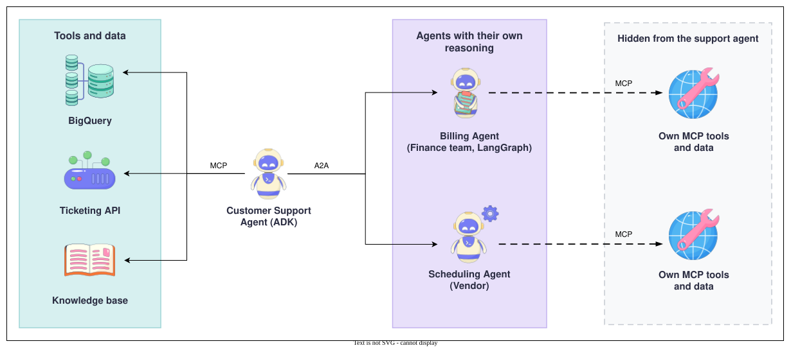

# A2A_Protocol_and_Multi-Agent_Design_for_AI_Systems

Source: https://www.educative.io/courses/forward-deployed-engineer/a2a-and-multi-agent-design

---

[Home](https://www.educative.io/)

[Courses](https://www.educative.io/search?tab=courses)

[Forward Deployed Engineer for AI Systems](https://www.educative.io/courses/forward-deployed-engineer)

# A2A and Multi-Agent Design

Explore how the Agent2Agent protocol enables communication between independent agents and how it differs from MCP. Learn the core A2A concepts, including Agent Cards and tasks, and how to judge when splitting a system into multiple agents is justified.

We'll cover the following...

- [How A2A differs from MCP](https://www.educative.io/courses/forward-deployed-engineer/a2a-and-multi-agent-design#How-A2A-differs-from-MCP)
- [Core concepts in A2A](https://www.educative.io/courses/forward-deployed-engineer/a2a-and-multi-agent-design#Core-concepts-in-A2A)
- [Using A2A with ADK](https://www.educative.io/courses/forward-deployed-engineer/a2a-and-multi-agent-design#Using-A2A-with-ADK)
- [When splitting into multiple agents is worth it](https://www.educative.io/courses/forward-deployed-engineer/a2a-and-multi-agent-design#When-splitting-into-multiple-agents-is-worth-it)
- [Common multi-agent mistakes](https://www.educative.io/courses/forward-deployed-engineer/a2a-and-multi-agent-design#Common-multi-agent-mistakes)

As agent deployments grow, a single agent often stops being enough. A customer may already have agents built by different teams, running on different frameworks, or supplied by different vendors. A billing agent built by the finance team, a network diagnostics agent built by operations, and a vendor’s scheduling agent may all need to work together to resolve one customer request. Connecting these agents requires a different kind of integration than connecting an agent to a database or an API.

The Agent2Agent (A2A) protocol addresses this need. Google introduced A2A in 2025 as an open standard for communication between agents and later contributed it to the Linux Foundation. FDE interviewers expect candidates to explain how A2A differs from MCP and, more importantly, to judge when a multi-agent design is justified. Splitting a system into many agents is easy to propose and often expensive to operate, so the ability to argue for or against it is a strong signal of design judgment.

## How A2A differs from MCP[#](https://www.educative.io/courses/forward-deployed-engineer/a2a-and-multi-agent-design#How-A2A-differs-from-MCP)

MCP and A2A solve different problems, and they are often used together. MCP connects an agent to **tools and data**. The agent calls a tool, receives a result, and stays in control of the reasoning. A2A connects an agent to **another agent**. The calling agent hands off a task, and the remote agent reasons, uses its own tools, and returns a result, sometimes after many steps and with follow-up questions along the way.

|  |  |  |
| --- | --- | --- |
| **Aspect** | **MCP** | **A2A** |
| Connects | An agent to tools, resources, and data | An agent to another agent |
| The other side is | A tool with a defined input and output | An autonomous agent with its own reasoning |
| Interaction style | Single call and result | A task that can run for minutes or longer, with status updates |
| Internal details | Tool schemas are fully exposed | The remote agent’s tools, memory, and prompts stay private |
| Typical use | Query BigQuery, create a ticket | Delegate a billing investigation to the finance team’s agent |

A useful way to remember the difference is that MCP treats the other side as an instrument, while A2A treats it as a colleague. A remote A2A agent is opaque: the calling agent does not see its prompts, tools, or internal state. This opacity is deliberate. It lets separate teams or companies collaborate through agents without exposing proprietary logic or data.

function call

With the distinction clear, the next step is to see how A2A structures communication between agents.

## Core concepts in A2A[#](https://www.educative.io/courses/forward-deployed-engineer/a2a-and-multi-agent-design#Core-concepts-in-A2A)

A2A is built on familiar web standards, including HTTP, JSON-RPC, and server-sent events for streaming. It introduces a small set of concepts.

|  |  |
| --- | --- |
| **Concept** | **Explanation** |
| Agent Card | A JSON document that describes an agent’s identity, skills, endpoint, and authentication requirements |
| Task | A unit of work with a lifecycle, such as submitted, working, input required, completed, or failed |
| Message | A turn of communication between agents, made of parts such as text, files, or structured data |
| Artifact | An output the remote agent produces as the result of a task |

The **Agent Card** is how agents discover each other. It is usually published at a well-known URL on the agent’s server, so a client agent can read it before sending any work. The following example shows a simplified Agent Card for a billing agent.

Ace Editor

1

2

3

4

5

6

7

8

9

10

11

12

13

14

15

16

17

18

19

20

21

{

"name": "Billing Dispute Agent",

"description": "Investigates billing disputes and recommends resolutions.",

"url": "https://billing-agent.example.com/a2a",

"version": "1.2.0",

"capabilities": { "streaming": true, "pushNotifications": false },

"defaultInputModes": ["text/plain"],

"defaultOutputModes": ["text/plain", "application/json"],

"securitySchemes": {

"bearer": { "type": "http", "scheme": "bearer" }

},

"security": [{ "bearer": [] }],

"skills": [

{

"id": "investigate\_dispute",

"name": "Investigate billing dispute",

"description": "Reviews charges on an account and explains any errors.",

"examples": ["Why was I charged twice in March?"]

}

]

}

הההההההההההההההההההההההההההההההההההההההההההההההההההההההההההההההההההההההההההההההההההההההההההההההההההההההההההההההההההההההההההההההההההההההההההההההההההההההההההההההההההההההההההההההההההההההההההההההההההההההההההההההההההההההההההההההההההההההההההההההההההההההההההההההההההההההההההההההההההההההההההההההההההההההההההההההההההההההההההההההההההההההההההההההההההההההההההההההההההההההההההההההההההההההההההההההההההההההההההההההההההההההההההההההההההההההההההההההההההההההההההההההההההההההההההההההההההההההההההההההההההההההההההההההההההההההההההההההה

XXXXXXXXXXXXXXXXXXXXXXXXXXXXXXXXXXXXXXXXXXXXXXXXXXXXXXXXXXXXXXXXXXXXXXXXXXXXXXXXXXXXXXXXXXXXXXXXXXXXXXXXXXXXXXXXXXXXXXXXXXXXXXXXXXXXXXXXXXXXXXXXXXXXXXXXXXXXXXXXXXXXXXXXXXXXXXXXXXXXXXXXXXXXXXXXXXXXXXXXXXXXXXXXXXXXXXXXXXXXXXXXXXXXXXXXXXXXXXXXXXXXXXXXXXXXXXXXXXXXXXXXXXXXXXXXXXXXXXXXXXXXXXXXXXXXXXXXXXXXXXXXXXXXXXXXXXXXXXXXXXXXXXXXXXXXXXXXXXXXXXXXXXXXXXXXXXXXXXXXXXXXXXXXXXXXXXXXXXXXXXXXXXXXXXXXXXXXXXXXXXXXXXXXXXXXXXXXXXXXXXXXXXXXXXXXXXXXXXXXXXXXXXXXXXXXXXXXXXXXXXXXXXXXXXXXXXXXXXXXXXXXXXXXXXXXXXXXXXXXXXXXXXXXXXXX

- **Lines 2–3:** The name and description tell client agents and developers what this agent is for. A coordinating agent’s model reads the description when deciding whether to delegate.
- **Line 4:** The URL is the endpoint where client agents send tasks.
- **Line 5:** The version lets client teams track changes to the agent’s behavior or interface.
- **Line 6:** `capabilities` declares that the agent can stream progress updates but does not send push notifications.
- **Lines 7–8:** Input and output modes state which content types the agent accepts and returns.
- **Lines 9–12:** `securitySchemes` and `security` require a bearer token on every request, so callers must authenticate before delegating work.
- **Lines 13–20:** `skills` lists what the agent can do. Each skill has an ID, a description, and example requests that help callers route work correctly.

A **task** is the central object in an A2A exchange. Because a task has a lifecycle, a remote agent can report that it is working, ask for more information by moving the task to an input-required state, and finally return artifacts when it completes. This makes A2A suitable for long-running work, such as an investigation that takes several minutes, which a single tool call could not handle cleanly.

## Using A2A with ADK[#](https://www.educative.io/courses/forward-deployed-engineer/a2a-and-multi-agent-design#Using-A2A-with-ADK)

ADK supports A2A in both directions. An ADK agent can be exposed as an A2A server, and an ADK agent can call a remote A2A agent as if it were a local sub-agent. The following example shows a support coordinator that delegates billing questions to a remote agent and handles order questions locally.

Ace Editor

1

2

3

4

5

6

7

8

9

10

11

12

13

14

15

16

17

18

19

20

21

22

23

24

25

26

from google.adk.agents import Agent

from google.adk.agents.remote\_a2a\_agent import RemoteA2aAgent, AGENT\_CARD\_WELL\_KNOWN\_PATH

billing\_agent = RemoteA2aAgent(

name="billing\_agent",

description="Investigates billing disputes and duplicate charges.",

agent\_card=f"https://billing-agent.example.com{AGENT\_CARD\_WELL\_KNOWN\_PATH}",

)

order\_agent = Agent(

name="order\_agent",

model=MODEL\_ID,

description="Answers questions about order status and delivery.",

instruction="Use get\_order\_status to answer delivery questions.",

tools=[get\_order\_status],

)

root\_agent = Agent(

name="support\_coordinator",

model=MODEL\_ID,

instruction=(

"Route billing and charge questions to billing\_agent. "

"Route order and delivery questions to order\_agent."

),

sub\_agents=[billing\_agent, order\_agent],

)

הההההההההההההההההההההההההההההההההההההההההההההההההההההההההההההההההההההההההההההההההההההההההההההההההההההההההההההההההההההההההההההההההההההההההההההההההההההההההההההההההההההההההההההההההההההההההההההההההההההההההההההההההההההההההההההההההההההההההההההההההההההההההההההההההההההההההההההההההההההההההההההההההההההההההההההההההההההההההההההההההההההההההההההההההההההההההההההההההההההההההההההההההההההההההההההההההההההההההההההההההההההההההההההההההההההההההההההההההההההההההההההההההההההההההההההההההההההההההההההההההההההההההההההההההההההההההההההההה

XXXXXXXXXXXXXXXXXXXXXXXXXXXXXXXXXXXXXXXXXXXXXXXXXXXXXXXXXXXXXXXXXXXXXXXXXXXXXXXXXXXXXXXXXXXXXXXXXXXXXXXXXXXXXXXXXXXXXXXXXXXXXXXXXXXXXXXXXXXXXXXXXXXXXXXXXXXXXXXXXXXXXXXXXXXXXXXXXXXXXXXXXXXXXXXXXXXXXXXXXXXXXXXXXXXXXXXXXXXXXXXXXXXXXXXXXXXXXXXXXXXXXXXXXXXXXXXXXXXXXXXXXXXXXXXXXXXXXXXXXXXXXXXXXXXXXXXXXXXXXXXXXXXXXXXXXXXXXXXXXXXXXXXXXXXXXXXXXXXXXXXXXXXXXXXXXXXXXXXXXXXXXXXXXXXXXXXXXXXXXXXXXXXXXXXXXXXXXXXXXXXXXXXXXXXXXXXXXXXXXXXXXXXXXXXXXXXXXXXXXXXXXXXXXXXXXXXXXXXXXXXXXXXXXXXXXXXXXXXXXXXXXXXXXXXXXXXXXXXXXXXXXXXXXXXX

- **Line 2:** We import `RemoteA2aAgent`, which represents an agent running elsewhere, and the standard path where Agent Cards are published.
- **Lines 4–8:** `billing_agent` is a remote agent. ADK reads its Agent Card from the given URL to learn its endpoint and requirements.
- **Line 6:** The local description tells the coordinator when to delegate to this agent.
- **Lines 10–16:** `order_agent` is a regular local ADK agent with its own tool.
- **Lines 18–26:** The coordinator is an LLM agent whose job is routing, not answering.
- **Lines 21–24:** The instruction defines clear routing rules, which reduces misrouted requests.
- **Line 25:** `sub_agents` lists both agents. The coordinator treats the remote and local agents the same way, and ADK handles the A2A communication behind the scenes.

Being able to connect agents is different from needing to. The more important design question is when a multi-agent system is worth building.

## When splitting into multiple agents is worth it[#](https://www.educative.io/courses/forward-deployed-engineer/a2a-and-multi-agent-design#When-splitting-into-multiple-agents-is-worth-it)

A multi-agent design adds real costs. Each handoff adds latency and model calls, which increases cost. Context can be lost or distorted between agents, errors in one agent can compound in the next, and debugging requires tracing a request across several systems. For many first releases, a single agent with a well-chosen set of tools performs better and is far easier to evaluate.

Splitting is justified when it solves a specific problem that a single agent cannot solve well.

|  |  |
| --- | --- |
| **Problem** | **Detal** |
| Separate ownership | Different teams or vendors build and maintain each capability |
| Separate security boundaries | Parts of the work require different permissions or data access that should not be combined |
| Too many tools for one agent | Tool selection accuracy drops when one agent has a large, mixed set of tools |
| Different model needs | Some steps need a fast Flash model, while others need deeper Pro-level reasoning |
| Independent parallel work | Subtasks can run at the same time without depending on each other |
| Existing agents to reuse | The customer already runs agents that can be connected through A2A |

If none of these signals is present, the strongest design is usually a single agent. If one or two are present, the next choice is the pattern. A coordinator that routes requests to specialists suits support scenarios with distinct domains. A sequential pipeline suits fixed processes, such as extract, validate, then summarize. A parallel pattern suits independent research or checks whose results are combined at the end.

In a design interview, stating why a single agent is not enough is more persuasive than describing a multi-agent architecture. A sentence such as “The billing agent is owned by the finance team and needs access to payment data that the support agent should never see, so we keep them separate and connect them through A2A” ties the split to a real constraint.

## Common multi-agent mistakes[#](https://www.educative.io/courses/forward-deployed-engineer/a2a-and-multi-agent-design#Common-multi-agent-mistakes)

Several mistakes recur in both interviews and real deployments. The first is splitting by job title, creating a “researcher,” a “writer,” and a “reviewer,” when a single agent with clear instructions would perform the same work faster. The second is adding agents to compensate for unclear requirements rather than clarifying the scope. The third is ignoring identity across handoffs, so a remote agent acts with broad service permissions instead of the original user’s access. The last is evaluating only the final answer, which hides which agent caused a failure. Production multi-agent systems need tracing and evaluation at each handoff.

A2A and MCP together give FDEs a complete set of connections: MCP links agents to the tools and data they use, and A2A links agents to one another across teams, frameworks, and organizations. The protocols make multi-agent systems possible, but the design judgment lies in knowing when to use them. A strong FDE starts with the simplest design that meets the scope and adds agents only when ownership, security, tool complexity, or model needs give a clear reason to do so.

MCP Tool Integration

Grounding and Enterprise Retrieval

Ask

[How A2A differs from MCP](https://www.educative.io/courses/forward-deployed-engineer/a2a-and-multi-agent-design#How-A2A-differs-from-MCP)

[Core concepts in A2A](https://www.educative.io/courses/forward-deployed-engineer/a2a-and-multi-agent-design#Core-concepts-in-A2A)

[Using A2A with ADK](https://www.educative.io/courses/forward-deployed-engineer/a2a-and-multi-agent-design#Using-A2A-with-ADK)

[When splitting into multiple agents is worth it](https://www.educative.io/courses/forward-deployed-engineer/a2a-and-multi-agent-design#When-splitting-into-multiple-agents-is-worth-it)

[Common multi-agent mistakes](https://www.educative.io/courses/forward-deployed-engineer/a2a-and-multi-agent-design#Common-multi-agent-mistakes)