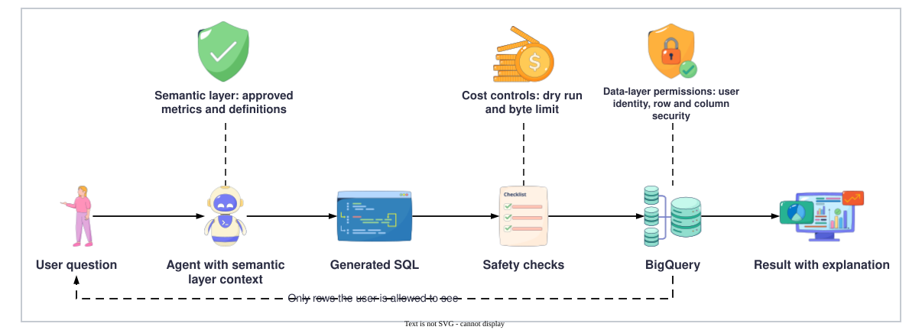

# BigQuery_and_Text-to-SQL_Best_Practices_for_Google_FDE

Source: https://www.educative.io/courses/forward-deployed-engineer/bigquery-and-text-to-sql

---

[Home](https://www.educative.io/)

[Courses](https://www.educative.io/search?tab=courses)

[Forward Deployed Engineer for AI Systems](https://www.educative.io/courses/forward-deployed-engineer)

# BigQuery and Text-to-SQL

Explore why Text-to-SQL pilots often fail between demonstration and production, from ambiguous business terms to uncontrolled costs. Learn to apply three key safeguards: semantic layers for meaning, cost controls for spending, and permissions enforced in the data layer.

We'll cover the following...

- [Why Text-to-SQL pilots fail](https://www.educative.io/courses/forward-deployed-engineer/bigquery-and-text-to-sql#Why-Text-to-SQL-pilots-fail)
- [Safeguard 1: A semantic layer](https://www.educative.io/courses/forward-deployed-engineer/bigquery-and-text-to-sql#Safeguard-1-A-semantic-layer)
- [Safeguard 2: Cost controls](https://www.educative.io/courses/forward-deployed-engineer/bigquery-and-text-to-sql#Safeguard-2-Cost-controls)
- [Safeguard 3: Permissions enforced in the data layer](https://www.educative.io/courses/forward-deployed-engineer/bigquery-and-text-to-sql#Safeguard-3-Permissions-enforced-in-the-data-layer)
- [Evaluating Text-to-SQL](https://www.educative.io/courses/forward-deployed-engineer/bigquery-and-text-to-sql#Evaluating-Text-to-SQL)

Many enterprise customers keep their most valuable data in BigQuery: sales, usage, billing, network events, and customer records. A natural request follows soon after any GenAI pilot begins: “Can business users just ask questions in plain English and get answers from our data?” Text-to-SQL, where a model translates a natural language question into a SQL query, appears to answer that request directly. Early demonstrations are often impressive, since a model can write a correct query against a small, clean sample schema within seconds.

Production is a different matter. Many Text-to-SQL pilots stall between demonstration and rollout, and the reasons are rarely about the model’s ability to write SQL. They involve ambiguous business definitions, unexpected query costs, and data access rules the agent was never designed to respect. FDE interviewers use Text-to-SQL scenarios frequently because they reveal whether a candidate thinks about data systems the way a customer’s data and security teams do.

## Why Text-to-SQL pilots fail[#](https://www.educative.io/courses/forward-deployed-engineer/bigquery-and-text-to-sql#Why-Text-to-SQL-pilots-fail)

The most serious failure in Text-to-SQL is not a query that crashes. It is a query that runs successfully and returns a plausible but wrong number. A sales director who receives an incorrect revenue figure has no obvious way to detect the error, and once one wrong number is discovered, trust in the whole system drops sharply.

Several causes account for most of these failures.

|  |  |
| --- | --- |
| Cause | What happens |
| Ambiguous business terms | “Active customer” or “revenue” has a specific internal definition that the model does not know |
| Unclear schemas | Columns such as amt\_2 or status\_cd give the model little to work with |
| Complex joins | The model joins tables on the wrong keys, duplicating or dropping rows |
| Unbounded queries | A query scans an entire multi-terabyte table, creating unexpected cost |
| Broad access | The agent runs under a powerful service account and returns data the user should not see |
| No evaluation | The team has no set of known questions and correct answers to measure accuracy |

Each of these causes has a corresponding safeguard. Three safeguards matter most: a semantic layer for meaning, cost controls for spending, and permissions enforced in the data layer for access.

Text to SQL

The first safeguard addresses the most common failure: the gap between business language and database structure.

## Safeguard 1: A semantic layer[#](https://www.educative.io/courses/forward-deployed-engineer/bigquery-and-text-to-sql#Safeguard-1-A-semantic-layer)

A semantic layer defines business concepts, such as metrics, dimensions, and relationships, once, in a governed location. Instead of asking the model to infer what “revenue” means from raw tables, the system gives it approved definitions to work from. The model’s task becomes selecting the right defined metric and filters rather than inventing the calculation.

In Google Cloud, Looker’s modeling language, LookML, is a common semantic layer. The following example defines an “active customers” metric.

Ace Editor

1

2

3

4

5

6

measure: active\_customers {

type: count\_distinct

sql: ${customer\_id} ;;

filters: [last\_activity\_date: "30 days"]

description: "Customers with any billable activity in the last 30 days."

}

הההההההההההההההההההההההההההההההההההההההההההההההההההההההההההההההההההההההההההההההההההההההההההההההההההההההההההההההההההההההההההההההההההההההההההההההההההההההההההההההההההההההההההההההההההההההההההההההההההההההההההההההההההההההההההההההההההההההההההההההההההההההההההההההההההההההההההההההההההההההההההההההההההההההההההההההההההההההההההההההההההההההההההההההההההההההההההההההההההההההההההההההההההההההההההההההההההההההההההההההההההההההההההההההההההההההההההההההההההההההההההההההההההההההההההההההההההההההההההההההההההההההההההההההההההההההההההההההה

XXXXXXXXXXXXXXXXXXXXXXXXXXXXXXXXXXXXXXXXXXXXXXXXXXXXXXXXXXXXXXXXXXXXXXXXXXXXXXXXXXXXXXXXXXXXXXXXXXXXXXXXXXXXXXXXXXXXXXXXXXXXXXXXXXXXXXXXXXXXXXXXXXXXXXXXXXXXXXXXXXXXXXXXXXXXXXXXXXXXXXXXXXXXXXXXXXXXXXXXXXXXXXXXXXXXXXXXXXXXXXXXXXXXXXXXXXXXXXXXXXXXXXXXXXXXXXXXXXXXXXXXXXXXXXXXXXXXXXXXXXXXXXXXXXXXXXXXXXXXXXXXXXXXXXXXXXXXXXXXXXXXXXXXXXXXXXXXXXXXXXXXXXXXXXXXXXXXXXXXXXXXXXXXXXXXXXXXXXXXXXXXXXXXXXXXXXXXXXXXXXXXXXXXXXXXXXXXXXXXXXXXXXXXXXXXXXXXXXXXXXXXXXXXXXXXXXXXXXXXXXXXXXXXXXXXXXXXXXXXXXXXXXXXXXXXXXXXXXXXXXXXXXXXXXXX

- **Line 1:** The measure is named `active_customers`, matching the term business users actually use.
- **Line 2:** `count_distinct` counts each customer once, avoiding inflated totals caused by duplicate rows.
- **Line 3:** The SQL expression identifies which column is being counted.
- **Line 4:** The filter encodes the business definition of “active” as activity within the last 30 days.
- **Line 5:** The description gives both people and models a plain-language explanation of the metric.

When a semantic layer is not available, a lighter version can still help. The team can provide the model with curated table descriptions, column explanations, approved join paths, and a set of example questions paired with correct SQL. BigQuery table and column descriptions are a practical place to store this context, since they stay with the data. Even this lighter approach reduces errors significantly compared to giving the model a raw schema.

In an interview, proposing to start with a small set of well-defined metrics, such as the ten questions business users ask most often, shows good scoping judgment. Broad, open-ended Text-to-SQL over an entire data warehouse is rarely a sound first release.

Correct meaning is not enough on its own. A correct query can still be too expensive to run.

## Safeguard 2: Cost controls[#](https://www.educative.io/courses/forward-deployed-engineer/bigquery-and-text-to-sql#Safeguard-2-Cost-controls)

BigQuery’s on-demand pricing is based on the amount of data a query scans. A model that writes `SELECT *` against a large event table, or forgets a date filter on a partitioned table, can scan terabytes in a single query. Across many users, this can produce costs the customer did not plan for.

BigQuery provides two useful controls. A **dry run** estimates how many bytes a query would process without running it, and the **maximum bytes billed** setting causes a query to fail if it would exceed a limit. The following function applies both before running model-generated SQL.

Ace Editor

1

2

3

4

5

6

7

8

9

10

11

12

13

14

15

16

17

18

19

from google.cloud import bigquery

MAX\_BYTES = 10 \* 1024\*\*3 # 10 GB limit per query

def run\_generated\_sql(sql: str, user\_credentials) -> list[dict]:

client = bigquery.Client(project="PROJECT\_ID", credentials=user\_credentials)

if not sql.lstrip().lower().startswith(("select", "with")):

raise ValueError("Only read queries are allowed.")

estimate = client.query(sql, job\_config=bigquery.QueryJobConfig(dry\_run=True, use\_query\_cache=False))

if estimate.total\_bytes\_processed > MAX\_BYTES:

raise ValueError(f"Query would scan {estimate.total\_bytes\_processed:,} bytes, above the limit.")

job = client.query(sql, job\_config=bigquery.QueryJobConfig(

maximum\_bytes\_billed=MAX\_BYTES,

labels={"source": "text\_to\_sql\_agent"},

))

return [dict(row) for row in job.result(max\_results=1000)]

הההההההההההההההההההההההההההההההההההההההההההההההההההההההההההההההההההההההההההההההההההההההההההההההההההההההההההההההההההההההההההההההההההההההההההההההההההההההההההההההההההההההההההההההההההההההההההההההההההההההההההההההההההההההההההההההההההההההההההההההההההההההההההההההההההההההההההההההההההההההההההההההההההההההההההההההההההההההההההההההההההההההההההההההההההההההההההההההההההההההההההההההההההההההההההההההההההההההההההההההההההההההההההההההההההההההההההההההההההההההההההההההההההההההההההההההההההההההההההההההההההההההההההההההההההההההההההההההה

XXXXXXXXXXXXXXXXXXXXXXXXXXXXXXXXXXXXXXXXXXXXXXXXXXXXXXXXXXXXXXXXXXXXXXXXXXXXXXXXXXXXXXXXXXXXXXXXXXXXXXXXXXXXXXXXXXXXXXXXXXXXXXXXXXXXXXXXXXXXXXXXXXXXXXXXXXXXXXXXXXXXXXXXXXXXXXXXXXXXXXXXXXXXXXXXXXXXXXXXXXXXXXXXXXXXXXXXXXXXXXXXXXXXXXXXXXXXXXXXXXXXXXXXXXXXXXXXXXXXXXXXXXXXXXXXXXXXXXXXXXXXXXXXXXXXXXXXXXXXXXXXXXXXXXXXXXXXXXXXXXXXXXXXXXXXXXXXXXXXXXXXXXXXXXXXXXXXXXXXXXXXXXXXXXXXXXXXXXXXXXXXXXXXXXXXXXXXXXXXXXXXXXXXXXXXXXXXXXXXXXXXXXXXXXXXXXXXXXXXXXXXXXXXXXXXXXXXXXXXXXXXXXXXXXXXXXXXXXXXXXXXXXXXXXXXXXXXXXXXXXXXXXXXXXXX

- **Line 3:** The byte limit is defined once as a business rule, so it can be reviewed and adjusted with the customer.
- **Line 5:** The function receives the signed-in user’s credentials rather than a shared service account.
- **Line 6:** The BigQuery client runs as that user, so BigQuery applies the user’s own permissions to every query.
- **Lines 8–9:** A basic check rejects anything other than read queries. This is a first filter only; the real protection is that the user’s credentials have read-only access.
- **Line 11:** A dry run estimates bytes processed without running the query or incurring query cost.
- **Lines 12–13:** If the estimate exceeds the limit, the function stops and returns a clear reason, which the agent can use to ask the user to narrow the question.
- **Line 16:** `maximum_bytes_billed` enforces the limit inside BigQuery itself, protecting against cases where the estimate and actual usage differ.
- **Line 17:** A label tags the query as coming from the agent, which makes its cost easy to track in billing reports.
- **Line 19:** `max_results` caps the number of rows returned to the agent, which keeps responses manageable and limits data exposure in the model’s context.

Partitioned and clustered tables, along with curated views that include required date filters, reduce cost further by limiting how much data a query can scan in the first place.

The final safeguard determines which data a query is allowed to return at all.

## Safeguard 3: Permissions enforced in the data layer[#](https://www.educative.io/courses/forward-deployed-engineer/bigquery-and-text-to-sql#Safeguard-3-Permissions-enforced-in-the-data-layer)

The most important rule in Text-to-SQL security is that the model must never be the component deciding who can see what. Instructions such as “only show data for the user’s region” can be bypassed by a cleverly worded question or simply ignored. Access rules belong in BigQuery, where they apply to every query regardless of how it was written.

BigQuery offers several mechanisms for this. **Row-level security** restricts which rows a user can see. **Column-level security**, using policy tags, restricts access to sensitive columns such as personal information. **Authorized views** expose a curated subset of data without granting access to the underlying tables. The following example creates a row access policy.

Ace Editor

1

2

3

4

CREATE ROW ACCESS POLICY emea\_sales\_only

ON `PROJECT\_ID.sales.orders`

GRANT TO ("group:emea-sales@example.com")

FILTER USING (region = "EMEA");

הההההההההההההההההההההההההההההההההההההההההההההההההההההההההההההההההההההההההההההההההההההההההההההההההההההההההההההההההההההההההההההההההההההההההההההההההההההההההההההההההההההההההההההההההההההההההההההההההההההההההההההההההההההההההההההההההההההההההההההההההההההההההההההההההההההההההההההההההההההההההההההההההההההההההההההההההההההההההההההההההההההההההההההההההההההההההההההההההההההההההההההההההההההההההההההההההההההההההההההההההההההההההההההההההההההההההההההההההההההההההההההההההההההההההההההההההההההההההההההההההההההההההההההההההההההההההההההההה

XXXXXXXXXXXXXXXXXXXXXXXXXXXXXXXXXXXXXXXXXXXXXXXXXXXXXXXXXXXXXXXXXXXXXXXXXXXXXXXXXXXXXXXXXXXXXXXXXXXXXXXXXXXXXXXXXXXXXXXXXXXXXXXXXXXXXXXXXXXXXXXXXXXXXXXXXXXXXXXXXXXXXXXXXXXXXXXXXXXXXXXXXXXXXXXXXXXXXXXXXXXXXXXXXXXXXXXXXXXXXXXXXXXXXXXXXXXXXXXXXXXXXXXXXXXXXXXXXXXXXXXXXXXXXXXXXXXXXXXXXXXXXXXXXXXXXXXXXXXXXXXXXXXXXXXXXXXXXXXXXXXXXXXXXXXXXXXXXXXXXXXXXXXXXXXXXXXXXXXXXXXXXXXXXXXXXXXXXXXXXXXXXXXXXXXXXXXXXXXXXXXXXXXXXXXXXXXXXXXXXXXXXXXXXXXXXXXXXXXXXXXXXXXXXXXXXXXXXXXXXXXXXXXXXXXXXXXXXXXXXXXXXXXXXXXXXXXXXXXXXXXXXXXXXXXX

- **Line 1:** We create a named row access policy, which makes it easy to audit and update.
- **Line 2:** The policy applies to the `orders` table in the `sales` dataset.
- **Line 3:** The policy grants access to members of the EMEA sales group.
- **Line 4:** Members of that group see only rows where the region is EMEA. Any query they run, including one generated by the agent, is filtered automatically.

These controls work only when queries run under the end user’s identity, as in the earlier Python function. If the agent uses a single, highly privileged service account for every request, row-level and column-level security cannot distinguish one user from another. Identity must flow from the user’s session, through the agent, to BigQuery.

## Evaluating Text-to-SQL[#](https://www.educative.io/courses/forward-deployed-engineer/bigquery-and-text-to-sql#Evaluating-Text-to-SQL)

Safeguards reduce risk, but accuracy still has to be measured. A strong evaluation set contains real questions from business users, each paired with a verified correct answer. Comparing result sets, rather than comparing SQL text, is the more reliable method, since two different queries can produce the same correct result. Tracking which questions fail, and why, shows whether the fix belongs in the semantic layer, the schema descriptions, or the prompt.

Text-to-SQL can give business users fast access to enterprise data, but its success depends far more on the surrounding system than on the model’s SQL ability. A semantic layer gives the model reliable business definitions, cost controls keep spending predictable, and permissions enforced in BigQuery ensure users see only the data they are entitled to. FDEs who design these safeguards from the start, and who scope the first release to a small set of well-defined questions, give the customer a system that can move past the demonstration stage and into daily use.

Grounding and Enterprise Retrieval

Enterprise Data Pipelines

Ask

[Why Text-to-SQL pilots fail](https://www.educative.io/courses/forward-deployed-engineer/bigquery-and-text-to-sql#Why-Text-to-SQL-pilots-fail)

[Safeguard 1: A semantic layer](https://www.educative.io/courses/forward-deployed-engineer/bigquery-and-text-to-sql#Safeguard-1-A-semantic-layer)

[Safeguard 2: Cost controls](https://www.educative.io/courses/forward-deployed-engineer/bigquery-and-text-to-sql#Safeguard-2-Cost-controls)

[Safeguard 3: Permissions enforced in the data layer](https://www.educative.io/courses/forward-deployed-engineer/bigquery-and-text-to-sql#Safeguard-3-Permissions-enforced-in-the-data-layer)

[Evaluating Text-to-SQL](https://www.educative.io/courses/forward-deployed-engineer/bigquery-and-text-to-sql#Evaluating-Text-to-SQL)