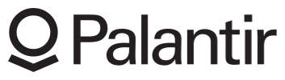

# Palantir_Forward_Deployed_AI_Engineer_Interview_Guide

Source: https://www.educative.io/courses/forward-deployed-engineer/interview-guide-palantir-forward-deployed-ai-engineers

---

[Home](https://www.educative.io/)

[Courses](https://www.educative.io/search?tab=courses)

[Forward Deployed Engineer for AI Systems](https://www.educative.io/courses/forward-deployed-engineer)

# Interview Guide: Palantir Forward Deployed AI Engineers

Understand the Palantir Forward Deployed AI Engineer role and its customer-focused responsibilities. Learn how to navigate each interview stage from coding and decomposition to system design and the hiring manager round. Develop the ability to operate under ambiguous conditions while addressing real enterprise constraints.

We'll cover the following...

- [The role and its requirements](https://www.educative.io/courses/forward-deployed-engineer/interview-guide-palantir-forward-deployed-ai-engineers#The-role-and-its-requirements)
- [Palantir’s engineering tracks](https://www.educative.io/courses/forward-deployed-engineer/interview-guide-palantir-forward-deployed-ai-engineers#Palantirs-engineering-tracks)
- [The interview loop](https://www.educative.io/courses/forward-deployed-engineer/interview-guide-palantir-forward-deployed-ai-engineers#The-interview-loop)
  - [The take-home project](https://www.educative.io/courses/forward-deployed-engineer/interview-guide-palantir-forward-deployed-ai-engineers#The-take-home-project)
  - [The coding round](https://www.educative.io/courses/forward-deployed-engineer/interview-guide-palantir-forward-deployed-ai-engineers#The-coding-round)
  - [The learning interview](https://www.educative.io/courses/forward-deployed-engineer/interview-guide-palantir-forward-deployed-ai-engineers#The-learning-interview)
  - [The decomposition interview](https://www.educative.io/courses/forward-deployed-engineer/interview-guide-palantir-forward-deployed-ai-engineers#The-decomposition-interview)
  - [The systems design round](https://www.educative.io/courses/forward-deployed-engineer/interview-guide-palantir-forward-deployed-ai-engineers#The-systems-design-round)
  - [The hiring manager round](https://www.educative.io/courses/forward-deployed-engineer/interview-guide-palantir-forward-deployed-ai-engineers#The-hiring-manager-round)

Palantir is a US data analytics and AI platform company that builds software for government agencies, defense organizations, and commercial enterprises. The company pioneered the Forward Deployed Engineer role and the interview formats that have since spread across the industry.

As enterprise demand for hands-on AI deployment has grown, Palantir has expanded its Forward Deployed AI Engineer hiring significantly. Before looking at the interview itself, it helps to understand exactly what this role involves and what Palantir is looking for in candidates.

## The role and its requirements[#](https://www.educative.io/courses/forward-deployed-engineer/interview-guide-palantir-forward-deployed-ai-engineers#The-role-and-its-requirements)

The Forward Deployed AI Engineer owns the end-to-end design and delivery of AI systems with enterprise customers. This is a customer-facing engineering role. The work happens inside the customer’s environment, against the customer’s data and on the customer’s timeline.

The role operates within Palantir's proprietary platform stack.

- Foundry is Palantir's data operations platform, where customer data is ingested, modeled, and made queryable.
- AIP (Artificial Intelligence Platform) is Palantir's generative AI layer built on top of Foundry, and it is where LLM workflows and AI agents are built and deployed.

According to Palantir’s published job description, core responsibilities include the following.

- Building LLM workflows using AIP.
- Designing and deploying AI agents in AIP Agent Studio, Palantir’s tool for creating and configuring agents within the Foundry environment.
- Building operational applications in Workshop, Palantir’s application-building layer within Foundry.
- Maintaining Foundry data pipelines through the full delivery lifecycle.
- Managing customer relationships and setting AI strategy with enterprise stakeholders.

On the requirements side, Palantir expects candidates to bring hands-on experience building AI systems, familiarity with data pipeline design, the ability to write and ship production-quality code independently, and comfort working in fast-changing, ambiguous environments. Strong communication is equally important because the AI FDE works with both technical and non-technical stakeholders throughout every engagement.

Understanding where this role sits within Palantir's engineering structure explains why the interview is built the way it is.

## Palantir’s engineering tracks[#](https://www.educative.io/courses/forward-deployed-engineer/interview-guide-palantir-forward-deployed-ai-engineers#Palantirs-engineering-tracks)

Palantir organizes its engineering into two tracks.

- **Dev track:** The Dev track builds and maintains the core Palantir platforms, including Foundry, Gotham, and AIP.
- **Delta track:** The Delta track deploys those platforms inside customer environments, configuring and extending them to fit each organization’s specific needs. The Forward Deployed AI Engineer is a Delta role.

Delta engineers do not build the platform. They build solutions on top of it, inside a customer’s organization, on a customer’s timeline. This distinction matters because it shapes every round in the interview. Palantir is not testing whether we can build a platform from scratch. It is testing whether we can operate effectively inside an organization where the problem is not yet defined, the tools are not yet familiar, and the deadline belongs to someone else. Every round reflects that condition, and the interview loop itself is structured to surface those qualities directly.

## The interview loop[#](https://www.educative.io/courses/forward-deployed-engineer/interview-guide-palantir-forward-deployed-ai-engineers#The-interview-loop)

The AI FDE interview runs 5 to 6 rounds over 28 to 35 days. The core evaluation happens during the virtual onsite, sometimes called Palantir Day, which combines the learning interview, decomposition interview, and systems design into a single multi-hour session. The table below maps the full sequence.

|  |  |  |  |
| --- | --- | --- | --- |
| **Round** | **Format** | **Duration** | **What It Tests** |
| Recruiter screen | Phone | 30 min | Background, motivation, mission alignment |
| Take-home project | Async | 3 to 4 hours | Practical delivery using Foundry and AIP tools |
| Coding round | HackerRank or CodePair | 60 min | Debugging, data handling, SQL, API integration |
| Learning interview | Live, CodePair | 60 min | Mental model formation from unfamiliar documentation |
| Decomposition interview | Live | 60 min | Problem analysis and AI agent design |
| Systems design | Live | 60 min | LLM workflow and pipeline design for enterprise conditions |
| Hiring manager | Live | 45 to 60 min | Customer judgment and individual ownership |

The sections below walk through each substantive round in the order it typically appears.

### The take-home project[#](https://www.educative.io/courses/forward-deployed-engineer/interview-guide-palantir-forward-deployed-ai-engineers#The-take-home-project)

The take-home project is the first real evaluation step after the recruiter screen. Palantir gives candidates an open-ended brief and asks them to build something using Foundry and AIP tools within 3 to 4 hours.

- **What it involves:** The submission includes working output and a written or recorded walkthrough explaining the decisions made. The brief is intentionally open-ended, which means scope decisions are part of the evaluation, not a precondition for starting.
- **What the interviewer evaluates:** The walkthrough carries as much weight as the working code. Interviewers are evaluating how we make decisions when the brief is ambiguous. What we chose to build, what we left out, and whether we can articulate the reasoning behind each choice are all part of that assessment. A submission that is narrow and complete with a clear explanation of scope decisions performs better than one that covers more ground but explains nothing.
- **How to perform well:** Treat every ambiguous requirement as a design decision to name explicitly in the walkthrough. Build end-to-end and narrow rather than broad and incomplete. Acknowledge what the submission does not cover and explain why that scope was the right call given the available time.

The coding round follows and tests how we work with unfamiliar code and data tasks under a time constraint.

### The coding round[#](https://www.educative.io/courses/forward-deployed-engineer/interview-guide-palantir-forward-deployed-ai-engineers#The-coding-round)

The coding round is conducted on HackerRank or in a live CodePair session. It is a practical engineering round focused on working with unfamiliar code, data, and APIs under time pressure.

- **What it involves:** Tasks that commonly appear include finding and fixing bugs distributed across a large code file, writing Python code to parse and clean a dataset, writing SQL queries without an execution environment to run them in, and building or calling an API endpoint with correct error handling. Some candidates also encounter a LeetCode-medium level algorithmic problem, though this is not the primary focus of the round.
- **What the interviewer evaluates:** Interviewers are assessing whether we can move through unfamiliar code systematically and arrive at working, readable solutions within the time available. Speed matters less than approach.
- **How to perform well:** Prioritize clean and readable code over optimization. When writing SQL queries from memory, narrate what the query needs to return before writing it, so the reasoning is visible even if a small syntax error appears in the final output. For debugging tasks, scan the full file before editing any specific lines.

The learning interview follows and is where this loop most distinctly differs from standard technical screens.

### The learning interview[#](https://www.educative.io/courses/forward-deployed-engineer/interview-guide-palantir-forward-deployed-ai-engineers#The-learning-interview)

The learning interview is a format Palantir developed that no other company in this space runs in the same way. Most candidates are least prepared for this round going into the loop, and it is the one that most consistently separates candidates who have only prepared technically from those who have built the underlying habits the role demands.

- **What it involves:** The interviewer provides an unfamiliar system, API, or proprietary query syntax at the start of the session, along with minimal documentation. We then work through four problems of increasing difficulty using the interviewer as an active resource throughout. A common example is receiving a graph database with a proprietary query syntax and implementing a series of operations using only the documentation provided at the start.
- **What the interviewer evaluates:** The round tests how we learn under a real constraint, not how much we already know. Interviewers watch for how quickly a working mental model forms from limited information, the quality and specificity of questions asked along the way, and whether forward progress is maintained when the material is genuinely unfamiliar.
- **How to perform well:** Use the interviewer throughout the session. Asking specific questions is a positive signal, not a sign of weakness. The session is explicitly designed to require that input. Pretending to understand the material and staying silent when blocked are the two behaviors that consistently fail this round. Before the interview, practice reading documentation for an unfamiliar API and building something specific from it within 30 minutes. The goal is to develop questioning instincts, not familiarity with any particular tool.

The decomposition interview tests a related skill, working toward a clear output when the starting point is deliberately underspecified.

### The decomposition interview[#](https://www.educative.io/courses/forward-deployed-engineer/interview-guide-palantir-forward-deployed-ai-engineers#The-decomposition-interview)

The decomposition interview is the format Palantir originated, and the round it weighs most heavily across the loop. The prompts are vague by design, and there is no single correct answer. Sixty minutes are available to work through it.

- **What it involves:** We receive a large-scale enterprise problem with no defined scope and are asked to break it down, ask clarifying questions, and arrive at a specific problem statement. Two prompt formats reflect the current range.

  - **Classic prompt:** A city has 911 call data, traffic data, and ambulance GPS data. The ask is to reduce emergency response times. Scope and constraints are left entirely undefined.
  - **2026 AI FDE variant:** Design an AI agent for automated shipment rerouting using real-time weather APIs and SAP data, define an evaluation framework, and ensure the agent does not overspend while maintaining contracted delivery rates. After the problem statement, candidates also name the tools the agent calls, select an orchestration pattern, and define evaluation criteria for the agent’s outputs.
- **What the interviewer evaluates:** Interviewers assess whether we stop to ask the right questions before proposing anything and whether we arrive at a problem statement specific enough to design from. The evaluation signal accumulates most in the clarifying questions phase, not in the solution.
- **How to perform well:** Resist the instinct to propose a solution early. Spend the first ten minutes asking questions that establish who the end users are, what data exists and who controls it, and what threshold constitutes a working solution. State assumptions out loud. Close with a problem statement that is meaningfully more specific than the one given at the start.

The system design round takes the constraints surfaced in the decomposition and applies them to a full architecture.

### The systems design round[#](https://www.educative.io/courses/forward-deployed-engineer/interview-guide-palantir-forward-deployed-ai-engineers#The-systems-design-round)

The systems design round focuses on LLM workflow architecture and data pipeline design for enterprise conditions. Prompts are drawn from Palantir’s real customer domains and carry real enterprise constraints.

- **What it involves:** Candidates are given a scenario and asked to design an LLM-based system that fits the constraints in the prompt. Data residency, access controls, legacy system integration, and audit requirements all appear in these scenarios and must be addressed as part of the design.
- **What the interviewer evaluates:** Interviewers are evaluating whether our design reflects the actual constraints in the scenario rather than the ideal architecture for a clean-slate environment. Evaluation methodology also carries significant weight. Naming what good output looks like and how it will be measured is a design component, not a separate discussion.
- **How to perform well:** Ask a brief round of clarifying questions before designing, carry that constraint-first approach through the architecture discussion, and treat the evaluation framework with the same depth as component selection.

The hiring manager round shifts focus from architecture to how we operate with and for customers.

### The hiring manager round[#](https://www.educative.io/courses/forward-deployed-engineer/interview-guide-palantir-forward-deployed-ai-engineers#The-hiring-manager-round)

The hiring manager round is a conversation about past customer-facing experience, how we handle ambiguity in real deployments, and genuine motivation for the role. It may also include a follow-up on a decision made in a prior round.

- **What it involves:** The interviewer asks about specific past projects, situations where we navigated ambiguity or conflict, and what draws us to this kind of role. There are no technical problems to solve, but the framing of past work is itself what is being evaluated.
- **What the interviewer evaluates:** Interviewers listen for how we frame experience. Describing a project in terms of the customer constraint faced and what changed for the customer carries more signal than describing the architecture or the engineering achievement. Individual ownership matters directly in this round. Using “I” rather than “we” when describing past decisions is the surface marker. The deeper signal is whether we can name a specific decision, explain the reasoning behind it, and state the outcome it produced.
- **How to perform well:** Prepare two or three past project examples framed as customer situations. For each, describe the constraint faced, the decision made under that constraint, and what changed for the customer as a result. Keep technical detail proportional to what the stakeholder in the story needs to understand.

Across all rounds, Palantir is evaluating the same underlying quality. The ability to operate effectively in an environment where the problem, the tools, and the constraints are all partially defined is what each round surfaces in a different way. Preparing for the formats specific to this loop, particularly the learning interview and decomposition round, is the most direct way to build that readiness before the process begins.

FDE Architecture Interview

Palantir FDSE: Foundry, Gotham, AIP, and the Ontology

Ask

[The role and its requirements](https://www.educative.io/courses/forward-deployed-engineer/interview-guide-palantir-forward-deployed-ai-engineers#The-role-and-its-requirements)

[Palantir’s engineering tracks](https://www.educative.io/courses/forward-deployed-engineer/interview-guide-palantir-forward-deployed-ai-engineers#Palantirs-engineering-tracks)

[The interview loop](https://www.educative.io/courses/forward-deployed-engineer/interview-guide-palantir-forward-deployed-ai-engineers#The-interview-loop)

[The take-home project](https://www.educative.io/courses/forward-deployed-engineer/interview-guide-palantir-forward-deployed-ai-engineers#The-take-home-project)

[The coding round](https://www.educative.io/courses/forward-deployed-engineer/interview-guide-palantir-forward-deployed-ai-engineers#The-coding-round)

[The learning interview](https://www.educative.io/courses/forward-deployed-engineer/interview-guide-palantir-forward-deployed-ai-engineers#The-learning-interview)

[The decomposition interview](https://www.educative.io/courses/forward-deployed-engineer/interview-guide-palantir-forward-deployed-ai-engineers#The-decomposition-interview)

[The systems design round](https://www.educative.io/courses/forward-deployed-engineer/interview-guide-palantir-forward-deployed-ai-engineers#The-systems-design-round)

[The hiring manager round](https://www.educative.io/courses/forward-deployed-engineer/interview-guide-palantir-forward-deployed-ai-engineers#The-hiring-manager-round)