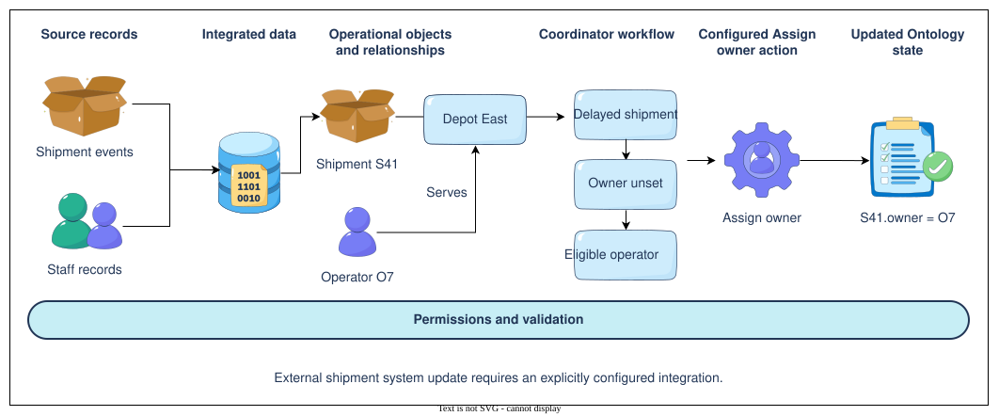

# Palantir_FDSE_Interview_Prep_with_Foundry_Gotham_AIP_Ontology

Source: https://www.educative.io/courses/forward-deployed-engineer/palantir-fdse-foundry-gotham-aip-and-the-ontology

---

[Home](https://www.educative.io/)

[Courses](https://www.educative.io/search?tab=courses)

[Forward Deployed Engineer for AI Systems](https://www.educative.io/courses/forward-deployed-engineer)

# Palantir FDSE: Foundry, Gotham, AIP, and the Ontology

Explore how Palantir's Forward Deployed Software Engineers (FDSEs) work with customers to integrate and optimize data operations through a delayed-shipment scenario. Connect disparate records to build actionable workflows, help users make informed decisions, and execute assignments effectively. Examine how Foundry, Gotham, and AIP support data management, analytics, and AI integration. Use the Ontology framework to link data with actionable concepts, verify changes, and enforce permissions throughout operational workflows.

We'll cover the following...

- [The coordinator needs a way to act on shipment S41](https://www.educative.io/courses/forward-deployed-engineer/palantir-fdse-foundry-gotham-aip-and-the-ontology#The-coordinator-needs-a-way-to-act-on-shipment-S41)
- [Separate records become an assignment workflow](https://www.educative.io/courses/forward-deployed-engineer/palantir-fdse-foundry-gotham-aip-and-the-ontology#Separate-records-become-an-assignment-workflow)
- [Foundry, Gotham, and AIP address different capabilities](https://www.educative.io/courses/forward-deployed-engineer/palantir-fdse-foundry-gotham-aip-and-the-ontology#Foundry-Gotham-and-AIP-address-different-capabilities)
- [The Ontology adds meaning and actions to S41’s stored fields](https://www.educative.io/courses/forward-deployed-engineer/palantir-fdse-foundry-gotham-aip-and-the-ontology#The-Ontology-adds-meaning-and-actions-to-S41s-stored-fields)
- [S41 translates into an operational decision](https://www.educative.io/courses/forward-deployed-engineer/palantir-fdse-foundry-gotham-aip-and-the-ontology#S41-translates-into-an-operational-decision)
- [The FDSE owns more than the assignment button](https://www.educative.io/courses/forward-deployed-engineer/palantir-fdse-foundry-gotham-aip-and-the-ontology#The-FDSE-owns-more-than-the-assignment-button)
- [Workflow success depends on observable state](https://www.educative.io/courses/forward-deployed-engineer/palantir-fdse-foundry-gotham-aip-and-the-ontology#Workflow-success-depends-on-observable-state)
- [Three kinds of evidence support claims in this course](https://www.educative.io/courses/forward-deployed-engineer/palantir-fdse-foundry-gotham-aip-and-the-ontology#Three-kinds-of-evidence-support-claims-in-this-course)
- [Interview readiness follows from observable progress](https://www.educative.io/courses/forward-deployed-engineer/palantir-fdse-foundry-gotham-aip-and-the-ontology#Interview-readiness-follows-from-observable-progress)
- [The same connection applies to machine M8](https://www.educative.io/courses/forward-deployed-engineer/palantir-fdse-foundry-gotham-aip-and-the-ontology#The-same-connection-applies-to-machine-M8)

Palantir builds software that helps organizations connect data to real-world operations. Its users include technicians and operators as well as engineers and analysts.

Consider an operations coordinator who sees a delayed shipment but must open another system to find someone to investigate it. The engineering problem is to connect those records, show the coordinator what matters, and support an authorized assignment.

That connection gives FDSE interview preparation a concrete purpose: explaining how engineering work becomes a usable customer capability.

## The coordinator needs a way to act on shipment S41[#](https://www.educative.io/courses/forward-deployed-engineer/palantir-fdse-foundry-gotham-aip-and-the-ontology#The-coordinator-needs-a-way-to-act-on-shipment-S41)

FDSE stands for Forward Deployed Software Engineer. Some Palantir materials use the shorter title FDE. Palantir describes forward-deployed engineering as engineers who work alongside customers in operational environments to build and ship capabilities.

Start with a small customer problem. Shipment events and staff assignments live in separate systems. The coordinator’s task is to assign an investigator to a delayed shipment, with these records available:

- **Shipment S41:** Depot East, status Delayed, owner unset.
- **Shipment S42:** Depot West, status On time, owner unset.
- **Operator O7:** Serves East.

An East coordinator may assign East shipments to East operators. A viewer may read authorized records but cannot assign anyone. The target is ownership assignment; rerouting shipments and optimizing delivery schedules are different tasks.

A table containing these records can answer “Which shipment is delayed?” It cannot, by itself, answer “Who may assign an investigator, what changes when they do, and how will they know it worked?”

An operationally complete solution connects a named user’s decision to a permitted action and a verifiable change in state.

**Key rule:** A complete solution has three parts: a named user’s decision, a permitted action, and a verifiable change in state.

## Separate records become an assignment workflow[#](https://www.educative.io/courses/forward-deployed-engineer/palantir-fdse-foundry-gotham-aip-and-the-ontology#Separate-records-become-an-assignment-workflow)

The high-level flow starts with source records, integrates them, represents operational concepts and relationships, and exposes those concepts in a user workflow. A configured action then changes the operational state. Permissions and validation apply throughout that flow.

Data flows from source records to updated ontology state

Trace S41 through the diagram:

1. **Read the sources:** Shipment events identify S41 as Delayed at East. Staff records identify O7 as serving East.
2. **Integrate the records:** Establish consistent identifiers and determine which event supplies the current shipment status. An old event must not silently become the current truth.
3. **Represent the operation:** Make S41 a Shipment object associated with Depot East. Represent O7 as an Operator associated with East.
4. **Support the coordinator:** Show the delayed shipment, its missing owner, and an eligible operator within the coordinator’s authorized view.
5. **Apply the configured action:** Validate the coordinator’s authority and operator eligibility, then assign ownership.
6. **Read the result:** Show the updated operational owner so the coordinator can confirm the assignment.

This is a mental model, rather than a mandatory deployment architecture. Its useful feature is that each step has an observable responsibility: Reading a record, connecting its meaning, enabling a decision, or changing state.

## Foundry, Gotham, and AIP address different capabilities[#](https://www.educative.io/courses/forward-deployed-engineer/palantir-fdse-foundry-gotham-aip-and-the-ontology#Foundry-Gotham-and-AIP-address-different-capabilities)

The product names describe different capabilities and purposes. They are not interchangeable labels, and they do not imply that every customer chooses exactly one platform.

- **Foundry** provides foundational data operations capabilities: Data management, logic authoring, Ontology development, analytics, and workflow development. In the shipment example, those capabilities support integrating shipment and staff records, modeling the relevant concepts, and building the coordinator’s assignment workflow.
- **Gotham** is Palantir’s first platform, built for analysts and operators in defense and intelligence. It helps users find patterns across many data sources and hand findings to operational users who plan and act. Palantir’s filings also describe wider government use and some commercial use, such as fraud investigations. It is background for this course, and S41 does not use it.
- **AIP** connects generative AI to operational domains through model connectivity, agents, automations, and evaluation. AIP and Foundry work together. An AI-assisted workflow could interpret an unstructured incident note or recommend an investigator using relevant context, but it would still need governed tools and a verified action to complete an assignment.

For S41, choose a direct rule-based workflow. O7 serves East, the shipment belongs to East, and the coordinator is authorized for East. An LLM adds no necessary reasoning to that rule.

For deployment context, Apollo is Palantir’s continuous delivery and infrastructure platform. It deploys and manages software, including Foundry and AIP, across environments. It is not part of the assignment logic.

## Platform Summary

|  |  |  |
| --- | --- | --- |
| **Product** | **Purpose** | **Role in S41** |
| Foundry | Data integration, modeling, analytics, operational applications | Integrates shipment and staff data, models the objects, hosts the workflow |
| Gotham | Analysis and operations for defense, intelligence and law enforcement | None; background only |
| AIP | Connects generative AI to operational data and actions | Not needed; the rule is sufficient |
| Apollo | Continuous delivery across environments | Deployment context only |

## The Ontology adds meaning and actions to S41’s stored fields[#](https://www.educative.io/courses/forward-deployed-engineer/palantir-fdse-foundry-gotham-aip-and-the-ontology#The-Ontology-adds-meaning-and-actions-to-S41s-stored-fields)

An **Ontology** represents operational decisions by bringing together data, logic, action, and security. Its objects, properties, and links connect underlying data to concepts that people and applications use.

For this workflow, define three object types:

- **Shipment:** Identified by shipment ID, with status and owner properties.
- **Depot:** Identified by depot name or a stable depot identifier.
- **Operator:** Identified by operator ID, with a relationship to the depot they serve.

The example contains these objects and connections:

- S41 is a Shipment object with status Delayed.
- East is a Depot object connected to S41 through a shipment-to-depot relationship.
- O7 is an Operator object connected to East through a serves-depot relationship.

A **link type** defines a relationship between object types. A **link** is one instance between particular objects: Shipment–Depot is the definition; S41–East is a specific link.

A database schema can describe stored fields and joins. The operational model also connects those concepts to the coordinator’s assignment decision, validation rules, permissions, and an Assign owner action. Representing S41’s connection to East does not itself authorize anyone to change S41.

Configured Foundry **Actions** can change properties, links, and objects. An Action is a transaction governed by user-defined logic.

Here, Assign owner takes a shipment and an operator. After validation, it sets the shipment’s owner to that operator’s identifier.

## S41 translates into an operational decision[#](https://www.educative.io/courses/forward-deployed-engineer/palantir-fdse-foundry-gotham-aip-and-the-ontology#S41-translates-into-an-operational-decision)

Seeing that S41 is delayed is not the same as being allowed to change it. Diagnose three separate questions

- **Eligibility:** Sharing Depot East makes O7 eligible under the example’s rule.
- **Authority:** That shared depot does not establish the coordinator’s permission to assign.
- **Execution:** Even an authorized choice leaves ownership unset until the configured action succeeds.

Now apply the checks to S41. The coordinator is authorized for East; S41 belongs to East, and O7 serves East. The assignment therefore passes the stated checks.

The configured action changes S41’s operational owner from unset to O7. S42’s owner remains unset because S42 was not a target of the action.

Stop the state-change claim at the supported Ontology change**.** Foundry’s documentation distinguishes edits stored in a writeback dataset from the datasource backing an object or link type. Those edits do not automatically overwrite the source records.

Updating an upstream shipment system would require an explicitly configured integration, such as an action webhook or an export. This example specifies none.

## The FDSE owns more than the assignment button[#](https://www.educative.io/courses/forward-deployed-engineer/palantir-fdse-foundry-gotham-aip-and-the-ontology#The-FDSE-owns-more-than-the-assignment-button)

Palantir describes forward deployed engineers as working alongside customers and building and shipping capabilities. In this course, ownership means following the problem until the coordinator can actually complete the task. Job postings vary, so treat the steps below as a working model, not a job description..

A credible engineering account follows this sequence:

1. **Discover the blocked decision:** Ask the coordinator how delayed shipments are noticed, who chooses an investigator, and what currently prevents assignment.
2. **Check the data:** Inspect shipment identifiers, event freshness, operator records, and the meaning of East across systems. A matching string is insufficient if the systems use it for different regions.
3. **Build the capability:** Implement the required integration, object relationships, assignment logic, and user workflow.
4. **Validate access and behavior:** Check both permitted assignments and rejected attempts. Confirm the user can see the resulting edited state.
5. **Deploy and observe use:** Have the coordinator complete the assignment in the deployed workflow and investigate any failure between the source data and the visible result.

A slide deck explaining this flow leaves implementation unfinished. A technically working pipeline also leaves the customer problem unfinished if the coordinator still cannot assign an owner.

Reduced time from noticing a delay to assigning an investigator is a proposed outcome to measure. We would establish the current process, measure the deployed workflow, and compare them before claiming improvement.

## Workflow success depends on observable state[#](https://www.educative.io/courses/forward-deployed-engineer/palantir-fdse-foundry-gotham-aip-and-the-ontology#Workflow-success-depends-on-observable-state)

Consider a tempting solution: S41 appears in a red Delayed dashboard tile, and an LLM recommends contacting O7. Ask one concrete question: “What is `S41.owner` now?” If the answer is still unset, the assignment task remains incomplete.

The repair is to connect the coordinator’s choice to the configured Assign owner action and check the resulting state. A recommendation can inform a decision; it is not evidence that the assignment occurred.

The checks separate failures that can otherwise look similar:

- **S41 still has no owner:** The workflow observed or recommended something without completing the state change.
- **S41 changes, but a viewer can also assign:** The intended result is possible, but the authority boundary is broken.
- **S42 changes too:** The action affected a record outside its intended target.
- **The coordinator cannot see O7 after assignment:** Investigate the read path and access to edits before declaring that either the action failed or the workflow succeeded.

A success condition therefore includes the intended positive result and the boundaries around it. That is what makes “working” more precise than “the dashboard loaded.”

## Three kinds of evidence support claims in this course[#](https://www.educative.io/courses/forward-deployed-engineer/palantir-fdse-foundry-gotham-aip-and-the-ontology#Three-kinds-of-evidence-support-claims-in-this-course)

The shipment walkthrough is an original explanatory example, not a reported interview prompt. Across the course, distinguish three kinds of evidence:

- **Official materials:** Palantir documentation, job materials, and company publications support claims about platforms, the company, and stated role expectations.
- **Public candidate reports:** These describe reported interview experiences. They provide preparation examples, not guaranteed questions or a fixed script for any particular interview.
- **Original reconstructions:** These rebuild a practice problem from a public description and identify added assumptions. Those assumptions make the exercise solvable; they are not additional facts about the actual interview.

Keep dates separate. A report published in October establishes its publication date, not that the interview happened in October. An update date records a revision. An interview date should be stated only when known; otherwise it remains unknown.

The same discipline applies to every explanation: say what the evidence supports, then identify the assumption that allows progress. For S41, the regional assignment rule is a stated practice assumption, while the explanation of Foundry Actions is supported by official documentation.

## Interview readiness follows from observable progress[#](https://www.educative.io/courses/forward-deployed-engineer/palantir-fdse-foundry-gotham-aip-and-the-ontology#Interview-readiness-follows-from-observable-progress)

The path moves from explaining the customer problem to solving and defending increasingly demanding engineering tasks. Use this preparation map to understand what each stage should produce, then follow the approved lesson sequence.

## Preparation Stages and Observable Readiness

|  |  |  |
| --- | --- | --- |
| Preparation Stage | Observable Capability | Evidence to Produce |
| Role understanding and credible personal evidence | Explain platforms and FDSE ownership while distinguishing evidence types. | An operational explanation and truthful motivation/project account. |
| Verified screen solutions | Manage time and solve implementation, algorithm, SQL, and API tasks. | Explainable Python, PostgreSQL, and paginated API solutions with checks. |
| Ambiguity and unfamiliar systems | Decompose an operational problem, learn from docs, extend and debug. | A scoped model plus an evidence-backed extension or minimal fix. |
| Adaptive engineering and integrated preparation | Handle changing requirements, operational design, behavioral evidence, and mocks. | Justified trade-offs, concrete stories, and targeted two-week preparation. |

Progress is observable. A useful screen solution has a clear contract and verified behavior. A useful decomposition names the user and a tractable decision. A useful unfamiliar-system exercise ends with evidence for an extension or fix. A useful mock exposes a specific weakness to work on next.

This course prepares methods for each interview round. It cannot promise an offer or a fixed interview script.

## The same connection applies to machine M8[#](https://www.educative.io/courses/forward-deployed-engineer/palantir-fdse-foundry-gotham-aip-and-the-ontology#The-same-connection-applies-to-machine-M8)

This path is for someone preparing for the FDSE loop who can already write code and use basic data structures. Prior SQL, system-design, or Palantir-platform experience is not assumed.

Transfer the shipment reasoning to a maintenance assignment. Machine M8 at site North needs inspection and has no assigned technician. Technician T3 serves North; a North dispatcher may assign North technicians to North machines, while a viewer cannot assign.

A plausible result and a justified explanation are different checks. T3 may be the right technician, while the claim about what authorizes assignment is wrong. Likewise, an operational assignment does not prove an external-system update.

**Worked answer: M8**

**User and decision:** The North dispatcher must choose a technician to inspect M8.
Objects and relationships: Machine M8, Site North and Technician T3. M8 is located at North and T3 serves North.
Permitted action: An Assign technician action checks the dispatcher’s authority and the shared site, then assigns T3 to M8.

**Expected state:** M8’s assigned technician is T3 in the Ontology. No external maintenance system is assumed to update.

**Verification:** The dispatcher sees the assignment, a viewer’s attempt is rejected, and other machines are unchanged.

**FDSE contribution:** The FDSE works with the dispatcher, connects the records, builds and deploys the workflow, and confirms the dispatcher can complete the task.

Add one sentence naming a relevant Foundry capability and explaining whether AIP is necessary. Try this before opening the model answer.

Model answer and self-check

1. The North dispatcher needs to choose a technician to inspect machine M8.
2. Machine and technician records supply Machine M8, Site North, and Technician T3 objects, with M8 located at North and T3 serving North.
3. A configured Assign technician action checks the dispatcher’s authority and the shared site before assigning T3 to M8.
4. After the action, M8’s operational assigned-technician value is T3; no update to an unspecified external maintenance system is assumed.
5. Verification checks that the assignment is visible to the dispatcher and that a viewer’s assignment attempt is rejected.
6. The FDSE collaborates with the dispatcher, connects records, implements and deploys the workflow, and checks that the dispatcher can complete the task.

Additional sentence: Foundry’s integration, Ontology, and workflow capabilities support this solution, and AIP is unnecessary because the stated regional rule is sufficient.

**Self-check:** Are the user and decision named? Are the objects grounded in the records? Does the action produce a specific state? Does verification cover both the assignment and the viewer restriction? Is the FDSE contribution explained without assuming an external-system update?

Product names alone do not fill those roles.

Before moving on, make the explanation precise enough for another engineer to identify:

- The record that changes.
- The person allowed to change it.
- The check that proves it worked.

The shipment and the machine share one structure: a named user, a permitted action, and a verifiable change in state. With that structure in place, the next lesson turns to the hiring process itself, where the same discipline of separating evidence from assumption decides what to prepare and in what order.

Interview Guide: Palantir Forward Deployed AI Engineers

The Hiring Process: Stages, Timeline, and No-AI Rule

Ask

[The coordinator needs a way to act on shipment S41](https://www.educative.io/courses/forward-deployed-engineer/palantir-fdse-foundry-gotham-aip-and-the-ontology#The-coordinator-needs-a-way-to-act-on-shipment-S41)

[Separate records become an assignment workflow](https://www.educative.io/courses/forward-deployed-engineer/palantir-fdse-foundry-gotham-aip-and-the-ontology#Separate-records-become-an-assignment-workflow)

[Foundry, Gotham, and AIP address different capabilities](https://www.educative.io/courses/forward-deployed-engineer/palantir-fdse-foundry-gotham-aip-and-the-ontology#Foundry-Gotham-and-AIP-address-different-capabilities)

[The Ontology adds meaning and actions to S41’s stored fields](https://www.educative.io/courses/forward-deployed-engineer/palantir-fdse-foundry-gotham-aip-and-the-ontology#The-Ontology-adds-meaning-and-actions-to-S41s-stored-fields)

[S41 translates into an operational decision](https://www.educative.io/courses/forward-deployed-engineer/palantir-fdse-foundry-gotham-aip-and-the-ontology#S41-translates-into-an-operational-decision)

[The FDSE owns more than the assignment button](https://www.educative.io/courses/forward-deployed-engineer/palantir-fdse-foundry-gotham-aip-and-the-ontology#The-FDSE-owns-more-than-the-assignment-button)

[Workflow success depends on observable state](https://www.educative.io/courses/forward-deployed-engineer/palantir-fdse-foundry-gotham-aip-and-the-ontology#Workflow-success-depends-on-observable-state)

[Three kinds of evidence support claims in this course](https://www.educative.io/courses/forward-deployed-engineer/palantir-fdse-foundry-gotham-aip-and-the-ontology#Three-kinds-of-evidence-support-claims-in-this-course)

[Interview readiness follows from observable progress](https://www.educative.io/courses/forward-deployed-engineer/palantir-fdse-foundry-gotham-aip-and-the-ontology#Interview-readiness-follows-from-observable-progress)

[The same connection applies to machine M8](https://www.educative.io/courses/forward-deployed-engineer/palantir-fdse-foundry-gotham-aip-and-the-ontology#The-same-connection-applies-to-machine-M8)