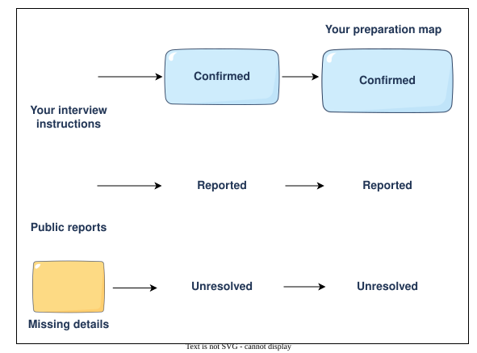

# Palantir_Forward_Deployed_Engineer_Hiring_Process_and_Preparation

Source: https://www.educative.io/courses/forward-deployed-engineer/the-hiring-process-stages-timeline-and-no-ai-rule

---

[Home](https://www.educative.io/)

[Courses](https://www.educative.io/search?tab=courses)

[Forward Deployed Engineer for AI Systems](https://www.educative.io/courses/forward-deployed-engineer)

# The Hiring Process: Stages, Timeline, and No-AI Rule

Understand the multi-stage interview process for Palantir's Forward Deployed Software Engineers (FDSE), including recruiter screenings, technical assessments, and hiring-manager interviews. Develop a structured preparation strategy by distinguishing confirmed, reported, and unresolved interview details. Practice independently without AI tools, verify interview-specific requirements, including task formats and permitted assistance, and document all communications to avoid misunderstandings.

We'll cover the following...

- [A candidate’s own instructions should determine the interview plan](https://www.educative.io/courses/forward-deployed-engineer/the-hiring-process-stages-timeline-and-no-ai-rule#A-candidates-own-instructions-should-determine-the-interview-plan)
- [Five technical formats make up the preparation pool](https://www.educative.io/courses/forward-deployed-engineer/the-hiring-process-stages-timeline-and-no-ai-rule#Five-technical-formats-make-up-the-preparation-pool)
- [The July 1, 2025 report establishes a limited set of facts](https://www.educative.io/courses/forward-deployed-engineer/the-hiring-process-stages-timeline-and-no-ai-rule#The-July-1-2025-report-establishes-a-limited-set-of-facts)
- [Neither 60 minutes nor a four-week decision can be counted on](https://www.educative.io/courses/forward-deployed-engineer/the-hiring-process-stages-timeline-and-no-ai-rule#Neither-60-minutes-nor-a-four-week-decision-can-be-counted-on)
- [Several details need confirmation before the next assessment](https://www.educative.io/courses/forward-deployed-engineer/the-hiring-process-stages-timeline-and-no-ai-rule#Several-details-need-confirmation-before-the-next-assessment)
- [The course’s no-AI default sets specific requirements](https://www.educative.io/courses/forward-deployed-engineer/the-hiring-process-stages-timeline-and-no-ai-rule#The-courses-no-AI-default-sets-specific-requirements)
- [AI-notetaker consent leaves candidate tools unresolved](https://www.educative.io/courses/forward-deployed-engineer/the-hiring-process-stages-timeline-and-no-ai-rule#AI-notetaker-consent-leaves-candidate-tools-unresolved)
- [A 60-minute screen invitation leads to a specific plan](https://www.educative.io/courses/forward-deployed-engineer/the-hiring-process-stages-timeline-and-no-ai-rule#A-60-minute-screen-invitation-leads-to-a-specific-plan)
  - [Confirm only the invitation’s three details](https://www.educative.io/courses/forward-deployed-engineer/the-hiring-process-stages-timeline-and-no-ai-rule#Confirm-only-the-invitations-three-details)
  - [Retain preparation coverage and name the unknowns](https://www.educative.io/courses/forward-deployed-engineer/the-hiring-process-stages-timeline-and-no-ai-rule#Retain-preparation-coverage-and-name-the-unknowns)
  - [Send an actionable message and begin preparing](https://www.educative.io/courses/forward-deployed-engineer/the-hiring-process-stages-timeline-and-no-ai-rule#Send-an-actionable-message-and-begin-preparing)
- [Before your next interview](https://www.educative.io/courses/forward-deployed-engineer/the-hiring-process-stages-timeline-and-no-ai-rule#Before-your-next-interview)

Two descriptions of the Palantir interview loop disagree:

- An FDSE report dated July 1, 2025 describes a decomposition-heavy sequence.
- A secondary software-engineering guide describes recruiter screening, technical screening, an onsite drawn from five formats, and a hiring-manager interview.

Two sources compete to determine preparation. Both provide useful coverage, but a candidate’s own instructions determine appointments. Build a preparation map that keeps those two kinds of information separate.

## A candidate’s own instructions should determine the interview plan[#](https://www.educative.io/courses/forward-deployed-engineer/the-hiring-process-stages-timeline-and-no-ai-rule#A-candidates-own-instructions-should-determine-the-interview-plan)

Use three labels before putting anything on a calendar:

- **Confirmed:** Instructions supplied for the candidate’s application or interview, with their exact scope recorded.
- **Reported:** A public account or guide describing someone else’s experience or a broader pattern.
- **Unresolved:** A consequential detail that the instructions have not answered.

An unsupported claim goes beyond the evidence available. For example, “Every FDSE candidate receives five onsite interviews” is unsupported even when five formats appear in a guide.

"Prepare capabilities from the reported pool; schedule and use tools according to instructions confirmed for the candidate’s own stage."

The secondary guide concerns software engineering broadly and supplies a useful preparation map rather than a universal FDSE sequence. Separately, a secondary summary of Palantir careers guidance says interview number and format are personalized to the candidate and role. That is an indirect summary of official guidance, rather than a directly inspected official statement here.

Keep a simple record for each important claim: What it says, who supplied it, its date, its scope, and the question still open. This prevents a specific report from quietly becoming a requirement in a candidate’s own plan. The map below shows the three labels and what feeds each one.

Interview sources sorted into confirmed, reported, unresolved items

## Five technical formats make up the preparation pool[#](https://www.educative.io/courses/forward-deployed-engineer/the-hiring-process-stages-timeline-and-no-ai-rule#Five-technical-formats-make-up-the-preparation-pool)

Start with recruiter conversations about the candidate’s background, role choice, and motivation. Add a technical screen or assessment where applicable, preparation across the technical pool, and hiring-manager follow-up.

The secondary guide describes two screen alternatives: A roughly 60-minute live screen and a 90-minute assessment containing implementation, SQL, and REST API work. Its API example involves aggregating a field across a paginated JSON endpoint. Confirm which format applies before allocating practice time around a particular assessment.

Recognize the five technical formats by the work they ask candidates to do:

- **Decomposition:** Turn an ambiguous problem into an executable approach. Prepare through lessons 8–9.
- **Learning:** Apply unfamiliar information, documentation, or concepts. Prepare through lesson 10.
- **Re-engineering:** Investigate and change existing code. Prepare through lesson 11.
- **Coding:** Produce working code and verify its behavior. Screen preparation is in lessons 4–7; adaptive coding is in lesson 12.
- **System design:** Connect components under operational constraints. Prepare through lessons 13–14.

Treat this pool as preparation coverage, not scheduled appointments.

Behavioral preparation belongs alongside this work. The secondary careers summary describes behavioral evaluation within onsite interviews, and the July 2025 FDSE account places behavioral questions inside the hiring-manager conversation. Evidence preparation proceeds without assuming a separate behavioral appointment; lessons 15–16 develop that preparation.

## The July 1, 2025 report establishes a limited set of facts[#](https://www.educative.io/courses/forward-deployed-engineer/the-hiring-process-stages-timeline-and-no-ai-rule#The-July-1-2025-report-establishes-a-limited-set-of-facts)

Extract the account before interpreting it. It labels the process “4 rounds” and describes:

1. A recruiter phone screen, with no duration supplied.
2. A short technical decomposition interview of approximately 45 minutes.
3. Two one-hour interviews: One decomposition and one case-study/technical-design style.
4. A one-hour hiring-manager interview moving between behavioral and decomposition-style questions.

The account therefore describes five interviews inside four round labels: One plus one plus two plus one. Counting “rounds” alone would hide an appointment.

Read the evidence through six questions:

- **Actor:** An individual reporting an FDSE interview experience.
- **Scope:** That person’s process, including the grouped pair of interviews.
- **Date:** The report is dated July 1, 2025; the interview date is not supplied.
- **Supported conclusion:** Decomposition, technical design, and behavioral discussion deserve preparation attention.
- **Unsupported inference:** The candidate’s second appointment will be a 45-minute decomposition interview.
- **Gap-closing question:** “What is my next interview format, and which formats are expected afterward?”

Before accepting a proposed calendar based on this account, decide what can legitimately transfer into the candidate’s preparation.

From report to preparation

1.

An individual FDSE report dated July 1, 2025 (interview date unknown) labels its process “4 rounds”: a recruiter screen; approximately 45-minute decomposition; two one-hour decomposition/design interviews; and a one-hour mixed behavioral/decomposition hiring-manager interview.

Which record is justified for your preparation?

A.

Reported July 1, 2025; interview date unknown. Schedule my recruiter screen, approximately 45-minute decomposition, two one-hour decomposition/design interviews, and one-hour mixed hiring-manager interview in that order.

B.

Reported July 1, 2025; interview date unknown. Plan for exactly four interviews in my process because the account explicitly labels it “4 rounds.”

C.

Reported July 1, 2025; interview date unknown. Prepare motivation, decomposition, design reasoning, and behavioral project evidence. My sequence and durations remain unresolved; ask which formats are expected next.

D.

Reported July 1, 2025; interview date unknown. Exclude this account from my preparation record because its sequence differs from the broader software-engineering guide.

---

1 / 1

The repeated decomposition work can help prioritize practice without predicting the schedule. Keep that priority revisable: If the recruiter confirms a different next format, shift the immediate preparation without treating the report as disproved.

A later public account, labeled “Reported Jul 2026” and published September 5, 2026, describes recruiter screening, decomposition, an onsite containing coding, learning and decomposition, then a hiring-manager round. Its overlap with the earlier account strengthens the case for decomposition practice; its different coverage supports keeping coding and learning in a candidate’s preparation. Combining the accounts into one longer mandatory loop would manufacture a sequence neither describes.

## Neither 60 minutes nor a four-week decision can be counted on[#](https://www.educative.io/courses/forward-deployed-engineer/the-hiring-process-stages-timeline-and-no-ai-rule#Neither-60-minutes-nor-a-four-week-decision-can-be-counted-on)

Separate three clocks:

- **Interview duration:** How long a particular appointment lasts.
- **Stage gap:** Time between an interview and another appointment or update.
- **End-to-end elapsed time:** Time between specified starting and ending events.

The secondary guide estimates three to four weeks from first contact to an offer. The later candidate account reports roughly five weeks before receiving a rejection update after its described final stage. Those intervals have different endpoints and outcomes. Neither creates a deadline for the application.

Likewise, “Reported Jul 2026” and “Published Sep 5, 2026” are distinct labels. Preserve both rather than converting either into an exact interview date.

For a personal schedule, ask: “What duration should I reserve, what stages remain, when should I expect the next update, and when would you prefer me to follow up?” Record the answer as an estimate unless it is a firm appointment. Elapsed time alone cannot indicate whether a candidate has been rejected or will receive an offer.

## Several details need confirmation before the next assessment[#](https://www.educative.io/courses/forward-deployed-engineer/the-hiring-process-stages-timeline-and-no-ai-rule#Several-details-need-confirmation-before-the-next-assessment)

Use a short confirmation checklist tied to the invitation:

- **Application:** Role, location, and application track.
- **Sequence:** Next stage and expected remaining stages.
- **Format:** Live interview or assessment; expected task type, including SQL or API work if relevant.
- **Schedule:** Duration, date, time zone, and connection details.
- **Environment:** Coding platform, permitted language, and any setup checks.
- **Materials:** What will be supplied and what may be brought or consulted.
- **Assistance:** Permissions for each tool or source of help.
- **Follow-up:** Expected next update and an appropriate follow-up date.

The application needs the same careful reading as the invitation. For example, the official Seoul FDSE application requests two videos, each no longer than 90 seconds: One about something the applicant built and one about thought-provoking Palantir coverage or content. It values preparation while requesting authentic, unscripted responses. Those requirements belong to that posting; they do not establish a universal video requirement or forbid preparation.

The actionable lesson is to inspect role-specific instructions before importing requirements from another location or track. If an invitation and application appear to conflict, quote the relevant wording in the clarification request.

## The course’s no-AI default sets specific requirements[#](https://www.educative.io/courses/forward-deployed-engineer/the-hiring-process-stages-timeline-and-no-ai-rule#The-courses-no-AI-default-sets-specific-requirements)

As of early November 2026, public sources do not settle whether Palantir has one company-wide rule on candidate AI use. One candidate guide says AI is prohibited throughout the loop, but that guide is a report, not an official statement. A secondary source reports finding no published live-interview rule and distinguishes a separate Build to Apply track that permits AI during project building. Its search finding cannot establish that no other policy exists.

The course’s **no-AI default** is a preparation and conduct safeguard: Practice producing unaided answers, and obtain explicit authorization for the particular assessed stage before introducing candidate assistance.

Two tempting conclusions both fail:

- “The title says No-AI Rule, so Palantir must have published a blanket ban.” The course default does not establish company policy.
- “A blanket ban has not been verified, so my assistant is allowed.” Absence of a verified prohibition supplies no authorization.

Record tool permissions separately. Permission to use supplied documentation answers one question. Permission to use an editor answers another. Neither settles web search, generative AI, AI autocomplete, personal notes, or outside human assistance.

If a tool has an assistance feature enabled by default, check its settings before the assessed stage. Disable unapproved assistance while retaining the environment the candidate was instructed to use. Ask about ambiguous features before beginning rather than testing the boundary during the interview.

## AI-notetaker consent leaves candidate tools unresolved[#](https://www.educative.io/courses/forward-deployed-engineer/the-hiring-process-stages-timeline-and-no-ai-rule#AI-notetaker-consent-leaves-candidate-tools-unresolved)

The official Seoul FDSE application states: “As part of our interview process, we may use AI notetakers to transcribe conversations for accuracy and efficiency.” It also says the decision to opt in or out will not affect candidacy.

Apply the same close reading used for the July 2025 sequence:

- **Actor:** Palantir, using a notetaker.
- **Scope:** Transcribing conversations for accuracy and efficiency; the candidate chooses whether to consent.
- **Date:** This is the official application wording as read in early November 2026. The posting shows no publication date.
- **Supported conclusion:** The company may transcribe with that tooling, and opting out will not affect candidacy.
- **Unsupported inference:** The candidate may generate answers, enable AI autocomplete or bring a personal recording bot.
- **Gap-closing question:** “Which candidate tools and assistance are authorized for this interview?”

An AI product offering or permission in another application track likewise has its own actor, purpose and scope. Resolve permission at that level of detail.

## A 60-minute screen invitation leads to a specific plan[#](https://www.educative.io/courses/forward-deployed-engineer/the-hiring-process-stages-timeline-and-no-ai-rule#A-60-minute-screen-invitation-leads-to-a-specific-plan)

Suppose a candidate’s invitation says: “Your next stage is a 60-minute live technical screen in a browser coding environment. Your recruiter will follow up afterward.” It supplies no further permissions or later-round details.

Build the resulting plan in three parts.

### Confirm only the invitation’s three details[#](https://www.educative.io/courses/forward-deployed-engineer/the-hiring-process-stages-timeline-and-no-ai-rule#Confirm-only-the-invitations-three-details)

Record a 60-minute live technical screen, a browser coding environment, and recruiter follow-up afterward. The wording supplies no update deadline. If the date, time zone, or browser setup details are elsewhere in the invitation, copy them exactly; otherwise ask.

### Retain preparation coverage and name the unknowns[#](https://www.educative.io/courses/forward-deployed-engineer/the-hiring-process-stages-timeline-and-no-ai-rule#Retain-preparation-coverage-and-name-the-unknowns)

Keep decomposition, learning, re-engineering, coding, and system design as reported preparation possibilities. Give the imminent live screen priority while retaining broader coverage until later formats are clarified.

Leave these items unresolved:

- Screen task type, permitted language, and whether SQL or API work is expected.
- Supplied materials and permission for notes, web search, AI features, or outside help.
- Remaining sequence and appointment durations.
- Expected update window.

The public July 2025 account remains evidence about that account. The invitation now supplies evidence about the next stage. Neither changes the scope of the official notetaker wording.

### Send an actionable message and begin preparing[#](https://www.educative.io/courses/forward-deployed-engineer/the-hiring-process-stages-timeline-and-no-ai-rule#Send-an-actionable-message-and-begin-preparing)

A concise message could read:

Thanks for the invitation. I have noted the 60-minute live screen, browser coding environment, and recruiter follow-up. Could you confirm the task type, whether SQL or API work is expected, and which programming languages are permitted? Please also confirm what materials and assistance are allowed, including notes, web search, generative AI, and AI autocomplete. Which later formats are currently expected, and when should I expect the next update?

The immediate decision is to practice unaided, familiarize with the specified browser environment if a practice mode is supplied, and continue broad preparation while awaiting answers. Familiarization should establish that the candidate can enter, run, and inspect code without relying on unapproved assistance.

Compare that plan with this faulty one:

“I have reserved five mandatory onsite blocks, expect an offer exactly four weeks after first contact, and will enable an AI coding assistant because I consented to the notetaker.”

Each error changes an evidence category:

- A preparation pool became scheduled appointments.
- A guide’s elapsed-time estimate became a personal deadline and promised outcome.
- Company transcription consent became candidate-assistance permission.

Repair the record by deleting invented appointments and the offer deadline, keeping preparation coverage, and recording tool permissions as unresolved until explicitly answered. Success is visible in the plan itself: Every scheduled duration comes from the instructions, and every proposed assistance tool has a permission status.

## Before your next interview[#](https://www.educative.io/courses/forward-deployed-engineer/the-hiring-process-stages-timeline-and-no-ai-rule#Before-your-next-interview)

Treat a guide’s assessment format and timeline as reported information. Adding “guaranteed” or “within four weeks” creates unsupported claims about your application.

Before your own next interview, you should be able to say: “This is scheduled; these formats remain possible; these are the questions I will resolve before using a tool.” Once that record is clear, the recruiter conversation still needs a substantive answer to another question: Why do you want this work?

Palantir FDSE: Foundry, Gotham, AIP, and the Ontology

Your Story: Why Palantir, Projects, Mission, and Ethics

Ask

[A candidate’s own instructions should determine the interview plan](https://www.educative.io/courses/forward-deployed-engineer/the-hiring-process-stages-timeline-and-no-ai-rule#A-candidates-own-instructions-should-determine-the-interview-plan)

[Five technical formats make up the preparation pool](https://www.educative.io/courses/forward-deployed-engineer/the-hiring-process-stages-timeline-and-no-ai-rule#Five-technical-formats-make-up-the-preparation-pool)

[The July 1, 2025 report establishes a limited set of facts](https://www.educative.io/courses/forward-deployed-engineer/the-hiring-process-stages-timeline-and-no-ai-rule#The-July-1-2025-report-establishes-a-limited-set-of-facts)

[Neither 60 minutes nor a four-week decision can be counted on](https://www.educative.io/courses/forward-deployed-engineer/the-hiring-process-stages-timeline-and-no-ai-rule#Neither-60-minutes-nor-a-four-week-decision-can-be-counted-on)

[Several details need confirmation before the next assessment](https://www.educative.io/courses/forward-deployed-engineer/the-hiring-process-stages-timeline-and-no-ai-rule#Several-details-need-confirmation-before-the-next-assessment)

[The course’s no-AI default sets specific requirements](https://www.educative.io/courses/forward-deployed-engineer/the-hiring-process-stages-timeline-and-no-ai-rule#The-courses-no-AI-default-sets-specific-requirements)

[AI-notetaker consent leaves candidate tools unresolved](https://www.educative.io/courses/forward-deployed-engineer/the-hiring-process-stages-timeline-and-no-ai-rule#AI-notetaker-consent-leaves-candidate-tools-unresolved)

[A 60-minute screen invitation leads to a specific plan](https://www.educative.io/courses/forward-deployed-engineer/the-hiring-process-stages-timeline-and-no-ai-rule#A-60-minute-screen-invitation-leads-to-a-specific-plan)

[Confirm only the invitation’s three details](https://www.educative.io/courses/forward-deployed-engineer/the-hiring-process-stages-timeline-and-no-ai-rule#Confirm-only-the-invitations-three-details)

[Retain preparation coverage and name the unknowns](https://www.educative.io/courses/forward-deployed-engineer/the-hiring-process-stages-timeline-and-no-ai-rule#Retain-preparation-coverage-and-name-the-unknowns)

[Send an actionable message and begin preparing](https://www.educative.io/courses/forward-deployed-engineer/the-hiring-process-stages-timeline-and-no-ai-rule#Send-an-actionable-message-and-begin-preparing)

[Before your next interview](https://www.educative.io/courses/forward-deployed-engineer/the-hiring-process-stages-timeline-and-no-ai-rule#Before-your-next-interview)