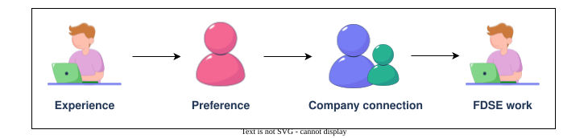

# Crafting_Your_Palantir_Story_with_Projects_and_Ethical_Views

Source: https://www.educative.io/courses/forward-deployed-engineer/your-story-why-palantir-projects-mission-and-ethics

---

[Home](https://www.educative.io/)

[Courses](https://www.educative.io/search?tab=courses)

[Forward Deployed Engineer for AI Systems](https://www.educative.io/courses/forward-deployed-engineer)

# Your Story: Why Palantir, Projects, Mission, and Ethics

Prepare a compelling response to “Why do you want to work at Palantir?” by connecting genuine motivation, relevant project experience, and a thoughtful perspective on the consequences of your work. Explain decisions and preferences through real examples, demonstrate your ability to navigate operational ambiguity, and articulate your views on data ethics, privacy risks, and safeguards. Connect your personal experiences with Palantir's mission and values to demonstrate an informed interest in the role.

We'll cover the following...

- [A strong answer survives a follow-up question](https://www.educative.io/courses/forward-deployed-engineer/your-story-why-palantir-projects-mission-and-ethics#A-strong-answer-survives-a-follow-up-question)
- [Only some questions have actual support](https://www.educative.io/courses/forward-deployed-engineer/your-story-why-palantir-projects-mission-and-ethics#Only-some-questions-have-actual-support)
- [An experience connects to Palantir through specific links](https://www.educative.io/courses/forward-deployed-engineer/your-story-why-palantir-projects-mission-and-ethics#An-experience-connects-to-Palantir-through-specific-links)
- [A project provides the evidence for motivation](https://www.educative.io/courses/forward-deployed-engineer/your-story-why-palantir-projects-mission-and-ethics#A-project-provides-the-evidence-for-motivation)
- [Personal decisions form the core of the account](https://www.educative.io/courses/forward-deployed-engineer/your-story-why-palantir-projects-mission-and-ethics#Personal-decisions-form-the-core-of-the-account)
- [An honest account identifies what worked](https://www.educative.io/courses/forward-deployed-engineer/your-story-why-palantir-projects-mission-and-ethics#An-honest-account-identifies-what-worked)
- [The same links become a concise motivation answer](https://www.educative.io/courses/forward-deployed-engineer/your-story-why-palantir-projects-mission-and-ethics#The-same-links-become-a-concise-motivation-answer)
- [Privacy discussion extends beyond login](https://www.educative.io/courses/forward-deployed-engineer/your-story-why-palantir-projects-mission-and-ethics#Privacy-discussion-extends-beyond-login)
- [The reasoning extends to mission and government work](https://www.educative.io/courses/forward-deployed-engineer/your-story-why-palantir-projects-mission-and-ethics#The-reasoning-extends-to-mission-and-government-work)
- [A defensible answer holds without notes](https://www.educative.io/courses/forward-deployed-engineer/your-story-why-palantir-projects-mission-and-ethics#A-defensible-answer-holds-without-notes)

Interviewers ask “Why do you want to work at Palantir?” because the answer shows how you think. An answer that says only “prestige, impact, and exciting AI” leaves blanks: which work, which experience, which decision, which consequences.

A follow-up question can explore those blanks; “prestige, impact, and exciting AI” gives it little to explore.

A first answer needs three connected parts:

- A truthful motivation.
- A project that supports it.
- A reasoned position on the consequences of the work.

Those connections make the interest defensible even while some questions remain about the company.

## A strong answer survives a follow-up question[#](https://www.educative.io/courses/forward-deployed-engineer/your-story-why-palantir-projects-mission-and-ethics#A-strong-answer-survives-a-follow-up-question)

Your answer should use one real decision. A candidate might have clarified a confusing requirement, rejected an unnecessary service, or discovered that the user’s definition differed from the database’s representation.

Then ask: “What did that decision reveal about the work I enjoy?” Enjoying operational ambiguity is credible when the candidate can describe the ambiguity and what was done about it. Merely calling oneself adaptable leaves the listener to supply the evidence.

Build each important claim from something done, something observed, or something that can be substantiated, and identify what remains unknown. The purpose is to discover a genuine fit that can be explained, rather than an approved personality to imitate.

## Only some questions have actual support[#](https://www.educative.io/courses/forward-deployed-engineer/your-story-why-palantir-projects-mission-and-ethics#Only-some-questions-have-actual-support)

The official Edge Autonomous Systems FDSE application asks: “What has been your favorite project or proudest accomplishment? Why?” and “Why do you want to work at Palantir?” These are requirements of that posting, rather than evidence that every interview uses identical questions.

The same application requests a three-to-five-sentence account of a technical challenge with no existing documentation or established solution, including the approach and outcome. Preparing only a description of what the application does would leave the decision-making part unanswered.

A public FDSE interview account presented as a 2026 experience reports these recruiter prompts:

- “Why do you want to work at Palantir?”
- “Why forward deployed engineering?”
- “Tell me about a time you worked with unclear customer requirements.”

The account gives no exact interview date, and these are reported questions, not guaranteed ones.

Use those prompts to rehearse. The equipment-loan project developed below is an invented teaching example. Its answer and results do not come from the reporting candidate.

## An experience connects to Palantir through specific links[#](https://www.educative.io/courses/forward-deployed-engineer/your-story-why-palantir-projects-mission-and-ethics#An-experience-connects-to-Palantir-through-specific-links)

Build four links before drafting the answer:

1. **Experience:** What happened in a project the candidate actually worked on?
2. **Preference:** Which decision revealed something the candidate enjoys or values in engineering?
3. **Company connection:** Which researched capability makes Palantir relevant to that preference?
4. **FDSE work:** Why does building alongside customers appeal to the candidate personally?

Suppose a candidate helped build an equipment-loan tool. The candidate enjoyed resolving what “overdue” meant with the coordinator because that clarification changed both the data logic and the user’s next action. The preference is concrete: The candidate likes turning messy operational records and user decisions into a working workflow.

Earlier in this chapter, we connected Foundry’s operational representation and configured actions to a user’s workflow. That provides a company connection for this interest. The role connection is the appeal of building alongside users and following the problem through to working behavior. The diagram shows the four links as a chain.

Experience, preference, and company connection lead to FDSE work

Naming Foundry alone leaves out the reasoning. A stronger answer explains why the capability interests the candidate, while remaining candid about whether the candidate has used it. No claim is needed that Palantir is the only company solving operational problems: A specific, researched reason to investigate the fit is enough.

## A project provides the evidence for motivation[#](https://www.educative.io/courses/forward-deployed-engineer/your-story-why-palantir-projects-mission-and-ethics#A-project-provides-the-evidence-for-motivation)

A project with defensible decisions is the better choice. A smaller tool with clear personal ownership gives more useful material than a fashionable system whose implementation cannot be explained.

For the equipment-loan case, establish these facts:

- A three-person team built a reservation and overdue-review tool.
- The candidate implemented status reconciliation and the return transition. Teammates built the interface and import process.
- The initial import contained 60 loan records, including 12 marked late.
- The coordinator explained that an approved extension changes the due date. The imported late flag was not authoritative.

The user problem is deciding which outstanding loans need follow-up. The constraint is that imported status can disagree with the coordinator’s current rules. A technology list would conceal the important engineering problem: The team first needed an agreed meaning for the status it displayed.

The 12 late flags describe the imported data. They do not establish that 12 loans truly required follow-up.

## Personal decisions form the core of the account[#](https://www.educative.io/courses/forward-deployed-engineer/your-story-why-palantir-projects-mission-and-ethics#Personal-decisions-form-the-core-of-the-account)

The candidate clarified the status rule, implemented its reconciliation logic, and handled recording a return. They did not build the interface or import pipeline.

The agreed rule for overdue status had three parts:

- An approved extension supplies the effective due date instead of the original due date.
- A returned loan is not currently overdue.
- An outstanding loan becomes overdue once the agreed due-date boundary has passed.

Before implementing that last condition, the candidate must clarify whether a due date means a date or a precise instant, and which time zone applies. “I checked the date” is incomplete when a boundary can change the answer.

Compare three implementation options:

- **Preserve imported flags:** Simple to display, but it keeps a value the coordinator has already said can be wrong.
- **Derive status when reading records:** Uses the current rule without maintaining a second status value that must be synchronized.
- **Update stored status on a schedule:** Can support precomputed queries, but creates a job to operate and a delay between a boundary passing and the next update.

Make the choice for this tool before reading the candidate’s decision.

Choose the status approach

1.

The small loan tool imports 60 records, including 12 marked late. The coordinator says an approved extension changes the effective due date, and a returned loan is not currently overdue. Which implementation and justification best fit this tool?

A.

Derive status on read: recalculating guarantees fresh status even when approved-extension inputs are stale.

B.

Update stored status on a schedule: precomputing the follow-up list is worth adding a job and accepting a delay for this small tool.

C.

Copy the imported late flags: preserving the source status gives the coordinator a consistent follow-up list.

D.

Derive status on read from the effective due date and returned state: this avoids synchronizing a second status value, but requires current inputs.

---

1 / 1

The candidate derived status on read (option D). That choice invites a useful follow-up: “What would make you reconsider?” Distinguish a wrong rule from stale input data and an expensive query. Each calls for a different remedy; switching to scheduled updates would not automatically solve all three.

At larger scale, the candidate would revisit query cost and response-time requirements. Precomputation could become justified, provided its freshness and reconciliation behavior were explicit. Explaining when the design would change shows that the choice follows the constraints.

## An honest account identifies what worked[#](https://www.educative.io/courses/forward-deployed-engineer/your-story-why-palantir-projects-mission-and-ethics#An-honest-account-identifies-what-worked)

The candidate prepared 12 checks covering approved extensions, returns, due-date boundaries, repeated return requests, and role restrictions. Initially, 10 passed; two showed that extended loans were incorrectly marked late. After correcting effective-due-date handling, all 12 passed.

Three intended users then completed a supervised pilot. No before-and-after handling-time baseline was measured.

Those observations support different claims:

- **Checks passed:** The implementation produced the expected results for those cases.
- **Pilot completed:** Three intended users completed the supervised trial.
- **Operational improvement:** Still unmeasured. Neither observation establishes fewer late returns or a percentage productivity gain.

Compare this weak answer with the facts above:

“I want Palantir because it is prestigious and Foundry and AIP have huge impact. I built our entire loan platform and cut processing time by 80%. Privacy is solved because users log in.”

Repair the claims using evidence, rather than stronger adjectives:

“I became interested in operational software when clarifying an overdue rule changed how our loan tool needed to behave. Foundry’s connection between operational data and user actions interests me for that reason. Our three-person team built the tool; I owned status reconciliation and return handling. After fixing extension handling, all 12 checks passed, and three intended users completed a supervised pilot. We did not measure processing-time improvement. Login alone would not justify broad disclosure or indefinite retention of borrower histories.”

The result remains useful after removing the invented metric. A concise limitation could be: “The pilot gave us initial workflow evidence; it did not establish sustained adoption or operational improvement.” That tells the listener exactly where the evidence stops.

## The same links become a concise motivation answer[#](https://www.educative.io/courses/forward-deployed-engineer/your-story-why-palantir-projects-mission-and-ethics#The-same-links-become-a-concise-motivation-answer)

Use 60–90 seconds as a rehearsal target, rather than an interview requirement. Here is a first answer to the reported why-Palantir and why-FDSE prompts:

“I became interested in operational software while helping build an equipment-loan tool. The coordinator and our imported data disagreed about what counted as overdue. I clarified that approved extensions changed the effective due date, then implemented status reconciliation and return handling; my teammates built the interface and import process.“I enjoyed that the engineering decision depended on understanding what the user needed to do next. I chose to derive overdue status rather than copy imported flags or maintain scheduled status updates. Two extension checks initially failed; after correcting the logic, all 12 checks passed, and three intended users completed a supervised pilot. We did not measure a productivity improvement.“That experience is why Foundry interests me: Its operational representation and actions connect data to user workflows. I haven’t used the platform yet, so this connection comes from my research. FDSE work appeals to me because I want to build alongside users and carry clarified requirements into working software. I’d like to learn how that balance works on this team.”

Prepare for three follow-ups:

- **“Why here rather than any data company?”** “The connection between operational concepts and actions gives me a specific reason to investigate Foundry. I want to understand how engineers use it with customers. I am not claiming that only Palantir can solve this problem.”
- **“What did you decide personally?”** “I chose derived overdue status after clarifying extensions, and implemented that logic and the return transition. The interface and import pipeline were my teammates’ work.”
- **“What proves the result?”** “The corrected logic passed our 12 checks, and three users completed the supervised pilot. I cannot infer a time saving from those observations.”

This is a reasoned interest in the company and role. Whether a particular team matches that preference is a question to investigate through the conversation.

## Privacy discussion extends beyond login[#](https://www.educative.io/courses/forward-deployed-engineer/your-story-why-palantir-projects-mission-and-ethics#Privacy-discussion-extends-beyond-login)

A stakeholder now asks to export every borrower’s full identifiable loan history to all volunteers and retain it indefinitely, aiming to improve return rates.

Separate the useful aim, recovering equipment, from the proposed means. Borrowers may face unnecessary disclosure or unfair judgments based on old, disputed, or incorrectly classified loans. Volunteers helping with today’s returns may need far less information than a lifetime history.

Compare the requested export with a restricted overdue-work queue:

- Give authorized coordinators current fields necessary for follow-up, such as the outstanding item, effective due date, and appropriate contact information.
- Use aggregate information for broader reporting where appropriate, checking whether small groups or combinations could reveal individuals.
- Define why identifiable history must be retained, for how long, and when that need will be reviewed.
- Keep a reviewable access trail and provide a way to correct errors.

Four safeguards answer different questions:

- **Access control** limits who may perform an operation.
- **Data minimization** limits what is collected or disclosed.
- **Retention limits** constrain how long information is kept.
- **Auditability** supports review of what happened.

None alone establishes that the underlying use is justified. Aggregation also does not automatically eliminate re-identification risk.

A substantive response might be:

“I support helping coordinators recover outstanding equipment, but I would not ship the unrestricted historical export as described. A current overdue queue for authorized coordinators appears sufficient for immediate follow-up. Before retaining identifiable history, I would ask what decision requires it, what evidence supports that need, who approves access, and how borrowers can challenge errors. I would reconsider a limited historical view if a specific necessary use and proportionate safeguards were established; I would decline disclosure to all volunteers without that justification.”

This states a provisional decision while identifying consequential unknowns. Waiting for every possible fact before expressing any judgment would leave the stakeholder without guidance.

## The reasoning extends to mission and government work[#](https://www.educative.io/courses/forward-deployed-engineer/your-story-why-palantir-projects-mission-and-ethics#The-reasoning-extends-to-mission-and-government-work)

The same discipline applies to software whose consequences extend beyond the project. A position should contain:

1. A genuine view about an intended benefit.
2. The people who benefit and those who could be harmed.
3. A material foreseeable risk.
4. A distinction between known facts and missing context.
5. A condition or boundary that would change the decision.

For example, a candidate might support some public-sector uses while requiring clarity about purpose, authorization, oversight, and redress. Another candidate may reach a different honest position. Legal authorization matters, but it does not by itself resolve every ethical concern.

1.

Palantir works with governments and defense customers. How do you feel about that?

Show Answer

Did you find this helpful?

**Why it works:** It states a real view, names who benefits and who could be harmed, names a risk, admits what the candidate doesn’t know, and gives a condition that would change the decision. Your position may differ. Another honest answer is fine. Use your own view, built the same way.

Ask a question that helps investigate the actual boundary:

> “How are concerns about data access or intended use raised and reviewed on this team?”

The question seeks information; it does not assert that a particular escalation process exists. Avoid inferring the legitimacy, privacy guarantees, or safeguards of an unrelated deployment from loan-tool reasoning. A candidate can express genuine reservations and unresolved questions without inventing agreement or claiming inside knowledge of customers and deployments.

## A defensible answer holds without notes[#](https://www.educative.io/courses/forward-deployed-engineer/your-story-why-palantir-projects-mission-and-ethics#A-defensible-answer-holds-without-notes)

Use one real project for a spoken or written rehearsal. First record six factual notes: The user problem, team contribution, personal contribution, rejected alternative, verification, and observed result or unknown outcome.

Then use the notes to deliver a 60–90-second practice answer. Without a prepared script, explain the personal decision, verification, and one rejected alternative. Add a genuine mission position, including what evidence could change the judgment.

If measured outcomes are missing, say what verification was actually performed. If platform experience is missing, make the researched connection explicit. A credible first attempt leaves named research questions rather than invented certainty.

We now have a way to explain why a candidate wants the work and what evidence supports that interest. When a technical screen begins, the next challenge is making the same discipline visible under a deadline: Clarify the task, choose a workable approach, implement it, and establish what actually works.

The Hiring Process: Stages, Timeline, and No-AI Rule

Screen Formats, Time Strategy, and the Implementation Problem

Ask

[A strong answer survives a follow-up question](https://www.educative.io/courses/forward-deployed-engineer/your-story-why-palantir-projects-mission-and-ethics#A-strong-answer-survives-a-follow-up-question)

[Only some questions have actual support](https://www.educative.io/courses/forward-deployed-engineer/your-story-why-palantir-projects-mission-and-ethics#Only-some-questions-have-actual-support)

[An experience connects to Palantir through specific links](https://www.educative.io/courses/forward-deployed-engineer/your-story-why-palantir-projects-mission-and-ethics#An-experience-connects-to-Palantir-through-specific-links)

[A project provides the evidence for motivation](https://www.educative.io/courses/forward-deployed-engineer/your-story-why-palantir-projects-mission-and-ethics#A-project-provides-the-evidence-for-motivation)

[Personal decisions form the core of the account](https://www.educative.io/courses/forward-deployed-engineer/your-story-why-palantir-projects-mission-and-ethics#Personal-decisions-form-the-core-of-the-account)

[An honest account identifies what worked](https://www.educative.io/courses/forward-deployed-engineer/your-story-why-palantir-projects-mission-and-ethics#An-honest-account-identifies-what-worked)

[The same links become a concise motivation answer](https://www.educative.io/courses/forward-deployed-engineer/your-story-why-palantir-projects-mission-and-ethics#The-same-links-become-a-concise-motivation-answer)

[Privacy discussion extends beyond login](https://www.educative.io/courses/forward-deployed-engineer/your-story-why-palantir-projects-mission-and-ethics#Privacy-discussion-extends-beyond-login)

[The reasoning extends to mission and government work](https://www.educative.io/courses/forward-deployed-engineer/your-story-why-palantir-projects-mission-and-ethics#The-reasoning-extends-to-mission-and-government-work)

[A defensible answer holds without notes](https://www.educative.io/courses/forward-deployed-engineer/your-story-why-palantir-projects-mission-and-ethics#A-defensible-answer-holds-without-notes)