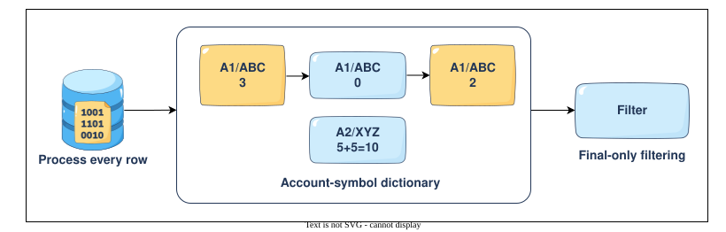

# Effective_Screen_Strategies_and_Time_Management_in_Palantir_FDE_Interviews

Source: https://www.educative.io/courses/forward-deployed-engineer/screen-formats-time-strategy-and-the-implementation-problem

---

[Home](https://www.educative.io/)

[Courses](https://www.educative.io/search?tab=courses)

[Forward Deployed Engineer for AI Systems](https://www.educative.io/courses/forward-deployed-engineer)

# Screen Formats, Time Strategy, and the Implementation Problem

Apply effective time management and a structured problem-solving strategy during technical assessments. Establish a clear input/output contract, choose an appropriate baseline, and implement runnable solutions. Verify assumptions against potential misunderstandings and adapt your approach to live coding screens or take-home assessments. Communicate your plan, justify time allocation, and prioritize working implementations over polishing unfinished code. Clarify problem requirements, maintain loop invariants, and verify solutions against known issues and edge cases.

We'll cover the following...

- [Read the instructions and fix the contract before typing](https://www.educative.io/courses/forward-deployed-engineer/screen-formats-time-strategy-and-the-implementation-problem#Read-the-instructions-and-fix-the-contract-before-typing)
- [Live screens and assessments need different strategies](https://www.educative.io/courses/forward-deployed-engineer/screen-formats-time-strategy-and-the-implementation-problem#Live-screens-and-assessments-need-different-strategies)
- [“Roll up holdings” needs an explicit contract](https://www.educative.io/courses/forward-deployed-engineer/screen-formats-time-strategy-and-the-implementation-problem#Roll-up-holdings-needs-an-explicit-contract)
- [The contract becomes a plan](https://www.educative.io/courses/forward-deployed-engineer/screen-formats-time-strategy-and-the-implementation-problem#The-contract-becomes-a-plan)
- [Trace the rows](https://www.educative.io/courses/forward-deployed-engineer/screen-formats-time-strategy-and-the-implementation-problem#Trace-the-rows)
- [Worked solution](https://www.educative.io/courses/forward-deployed-engineer/screen-formats-time-strategy-and-the-implementation-problem#Worked-solution)
- [Python shortcuts that break this plan](https://www.educative.io/courses/forward-deployed-engineer/screen-formats-time-strategy-and-the-implementation-problem#Python-shortcuts-that-break-this-plan)
  - [When a test fails](https://www.educative.io/courses/forward-deployed-engineer/screen-formats-time-strategy-and-the-implementation-problem#When-a-test-fails)
  - [Practice: roll up a new fixture](https://www.educative.io/courses/forward-deployed-engineer/screen-formats-time-strategy-and-the-implementation-problem#Practice-roll-up-a-new-fixture)
  - [Deciding when to move on](https://www.educative.io/courses/forward-deployed-engineer/screen-formats-time-strategy-and-the-implementation-problem#Deciding-when-to-move-on)

Thirty-five minutes into a 90-minute practice assessment, a candidate is still polishing the implementation task. SQL and API work remain untouched, and boundary cases have not been tested. What evidence would justify another ten minutes here?

A strong screen strategy makes progress visible through an explicit contract, a working baseline, and checks that target plausible errors. That evidence tells you whether to continue, repair, or move on before the deadline decides for you.

## Read the instructions and fix the contract before typing[#](https://www.educative.io/courses/forward-deployed-engineer/screen-formats-time-strategy-and-the-implementation-problem#Read-the-instructions-and-fix-the-contract-before-typing)

Start by reading the confirmed instructions, including submission, navigation, and tool rules. Don’t assume you can revisit answers, inspect every task, or run your own tests just because the editor looks familiar.

Then follow this sequence:

1. Establish the input/output contract.
2. Choose a correct baseline that fits the constraints.
3. Implement something runnable.
4. Verify the rules most likely to be misunderstood.
5. Improve it only when the constraints and remaining time justify it.

A strong answer is runnable, explainable, and verified against its contract before it is polished. One public candidate account (dated March 2025) describes practical feature implementation and recommends a working solution over an unfinished optimized one. That is one candidate’s experience, not a scoring rule.

## Live screens and assessments need different strategies[#](https://www.educative.io/courses/forward-deployed-engineer/screen-formats-time-strategy-and-the-implementation-problem#Live-screens-and-assessments-need-different-strategies)

One preparation guide reports an approximately 60-minute live technical screen and a 90-minute assessment with implementation, SQL, and API work. Other accounts describe different mixes, so treat these as preparation possibilities, not confirmed formats. Your own invitation decides.

For a live screen, speak at meaningful moments, not at every keystroke:

- **Contract:** State the rules that matter and invite correction.
- **Plan:** Name the data structure and why it preserves those rules.
- **Blocker:** Name the uncertainty and the next step to resolve it.
- **Verification:** Say what you tested, what you expected, and what it distinguishes.

A useful transition: “I’ll group by this identity, accumulate each contribution, then apply the output rules. Does that match the intended behavior?”

For a 60-minute live screen, a practice split is 5 minutes to clarify, 5 to plan, 30 to implement, 10 to verify, and 10 as a buffer (5 + 5 + 30 + 10 + 10 = 60).

For an unrestricted 90-minute assessment with three tasks, try 5 minutes to inspect, 25 per task, and 10 for final verification (5 + 3 × 25 + 10 = 90).

These are practice choices, not published Palantir requirements. Before ordering tasks, check whether you can navigate freely and whether any scoring information is shown. No budget guarantees every task passes.

## “Roll up holdings” needs an explicit contract[#](https://www.educative.io/courses/forward-deployed-engineer/screen-formats-time-strategy-and-the-implementation-problem#Roll-up-holdings-needs-an-explicit-contract)

One interview guide reports a portfolio-holdings roll-up as an example implementation task. The details below are a reconstruction for practice, not recovered assessment material.

The phrase “roll up holdings” leaves correctness open:

- Does identity mean symbol alone, or account plus symbol?
- Do identical rows count twice, or are they duplicate events?
- Should negative and zero positions appear?
- What ordering is required, and may the input change?

Use this resolved contract:

- Each row is `(account, symbol, quantity)`: two strings and a signed integer.
- Every row contributes once, including identical rows.
- Group by account and symbol together.
- Keep negative totals. Remove only final zero totals.
- Return a list of tuples sorted by account, then symbol.
- Don’t change the input. Empty input returns `[]`.

A candidate could say: “I’ll treat these as additive rows, including repeats. Accounts stay separate, short positions stay, and zeros are removed only from the final output.” That says more than “I’ll use a hash map”, because it explains what the map means.

## The contract becomes a plan[#](https://www.educative.io/courses/forward-deployed-engineer/screen-formats-time-strategy-and-the-implementation-problem#The-contract-becomes-a-plan)

Use one dictionary keyed by `(account, symbol)`. For each row, add its quantity to that key’s total. After the loop, sort the keys and output the nonzero totals.

Grouping by symbol alone would merge different accounts. Scanning an output list for each pair would add needless work.

State what stays true while you loop, called the **loop invariant**:

After each processed row, the dictionary holds every account-symbol pair seen so far, and each stored value is the sum of that pair’s quantities so far, including zero totals.

An empty dictionary satisfies this at the start. Each row changes exactly one pair by exactly its quantity, so the invariant keeps holding. Filtering and sorting happen only after all rows are processed.



Every row feeds the dictionary, then final-only filtering applies

## Trace the rows[#](https://www.educative.io/courses/forward-deployed-engineer/screen-formats-time-strategy-and-the-implementation-problem#Trace-the-rows)

Before the full trace, predict what happens to a position that reaches zero and then receives another row.

Predict the final holdings

1.

Process these rows in order under the resolved contract:

python
[(‘A1’,‘ABC’,3), (‘A1’,‘ABC’,-3), (‘A1’,‘ABC’,2),
(‘A2’,‘XYZ’,5), (‘A2’,‘XYZ’,5)]

Choose the final output. Before submitting, explain in your own words why ABC’s intermediate zero and the repeated XYZ row behave as they do.

A.

[(‘A1’,‘ABC’,2), (‘A2’,‘XYZ’,10)]

B.

[(‘A1’,‘ABC’,0), (‘A2’,‘XYZ’,10)]

C.

[(‘A1’,‘ABC’,2), (‘A2’,‘XYZ’,5)]

D.

[(‘A2’,‘XYZ’,10)]

---

1 / 1

Now process the full eight-row fixture in order:

1. `('A2', 'XYZ', 5)` creates `A2/XYZ = 5`.
2. `('A1', 'XYZ', 10)` creates a separate `A1/XYZ = 10`.
3. `('A1', 'XYZ', -4)` changes `A1/XYZ` to `6`.
4. `('A1', 'ABC', 3)` creates `A1/ABC = 3`.
5. `('A1', 'ABC', -3)` changes `A1/ABC` to `0`. The key stays stored.
6. `('A2', 'XYZ', 5)` changes `A2/XYZ` to `10`. An identical row contributes again.
7. `('A1', 'DEF', -2)` creates `A1/DEF = -2`.
8. `('A1', 'ABC', 2)` changes `A1/ABC` from `0` to `2`.

The sorted result is `[('A1', 'ABC', 2), ('A1', 'DEF', -2), ('A1', 'XYZ', 6), ('A2', 'XYZ', 10)]`.

## Worked solution[#](https://www.educative.io/courses/forward-deployed-engineer/screen-formats-time-strategy-and-the-implementation-problem#Worked-solution)

Run the code below as it is. Each expected value in the checks comes from a contract rule, not from the function’s own output.

Python 3.14.0

```
def roll_up_holdings(rows):

totals = {}

for account, symbol, quantity in rows:

key = (account, symbol)

totals[key] = totals.get(key, 0) + quantity

return [

(account, symbol, totals[(account, symbol)])

for account, symbol in sorted(totals)

if totals[(account, symbol)] != 0

]

def check(name, got, expected):

ok = got == expected

print("PASS" if ok else "FAIL", "-", name)

if not ok:

print("  got:", got)

print("  expected:", expected)

rows = [

('A2', 'XYZ', 5), ('A1', 'XYZ', 10), ('A1', 'XYZ', -4),

('A1', 'ABC', 3), ('A1', 'ABC', -3), ('A2', 'XYZ', 5),

('A1', 'DEF', -2), ('A1', 'ABC', 2),

]

before = rows.copy()

check("full trace", roll_up_holdings(rows),

[('A1', 'ABC', 2), ('A1', 'DEF', -2), ('A1', 'XYZ', 6), ('A2', 'XYZ', 10)])

check("input unchanged", rows, before)

check("empty input", roll_up_holdings([]), [])

check("accounts sorted", roll_up_holdings([('B2', 'X', 2), ('A1', 'X', 3)]), [('A1', 'X', 3), ('B2', 'X', 2)])

check("repeated rows add", roll_up_holdings([('A2', 'XYZ', 5), ('A2', 'XYZ', 5)]), [('A2', 'XYZ', 10)])

check("final zero removed", roll_up_holdings([('A1', 'X', 3), ('A1', 'X', -3)]), [])

check("zero then reopened", roll_up_holdings([('A1', 'X', 3), ('A1', 'X', -3), ('A1', 'X', 2)]), [('A1', 'X', 2)])

check("negative kept", roll_up_holdings([('A1', 'X', -2)]), [('A1', 'X', -2)])
```

⋯

Complete solution with checks for each contract rule

- **Line 2:** `totals` is created fresh on every call, so no state carries over between calls.
- **Lines 3–5:** One pass over the rows. `get(key, 0)` supplies a starting value of zero for a new pair.
- **Lines 7–11:** Keys are sorted, and only nonzero totals are returned. Zeros are removed here, after all the adding is done.
- **Lines 14–19:** `check` prints `PASS` or `FAIL`, so one failure doesn’t hide the others.
- **Lines 27–28:** The full eight-row trace, covering unsorted input, the repeated row, the reopened position, and the negative total.
- **Lines 32 and 34:** The two cases people most often get wrong: repeated rows must add, and a zero followed by another row must reopen the position.

If everything is correct, all eight lines print PASS. These checks give evidence for the cases they cover. They don’t prove that every hidden test will pass.

**Cost.** Let `n` be the number of rows and `k` the number of distinct account-symbol pairs.

- Adding up the rows takes about `O(n)` time.
- Sorting the keys takes `O(k log k)`, so the total is `O(n + k log k)`.
- Extra space is `O(k)`, and the output is at most `O(k)`.

In an interview you might say: “The scan is linear, and the required ordering adds the sort. The invariant covers accumulation. The final pass handles ordering and zero removal.”

**Baseline first:** Sorting the rows and summing each run of equal keys also works. The dictionary is simpler to reason about, so start there. Reach for anything cleverer only after your checks pass.

## Python shortcuts that break this plan[#](https://www.educative.io/courses/forward-deployed-engineer/screen-formats-time-strategy-and-the-implementation-problem#Python-shortcuts-that-break-this-plan)

**Mutable default.** A default dictionary is created once and shared by every call:

Ace Editor

1

2

3

4

5

6

7

def add\_row(row, totals={}): # BAD: one dict shared by every call

totals[row[0]] = totals.get(row[0], 0) + row[1]

return dict(totals)

print(add\_row(("XYZ", 4))) # {'XYZ': 4}

print(add\_row(("ABC", 1))) # {'XYZ': 4, 'ABC': 1} <- XYZ leaked in

הההההההההההההההההההההההההההההההההההההההההההההההההההההההההההההההההההההההההההההההההההההההההההההההההההההההההההההההההההההההההההההההההההההההההההההההההההההההההההההההההההההההההההההההההההההההההההההההההההההההההההההההההההההההההההההההההההההההההההההההההההההההההההההההההההההההההההההההההההההההההההההההההההההההההההההההההההההההההההההההההההההההההההההההההההההההההההההההההההההההההההההההההההההההההההההההההההההההההההההההההההההההההההההההההההההההההההההההההההההההההההההההההההההההההההההההההההההההההההההההההההההההההההההההההההההההההההההההה

XXXXXXXXXXXXXXXXXXXXXXXXXXXXXXXXXXXXXXXXXXXXXXXXXXXXXXXXXXXXXXXXXXXXXXXXXXXXXXXXXXXXXXXXXXXXXXXXXXXXXXXXXXXXXXXXXXXXXXXXXXXXXXXXXXXXXXXXXXXXXXXXXXXXXXXXXXXXXXXXXXXXXXXXXXXXXXXXXXXXXXXXXXXXXXXXXXXXXXXXXXXXXXXXXXXXXXXXXXXXXXXXXXXXXXXXXXXXXXXXXXXXXXXXXXXXXXXXXXXXXXXXXXXXXXXXXXXXXXXXXXXXXXXXXXXXXXXXXXXXXXXXXXXXXXXXXXXXXXXXXXXXXXXXXXXXXXXXXXXXXXXXXXXXXXXXXXXXXXXXXXXXXXXXXXXXXXXXXXXXXXXXXXXXXXXXXXXXXXXXXXXXXXXXXXXXXXXXXXXXXXXXXXXXXXXXXXXXXXXXXXXXXXXXXXXXXXXXXXXXXXXXXXXXXXXXXXXXXXXXXXXXXXXXXXXXXXXXXXXXXXXXXXXXXXXX

Mutable default argument keeps state between calls

The second call should have returned only `ABC`. Line 1 is the cause. Create `totals` inside the function instead.

Missing versus zero. A key that is absent differs from a key stored with value zero. `totals.get(key, 0)` treats absence as zero only for adding. If you permanently closed a position at zero, you would lose the later `A1/ABC` row.

Choosing a collection.

- Dictionary: keyed totals and lookup.
- Set: membership and uniqueness.
- List: ordered output.
- `collections.deque`: first-in-first-out processing. `list.pop(0)` shifts every remaining element, and a deque doesn’t.

The standard library is enough here. Never assume extra packages are available.

### When a test fails[#](https://www.educative.io/courses/forward-deployed-engineer/screen-formats-time-strategy-and-the-implementation-problem#When-a-test-fails)

Suppose you change the loop to `for account, symbol, quantity in set(rows):`. The repeated-row check now returns `[('A2', 'XYZ', 5)]` instead of `[('A2', 'XYZ', 10)]`.

Check the contract first. There are no event IDs, and every row contributes, so converting to a set deletes a valid row. Restore the loop over `rows`, rerun that check, then rerun the rest to look for new failures.

If sorting looks expensive, ask whether ordering is required. Here it is, so removing it breaks correctness. With little time left, fix proven defects and verify the other tasks before refactoring code that already passes.

### Practice: roll up a new fixture[#](https://www.educative.io/courses/forward-deployed-engineer/screen-formats-time-strategy-and-the-implementation-problem#Practice-roll-up-a-new-fixture)

Predict the answer on paper before you write code. Work out the expected output for the fixture and state the invariant. Then fill in the three TODOs and run it.

python310

```
def roll_up_holdings(rows):

totals = {}

for account, symbol, quantity in rows:

key = None  # TODO 1: the holding's identity (account and symbol together)

# TODO 2: add quantity to totals[key], starting from 0 if key is new

# TODO 3: return sorted (account, symbol, total) tuples, skipping zero totals

return []
```

⋯

Fill the TODO lines, run, compare with prediction

If your output disagrees with your prediction, find the first row where the invariant stops holding. That narrows the problem to one update. Two things to check in your own answer: `B1/AAA` goes 7 → 0 → 3, so it must appear, and `B2/AAA` receives two identical rows, so it totals 8.

### Deciding when to move on[#](https://www.educative.io/courses/forward-deployed-engineer/screen-formats-time-strategy-and-the-implementation-problem#Deciding-when-to-move-on)

Suppose you have a working, saved implementation and other tasks are waiting.

Deadline check

1. Is the current task runnable and checked against its contract? If yes, stop polishing.
2. Is there a known failing case you can fix in a few minutes? If yes, fix it. Otherwise, leave a short note on what remains.
3. Do other tasks still have no baseline? If yes, move on.
4. Keep your final verification time. Don’t spend it on earlier tasks.

**Back to the opening question:** Another ten minutes is justified only if you can name a specific failing case you expect to fix, and your other tasks already have a runnable baseline. “It could be cleaner” isn’t evidence.

Don’t assume the tasks carry equal weight, that you can go back, or that partial credit exists. Check what the platform allows. The right question is how to spend the time that remains, not which task order is best.

The next lesson looks at when a new prompt fits keyed accumulation and when it needs a different pattern with a different invariant.

Your Story: Why Palantir, Projects, Mission, and Ethics

Algorithm Patterns That Show Up in the Screen

Ask

[Read the instructions and fix the contract before typing](https://www.educative.io/courses/forward-deployed-engineer/screen-formats-time-strategy-and-the-implementation-problem#Read-the-instructions-and-fix-the-contract-before-typing)

[Live screens and assessments need different strategies](https://www.educative.io/courses/forward-deployed-engineer/screen-formats-time-strategy-and-the-implementation-problem#Live-screens-and-assessments-need-different-strategies)

[“Roll up holdings” needs an explicit contract](https://www.educative.io/courses/forward-deployed-engineer/screen-formats-time-strategy-and-the-implementation-problem#Roll-up-holdings-needs-an-explicit-contract)

[The contract becomes a plan](https://www.educative.io/courses/forward-deployed-engineer/screen-formats-time-strategy-and-the-implementation-problem#The-contract-becomes-a-plan)

[Trace the rows](https://www.educative.io/courses/forward-deployed-engineer/screen-formats-time-strategy-and-the-implementation-problem#Trace-the-rows)

[Worked solution](https://www.educative.io/courses/forward-deployed-engineer/screen-formats-time-strategy-and-the-implementation-problem#Worked-solution)

[Python shortcuts that break this plan](https://www.educative.io/courses/forward-deployed-engineer/screen-formats-time-strategy-and-the-implementation-problem#Python-shortcuts-that-break-this-plan)

[When a test fails](https://www.educative.io/courses/forward-deployed-engineer/screen-formats-time-strategy-and-the-implementation-problem#When-a-test-fails)

[Practice: roll up a new fixture](https://www.educative.io/courses/forward-deployed-engineer/screen-formats-time-strategy-and-the-implementation-problem#Practice-roll-up-a-new-fixture)

[Deciding when to move on](https://www.educative.io/courses/forward-deployed-engineer/screen-formats-time-strategy-and-the-implementation-problem#Deciding-when-to-move-on)