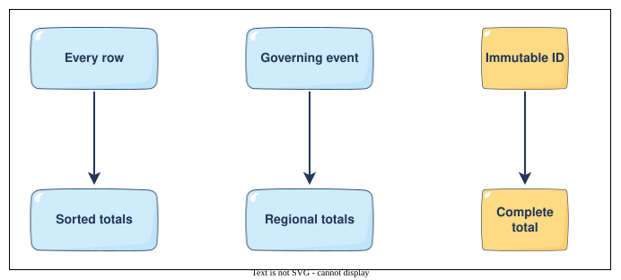

# Step-by-step_Palantir_FDE_technical_screen_case_study

Source: https://www.educative.io/courses/forward-deployed-engineer/case-study-a-full-technical-screen-solved-step-by-step

---

[Home](https://www.educative.io/)

[Courses](https://www.educative.io/search?tab=courses)

[Forward Deployed Engineer for AI Systems](https://www.educative.io/courses/forward-deployed-engineer)

# Case Study: A Full Technical Screen, Solved Step by Step

Work through a 90-minute technical screen covering three tasks: implementation, SQL queries, and API interaction. Inspect all tasks before coding, allocate time effectively, and maintain a decision log to track progress. Apply critical thinking to each task, anticipate common pitfalls, and verify outputs against hand-calculated predictions. Communicate assumptions clearly, handle errors systematically, and ensure accuracy throughout the assessment.

We'll cover the following...

- [The screen](https://www.educative.io/courses/forward-deployed-engineer/case-study-a-full-technical-screen-solved-step-by-step#The-screen)
- [Minutes 0–5: Inspect, then budget](https://www.educative.io/courses/forward-deployed-engineer/case-study-a-full-technical-screen-solved-step-by-step#Minutes-05-Inspect-then-budget)
- [Task 1 (minutes 5–22): Every row → sorted totals](https://www.educative.io/courses/forward-deployed-engineer/case-study-a-full-technical-screen-solved-step-by-step#Task-1-minutes-522-Every-row--sorted-totals)
  - [Task 2 (minutes 22–50): Governing event → regional totals](https://www.educative.io/courses/forward-deployed-engineer/case-study-a-full-technical-screen-solved-step-by-step#Task-2-minutes-2250-Governing-event--regional-totals)
  - [Task 3 (minutes 50–72): Immutable ID → complete total](https://www.educative.io/courses/forward-deployed-engineer/case-study-a-full-technical-screen-solved-step-by-step#Task-3-minutes-5072-Immutable-ID--complete-total)
  - [Minutes 72–90: Final verification](https://www.educative.io/courses/forward-deployed-engineer/case-study-a-full-technical-screen-solved-step-by-step#Minutes-7290-Final-verification)
  - [What made this screen work](https://www.educative.io/courses/forward-deployed-engineer/case-study-a-full-technical-screen-solved-step-by-step#What-made-this-screen-work)
  - [Practice: Repair a submission](https://www.educative.io/courses/forward-deployed-engineer/case-study-a-full-technical-screen-solved-step-by-step#Practice-Repair-a-submission)

A full screen combines an implementation task, a SQL query and an API task under one deadline. Below, each task is solved under a clock, with the checks that justify each move.

The screen below is a reconstruction built from public preparation reports, not a real Palantir assessment. Use it to rehearse the method, not to predict questions.

## The screen[#](https://www.educative.io/courses/forward-deployed-engineer/case-study-a-full-technical-screen-solved-step-by-step#The-screen)

It is a 90-minute practice assessment with three tasks. Navigation is free, and you can run your own code. No scoring weights are shown.

1. **Implementation:** Roll up inventory changes per warehouse and SKU.
2. **SQL:** Count open support tickets and their total severity per region.
3. **API:** Total the cost of incidents from a paginated endpoint.

## Minutes 0–5: Inspect, then budget[#](https://www.educative.io/courses/forward-deployed-engineer/case-study-a-full-technical-screen-solved-step-by-step#Minutes-05-Inspect-then-budget)

Read all three prompts before writing any code. For each one, note what the output row represents and which rule is most likely to be misunderstood.

> **Budget for this screen**
>
> - 0–5: inspect all tasks
> - 5–30: Task 1
> - 30–55: Task 2
> - 55–80: Task 3
> - 80–90: final verification of all three
>
> Each task block ends with a runnable baseline and at least one check. If a block runs over, save what works, write a note, and move on.

**Keep a decision log:** At each checkpoint, write one line: the time, what is verified, and your next move. For example: `22:00 — Task 1: 4 checks pass. Switching to Task 2 early.` It takes seconds, and it stops you from losing track of what is actually done. In a live screen, say the same line aloud.

While inspecting, the candidate notices that each task depends on one thing that must be preserved exactly:

- **Task 1:** Every row contributes, then the totals are sorted.
- **Task 2:** The *governing* event, meaning the latest one, decides each ticket’s status before anything is summed by region.
- **Task 3:** Each immutable ID counts once, and the total is valid only when the traversal is complete.



Three inputs each produce their matching totals, then checkpoints.

Get those three right and the rest is routine. Each task below follows one column of the diagram.

## Task 1 (minutes 5–22): Every row → sorted totals[#](https://www.educative.io/courses/forward-deployed-engineer/case-study-a-full-technical-screen-solved-step-by-step#Task-1-minutes-522-Every-row--sorted-totals)

**Prompt:** Rows are `(warehouse, sku, delta)`. Return the net quantity per warehouse and SKU, sorted, without zero totals.

**Contract the candidate writes down first:**

- Every row contributes, including identical rows.
- Group by warehouse and SKU together.
- Keep negative totals and drop only final zeros.
- Sort by warehouse, then SKU. Don’t modify the input.

**Plan, said aloud:** “One dictionary keyed by warehouse and SKU. Add each delta, then sort and drop zeros at the end.” The invariant: after each row, every pair’s value is the sum of its deltas so far.

**Hand prediction for the fixture:**

- W1/nut goes 10 → 0 → 6, so it reappears.
- W2/bolt receives 4 twice, for 8.
- W1/gear is −3 and stays.

Try it before opening the solution

C++

```
def roll_up(rows):

totals = {}

for warehouse, sku, delta in rows:

pass  # TODO 1: add delta to the running total for (warehouse, sku)

# TODO 2: return sorted (warehouse, sku, total) tuples, skipping final zeros

return []
```

⋯

Implement Task 1: every row adds, then sort.

**Checkpoint at minute 22:** All four checks pass. That beats the 25-minute budget, so the candidate stops instead of polishing and moves on with 3 minutes banked.

### Task 2 (minutes 22–50): Governing event → regional totals[#](https://www.educative.io/courses/forward-deployed-engineer/case-study-a-full-technical-screen-solved-step-by-step#Task-2-minutes-2250-Governing-event--regional-totals)

**Prompt:** For every region, count the tickets whose *latest* status is `open` and sum their severity. “Latest” means the greatest `event_time`, and the larger `event_id` wins a tie. A ticket with no events doesn’t count.

**Traps found while reading the fixture:**

- **K1** has two events at 10:00 (closed and open), so the tie-break decides it.
- **K3** has a highest-ID event (7, open) that is *older* than its latest event (6, closed).
- **K4** has no events, and west has no tickets.

**First attempt (minute 30).** The candidate writes a direct join with `WHERE status = 'open'`. It returns east 8 and north 10, and west is missing.

The hand prediction said east 5 (K1 3 + K2 2), north 0, and west 0, so the mismatch is caught immediately. East 8 means K1’s 3 was counted twice, which is fan-out. North 10 means K3’s two old open events were counted, which is a history filter. West is gone because of an inner join. These are three common SQL failures, and each has a known fix.

**Decision at minute 38.** Task 3 has no baseline yet. But the fix is known and small, so the candidate applies it rather than moving on.

Try it before opening the solution. The starter contains the naive first attempt. Run it to see east 8 and north 10, then replace the query.

C++

```
import sqlite3

db = sqlite3.connect(":memory:")

db.executescript("""

CREATE TABLE regions (region_id TEXT PRIMARY KEY, name TEXT);

CREATE TABLE tickets (ticket_id TEXT PRIMARY KEY, region_id TEXT, severity INTEGER);

CREATE TABLE ticket_events (event_id INTEGER PRIMARY KEY, ticket_id TEXT, status TEXT, event_time TEXT);

INSERT INTO regions VALUES ('R1','east'), ('R2','north'), ('R3','west');

INSERT INTO tickets VALUES ('K1','R1',3), ('K2','R1',2), ('K3','R2',5), ('K4','R2',1);

INSERT INTO ticket_events VALUES

(1,'K1','open','2026-09-01 09:00'), (2,'K1','closed','2026-09-01 10:00'),

(3,'K1','open','2026-09-01 10:00'), (4,'K2','open','2026-09-01 08:00'),

(5,'K3','open','2026-09-01 07:00'), (6,'K3','closed','2026-09-01 12:00'),

(7,'K3','open','2026-09-01 06:00');

""")

# TODO: replace this naive query. Rank each ticket's events (latest first,

#       larger event_id wins ties), keep tickets whose latest status is 'open',

#       then LEFT JOIN from regions: name, open count, total severity (0 if none).

query = """

SELECT rg.name, SUM(t.severity)

FROM regions rg

JOIN tickets t ON t.region_id = rg.region_id

JOIN ticket_events e ON e.ticket_id = t.ticket_id

WHERE e.status = 'open'

GROUP BY rg.name

ORDER BY rg.name;

"""
```

⋯

Implement Task 2: rank events, then total regions

East has the largest total, 5, and every total in this fixture is known, so “east has the most” is a supported claim.

> **Twist: what if a severity is unknown?** Suppose K3’s latest event were `open` and its severity were NULL. North would have one qualifying ticket with an unknown severity. `SUM` ignores NULLs, so the query above would quietly report north as `0`, which looks like a known total. A safer final column reports NULL when any qualifying severity is missing:
>
> `CASE WHEN COUNT(o.ticket_id) > COUNT(o.severity) THEN NULL ELSE COALESCE(SUM(o.severity), 0) END`
>
> East’s 5 would still be the largest *known* total, but you could no longer say east is the largest overall, because north’s real total might be bigger. Say “largest known total” unless every total is known.

**Checkpoint at minute 50:** PASS. That is 5 minutes ahead of the budget, and the time banked in Task 1 is still there.

Technical Quiz

1.

At minute 38, Task 2 returns east 8 instead of 5. You recognize the fan-out, and the fix (rank first, keep rn = 1) takes about 5 minutes. Task 3 has no baseline. 52 minutes remain, with 10 reserved for final checks. What is the best move?

A.

Move to Task 3 immediately and leave Task 2 as it is.

B.

Apply the known 5-minute fix, rerun the check, then move to Task 3.

C.

Rewrite Task 1 more cleanly first, since it already passes.

D.

Stay on Task 2 and add many more edge-case tests before touching Task 3.

---

1 / 1

### Task 3 (minutes 50–72): Immutable ID → complete total[#](https://www.educative.io/courses/forward-deployed-engineer/case-study-a-full-technical-screen-solved-step-by-step#Task-3-minutes-5072-Immutable-ID--complete-total)

**Prompt:** Sum `cost` across all incidents from a paginated endpoint. Follow `nextPageToken` until it is absent. An incident `id` never changes, and the same `id` on two pages is one incident.

**Hand prediction from the sample pages:**

- Page 1 has I1 (12) and I2 (8), with a token.
- Page 2 is empty but has a token, so keep going.
- Page 3 repeats I2 and adds I3 (5), with no token.

The correct total is 12 + 8 + 5 = 25. Two plausible wrong answers: 33, from adding I2 twice, and 20, from stopping at the empty page.

Try it before opening the solution.

C++

```
PAGES = {

None: {"items": [{"id": "I1", "cost": 12}, {"id": "I2", "cost": 8}], "nextPageToken": "b"},

"b": {"items": [], "nextPageToken": "c"},

"c": {"items": [{"id": "I2", "cost": 8}, {"id": "I3", "cost": 5}]},

}

def total_cost(fetch, max_pages=100):

token, seen_tokens, costs = None, set(), {}

for _ in range(max_pages):

page = fetch(token)

# TODO 1: stop with an error if a token repeats

# TODO 2: record each item's cost by id (the same id counts once)

# TODO 3: if "nextPageToken" is missing, return the sum; otherwise move to it

break  # remove this line when TODO 3 is done

return 0
```

⋯

Implement Task 3: count each ID, finish all pages.

**Four meanings of “finished”**  
Change one thing about page `c` and look at what each run means:

- **Stopped at the empty page** **`b`****:** Returns 20. I3 was never retrieved, so the answer is wrong.
- **Page** **`c`** **fails after all retries:** Progress so far is 20, but there is no complete result. Raise an error. Don’t return 20.
- **Page** **`c`** **is genuinely empty with no token:** Returns 20, and this time 20 is correct and complete.
- **Page** **`c`** **returns I2 with cost 9:** The same `id` has two different costs. Raise an error. Picking one would invent a rule.

Three of these produce the number 20. The number alone can’t tell them apart. Only the stop condition and the request trace can.

**Checkpoint at minute 72:** the total is 25, matching the prediction. That leaves 18 minutes, 8 more than the planned budget.

### Minutes 72–90: Final verification[#](https://www.educative.io/courses/forward-deployed-engineer/case-study-a-full-technical-screen-solved-step-by-step#Minutes-7290-Final-verification)

The candidate uses the spare time to verify, not to polish:

> **Final check, one line per task**
>
> - **Task 1:** Rerun all checks. Confirm that repeated rows add and the zero partway through reopens.
> - **Task 2:** Confirm the tie-break line is present and west appears as `0, 0`.
> - **Task 3:** Confirm that 25 matches the hand prediction and that no code path returns a total early.
> - **All tasks:** Submitted and saved. No debug prints that change the output.

If a final run breaks something that passed earlier, undo the last change first. Don’t start a new fix in the last five minutes.

The candidate’s decision log for the whole attempt:

> **Decision log**
>
> - `00:00` Inspect all three tasks. Reserve the last 10 minutes.
> - `05:00` Contracts and hand predictions written. Start Task 1.
> - `22:00` Task 1: 4 checks pass. Switch to Task 2 early.
> - `30:00` Task 2 first attempt: east 8, north 10, west missing. Diagnosed: fan-out, history filter, inner join.
> - `38:00` Known fix, about 5 minutes. Applying it before Task 3.
> - `50:00` Task 2 PASS. Start Task 3.
> - `72:00` Task 3: 25, matches prediction. Start final verification.
> - `90:00` All three submitted. Not tested: a NULL severity in Task 2 and API failures in Task 3.

The last line is the most important. It says honestly what was *not* verified, instead of implying everything was.

### What made this screen work[#](https://www.educative.io/courses/forward-deployed-engineer/case-study-a-full-technical-screen-solved-step-by-step#What-made-this-screen-work)

- **Predictions came before code.** Every mismatch in Task 2 was caught by comparing the output to a hand-computed answer, not by staring at the code.
- **Each failure pointed to one rule.** East 8 meant fan-out, north 10 meant history instead of the latest event, and missing west meant an inner join.
- **Checkpoints decided the time.** Finishing early banked minutes, and the known Task 2 fix was worth spending them on.
- **Claims matched the evidence.** “Largest known total” and “complete because the token was absent” are claims you can defend. “Looks right” isn’t.

### Practice: Repair a submission[#](https://www.educative.io/courses/forward-deployed-engineer/case-study-a-full-technical-screen-solved-step-by-step#Practice-Repair-a-submission)

Here is another candidate’s Task 3 submission. It runs and returns a number, but the number is wrong. Find both bugs before reading the solution.

C++

```
def total_cost(fetch):

token = None

total = 0

while True:

page = fetch(token)

if not page["items"]:

break

for item in page["items"]:

total += item["cost"]

if "nextPageToken" not in page:

break

token = page["nextPageToken"]

return total

def check(name, got, expected):

ok = got == expected

print("PASS" if ok else "FAIL", "-", name)

if not ok:

print("  got:", got)

print("  expected:", expected)

PAGES = {

None: {"items": [{"id": "I1", "cost": 12}, {"id": "I2", "cost": 8}], "nextPageToken": "b"},

"b": {"items": [], "nextPageToken": "c"},

"c": {"items": [{"id": "I2", "cost": 8}, {"id": "I3", "cost": 5}]},

}

REPEAT = {None: {"items": [{"id": "X", "cost": 2}], "nextPageToken": "y"},

"y": {"items": [{"id": "X", "cost": 2}]}}

check("sample pages", total_cost(lambda t: PAGES[t]), 25)

check("same id on two pages", total_cost(lambda t: REPEAT[t]), 2)
```

⋯

Find and fix both bugs in this submission

Read the FAIL output before the code. “Got 20” on the sample says pages were skipped. “Got 4” on the repeat case says an `id` was counted twice. Each number points to one rule in the contract.

SQL and API Tasks: Queries, Pagination, and Aggregation

Decomposition: What It Tests and a Repeatable Framework

Ask

[The screen](https://www.educative.io/courses/forward-deployed-engineer/case-study-a-full-technical-screen-solved-step-by-step#The-screen)

[Minutes 0–5: Inspect, then budget](https://www.educative.io/courses/forward-deployed-engineer/case-study-a-full-technical-screen-solved-step-by-step#Minutes-05-Inspect-then-budget)

[Task 1 (minutes 5–22): Every row → sorted totals](https://www.educative.io/courses/forward-deployed-engineer/case-study-a-full-technical-screen-solved-step-by-step#Task-1-minutes-522-Every-row--sorted-totals)

[Task 2 (minutes 22–50): Governing event → regional totals](https://www.educative.io/courses/forward-deployed-engineer/case-study-a-full-technical-screen-solved-step-by-step#Task-2-minutes-2250-Governing-event--regional-totals)

[Task 3 (minutes 50–72): Immutable ID → complete total](https://www.educative.io/courses/forward-deployed-engineer/case-study-a-full-technical-screen-solved-step-by-step#Task-3-minutes-5072-Immutable-ID--complete-total)

[Minutes 72–90: Final verification](https://www.educative.io/courses/forward-deployed-engineer/case-study-a-full-technical-screen-solved-step-by-step#Minutes-7290-Final-verification)

[What made this screen work](https://www.educative.io/courses/forward-deployed-engineer/case-study-a-full-technical-screen-solved-step-by-step#What-made-this-screen-work)

[Practice: Repair a submission](https://www.educative.io/courses/forward-deployed-engineer/case-study-a-full-technical-screen-solved-step-by-step#Practice-Repair-a-submission)