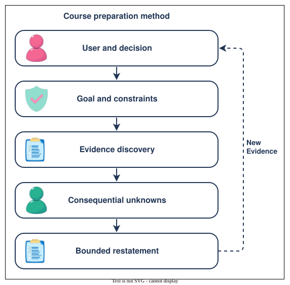

# Decomposition_Framework_and_Testing_in_Palantir_FDE_Interviews

Source: https://www.educative.io/courses/forward-deployed-engineer/decomposition-what-it-tests-and-a-repeatable-framework

---

[Home](https://www.educative.io/)

[Courses](https://www.educative.io/search?tab=courses)

[Forward Deployed Engineer for AI Systems](https://www.educative.io/courses/forward-deployed-engineer)

# Decomposition: What It Tests and a Repeatable Framework

Apply a five-pass decomposition framework to turn broad goals into actionable decisions. Identify the user and decision, define goals and constraints, gather relevant evidence, surface consequential unknowns, and create a bounded restatement of the problem. Ask critical questions that could change the scope of the work, ground decisions in evidence and clear objectives, and iteratively refine the problem as new information emerges.

We'll cover the following...

- [What the round tests](https://www.educative.io/courses/forward-deployed-engineer/decomposition-what-it-tests-and-a-repeatable-framework#What-the-round-tests)
- [A repeatable framework: Five passes](https://www.educative.io/courses/forward-deployed-engineer/decomposition-what-it-tests-and-a-repeatable-framework#A-repeatable-framework-Five-passes)
- [Pass 1: Questions that change scope](https://www.educative.io/courses/forward-deployed-engineer/decomposition-what-it-tests-and-a-repeatable-framework#Pass-1-Questions-that-change-scope)
  - [Pass 1 result: The user and decision](https://www.educative.io/courses/forward-deployed-engineer/decomposition-what-it-tests-and-a-repeatable-framework#Pass-1-result-The-user-and-decision)
  - [Pass 2: Goal and constraints](https://www.educative.io/courses/forward-deployed-engineer/decomposition-what-it-tests-and-a-repeatable-framework#Pass-2-Goal-and-constraints)
  - [Pass 3: Evidence discovery](https://www.educative.io/courses/forward-deployed-engineer/decomposition-what-it-tests-and-a-repeatable-framework#Pass-3-Evidence-discovery)
  - [Pass 4: Consequential unknowns](https://www.educative.io/courses/forward-deployed-engineer/decomposition-what-it-tests-and-a-repeatable-framework#Pass-4-Consequential-unknowns)
  - [Pass 5: Bounded restatement](https://www.educative.io/courses/forward-deployed-engineer/decomposition-what-it-tests-and-a-repeatable-framework#Pass-5-Bounded-restatement)
  - [The same method on “Improve city traffic”](https://www.educative.io/courses/forward-deployed-engineer/decomposition-what-it-tests-and-a-repeatable-framework#The-same-method-on-Improve-city-traffic)
  - [Reported decomposition prompts](https://www.educative.io/courses/forward-deployed-engineer/decomposition-what-it-tests-and-a-repeatable-framework#Reported-decomposition-prompts)

Catalog species in an unfamiliar environment” has at least two reasonable interpretations:

- Help a researcher identify specimens.
- Help a field coordinator choose tomorrow’s survey sites.

Both could justify a catalog, but they need different evidence and different measures of success.

**Decomposition** turns a broad goal into a bounded decision that an authorized person can make with the evidence available. The first useful output is a defensible problem statement. Choosing a database or a classifier comes after that boundary is clear.

## What the round tests[#](https://www.educative.io/courses/forward-deployed-engineer/decomposition-what-it-tests-and-a-repeatable-framework#What-the-round-tests)

Public candidate reports describe the decomposition round as an open-ended conversation, usually with little or no code. The prompt is deliberately vague. A strong candidate doesn’t jump to a solution. They establish whose problem is worth solving, what action is possible, and whether the evidence supports it.

In practice, that means showing four things:

- You ask questions whose answers change the work.
- You separate what is known from what is assumed.
- You notice when data looks complete but can’t support the decision.
- You end with a scoped statement someone could act on.

## A repeatable framework: Five passes[#](https://www.educative.io/courses/forward-deployed-engineer/decomposition-what-it-tests-and-a-repeatable-framework#A-repeatable-framework-Five-passes)

Each pass produces something you can say aloud in one or two sentences:

1. **User and decision:** Who decides what, and by when.
2. **Goal and constraints:** The operational change wanted and the limits that bind it.
3. **Evidence discovery:** Which records exist, what they mean, and their limits.
4. **Consequential unknowns:** A short, prioritized list of assumptions whose answers could change the work.
5. **Bounded restatement:** A problem statement with its scope and remaining uncertainty made explicit.

Five-step method for preparing a course, looping on new evidence

The dashed arrow matters as much as the boxes. When an answer to an unknown invalidates an earlier assumption, go back to the top and revise the user and decision. For example, learning that records arrive a day late can turn a live-monitoring goal into a planning goal.

This is a preparation method, not a published Palantir rubric or a guaranteed interview sequence. The passes are useful because each one produces something visible. A revised decision sentence is real progress. Twenty unanswered questions that change nothing are not.

## Pass 1: Questions that change scope[#](https://www.educative.io/courses/forward-deployed-engineer/decomposition-what-it-tests-and-a-repeatable-framework#Pass-1-Questions-that-change-scope)

A **consequential question** is one where plausible answers would change the user, the decision, the scope, the evidence you need, or whether the work is feasible. When you ask one, say why it matters.

For the species prompt, three questions open the main branches:

- **Who uses the result, and what do they decide?** A researcher confirming an identification needs different support from a coordinator allocating fieldwork.
- **Does “catalog” mean recording observations, or establishing confirmed species identities?** The second needs much stronger evidence and expert confirmation.
- **What field access and expert review are available?** Access limits what can be collected. Review capacity limits what can be claimed.

A concise spoken opening:

“If the goal is tomorrow’s field allocation, I need survey effort and coverage. If it’s species identification, I need evidence and expert confirmation. Which decision should I support?”

Asking which database to use can’t resolve any of these branches. If the interviewer won’t answer, propose a reversible assumption: “I’ll assume the immediate user allocates fieldwork, so coverage planning comes first. I’d revisit that if identification turns out to be the real decision.”

Which questions change the scope?

1.

You’re given “Catalog species in an unfamiliar environment.” Which question should you ask first?

A.

Which database should store the catalog?

B.

Who will use the result, and what decision will they make with it?

C.

Should the classifier be a CNN or a transformer?

D.

How many species live in the environment?

---

1 / 1

### Pass 1 result: The user and decision[#](https://www.educative.io/courses/forward-deployed-engineer/decomposition-what-it-tests-and-a-repeatable-framework#Pass-1-result-The-user-and-decision)

The interviewer gives a boundary: a field coordinator assigns two teams to two of four zones for tomorrow, and assignments are due at 16:00. Each person has a different role:

- **Coordinator:** Authorizes team assignments.
- **Field teams:** Collect observations on approved routes.
- **Expert reviewer:** Confirms uncertain identifications.
- **Data owner:** Controls use of the logs. Who this is still needs confirming.

Recommending a zone doesn’t grant permission to enter it. Assigning teams doesn’t include confirming species.

**Decision sentence:** “The field coordinator must choose tomorrow’s two survey zones before 16:00, within route permissions and team capacity.”

### Pass 2: Goal and constraints[#](https://www.educative.io/courses/forward-deployed-engineer/decomposition-what-it-tests-and-a-repeatable-framework#Pass-2-Goal-and-constraints)

The goal is to reduce gaps in a usable observation catalog. The binding constraints are approved routes only, expert review for uncertain labels, and restricted access to sensitive locations. Certifying every species is out of scope.

### Pass 3: Evidence discovery[#](https://www.educative.io/courses/forward-deployed-engineer/decomposition-what-it-tests-and-a-repeatable-framework#Pass-3-Evidence-discovery)

For each source, ask what it can support, how it was produced, and when it is usable. For field logs, that means:

- **Identity:** One observation ID per sighting, and a rule for duplicate uploads.
- **Effort:** Survey-hours per zone, recorded once per survey, not once per sighting.
- **Quality:** Whether labels are provisional or reviewed.
- **Timing:** Logs upload by 14:00 the next day, and review takes three days.

**Event time** is when something happened. **Availability time** is when the decision-maker can use the record. At 16:00, yesterday’s logs are available, but most labels are still provisional.

Yesterday’s summary:

|  |  |  |  |
| --- | --- | --- | --- |
| **Zone** | **Observations** | **Survey-Hours** | **Rate Per Hour** |
| A | 18 | 6 | 3 |
| B | 8 | 2 | 4 |
| C | 0 | 0 | undefined |
| D | 4 | 4 | 1 |

> **Zero isn’t absence.** C had no survey effort, so “C has no species” is unsupported. The defensible claim is “C lacks survey evidence.” Rates don’t measure biodiversity either, because methods and routes may differ between zones.
>
> **A tempting answer:** “Using live data, rank zones by biodiversity, skip C, and complete the catalog.” Every part overreaches: logs are a day old, rates aren’t biodiversity, C was never surveyed, and two surveys can’t complete a catalog.

### Pass 4: Consequential unknowns[#](https://www.educative.io/courses/forward-deployed-engineer/decomposition-what-it-tests-and-a-repeatable-framework#Pass-4-Consequential-unknowns)

Of three open questions (Is C reachable? What is one sighting’s final label? Which storage engine?), ask about C’s reachability first. It is the only one whose answer changes which assignments are possible.

The interviewer confirms that C is accessible and that each team has four hours. This is the dashed loop in the diagram: new evidence revises the decision.

|  |  |  |
| --- | --- | --- |
| **Answers** | **Assumption It Broke** | **Revised Boundary** |
| C had zero effort | Zero sightings means no species | Treat C as a coverage gap |
| Logs arrive next day | Today’s data is visible at 16:00 | Plan from yesterday’s uploads |
| Review takes three days | All labels are confirmed | Keep provisional and reviewed labels separate |
| C is accessible | A gap alone makes a survey feasible | C is a feasible survey |

The second zone still needs safety and priority information, so keep that choice provisional. Stop asking once answers can no longer change the decision.

### Pass 5: Bounded restatement[#](https://www.educative.io/courses/forward-deployed-engineer/decomposition-what-it-tests-and-a-repeatable-framework#Pass-5-Bounded-restatement)

“Help the field coordinator plan two four-hour surveys before 16:00 using available, permitted records, prioritizing coverage gaps and keeping provisional and reviewed labels separate.”

- **Proxy:** Zones with recorded survey effort.
- **Baseline:** 3 of 4 zones (75%).
- **Verification:** Surveying C could reach 100%, but only returned effort records prove it.

Full coverage improves the proxy. It doesn’t prove every species was cataloged.

### The same method on “Improve city traffic”[#](https://www.educative.io/courses/forward-deployed-engineer/decomposition-what-it-tests-and-a-repeatable-framework#The-same-method-on-Improve-city-traffic)

Separate a signal operator acting minute by minute from a planner choosing next month’s study corridor. If sensor counts arrive a day late and nobody has confirmed authority to change signals, frame it as planning:

“Help the transport planner choose a corridor for next month’s study, using permitted historical data and noting the coverage gaps.”

The key unknowns differ from the species case (road-user coverage, privacy, authority to intervene), but the five passes are the same.

### Reported decomposition prompts[#](https://www.educative.io/courses/forward-deployed-engineer/decomposition-what-it-tests-and-a-repeatable-framework#Reported-decomposition-prompts)

These prompt families appear in public candidate reports. Wording varies, and none is guaranteed.

1.

Catalog species in an unfamiliar environment.

Show Answer

1 / 3

Case Study: A Full Technical Screen, Solved Step by Step

From Ideation to Execution: Users, Data Models, and APIs

Ask

[What the round tests](https://www.educative.io/courses/forward-deployed-engineer/decomposition-what-it-tests-and-a-repeatable-framework#What-the-round-tests)

[A repeatable framework: Five passes](https://www.educative.io/courses/forward-deployed-engineer/decomposition-what-it-tests-and-a-repeatable-framework#A-repeatable-framework-Five-passes)

[Pass 1: Questions that change scope](https://www.educative.io/courses/forward-deployed-engineer/decomposition-what-it-tests-and-a-repeatable-framework#Pass-1-Questions-that-change-scope)

[Pass 1 result: The user and decision](https://www.educative.io/courses/forward-deployed-engineer/decomposition-what-it-tests-and-a-repeatable-framework#Pass-1-result-The-user-and-decision)

[Pass 2: Goal and constraints](https://www.educative.io/courses/forward-deployed-engineer/decomposition-what-it-tests-and-a-repeatable-framework#Pass-2-Goal-and-constraints)

[Pass 3: Evidence discovery](https://www.educative.io/courses/forward-deployed-engineer/decomposition-what-it-tests-and-a-repeatable-framework#Pass-3-Evidence-discovery)

[Pass 4: Consequential unknowns](https://www.educative.io/courses/forward-deployed-engineer/decomposition-what-it-tests-and-a-repeatable-framework#Pass-4-Consequential-unknowns)

[Pass 5: Bounded restatement](https://www.educative.io/courses/forward-deployed-engineer/decomposition-what-it-tests-and-a-repeatable-framework#Pass-5-Bounded-restatement)

[The same method on “Improve city traffic”](https://www.educative.io/courses/forward-deployed-engineer/decomposition-what-it-tests-and-a-repeatable-framework#The-same-method-on-Improve-city-traffic)

[Reported decomposition prompts](https://www.educative.io/courses/forward-deployed-engineer/decomposition-what-it-tests-and-a-repeatable-framework#Reported-decomposition-prompts)