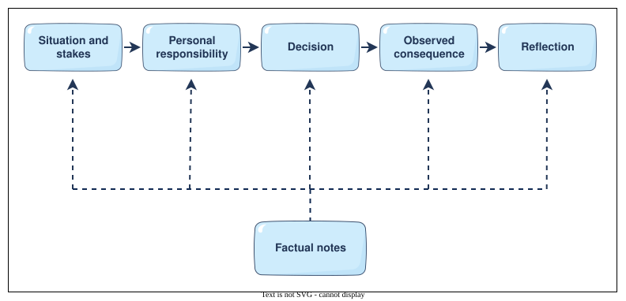

# Behavioral_Questions_for_Palantir_FDE_Interviews_on_Pushback_and_Ownership

Source: https://www.educative.io/courses/forward-deployed-engineer/behavioral-questions-pushback-failure-ownership-and-ambiguity

---

[Home](https://www.educative.io/)

[Courses](https://www.educative.io/search?tab=courses)

[Forward Deployed Engineer for AI Systems](https://www.educative.io/courses/forward-deployed-engineer)

# Behavioral Questions: Pushback, Failure, Ownership and Ambiguity

Prepare clear, defensible behavioral interview examples that demonstrate personal decision-making and accountability. Develop specific stories highlighting your choices, available information, impact on others, and measurable outcomes. Use the STAR method to structure responses while prioritizing factual details over vague claims. Demonstrate ownership, navigate ambiguity, and discuss failures with evidence of learning. Address ethical considerations and articulate your motivations for pursuing the role, aligning your experiences with its expectations.

We'll cover the following...

- [What a defensible answer contains](https://www.educative.io/courses/forward-deployed-engineer/behavioral-questions-pushback-failure-ownership-and-ambiguity#What-a-defensible-answer-contains)
- [A structure that survives follow-ups](https://www.educative.io/courses/forward-deployed-engineer/behavioral-questions-pushback-failure-ownership-and-ambiguity#A-structure-that-survives-follow-ups)
- [Worked example: Pushback with a deadline](https://www.educative.io/courses/forward-deployed-engineer/behavioral-questions-pushback-failure-ownership-and-ambiguity#Worked-example-Pushback-with-a-deadline)
- [The failure: A specific cause](https://www.educative.io/courses/forward-deployed-engineer/behavioral-questions-pushback-failure-ownership-and-ambiguity#The-failure--A-specific-cause)
- [Ownership and ambiguity](https://www.educative.io/courses/forward-deployed-engineer/behavioral-questions-pushback-failure-ownership-and-ambiguity#Ownership-and-ambiguity)
- [When the interviewer challenges the evidence](https://www.educative.io/courses/forward-deployed-engineer/behavioral-questions-pushback-failure-ownership-and-ambiguity#When-the-interviewer-challenges-the-evidence)
- [Connecting to “Why Palantir?” and “Why FDSE?”](https://www.educative.io/courses/forward-deployed-engineer/behavioral-questions-pushback-failure-ownership-and-ambiguity#Connecting-to-Why-Palantir-and-Why-FDSE)
- [Mission and ethics without performing agreement](https://www.educative.io/courses/forward-deployed-engineer/behavioral-questions-pushback-failure-ownership-and-ambiguity#Mission-and-ethics-without-performing-agreement)
- [A tempting answer, repaired](https://www.educative.io/courses/forward-deployed-engineer/behavioral-questions-pushback-failure-ownership-and-ambiguity#A-tempting-answer-repaired)
- [Preparing your own stories](https://www.educative.io/courses/forward-deployed-engineer/behavioral-questions-pushback-failure-ownership-and-ambiguity#Preparing-your-own-stories)
- [Reported behavioral questions](https://www.educative.io/courses/forward-deployed-engineer/behavioral-questions-pushback-failure-ownership-and-ambiguity#Reported-behavioral-questions)

A behavioral answer is only as strong as the evidence you can defend when follow-ups probe your decisions, your responsibility and what you didn’t know. Before choosing a story, identify one real decision you made and one consequence it had. If you can’t, the story isn’t ready.

A defensible answer keeps the same facts when the interviewer changes the question.

## What a defensible answer contains[#](https://www.educative.io/courses/forward-deployed-engineer/behavioral-questions-pushback-failure-ownership-and-ambiguity#What-a-defensible-answer-contains)

Every answer needs four things: a personal decision, the information you had at the time, the people affected, and an observed consequence.

- **Vague:** “We delivered under pressure.” All four are unclear.
- **Specific:** “I assumed an empty field meant standard service. Review found four incorrect classifications.” This gives the interviewer something concrete to probe.

One official US Government FDSE posting describes valuing collaboration with technical and non-technical people, iterating with users as objectives change, continuous learning, and making decisions with minimal supervision. Those are expectations stated in a posting, not a published scoring rubric. Prepare evidence of those behaviors from your own work. A modest project where your responsibility is clear beats a large one whose decisions you can’t explain.

## A structure that survives follow-ups[#](https://www.educative.io/courses/forward-deployed-engineer/behavioral-questions-pushback-failure-ownership-and-ambiguity#A-structure-that-survives-follow-ups)

STAR (Situation, Task, Action, Result) organizes an answer, but the value is in what goes inside it. Use five parts, each backed by factual notes:

1. **Situation and stakes:** the user’s problem and why it mattered, in brief.
2. **Personal responsibility:** separate your work from your teammates’. Name the uncertainty or disagreement.
3. **Decision:** the evidence, the alternatives, your recommendation, and who had the authority to decide.
4. **Observed consequence:** what happened and how you know. Keep measurements, observations, and unknowns separate.
5. **Reflection:** what you would change. For a failure, show changed behavior *later*, if you have evidence of it.

Factual notes support every step from situation to reflection

Prepare factual notes, not memorized paragraphs. Aim for a 60–90 second opening, then expand when asked. That timing is a practice target, not a rule. The structure helps you retrieve facts under pressure. It can’t supply responsibility you didn’t have or turn an intended improvement into a demonstrated one. If there’s no later example of changed behavior, say so, and say what you intend to do differently.

## Worked example: Pushback with a deadline[#](https://www.educative.io/courses/forward-deployed-engineer/behavioral-questions-pushback-failure-ownership-and-ambiguity#Worked-example-Pushback-with-a-deadline)

**Prompt (reported):** “Tell me about a time you pushed back on a customer request.” The story below is an invented demonstration.

An operations lead wants a Friday pilot in which 30 imported delivery jobs go directly to dispatch. Six jobs have incomplete destinations.

|  |  |
| --- | --- |
| **Person** | **Owns** |
| You | Parsing, validation, exception queue |
| Teammates | Dispatch interface, scheduling integration |
| Operations lead | Classification policy, pilot approval |

|  |  |  |
| --- | --- | --- |
| **Option** | **Benefit** | **Cost** |
| Dispatch everything | Keeps full scope and the date | Sends unresolved destinations into operations |
| Block the whole pilot | No exposure | Stops work that could be reviewed and used |
| Supervised pilot with an exception queue | Useful pilot, incomplete jobs held for review | Someone must review exceptions |

You recommend the queue, acknowledge the Friday constraint, and ask the lead to approve the scope. You own the implementation, and the lead decides whether the bounded pilot is acceptable.

A concise opening answer:

“An operations lead wanted 30 imported delivery jobs sent straight to dispatch for a Friday pilot. I owned parsing, validation, and exception handling. Six jobs had incomplete destinations, so I recommended a supervised pilot with those jobs held for review. I compared that with dispatching everything and with delaying all the work. The lead owned the pilot scope and approved the reviewed approach.

The review also exposed my own mistake: I had treated empty service codes as standard without confirming the policy. Four jobs needed reclassification, and the pilot started a day late. I removed the default, got approved classifications, and checked the rerun against all 30. On a later import, I used an explicit code dictionary and approved examples before implementation, which caught two undocumented codes before release. I learned to confirm operational meanings before encoding them.”

The lead’s deadline was legitimate. Evidence that the destinations were actually complete would have changed the recommendation. Good pushback stays open to evidence like that.

## The failure: A specific cause[#](https://www.educative.io/courses/forward-deployed-engineer/behavioral-questions-pushback-failure-ownership-and-ambiguity#The-failure--A-specific-cause)

The failure is the unconfirmed service-code assumption. The earlier pushback about destinations doesn’t excuse it.

Asked “What did you personally get wrong?”, answer directly:

“I treated an empty service code as standard without confirming it with the operations lead. That was my parser decision. Four jobs needed reclassification, and the pilot began a day late. I should have raised the unknown policy before implementing.”

|  |  |  |
| --- | --- | --- |
|  | **What It Shows** | **Example** |
| Repair | You fixed this instance | Removed the default, routed unclassified jobs to review, verified the rerun |
| Changed behavior | You changed how you work | On a later 20-job import, a code dictionary and approved sample caught two undocumented codes before release |

“I fixed the parser” is recovery. The later import is evidence that you changed how you establish requirements. Don’t blame messy data. The source contained an unknown, and you chose to give it a meaning nobody had confirmed.

## Ownership and ambiguity[#](https://www.educative.io/courses/forward-deployed-engineer/behavioral-questions-pushback-failure-ownership-and-ambiguity#Ownership-and-ambiguity)

Asked “Did you own the whole system?”, keep the boundaries:

> “I owned the parser, validation and exception handling. Teammates owned the dispatch interface and scheduling. The lead owned classification policy and pilot approval. I brought the alternatives and implemented the agreed behavior. I didn’t have authority to define service policy or approve dispatch.”

For ambiguity, explain how reversible each choice was:

- **Before release:** A code mapping can be changed and the import rerun.
- **After dispatch:** An instruction may already have affected people and work, which is much harder to undo.
- **Deliberately left out:** Route optimization and automatic exception handling. The first version had to establish reliable import and review. Optimization wouldn’t have settled destination completeness or classification policy.

Ownership shows in a decision carried through to verification, with authority left with the right person.

## When the interviewer challenges the evidence[#](https://www.educative.io/courses/forward-deployed-engineer/behavioral-questions-pushback-failure-ownership-and-ambiguity#When-the-interviewer-challenges-the-evidence)

The facts stay fixed. The supervised review covered 30 jobs and found four wrong classifications and six incomplete destinations, with the overlap between those groups unknown. The corrected rerun matched approved classifications for all 30. No handling-time baseline was collected.

Defend the evidence

1.

The interviewer asks: “How many jobs were affected, and did the process become faster?”

A review of 30 jobs found four wrong classifications and six incomplete destinations, with overlap unspecified. The corrected rerun matched approved classifications for all 30. No handling-time baseline was collected.

Which response is defensible?

A.

Four jobs had wrong classifications; six had incomplete destinations. I cannot give an exact distinct-job total without knowing the overlap. The corrected rerun matched all 30 approved classifications, but I cannot claim faster handling.

B.

Four jobs had wrong classifications and six had incomplete destinations, with overlap unknown. Matching all 30 approved classifications on the rerun supports an estimated 50% speed gain.

C.

Four jobs had wrong classifications and six had incomplete destinations, with overlap unknown. The corrected rerun proves classifications are now correct throughout production, though speed remains unmeasured.

D.

Ten distinct jobs were affected: four with wrong classifications plus six with incomplete destinations. The corrected rerun matched all 30 approved classifications, but speed was not measured.

---

1 / 1

The overlap is unknown, so the number of distinct affected jobs is somewhere from 6 to 10. Say that rather than adding 4 + 6.

|  |  |
| --- | --- |
| **Challenge** | **Defensible Reply** |
| “Was it your decision?” | “The empty-code default was mine. The reviewed-pilot scope was my recommendation, approved by the lead. Classification policy was the lead’s.” |
| “Why not delay everything?” | “The known destination issue didn’t justify discarding all progress. The lead could still delay if supervision wasn’t available. It ultimately started a day late.” |
| “How do you know it improved?” | “The rerun matched approved classifications for all 30 reviewed jobs. With no baseline, I can’t claim it was faster.” |
| “What did you do differently next time?” | “On a later 20-job import, a code dictionary and approved examples caught two undocumented codes before release. That supports a change in practice, not a claim that every future error was prevented.” |
| “What would the stakeholder say?” | “I can’t speak for them. They could fairly point to the missed Friday start and the extra review my assumption caused. I’d ask whether the exception process met their needs.” |

Each reply survives scrutiny because it never turns the story into a victory.

## Connecting to “Why Palantir?” and “Why FDSE?”[#](https://www.educative.io/courses/forward-deployed-engineer/behavioral-questions-pushback-failure-ownership-and-ambiguity#Connecting-to-Why-Palantir-and-Why-FDSE)

Use your own experience to explain the interest:

> “I found I wanted to stay involved through user review and operational verification, not stop when the parser produced output. The FDSE posting describes working with technical and non-technical people and iterating with users as objectives change. That’s a reason I’m looking at FDSE work at Palantir. I’d want to understand how this team balances hands-on building with user iteration.”

This needs no platform experience, no claim that Palantir is unique, and no product-name dropping. It explains what you want to do, not just prestige or “impact”.

## Mission and ethics without performing agreement[#](https://www.educative.io/courses/forward-deployed-engineer/behavioral-questions-pushback-failure-ownership-and-ambiguity#Mission-and-ethics-without-performing-agreement)

Suppose the lead asks to give every contractor indefinite access to identifiable delivery histories for troubleshooting. The goal, resolving delivery problems, is useful. The proposed access needs its own justification.

> “I support giving contractors what they need to resolve their assigned delivery problems. First I’d establish which records and fields they need, whose information is in those histories, what authorization applies and how long access is needed. A restricted view of current jobs might meet the need with far less exposure. I wouldn’t implement blanket indefinite access while purpose, authorization and retention are unresolved. I’d escalate those questions to the people who own them.”

Use the same approach for questions about government, defense, privacy or civil liberties: state a real view, the trade-off you see, and what information would change your decision. Don’t invent safeguards or facts about deployments.

One secondary guide describes a candidate who blamed their rejection after a hiring-manager interview on “mission alignment”. That is the poster’s interpretation. It doesn’t establish the cause, or a stance you should adopt.

## A tempting answer, repaired[#](https://www.educative.io/courses/forward-deployed-engineer/behavioral-questions-pushback-failure-ownership-and-ambiguity#A-tempting-answer-repaired)

**Tempting:** *“The client wanted a bad approach, so I convinced them to use mine. We launched successfully, saved 50% of the time, and I learned to communicate.”*

**What’s wrong:** it calls the stakeholder’s approach “bad”, claims authority the candidate didn’t have (“convinced them to use mine”), claims a launch success and a 50% saving with no evidence, and offers a generic lesson.

**Repaired:** “The lead needed a Friday pilot. Six jobs lacked complete destinations, so I recommended supervised review, and the lead approved the scope. My unconfirmed empty-code default caused four wrong classifications, and the pilot began a day late. I removed the default and verified the rerun against all 30. I have no speed baseline. On a later import, a code dictionary caught two undocumented codes before release.”

The repaired version never calls anything bad or successful. The facts let the listener judge both the decision and the mistake.

## Preparing your own stories[#](https://www.educative.io/courses/forward-deployed-engineer/behavioral-questions-pushback-failure-ownership-and-ambiguity#Preparing-your-own-stories)

Build notes for one pushback story and one separate failure story from your own experience. Don’t borrow the dispatch story. Fill each field with facts, not adjectives:

|  |  |
| --- | --- |
| **Field** | **What to Note** |
| Situation and stakes | The user, the problem, the deadline or risk |
| Your responsibility | What you owned, and what others owned |
| Decision | The options, your recommendation, who decided |
| Consequence | Measured, observed or unknown, and how you know |
| Reflection | Later changed behavior, or plainly what you intend |

A listener should be able to identify your decision, the stakeholder’s legitimate constraint, who owned the decision, the observed consequence, and what supports any claimed change.

## Reported behavioral questions[#](https://www.educative.io/courses/forward-deployed-engineer/behavioral-questions-pushback-failure-ownership-and-ambiguity#Reported-behavioral-questions)

These themes appear in public candidate reports and guides. Wording varies, and none is guaranteed.

1.

Why Palantir, and why this team?

Show Answer

1 / 6

These stories carry into the final stage. The hiring-manager conversation, team matching, and the offer each test the same thing: whether your claims about your work, your interests, and your fit hold up under direct questions.

Case Study: Designing an Operational System With Trade-offs

The Hiring Manager Final, Team Matching, and the Offer

Ask

[What a defensible answer contains](https://www.educative.io/courses/forward-deployed-engineer/behavioral-questions-pushback-failure-ownership-and-ambiguity#What-a-defensible-answer-contains)

[A structure that survives follow-ups](https://www.educative.io/courses/forward-deployed-engineer/behavioral-questions-pushback-failure-ownership-and-ambiguity#A-structure-that-survives-follow-ups)

[Worked example: Pushback with a deadline](https://www.educative.io/courses/forward-deployed-engineer/behavioral-questions-pushback-failure-ownership-and-ambiguity#Worked-example-Pushback-with-a-deadline)

[The failure: A specific cause](https://www.educative.io/courses/forward-deployed-engineer/behavioral-questions-pushback-failure-ownership-and-ambiguity#The-failure--A-specific-cause)

[Ownership and ambiguity](https://www.educative.io/courses/forward-deployed-engineer/behavioral-questions-pushback-failure-ownership-and-ambiguity#Ownership-and-ambiguity)

[When the interviewer challenges the evidence](https://www.educative.io/courses/forward-deployed-engineer/behavioral-questions-pushback-failure-ownership-and-ambiguity#When-the-interviewer-challenges-the-evidence)

[Connecting to “Why Palantir?” and “Why FDSE?”](https://www.educative.io/courses/forward-deployed-engineer/behavioral-questions-pushback-failure-ownership-and-ambiguity#Connecting-to-Why-Palantir-and-Why-FDSE)

[Mission and ethics without performing agreement](https://www.educative.io/courses/forward-deployed-engineer/behavioral-questions-pushback-failure-ownership-and-ambiguity#Mission-and-ethics-without-performing-agreement)

[A tempting answer, repaired](https://www.educative.io/courses/forward-deployed-engineer/behavioral-questions-pushback-failure-ownership-and-ambiguity#A-tempting-answer-repaired)

[Preparing your own stories](https://www.educative.io/courses/forward-deployed-engineer/behavioral-questions-pushback-failure-ownership-and-ambiguity#Preparing-your-own-stories)

[Reported behavioral questions](https://www.educative.io/courses/forward-deployed-engineer/behavioral-questions-pushback-failure-ownership-and-ambiguity#Reported-behavioral-questions)