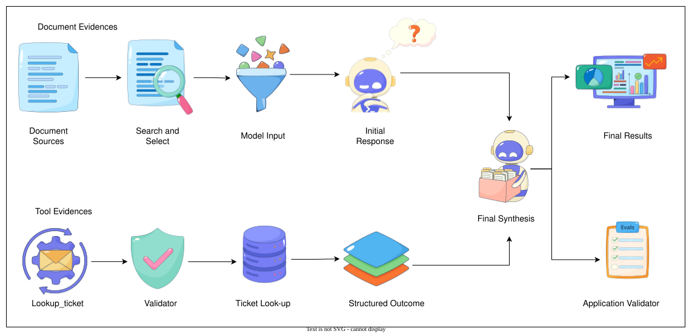

# Building_Effective_LLM-Powered_AI_Helpdesk_Solutions

Source: https://www.educative.io/courses/forward-deployed-engineer/building-llm-powered-solutions

---

[Home](https://www.educative.io/)

[Courses](https://www.educative.io/search?tab=courses)

[Forward Deployed Engineer for AI Systems](https://www.educative.io/courses/forward-deployed-engineer)

# Building LLM-Powered Solutions

Choose the simplest LLM workflow that meets the requirements, whether through direct prompting, retrieval, or limited tool use. Make retrieved evidence traceable, validate model-generated output against a defined schema, and enforce tool-call permissions and execution limits in application code to build LLM features that produce verifiable, evidence-grounded responses.

We'll cover the following...

- [Choosing the simplest workflow](https://www.educative.io/courses/forward-deployed-engineer/building-llm-powered-solutions#Choosing-the-simplest-workflow)
- [Preparing traceable chunks](https://www.educative.io/courses/forward-deployed-engineer/building-llm-powered-solutions#Preparing-traceable-chunks)
- [Keeping retrieval bounded](https://www.educative.io/courses/forward-deployed-engineer/building-llm-powered-solutions#Keeping-retrieval-bounded)
- [Defining the output schema](https://www.educative.io/courses/forward-deployed-engineer/building-llm-powered-solutions#Defining-the-output-schema)
- [Controlling tool calls](https://www.educative.io/courses/forward-deployed-engineer/building-llm-powered-solutions#Controlling-tool-calls)
  - [Walk through the two files](https://www.educative.io/courses/forward-deployed-engineer/building-llm-powered-solutions#Walk-through-the-two-files)
- [Valid citations, false answers](https://www.educative.io/courses/forward-deployed-engineer/building-llm-powered-solutions#Valid-citations-false-answers)
- [Practice: The meeting-room assistant](https://www.educative.io/courses/forward-deployed-engineer/building-llm-powered-solutions#Practice-The-meeting-room-assistant)

“How long can I borrow a projector, and what is the status of repair ticket `T41`?”

An equipment-helpdesk assistant needs two sources of information: the equipment-loan policy and the current record for ticket `T41`. The model can combine both sources into a response, but generating a plausible answer does not establish its accuracy or authorize a ticket lookup.

Application code controls which evidence is provided to the model, which tool calls are authorized and executed, and which model outputs pass validation.

## Choosing the simplest workflow[#](https://www.educative.io/courses/forward-deployed-engineer/building-llm-powered-solutions#Choosing-the-simplest-workflow)

Use ordinary code for identifier validation, document indexing, ticket lookup, and date arithmetic. The useful generative work is interpreting the question and composing a readable response from supplied evidence.

Choose the smallest workflow that supplies that evidence:

- **Direct prompting:** Put one relevant passage directly into the request. This works when all necessary information fits there.
- **Retrieval-augmented generation (RAG):** Retrieve relevant passages from a collection and supply them with the question. A standard pipeline fixes the retrieval sequence at design time.
- **Bounded tool use:** Let the model propose a narrowly defined operation, then let application code validate and execute it.

For this request, choose fixed RAG plus one optional read-only ticket lookup. Dynamic source selection or runtime query decomposition could justify additional agentic behavior; this small collection needs neither.

## Preparing traceable chunks[#](https://www.educative.io/courses/forward-deployed-engineer/building-llm-powered-solutions#Preparing-traceable-chunks)

A **chunk** is a retrievable unit of source content. Its boundary should preserve the context needed to interpret its rule.

Create `equipment_policies.json` with these three section-level records:

- `equipment-policy:projector-loans`, source `equipment-policy`, version `3`, section `projector-loans`: “Projectors may be borrowed for 3 calendar days. Extensions require desk approval.”
- `equipment-policy:laptop-loans`, source `equipment-policy`, version `3`, section `laptop-loans`: “Laptops may be borrowed for 14 calendar days.”
- `repair-guide:repair-states`, source `repair-guide`, version `2`, section `repair-states`: “awaiting\_parts means a repair is waiting for replacement parts. This state provides no completion-date guarantee.”

Each record stores `chunk_id`, `source_id`, `version`, `section`, and `text`. Preserve these fields through cleaning, indexing, retrieval, and citation rendering so a reviewer can trace an answer back to a particular section and version.

Keep the projector rule and its extension condition together. Complete sentences alone do not guarantee complete meaning: A heading, several sentences, and their exceptions may need to remain together. The same principle prevents detaching a table header from the rows it explains.

## Keeping retrieval bounded[#](https://www.educative.io/courses/forward-deployed-engineer/building-llm-powered-solutions#Keeping-retrieval-bounded)

An inverted lexical index maps normalized terms to the IDs of chunks containing them. For this collection, an in-memory dictionary is sufficient.

The implementation lowercases words, splits punctuation and underscores, normalizes `projectors` to `projector` and `laptops` to `laptop`, and removes common function words. It indexes section headings and passage text. Rank chunks by the number of distinct query terms they match, breaking ties by chunk ID.

Then apply three explicit limits:

1. Exclude zero-match chunks.
2. Select at most two whole chunks.
3. Keep the serialized context, including metadata, within 250 whitespace-separated words. Skip an oversized chunk rather than silently truncating it.

For the opening question, `projector` finds the projector section and `repair` finds the repair guide. The laptop section has no matching content term. Expose both selected IDs and their full passages before generation.



Fixture mode

Document provenance and ticket evidence remain separate as application-controlled retrieval, lookup, and validation support the final answer. Inspecting the selected passages answers a concrete question: Did retrieval supply the rule the customer needs? A model cannot recover an omitted extension condition reliably from a passage that never included it.

## Defining the output schema[#](https://www.educative.io/courses/forward-deployed-engineer/building-llm-powered-solutions#Defining-the-output-schema)

Assemble messages containing the task, question, selected records, permitted tool definition, and response alternatives. Ask for JSON only, with one of two exact shapes.

A tool proposal looks like this:

Ace Editor

1

2

{"type":"tool","name":"lookup\_ticket","arguments":{"ticket\_id":"T41"}}

הההההההההההההההההההההההההההההההההההההההההההההההההההההההההההההההההההההההההההההההההההההההההההההההההההההההההההההההההההההההההההההההההההההההההההההההההההההההההההההההההההההההההההההההההההההההההההההההההההההההההההההההההההההההההההההההההההההההההההההההההההההההההההההההההההההההההההההההההההההההההההההההההההההההההההההההההההההההההההההההההההההההההההההההההההההההההההההההההההההההההההההההההההההההההההההההההההההההההההההההההההההההההההההההההההההההההההההההההההההההההההההההההההההההההההההההההההההההההההההההההההההההההההההההההההההההההההההההה

XXXXXXXXXXXXXXXXXXXXXXXXXXXXXXXXXXXXXXXXXXXXXXXXXXXXXXXXXXXXXXXXXXXXXXXXXXXXXXXXXXXXXXXXXXXXXXXXXXXXXXXXXXXXXXXXXXXXXXXXXXXXXXXXXXXXXXXXXXXXXXXXXXXXXXXXXXXXXXXXXXXXXXXXXXXXXXXXXXXXXXXXXXXXXXXXXXXXXXXXXXXXXXXXXXXXXXXXXXXXXXXXXXXXXXXXXXXXXXXXXXXXXXXXXXXXXXXXXXXXXXXXXXXXXXXXXXXXXXXXXXXXXXXXXXXXXXXXXXXXXXXXXXXXXXXXXXXXXXXXXXXXXXXXXXXXXXXXXXXXXXXXXXXXXXXXXXXXXXXXXXXXXXXXXXXXXXXXXXXXXXXXXXXXXXXXXXXXXXXXXXXXXXXXXXXXXXXXXXXXXXXXXXXXXXXXXXXXXXXXXXXXXXXXXXXXXXXXXXXXXXXXXXXXXXXXXXXXXXXXXXXXXXXXXXXXXXXXXXXXXXXXXXXXXXXX

An answer contains `type`, `status`, `claims`, and `reason`. Each claim contains `text` and an `evidence` list; each evidence entry contains `kind` and `id`.

Ace Editor

1

2

{"type":"answer","status":"answered","claims":[{"text":"Projectors may be borrowed for 3 calendar days; extensions require desk approval.","evidence":[{"kind":"document","id":"equipment-policy:projector-loans"}]}],"reason":null}

הההההההההההההההההההההההההההההההההההההההההההההההההההההההההההההההההההההההההההההההההההההההההההההההההההההההההההההההההההההההההההההההההההההההההההההההההההההההההההההההההההההההההההההההההההההההההההההההההההההההההההההההההההההההההההההההההההההההההההההההההההההההההההההההההההההההההההההההההההההההההההההההההההההההההההההההההההההההההההההההההההההההההההההההההההההההההההההההההההההההההההההההההההההההההההההההההההההההההההההההההההההההההההההההההההההההההההההההההההההההההההההההההההההההההההההההההההההההההההההההההההההההההההההההההההההההההההההההה

XXXXXXXXXXXXXXXXXXXXXXXXXXXXXXXXXXXXXXXXXXXXXXXXXXXXXXXXXXXXXXXXXXXXXXXXXXXXXXXXXXXXXXXXXXXXXXXXXXXXXXXXXXXXXXXXXXXXXXXXXXXXXXXXXXXXXXXXXXXXXXXXXXXXXXXXXXXXXXXXXXXXXXXXXXXXXXXXXXXXXXXXXXXXXXXXXXXXXXXXXXXXXXXXXXXXXXXXXXXXXXXXXXXXXXXXXXXXXXXXXXXXXXXXXXXXXXXXXXXXXXXXXXXXXXXXXXXXXXXXXXXXXXXXXXXXXXXXXXXXXXXXXXXXXXXXXXXXXXXXXXXXXXXXXXXXXXXXXXXXXXXXXXXXXXXXXXXXXXXXXXXXXXXXXXXXXXXXXXXXXXXXXXXXXXXXXXXXXXXXXXXXXXXXXXXXXXXXXXXXXXXXXXXXXXXXXXXXXXXXXXXXXXXXXXXXXXXXXXXXXXXXXXXXXXXXXXXXXXXXXXXXXXXXXXXXXXXXXXXXXXXXXXXXXXXX

Validation enforces exact fields and types, rather than accepting arbitrary extra keys:

- `answered` requires at least one nonempty claim, each with evidence, and a null reason.
- `unsupported` requires an empty claims list and a nonempty reason.
- Document evidence IDs must occur in the supplied context.
- Tool evidence IDs must refer to an actual successful lookup from this attempt.
- Unknown response types, operations, fields, and evidence kinds are rejected.

Keep `invalid_response` distinct from `unsupported`. Malformed JSON is a contract failure; an unsupported question is a valid application outcome.

Requesting JSON, receiving parseable JSON, satisfying the schema, and making supported claims are four separate properties. Structured-output features help with representation but leave application validation and factual checking necessary.

## Controlling tool calls[#](https://www.educative.io/courses/forward-deployed-engineer/building-llm-powered-solutions#Controlling-tool-calls)

The tool definition should explain its purpose, parameters, example, edge cases, and boundaries. Clear interfaces reduce opportunities for incorrect calls.

Define `lookup_ticket(ticket_id)` as a read-only operation accepting exactly one argument: A string matching `T` followed by one or more ASCII digits. It returns `ok or not_found`. The local fixture maps `T41` to `awaiting_parts`; it supplies no completion date.

The application follows this sequence:

1. Validate the first model response.
2. If it proposes a valid lookup, record and execute one read.
3. Append the structured outcome to the messages.
4. Make one final model call with tools disabled.
5. Reject any second tool proposal as `tool_limit_reached`.

The ceiling is one lookup and two model calls. Invalid arguments never reach the lookup function. A real model adapter should also have a timeout that ends the attempt without retrying; this fixture doesn’t simulate one.

Save the two independent files together using Python 3.11 or newer. On macOS or Linux, run `python3 equipment_assistant.py`; on Windows, run `py equipment_assistant.py`. They require no packages, accounts, or credentials.

Before running it, predict the selected chunks, lookup count, and evidence attached to each final claim.

Files

equipment\_assistant.py

equipment\_policies.json

python310

```
"""Equipment helpdesk assistant, fixture mode only.

A scripted fake stands in for the model; no live model is called.

Run: python3 equipment_assistant.py"""

import json

import re

from pathlib import Path

QUESTION = "How long can I borrow a projector, and what is the status of repair ticket T41?"

STOP_WORDS = set("a an the and or of for to in on is are be may can i how what long".split())

SINGULAR = {"projectors": "projector", "laptops": "laptop"}

TICKETS = {"T41": "awaiting_parts"}

def terms(text):

words = re.findall(r"[a-z0-9]+", text.lower())

return {SINGULAR.get(word, word) for word in words if word not in STOP_WORDS}

def retrieve(records, question, max_chunks=2, max_words=250):

query = terms(question)

scored = []

for record in records:

score = len(query & terms(record["section"] + " " + record["text"]))

if score > 0:

scored.append((-score, record["chunk_id"], record))

selected = []

for _, _, record in sorted(scored, key=lambda item: (item[0], item[1])):

candidate = selected + [record]

if len(candidate) <= max_chunks and len(json.dumps(candidate).split()) <= max_words:

selected = candidate

return selected

def lookup_ticket(ticket_id):

if ticket_id not in TICKETS:

return {"outcome": "not_found", "ticket_id": ticket_id}

return {"outcome": "ok", "ticket_id": ticket_id, "status": TICKETS[ticket_id],

"evidence_id": "lookup_ticket:" + ticket_id}

def check_response(response, document_ids, tool_ids):

"""Returns None if the response is structurally valid, else a reason."""

if not isinstance(response, dict):

return "not a JSON object"

if response.get("type") == "tool":

if set(response) != {"type", "name", "arguments"} or response["name"] != "lookup_ticket":

return "unknown tool proposal"

arguments = response["arguments"]

if not isinstance(arguments, dict) or set(arguments) != {"ticket_id"}:

return "lookup_ticket accepts only ticket_id"

if not re.fullmatch(r"T[0-9]+", str(arguments["ticket_id"])):

return "invalid ticket_id"

return None

if response.get("type") != "answer" or set(response) != {"type", "status", "claims", "reason"}:

return "unknown response shape"

if response["status"] == "unsupported":

return None if response["claims"] == [] and response["reason"] else "bad unsupported answer"

if response["status"] != "answered" or not response["claims"] or response["reason"] is not None:

return "bad answered answer"

for claim in response["claims"]:

if not claim.get("text") or not claim.get("evidence"):

return "claim without text or evidence"

for evidence in claim["evidence"]:

allowed = document_ids if evidence.get("kind") == "document" else tool_ids

if evidence.get("kind") not in ("document", "tool") or evidence.get("id") not in allowed:

return "unknown evidence reference"

return None

def run_attempt(records, question, model_responses, context=None):

"""At most two model calls and one lookup. model_responses is the scripted fake."""

selected = context if context is not None else retrieve(records, question)

document_ids = {record["chunk_id"] for record in selected}

tool_ids = set()

trace = {"selected": sorted(document_ids), "lookups": [], "result": None}

for call_number in (1, 2):

try:

response = json.loads(model_responses[call_number - 1])

except json.JSONDecodeError:

trace["result"] = "invalid_response"

return trace

if call_number == 2 and isinstance(response, dict) and response.get("type") == "tool":

trace["result"] = "tool_limit_reached"

return trace

problem = check_response(response, document_ids, tool_ids)

if problem:

trace["result"] = "invalid_response: " + problem

return trace

if response["type"] == "answer":

trace["result"] = response["status"]

trace["claims"] = response["claims"]

return trace

outcome = lookup_ticket(response["arguments"]["ticket_id"])

trace["lookups"].append(outcome)

if outcome["outcome"] == "ok":

tool_ids.add(outcome["evidence_id"])

return trace

def tool(ticket_id="T41", **extra):

return json.dumps({"type": "tool", "name": "lookup_ticket", "arguments": dict(ticket_id=ticket_id, **extra)})

def answer(*claims):

claim_list = [{"text": text, "evidence": [{"kind": kind, "id": cid}]} for text, kind, cid in claims]

return json.dumps({"type": "answer", "status": "answered", "claims": claim_list, "reason": None})

def unsupported(reason):

return json.dumps({"type": "answer", "status": "unsupported", "claims": [], "reason": reason})

SUCCESS = answer(

("Projectors may be borrowed for 3 calendar days; extensions require desk approval.",

"document", "equipment-policy:projector-loans"),

("T41 is awaiting_parts.", "tool", "lookup_ticket:T41"),

("awaiting_parts means waiting for parts, with no completion-date guarantee.",

"document", "repair-guide:repair-states"),

)

LAPTOP_CLAIM = answer(("Projectors can be borrowed for 14 calendar days.", "document", "equipment-policy:laptop-loans"))

if __name__ == "__main__":

records = json.loads(Path(__file__).with_name("equipment_policies.json").read_text())

by_id = {record["chunk_id"]: record for record in records}

scenarios = [

("success", QUESTION, [tool(), SUCCESS], None),

("exact date", "What exact date will repair ticket T41 be ready?",

[tool(), unsupported("Neither source supplies a completion date.")], None),

("malformed JSON", QUESTION, ["{"], None),

("invalid ticket_id", QUESTION, [tool("../all")], None),

("repeated proposal", QUESTION, [tool(), tool()], None),

("laptop citation", QUESTION, [LAPTOP_CLAIM],

[by_id["equipment-policy:projector-loans"], by_id["equipment-policy:laptop-loans"]]),

]

print("Mode: fixture (scripted model responses); no live model called\n")

for name, question, responses, context in scenarios:

trace = run_attempt(records, question, responses, context)

print(f"{name}: result={trace['result']}, lookups={len(trace['lookups'])}, selected={trace['selected']}")

print("\nNote: 'laptop citation' passes structural checks but is factually wrong;")

print("only comparing the claim with the cited passage catches it.")
```

⋯

Scripted scenarios, fixture mode only

### Walk through the two files[#](https://www.educative.io/courses/forward-deployed-engineer/building-llm-powered-solutions#Walk-through-the-two-files)

In `equipment_policies.json`:

- **Lines 2–8:** Store the projector section with its stable identifiers, version, and complete rule. Keeping the extension condition here prevents retrieval from losing it.
- **Lines 9–15:** Store the separate laptop rule. Its real citation ID makes it useful for testing whether reference membership is confused with evidence support.
- **Lines 16–22:** Store the repair-state definition and its completion-date limitation together. A status explanation must preserve both.

The `equipment_assistant.py` module implements the workflow controls in application code. `retrieve` selects up to two matching chunks, with a combined limit of 250 words. `check_response` validates responses against the required JSON schemas, permitted tool name, ticket ID format, and supplied citation IDs. `run_attempt` limits execution to two model calls and one lookup, returning `tool_limit_reached` if the model proposes another tool call.

The six scripted scenarios cover a successful response, an unsupported date question, malformed JSON, an invalid ticket ID, a repeated tool proposal, and an incorrect laptop citation. The final scenario passes structural validation despite containing a factual error.

Distinguish guarantees enforced by application code from behavior simulated through scripted model responses. The scenarios verify lookup counts and rejection behavior under the scripted inputs. They do not establish how reliably a live model would select relevant evidence or propose appropriate tool calls.

The expected successful trace is entirely **fixture-mode**:

1. The source sections become the projector and repair-state chunks, retaining their versions and text.
2. Retrieval selects `equipment-policy:projector-loans` and `repair-guide:repair-states` within the context cap.
3. The first scripted response proposes `lookup_ticket` with only `ticket_id: T41`.
4. Validation permits dispatch. The recorded lookup list becomes `[“T41”]`.
5. The lookup returns `ok`, ticket `T41`, status `awaiting_parts`, evidence ID `lookup_ticket:T41`.
6. The final scripted answer produces three claims: The 3-calendar-day rule with desk approval for extensions, citing the projector section; T41’s status, citing the lookup result; and the meaning of `awaiting_parts`, citing the repair guide.

A `not_found` or `error` outcome cannot support a ticket-status claim. It remains visible as the lookup outcome rather than becoming an invented status.

## Valid citations, false answers[#](https://www.educative.io/courses/forward-deployed-engineer/building-llm-powered-solutions#Valid-citations-false-answers)

Suppose the supplied context instead contains the projector and laptop sections. The model emits:

Ace Editor

1

2

{"type":"answer","status":"answered","claims":[{"text":"Projectors can be borrowed for 14 calendar days.","evidence":[{"kind":"document","id":"equipment-policy:laptop-loans"}]}],"reason":null}

הההההההההההההההההההההההההההההההההההההההההההההההההההההההההההההההההההההההההההההההההההההההההההההההההההההההההההההההההההההההההההההההההההההההההההההההההההההההההההההההההההההההההההההההההההההההההההההההההההההההההההההההההההההההההההההההההההההההההההההההההההההההההההההההההההההההההההההההההההההההההההההההההההההההההההההההההההההההההההההההההההההההההההההההההההההההההההההההההההההההההההההההההההההההההההההההההההההההההההההההההההההההההההההההההההההההההההההההההההההההההההההההההההההההההההההההההההההההההההההההההההההההההההההההההההההההההההההההה

XXXXXXXXXXXXXXXXXXXXXXXXXXXXXXXXXXXXXXXXXXXXXXXXXXXXXXXXXXXXXXXXXXXXXXXXXXXXXXXXXXXXXXXXXXXXXXXXXXXXXXXXXXXXXXXXXXXXXXXXXXXXXXXXXXXXXXXXXXXXXXXXXXXXXXXXXXXXXXXXXXXXXXXXXXXXXXXXXXXXXXXXXXXXXXXXXXXXXXXXXXXXXXXXXXXXXXXXXXXXXXXXXXXXXXXXXXXXXXXXXXXXXXXXXXXXXXXXXXXXXXXXXXXXXXXXXXXXXXXXXXXXXXXXXXXXXXXXXXXXXXXXXXXXXXXXXXXXXXXXXXXXXXXXXXXXXXXXXXXXXXXXXXXXXXXXXXXXXXXXXXXXXXXXXXXXXXXXXXXXXXXXXXXXXXXXXXXXXXXXXXXXXXXXXXXXXXXXXXXXXXXXXXXXXXXXXXXXXXXXXXXXXXXXXXXXXXXXXXXXXXXXXXXXXXXXXXXXXXXXXXXXXXXXXXXXXXXXXXXXXXXXXXXXXXXX

Compare the actual evidence:

- Cited laptop passage: “Laptops may be borrowed for 14 calendar days.”
- Projector passage: “Projectors may be borrowed for 3 calendar days. Extensions require desk approval.”

JSON parsing passes. Field types pass. The citation ID belongs to the supplied context, so reference membership passes too. The evidence comparison fails: The 14-day rule applies to laptops, while the projector rule specifies 3 days and an extension condition.

The validator therefore reports structural acceptance, not factual approval. Adding a confidence percentage would create another unsupported assertion. More context or an agent framework would not make the laptop passage support a projector claim.

Now compare that evidence failure with the execution boundary. `ticket_id: “../all”` fails the identifier rule. Adding `export_all: true` fails the exact argument shape. Both produce zero recorded lookups. A second otherwise valid proposal produces `tool_limit_reached`, leaving the total at one.

Predict the boundary: evidence or execution?

↓ Entry

📄Case 1: Laptop citation

↓ Entry

🔎Case 2: Initial T41 lookup

↓ Entry

🚧Case 3: Invalid identifier

↓ Entry

📦Case 4: Extra argument

↓ Entry

🔁Case 5: Second proposal

↓ Entry

🧩1. JSON parsing

📐2. Exact shape and types

🔗3. Reference membership

⚖️4. Claim-to-passage support

🚦5. Dispatch eligibility

🧾6. Recorded lookup calls

72%

Failure simulator

Pick a component to knock out — see how far the damage spreads.⌀ badges show each node’s blast radius — the bigger the number, the closer it is to a single point of failure.

Do you find this helpful?

For the question “When will ticket `T41` be completed?”, check both available sources. The ticket lookup provides only the current status, while the repair guide does not guarantee a completion date. Return a response with `status` set to `unsupported`, an empty `claims` list, and the reason “Neither the ticket lookup nor the repair guide provides a completion date.”

## Practice: The meeting-room assistant[#](https://www.educative.io/courses/forward-deployed-engineer/building-llm-powered-solutions#Practice-The-meeting-room-assistant)

Fixture-based tests verify application behavior under scripted conditions, but they do not establish live-model reliability.

Apply the same evidence-validation and tool-execution constraints to a separate meeting-room assistant. The proposed workflow retrieves a standard-room policy for a question about studio bookings. It also attempts a booking lookup with an unsupported cancellation parameter.

Review the memo, identify incorrect recommendations, and propose corrections before viewing the explanations.

Meeting-Room Assistant — Repair Specification

Your task

You are reviewing an independent meeting-room assistant before release. Specify a repair for its policy retrieval, booking lookup, validation, execution limits, and evidence handling. The customer asks: “How long can I book a studio, and is B12 confirmed?”

Tap any claim to classify it, and click on References to verify authorities.

TOApplication reviewerFROMMeeting-room assistant implementation teamDATEOctober 19, 2026SUBJECTStudio policy and B12 booking lookup

Background

Room-policy version 1 contains two sections: standard — “Standard rooms may be booked for 2 hours”; studio — “Studios may be booked for 4 hours; extensions require coordinator approval.” The sole tool, `lookup_booking`, is read-only. Fixture B12 returns `confirmed` and supplies no attendee count.

Issue

The proposed workflow retrieves only the standard section, answers “2 hours” with `room-policy:standard`, and dispatches `lookup_booking` with `{"booking_id":"B12","cancel":true}`. A repair specification must address source records, bounded retrieval, exact validation, execution limits, evidence references, and unsupported questions.

Analysis

Because `room-policy:standard` occurs in the supplied context, the citation validates the claim that a studio may be booked for 2 hours. Retrieving the studio section is unnecessary.

The tool interface includes a cancellation override: adding `cancel: true` to a booking lookup is an authorized way to reconcile the booking before reading its status.

Once B12 is confirmed, the assistant can also answer how many people will attend B12. Confirmation is sufficient evidence for an attendance claim, even though the lookup has no attendee-count field.

Conclusion

Release requires an applicable studio rule, a validated read-only lookup, and separate evidence for policy and booking status. Neither a structurally valid citation nor parseable JSON alone establishes factual support.

Recommendation

Write a repair specification covering the complete chunk records, selected context and word cap, valid proposal, rejection before execution, stopping rules, final evidence-bearing answer, and the unsupported attendee-count response. Keep the raw proposal, validation result, recorded calls, lookup outcome, and accepted answer distinguishable.

Do you find this helpful?

The decisive repair preserves the studio’s 4-hour rule and approval condition, rejects the extra argument before dispatch, and attributes B12’s confirmation to the lookup outcome. Because neither source supplies attendance, a credible assistant leaves attendee count unsupported.

That gives you an inspectable workflow. The next question is how often its retrieval, answers, and tool choices hold up on questions beyond the ones used to build it.

Integrating Third-Party APIs

Evaluating and Guardrailing LLM Output

Ask

[Choosing the simplest workflow](https://www.educative.io/courses/forward-deployed-engineer/building-llm-powered-solutions#Choosing-the-simplest-workflow)

[Preparing traceable chunks](https://www.educative.io/courses/forward-deployed-engineer/building-llm-powered-solutions#Preparing-traceable-chunks)

[Keeping retrieval bounded](https://www.educative.io/courses/forward-deployed-engineer/building-llm-powered-solutions#Keeping-retrieval-bounded)

[Defining the output schema](https://www.educative.io/courses/forward-deployed-engineer/building-llm-powered-solutions#Defining-the-output-schema)

[Controlling tool calls](https://www.educative.io/courses/forward-deployed-engineer/building-llm-powered-solutions#Controlling-tool-calls)

[Walk through the two files](https://www.educative.io/courses/forward-deployed-engineer/building-llm-powered-solutions#Walk-through-the-two-files)

[Valid citations, false answers](https://www.educative.io/courses/forward-deployed-engineer/building-llm-powered-solutions#Valid-citations-false-answers)

[Practice: The meeting-room assistant](https://www.educative.io/courses/forward-deployed-engineer/building-llm-powered-solutions#Practice-The-meeting-room-assistant)