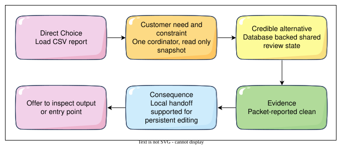

# Presenting_and_Defending_Design_Decisions_in_AI_Systems

Source: https://www.educative.io/courses/forward-deployed-engineer/presenting-and-defending-your-decisions

---

[Home](https://www.educative.io/)

[Courses](https://www.educative.io/search?tab=courses)

[Forward Deployed Engineer for AI Systems](https://www.educative.io/courses/forward-deployed-engineer)

# Presenting and Defending Your Decisions

Explain your implementation choices using customer requirements, constraints, alternative approaches, and available evidence. Distinguish business requirements from test-verified behavior, and reassess decisions when new evidence becomes available. Clearly communicate the rationale, tradeoffs, and limitations of your approach.

We'll cover the following...

- [Understanding the reviewer’s question](https://www.educative.io/courses/forward-deployed-engineer/presenting-and-defending-your-decisions#Understanding-the-reviewers-question)
- [Answering with evidence](https://www.educative.io/courses/forward-deployed-engineer/presenting-and-defending-your-decisions#Answering-with-evidence)
- [What tests actually prove](https://www.educative.io/courses/forward-deployed-engineer/presenting-and-defending-your-decisions#What-tests-actually-prove)
- [Handling contradicting evidence](https://www.educative.io/courses/forward-deployed-engineer/presenting-and-defending-your-decisions#Handling-contradicting-evidence)
- [Revising your position honestly](https://www.educative.io/courses/forward-deployed-engineer/presenting-and-defending-your-decisions#Revising-your-position-honestly)
- [Rehearsing with evidence maps](https://www.educative.io/courses/forward-deployed-engineer/presenting-and-defending-your-decisions#Rehearsing-with-evidence-maps)

Explain how significant implementation decisions addressed customer requirements within the project's constraints. Revise those decisions when new evidence challenges the original assumptions. Retain decisions supported by evidence, and update assumptions or conclusions when new findings invalidate them.

Be prepared to explain your problem-solving approach, implementation decisions, and technical reasoning. Review the interview instructions for the required format and permitted tools.

## Understanding the reviewer’s question[#](https://www.educative.io/courses/forward-deployed-engineer/presenting-and-defending-your-decisions#Understanding-the-reviewers-question)

Consider an accounts-payable review tool developed within a four-hour time limit. The brief requires a local, read-only CSV report for a single coordinator. Each invoice ID must have one review result, and unresolved records must remain visible. The brief does not require payment processing, collaborative editing, or database storage.

The reviewer asks: “Why did you choose a CSV report instead of a database-backed application?”

The question asks you to justify the architecture against the customer's workflow and requirements. Citing the four-hour limit alone does not explain why a CSV report meets the customer's needs. Dismissing a database as unnecessary overlooks scenarios where persistent storage, concurrent access, or shared editing could justify it.

Explain the rationale for each of the following three design decisions:

- **Delivery:** A local CSV snapshot for one coordinator.
- **Reconciliation:** A rule for handling repeated invoice IDs.
- **Verification:** The checks used to support claims about the result.

Evidence against one choice need not invalidate the others. Keep those dependencies visible as the conversation develops.

## Answering with evidence[#](https://www.educative.io/courses/forward-deployed-engineer/presenting-and-defending-your-decisions#Answering-with-evidence)

Apply the trade-off and evidence guidance from the Documenting Trade-Offs and Limitations lesson to the reviewer's question: lead with your choice, then point to the specific artifact that supports it and state what it does not establish.

Here’s a concise answer:

“I chose CSV because the requested task is a single coordinator’s read-only snapshot review, delivered locally within four hours. A database-backed application would become more useful if reviewers needed persistent shared decisions or concurrent editing, but it adds setup and deployment requirements to this handoff. The delivery packet reports a successful clean-clone run and seven invoice entries in the report. That supports this local execution route; it doesn’t establish customer adoption or production readiness. I can show the output first, or the entry point if you’d prefer.”

The answer gives the reviewer a choice of supporting detail. It also avoids claiming CSV is faster: No comparative timing was measured.

An inspectable answer connects the CSV choice to the customer’s constraints, a credible alternative, bounded evidence, and a condition for reconsidering it

Offer more detail after answering the question. Starting with a repository tour makes the reviewer extract your rationale from unrelated implementation details.

## What tests actually prove[#](https://www.educative.io/courses/forward-deployed-engineer/presenting-and-defending-your-decisions#What-tests-actually-prove)

Here’s the delivery packet for this fictional submission. All input values, times, counts, and practice limits are instructional inputs. The execution observations are packet-reported; you have not personally run this tool.

The synthetic test fixture contains eight rows with the fields `invoice_id`, `supplier_id`, `amount`, and `exported_at`:

- `I701, S11, 100.00, 08:00`
- `I702, S12, 200.00, 08:10`
- `I703, S13, 300.00, 08:20`
- `I704, S14, 400.00, 08:30`
- `I705, S15, 500.00, 08:40`
- `I706, S16, 600.00, 08:50`
- `I707, S19, 1200.00, 09:00`
- `I707, S28, 900.00, 09:05`

The assumption log defines a provisional rule: For repeated invoice IDs, treat the row with the latest `exported_at` value as authoritative. The implementation applies this rule when resolving duplicate invoice IDs.

The packet reports:

- A successful run from a fresh repository clone using the documented prerequisites, without relying on undocumented local state or embedded credentials.
- Seven unique invoice IDs in the output. Records `I701`–`I706` are retained, while `I707` uses supplier `S28` and amount `900.00` from the later-exported row.
- All four reported tests pass: unique invoice IDs are preserved, duplicate IDs are resolved using the latest `exported_at` value, and inputs with missing required headers or blank invoice IDs are rejected.

Before explaining the implementation's correctness, distinguish the behavior verified by each test from assumptions and requirements that remain unvalidated.

Match Evidence to Its Scope

Packet-reported observation

Passing test: distinct invoice IDs remain.

Passing test: the later-exported duplicate wins.

Passing test: a blank invoice ID is rejected.

Passing test: a missing required header is rejected.

Reported output: seven entries from eight synthetic rows; I707 selects S28, 900.00.

Reported clean-clone execution succeeds after documented prerequisites.

Narrowest supported conclusion

The packet reports reproducibility under documented prerequisites.

The checked blank-invoice-ID input is rejected.

The implementation follows the latest-export rule in the checked duplicate case.

This synthetic input yields one entry per ID, with the two I707 rows reduced to one.

Distinct IDs are preserved in the checked cases.

The checked missing-header input is rejected.

Match each packet-reported observation to its narrowest supported conclusion. All observations come from the packet, not a run you performed.

Do you find this helpful?

A bounded spoken answer would be:

> “The packet reports four of four tests passing. They check preservation of distinct IDs, later-export duplicate selection, and rejection of missing headers and blank IDs. The reported local run produces seven entries from eight synthetic rows. These checks support the implementation’s behavior on those cases. They don’t establish that later export means authoritative correction, that every error is handled, or that a customer has used the report.”

Tests can establish that code follows a specified rule for checked cases. Business-rule validity requires evidence that the rule represents the customer’s process. A test that expects the later row to win cannot independently establish why that row should be authoritative.

Keep measurements attached to their scope: “Four of four specified tests” and “seven entries from eight synthetic rows in a reported local run.” Fixture results, live-service observations, and customer impact are different kinds of evidence. This packet supplies only local synthetic-case evidence.

## Handling contradicting evidence[#](https://www.educative.io/courses/forward-deployed-engineer/presenting-and-defending-your-decisions#Handling-contradicting-evidence)

The reviewer now supplies an authoritative source clarification:

> “`exported_at` is extraction time, not revision order. The source provides no precedence guarantee for conflicting duplicates.”

Put the affected facts together:

- **Earlier extraction:** I707, supplier S19, amount 1200.00, `exported_at` 09:00.
- **Later extraction:** I707, supplier S28, amount 900.00, `exported_at` 09:05.
- **Submitted selection:** I707 → S28, 900.00.
- **Passing duplicate test:** Expects S28 and 900.00 because 09:05 is later than 09:00.
- **Source clarification:** Neither extraction time establishes which supplier and amount are authoritative.

Consider this response before preparing your own:

> “All four tests pass, and I documented the assumption. With only four hours, latest wins was the best option, so the report is correct.”

Decide which claims survive the clarification and which must change.

Apply the clarification: what survives?

↓ Entry

📄CSV delivery rationale

↓ Entry

🔗Apply clarification: remove this premise

⚙️Latest-export implementation claim

↓ Entry

🧪Passing duplicate test

✅Authoritative I707 selection

↓ Entry

📝Documented assumption

↓ Entry

⏱️Acceptability under four hours

💬Identify all three errors

87%

Failure simulator

Pick a component to knock out — see how far the damage spreads.⌀ badges show each node’s blast radius — the bigger the number, the closer it is to a single point of failure.

Do you find this helpful?

The response contains three reasoning errors. It treats passing implementation tests as proof that the business rule is correct, assumes a documented rule is authorized, and uses the time limit to justify overlooking customer risk. Documenting an assumption makes it traceable and open to revision, but does not establish its validity.

The duplicate-resolution test still passes because the implementation follows the defined selection rule. However, the new clarification establishes that the selection rule is not authoritative. Selecting supplier `S28` and amount `900.00` could lead the coordinator to review incorrect invoice details, even though the tool does not execute payments.

A challenge alone does not justify changing an implementation decision. In this case, authoritative new evidence contradicts the assumption behind the duplicate-resolution rule. Keep the CSV-based approach, which remains supported by the requirements, but stop treating `I707` as correctly resolved until an authoritative selection rule is established.

## Revising your position honestly[#](https://www.educative.io/courses/forward-deployed-engineer/presenting-and-defending-your-decisions#Revising-your-position-honestly)

A useful revision distinguishes the original rationale, demonstrated defect, revised recommendation, and checks still needed:

> “At first, I assumed the later extraction was the correct one, and I recorded that assumption. Your clarification shows that assumption was wrong. The duplicate test passes, but that only proves my code follows the rule I chose. It doesn’t justify picking S28 and 900.00. That choice could send the coordinator’s review in the wrong direction, so I’m withdrawing my resolved recommendation for I707.
>
> “I still think CSV is the right choice for a local workflow used by one person. For duplicates, I propose showing the six entries with no conflicts, plus one unresolved I707 group that keeps both source rows and their references. That still gives one review result per invoice ID, and the conflict stays visible. This is a proposal. I haven’t run the revised version yet.
>
> “To check it, I’d confirm two things. First, the I707 fixture keeps both source references in one unresolved group and doesn’t pick either one. Second, I701 to I706 stay unchanged. Later, a clear record of which version replaced which, or confirmation from the data’s owner, could justify picking one record.”

The limitation names both affected behavior and customer consequence. The four-hour limit explains the context of the original decision; it cannot make an unmet requirement or unsafe recommendation acceptable.

Notice the count distinction. The submitted packet describes seven output entries, including an incorrectly justified resolved I707. The proposal also has seven invoice-level results,six unconflicted entries and one unresolved group,but contains different information. Equal counts do not demonstrate a corrected outcome.

## Rehearsing with evidence maps[#](https://www.educative.io/courses/forward-deployed-engineer/presenting-and-defending-your-decisions#Rehearsing-with-evidence-maps)

Prepare an **evidence map**: Short notes connecting each consequential choice to its supporting artifact, boundary, and revision trigger. For this packet, use three entries:

- **CSV:** Single-coordinator snapshot brief; reported clean-clone run; reconsider if persistent shared review state becomes required.
- **Verification:** Four specified passing tests and seven reported entries from eight synthetic rows; no general correctness or customer-impact claim.
- **I707:** Original timestamp assumption contradicted by source clarification; withdraw the resolved selection and propose an unresolved group with explicit checks.

Use those notes to answer varied questions aloud. A short pause to identify the question is more useful than an unrelated explanation delivered fluently.

Practice defending your implementation decisions using the complete assignment packet. You do not need to execute code or record the session. Practice your responses aloud when possible, or submit them in writing.

Independent Oral Defense — CSV Review Packet

Your task

You are defending a fictional accounts-payable review submission to a reviewer. Explain the supported delivery choice, distinguish reported execution from business-rule validity, and revise your position when authoritative source information contradicts your reconciliation assumption. An unjustified supplier-and-amount selection could misdirect the coordinator’s review even though the tool executes no payments.

Tap any claim to classify it, and click on References to verify authorities.

TOSubmission reviewerFROMPractice packetDATEOctober 19, 2026SUBJECTIndependent defense of delivery, verification, and I707 reconciliation

Background

The fictional brief requests an accounts-payable review tool within a four-hour practice limit: a local, read-only CSV report for one coordinator, one review result per invoice ID, and visibility into unresolved records. It requests no payment execution, shared editing, or database. All rows are synthetic. Execution observations are packet-reported, not runs you have personally performed. Use the complete references below as your evidence packet.

Issue

Prepare your own response from scratch, not a rewrite of the claims below. First give a 60–90-second orientation covering the customer task, CSV delivery choice, reported result, and evidence boundary. Then answer separately: **Why not use a database? Do four passing tests prove this report is correct? The source says exported\_at is only extraction time; do you still defend the I707 selection?** End with a revised position and an exact proposed check. Speak aloud and enter brief notes or a transcript; a written answer is an accessibility alternative. The time target is a course practice convention, not an employer requirement.

Analysis

**Claim to evaluate, not a response to copy:** The four passing tests establish that the customer brief authorizes later extraction time as the authoritative correction rule.

**Claim to evaluate, not a response to copy:** A source-owner confirmation in the packet establishes that S28 and 900.00 are the authoritative values for I707.

**Claim to evaluate, not a response to copy:** After the source clarification, the original latest-export assumption remains the current basis for resolving I707 because it was documented before submission.

Evaluate delivery separately from reconciliation. The requested single-coordinator local snapshot supports CSV; persistent shared decisions or concurrent editing would be reasons to revisit a database-backed application. The reported clean-clone run supports the local execution route, not a claim that CSV is faster than a database or that the report is production-ready.

Conclusion

In your final answer, distinguish the submitted seven-entry result from your proposed behavior. State what you retain, what you withdraw, what customer consequence matters, and what remains unexecuted. Give the exact proposed check: **Both I707 source references remain in one unresolved group with no resolved selection, while I701–I706 remain unchanged.**

Recommendation

After preparing your response, self-audit your spoken attempt: Did I answer each question first? Can I name the packet source for every material claim? Did I say four of four and describe coverage? Did I distinguish local synthetic evidence from customer outcomes? Did I preserve the CSV rationale, acknowledge the customer consequence, withdraw I707’s resolution, and label the revised grouping and check as proposed rather than executed? If you spoke, note any omissions from your submitted notes or transcript; only you can assess speech that was not submitted.

Do you find this helpful?

For your own submission, choose one consequential decision and locate the exact artifact that supports it. Then name what evidence would make you change your mind. That prepares you to own both the original reasoning and a justified revision,and to distinguish a correction you recommend from one you have actually implemented and checked.

Recording the Walk-Through Video

Handling Live Extension Exercises

Ask

[Understanding the reviewer’s question](https://www.educative.io/courses/forward-deployed-engineer/presenting-and-defending-your-decisions#Understanding-the-reviewers-question)

[Answering with evidence](https://www.educative.io/courses/forward-deployed-engineer/presenting-and-defending-your-decisions#Answering-with-evidence)

[What tests actually prove](https://www.educative.io/courses/forward-deployed-engineer/presenting-and-defending-your-decisions#What-tests-actually-prove)

[Handling contradicting evidence](https://www.educative.io/courses/forward-deployed-engineer/presenting-and-defending-your-decisions#Handling-contradicting-evidence)

[Revising your position honestly](https://www.educative.io/courses/forward-deployed-engineer/presenting-and-defending-your-decisions#Revising-your-position-honestly)

[Rehearsing with evidence maps](https://www.educative.io/courses/forward-deployed-engineer/presenting-and-defending-your-decisions#Rehearsing-with-evidence-maps)