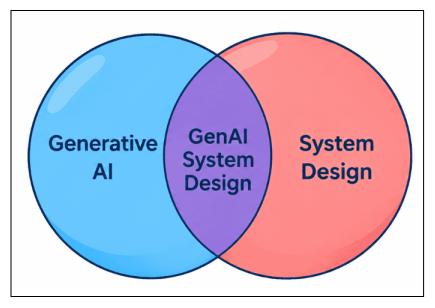
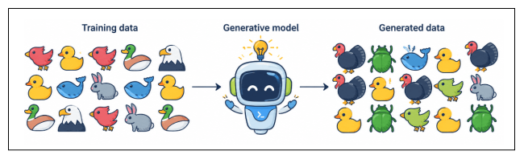
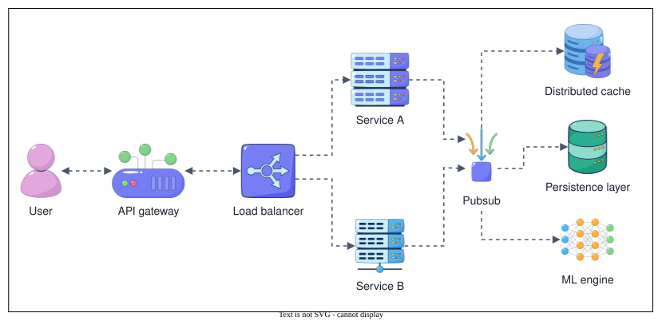
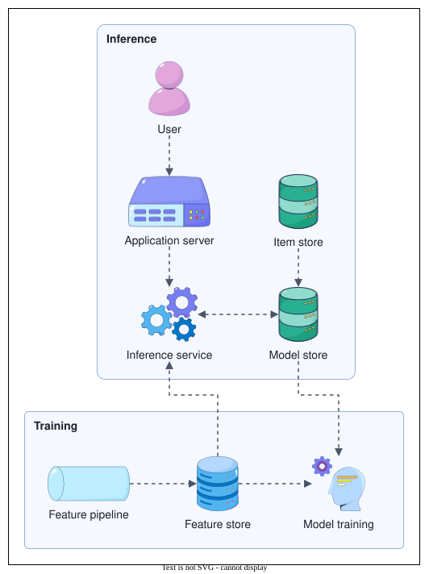

# Introduction_to_Generative_AI_System_Design_Principles

Source: https://www.educative.io/courses/generative-ai-system-design/introduction-to-generative-ai-system-design

---

[Home](https://www.educative.io/)

[Courses](https://www.educative.io/search?tab=courses)

[Grokking the Generative AI System Design Interview](https://www.educative.io/courses/generative-ai-system-design)

# Introduction to Generative AI System Design

Discover what GenAI system design is, how it differs from traditional system design, and the core components and applications covered in the course.

We'll cover the following...

- [What is generative AI System Design?](https://www.educative.io/courses/generative-ai-system-design/introduction-to-generative-ai-system-design#What-is-generative-AI-System-Design)
- [Who is this course for?](https://www.educative.io/courses/generative-ai-system-design/introduction-to-generative-ai-system-design#Who-is-this-course-for)
- [Prerequisites for the GenAI System Design](https://www.educative.io/courses/generative-ai-system-design/introduction-to-generative-ai-system-design#Prerequisites-for-the-GenAI-System-Design)
  - [Generative AI: From Theory to Product Launch](https://www.educative.io/courses/generative-ai-system-design/introduction-to-generative-ai-system-design#Generative-AI-From-Theory-to-Product-Launch)
  - [Grokking Modern System Design Interview](https://www.educative.io/courses/generative-ai-system-design/introduction-to-generative-ai-system-design#Grokking-Modern-System-Design-Interview)
  - [Machine learning System Design](https://www.educative.io/courses/generative-ai-system-design/introduction-to-generative-ai-system-design#Machine-learning-System-Design)

Generative AI systems are rapidly changing the world around us. From creating stunningly realistic images to composing captivating music, these systems are pushing the boundaries of what’s possible with artificial intelligence. Behind these systems, however, lies a combination of two technologies: **distributed machine learning (DML)** for training generative models and System Designfor deploying these models.

DML has revolutionized how we train the massive machine learning models that power generative AI. By distributing the computational workload across numerous machines, DML allows us to handle the enormous datasets and complex models required for generative AI. This approach, inspired by the principles of distributed systems, enables us to train models faster and more efficiently.

However, training these models is only half the complexity. To realize their power, we need robust and sophisticated systems to deploy and manage them. This is where System Design comes in. By applying core System Design principles like modularity, scalability, and reliability, we can build the infrastructure needed to support real-world generative AI applications.

Generative AI System Design: Blending traditional System Design principles with emerging GenAI concepts like DML

## What is generative AI System Design?[#](https://www.educative.io/courses/generative-ai-system-design/introduction-to-generative-ai-system-design#What-is-generative-AI-System-Design)

The combination of generative AI and System Design gives rise to a new discipline: Generative AI System Design. This emerging field focuses on training and deploying complex systems that power generative AI applications, ensuring these systems are robust, efficient, scalable, and reliable.

Generative AI system design is already shaping how products are built across industries. Coding assistants, customer support agents, and AI search tools all depend on the same core decisions: how to serve large models efficiently, how to ground responses in reliable data, and how to evaluate and monitor outputs at scale. Teams that get these decisions right can ship capable AI features quickly and run them reliably in production.

As generative AI continues to evolve, so will the generative AI System Design field. This field will be essential in tackling the challenges and harnessing the opportunities of rapidly advancing technology, shaping the future of AI and its applications across various domains.

The rise of large-scale GenAI applications, such as chatbots, image-generation models, and code-generation tools, has highlighted the need for a systematic approach to their development. The principles guiding the development of these large-scale systems need to be defined. Additionally, addressing the industry’s skill gap is essential to achieving the goal of delivering applications in a short period. This course aims to fill that knowledge gap by exploring the System Design of real-world generative AI systems.

## Who is this course for?[#](https://www.educative.io/courses/generative-ai-system-design/introduction-to-generative-ai-system-design#Who-is-this-course-for)

This course isn’t just about learning GenAI System Design; it’s about preparing yourself for the present and future in tech. No matter where you stand in your career, the insights and knowledge present in this course can empower you to contribute to the AI landscape.

Generative AI System Design is for you if you are a:

- **Software engineer:** This course will equip software engineers (SEs) of various levels (associate SEs to principal SEs) with a strong foundation to build cutting-edge GenAI systems and solve real-world challenges. Whether just starting or leading a team, you can equip yourself with the knowledge of designing large-scale GenAI systems.
- **Machine learning (ML) engineer:** As an ML engineer, you’ll gain valuable insights into how your models fit into the broader system architecture. This course will bridge the gap between model development and deployment, familiarizing you with designing scalable and reliable systems that effectively utilize GenAI models. You’ll learn about infrastructure considerations, optimization techniques, and best practices for integrating ML models into real-world applications.
- **Engineering and product manager:** These managers or leaders can gain a deeper technical understanding of how GenAI systems work to make informed decisions, plan effectively, and lead cross-functional teams.
- **Interviewee:** Mastering these concepts puts you ahead in the competitive tech job market, particularly for AI-focused roles where System Design is critical. System Design interviews now emphasize future-proofing, with GenAI becoming one of the key topics to be discussed.
- **Learning enthusiast:** Are you a techie who’s curious about generative AI? This course allows you to immerse in the design principles powering GenAI advancements. In today’s tech landscape, staying ahead is key; this course will be a great asset in staying ahead of the curve. Also, if you are interested in the inner workings of modern GenAI systems like ChatGPT, Stable Diffusion, etc., this course is for you.

Are you ready to take this course? Attempt the quiz below to find out!

Say “Hi,” and Ed will guide you through the quiz.

AI Powered

Saved

15 attempts left

Reset

You have 15 attempts to answer.

## Prerequisites for the GenAI System Design[#](https://www.educative.io/courses/generative-ai-system-design/introduction-to-generative-ai-system-design#Prerequisites-for-the-GenAI-System-Design)

We assume that you have a fundamental knowledge of key concepts of [distributed systems](https://www.educative.io/courses/distributed-systems-practitioners). An understanding and knowledge of the following courses will enable you to learn the core concepts and systems discussed in this course:

### Generative AI: From Theory to Product Launch[#](https://www.educative.io/courses/generative-ai-system-design/introduction-to-generative-ai-system-design#Generative-AI-From-Theory-to-Product-Launch)

To successfully navigate the world of GenAI System Design, a solid grasp of [generative AI](https://www.educative.io/courses/generative-ai-from-theory-to-product-launch) itself is crucial. You should be familiar with the core concepts of generative models, their applications, and the underlying technologies that drive them. This includes understanding transformer networks and their variants, such as vision transformers for [image generation](https://www.educative.io/courses/introduction-to-diffusion-models) and multimodal transformers for tasks involving multiple data types. You’ll also have practical experience with hands-on exercises, like experimenting with [large language models (LLMs)](https://www.educative.io/courses/essentials-of-large-language-models-a-beginners-journey) for text generation, which will further solidify your understanding and prepare you for the System Design challenges ahead.

An example of generative AI models

### Grokking Modern System Design Interview[#](https://www.educative.io/courses/generative-ai-system-design/introduction-to-generative-ai-system-design#Grokking-Modern-System-Design-Interview)

A strong foundation in traditional [System Design](https://www.educative.io/courses/grokking-the-system-design-interview) principles is essential. You should be comfortable with concepts like:

- **Scalability:** Understanding how to design systems that handle increasing data and user traffic.
- **Availability:** Guaranteeing the system is accessible and operational when needed. This is closely related to reliability but focuses on uptime.
- **Low latency:** Optimizing system speed and responsiveness for a smooth user experience.
- **Reliability:** Knowing how to build fault-tolerant systems that can withstand failures and maintain availability.
- **Maintainability:** Designing systems that are easy to understand, upgrade, modify, and maintain over time.

A snapshot of the System Design diagram depicting its core components

Familiarity with common System Design patterns and building blocks is also beneficial. Experience with real-world systems, like distributed databases, message queues, and caching mechanisms, will further prepare you for the challenges of designing GenAI systems.

### Machine learning System Design[#](https://www.educative.io/courses/generative-ai-system-design/introduction-to-generative-ai-system-design#Machine-learning-System-Design)

A solid understanding of [machine learning System Design](https://www.educative.io/courses/machine-learning-system-design) is essential for tackling GenAI System Design.

This includes:

- **Feature engineering:** The ability to select, transform, and create relevant features for machine learning models.
- **Model selection and training:** Knowledge of different machine learning models and how to train them effectively.
- **Model evaluation and deployment:** Understanding how to assess performance and deploy models into production environments.
- **ML infrastructure:** Familiarity with the tools and technologies used to build and deploy machine learning systems, such as cloud platforms and frameworks.

An abstract machine learning System Design

Learn more about this machine learning System Design in [this lesson](https://www.educative.io/courses/machine-learning-system-design/problem-statement-and-metrics-g7DrxM64mxZ).

With the core prerequisites and course objectives established, the next lesson examines why GenAI System Design is its own interview, detailing how non-deterministic outputs, accelerator hardware constraints, and continuous evaluation transform standard technical evaluations.

Why GenAI System Design Is Its Own Interview

Ask

[What is generative AI System Design?](https://www.educative.io/courses/generative-ai-system-design/introduction-to-generative-ai-system-design#What-is-generative-AI-System-Design)

[Who is this course for?](https://www.educative.io/courses/generative-ai-system-design/introduction-to-generative-ai-system-design#Who-is-this-course-for)

[Prerequisites for the GenAI System Design](https://www.educative.io/courses/generative-ai-system-design/introduction-to-generative-ai-system-design#Prerequisites-for-the-GenAI-System-Design)

[Generative AI: From Theory to Product Launch](https://www.educative.io/courses/generative-ai-system-design/introduction-to-generative-ai-system-design#Generative-AI-From-Theory-to-Product-Launch)

[Grokking Modern System Design Interview](https://www.educative.io/courses/generative-ai-system-design/introduction-to-generative-ai-system-design#Grokking-Modern-System-Design-Interview)

[Machine learning System Design](https://www.educative.io/courses/generative-ai-system-design/introduction-to-generative-ai-system-design#Machine-learning-System-Design)