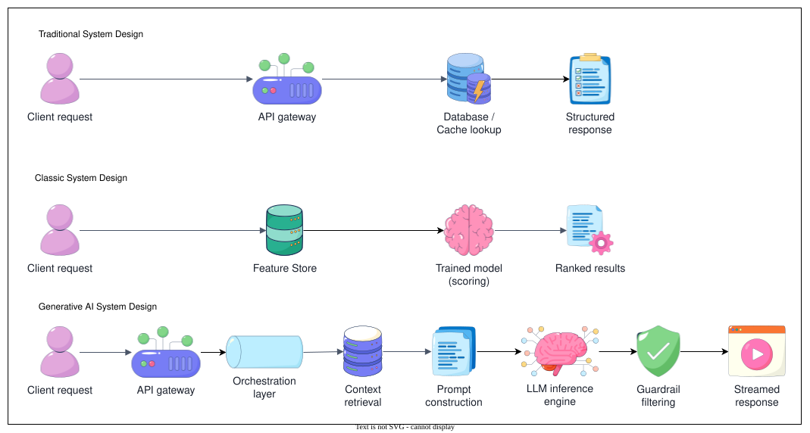

# Understanding_Why_GenAI_System_Design_Interviews_Are_Unique

Source: https://www.educative.io/courses/generative-ai-system-design/why-genai-system-design-is-its-own-interview

---

[Home](https://www.educative.io/)

[Courses](https://www.educative.io/search?tab=courses)

[Grokking the Generative AI System Design Interview](https://www.educative.io/courses/generative-ai-system-design)

# Why GenAI System Design Is Its Own Interview

Explore how Generative AI system design interviews differ from traditional system and ML design rounds. Understand the distinct inference path, key architectural components like retrieval, orchestration, and guardrails, and how to tailor your preparation based on company interview formats and expectations.

We'll cover the following...

- [How GenAI design differs from classic rounds](https://www.educative.io/courses/generative-ai-system-design/why-genai-system-design-is-its-own-interview#How-GenAI-design-differs-from-classic-rounds)
- [Interview formats by company archetype](https://www.educative.io/courses/generative-ai-system-design/why-genai-system-design-is-its-own-interview#Interview-formats-by-company-archetype)
  - [Conclusion](https://www.educative.io/courses/generative-ai-system-design/why-genai-system-design-is-its-own-interview#Conclusion)

Traditional System Design interviews test servers, database sharding, and caching layers. ML System Design interviews test offline model training and data pipelines. Neither round tests the components unique to GenAI, such as context retrieval, dynamic prompt assembly, safety filters, model orchestration, and token cost controls within a single user request.

This gap is why many technology companies now evaluate candidates using a dedicated GenAI System Design interview round. In this lesson, we'll learn how these rounds differ from classic technical interviews, break down common company formats, and show how to tailor answers to meet interviewer expectations.

**Note:** Your goal in this lesson is not to solve an entire architecture from scratch. Your goal is to identify which interview format you will encounter, recognize the core architectural components, and calibrate your preparation to the correct depth.

To understand how interview expectations differ, we must first examine how the core execution path of a GenAI system diverges from earlier architectural patterns.

## How GenAI design differs from classic rounds[#](https://www.educative.io/courses/generative-ai-system-design/why-genai-system-design-is-its-own-interview#How-GenAI-design-differs-from-classic-rounds)

GenAI System Design builds directly on established engineering practices, but the request path fundamentally diverges during runtime execution.

Traditional System Design handles the operational infrastructure by routing requests through an API gateway, authenticating users, managing caches, and ensuring database availability. ML System Design provides the modeling foundation through offline dataset preparation, feature engineering, model selection, and performance benchmarking.

The difference appears during inference. Classic web services return predictable database records, and traditional ML pipelines return a numerical score or category. In contrast, a GenAI system dynamically retrieves unstructured context, constructs a prompt, and generates output token by token.

The diagram below compares how a user request travels through each of these three architectures.

Structural request lifecycle comparison

This request execution path relies on three fundamental architectural patterns that address the probabilistic nature of generative models and mitigate failure modes like hallucination.

- **Retrieval-Augmented Generation (RAG):** An architectural pattern where the system retrieves external context from a vector database or document store and injects it into the LLM prompt prior to output generation.
- **Orchestration:** An architectural layer that coordinates multi-step agent workflows, tool execution, and dynamic context retrieval.
- **Guardrails:** An architectural safety tier that inspects inputs and outputs to enforce business policies, block prompt injections, and filter out hallucinated or out-of-bounds responses.

System Design focuses on infrastructure availability, latency, and throughput. Traditional ML System Design evaluates fixed numerical metrics such as precision, recall, and classification accuracy. In contrast, GenAI System Design evaluates open-ended text and media where answer quality, factual grounding, and safety are non-deterministic and difficult to score automatically. How deeply an interview explores these trade-offs depends on the type of company hiring.

## Interview formats by company archetype[#](https://www.educative.io/courses/generative-ai-system-design/why-genai-system-design-is-its-own-interview#Interview-formats-by-company-archetype)

Interview formats generally reflect how central GenAI technologies are to the organizational business model and where the target team operates within the software stack. Company loops fall into four primary categories:

- **AI labs and research organizations:** These teams often run dedicated GenAI System Design rounds. Discussions typically span model behavior, alignment policies, custom evaluation frameworks, and low-level GPU inference optimization.
- **AI-first product companies:** These teams frequently run hybrid System Design rounds. Interviews often begin with product features and user experience requirements, then pivot to context retrieval performance, safety guardrails, and serving infrastructure costs.
- **Big tech companies:** These organizations usually integrate generative concepts into existing System Design or ML System Design tracks. The problem statement often sounds like a classic architecture question, but key discussion segments focus on LLM trade-offs.
- **Non-tech companies adopting AI:** These teams typically focus on practical integration scenarios. Questions usually center on adding document summarization, virtual assistants, or semantic search to pre-existing corporate platforms.

**Practical tip:** Contact the technical recruiter early in the process to clarify whether the loop features a standalone GenAI System Design round or evaluates generative concepts inside a standard backend or ML System Design session.

Primary signals in job descriptions include references to LLM orchestration, RAG, agentic workflows, inference optimization, or safety guardrails. To help evaluate these organizational variations, the comparison matrix below outlines typical expectations by company archetype.

## GenAI Interview Expectations by Company Type

|  |  |  |  |
| --- | --- | --- | --- |
| **Company type** | **Typical interview format** | **Depth of GenAI content** | **Example prompt** |
| AI labs | Research-heavy System Design, model behavior tradeoffs, evaluation discussions | Very deep; architecture, data, evals, safety, and inference tradeoffs | Design a conversational assistant end to end, including retrieval, memory, safety, and evaluation |
| AI-first product companies | Product + System Design with focus on user experience and iteration speed | Deep; strong emphasis on product constraints, latency, and quality | Design a customer-facing conversational assistant for a SaaS product with feedback loops and success metrics |
| Big tech companies | Structured product/System Design with cross-functional and scale considerations | Moderate to deep; feature quality, reliability, and platform integration | Improve grounding and answer quality for an AI-powered search experience at global scale |
| Non-tech companies adopting AI | Practical case interviews centered on existing workflows and ROI | Moderate; applied use cases, vendor choices, compliance, and rollout | Add summarization to a support tooling workflow to reduce handle time while preserving accuracy and auditability |

### Conclusion[#](https://www.educative.io/courses/generative-ai-system-design/why-genai-system-design-is-its-own-interview#Conclusion)

GenAI System Design stands apart as a unique interview category because a single request path combines distributed software systems, probabilistic model behavior, context retrieval, safety enforcement, and token economics.

Three primary principles guide preparation for these rounds.

1. Understand how the request lifecycle diverges from traditional web services and standard machine learning pipelines during live inference.
2. Identify the company archetype early to anticipate whether you face a dedicated, hybrid, or integrated GenAI System Design round.
3. Focus on evaluating open-ended quality, factual grounding, and token economics alongside classic infrastructure metrics like latency and availability.

Now that we understand what sets this interview apart and which round formats to expect, the next lesson examines the specific evaluation rubrics interviewers use to grade candidate performance during these rounds.

Introduction to Generative AI System Design

What the GenAI Design Interview Tests

Ask

[How GenAI design differs from classic rounds](https://www.educative.io/courses/generative-ai-system-design/why-genai-system-design-is-its-own-interview#How-GenAI-design-differs-from-classic-rounds)

[Interview formats by company archetype](https://www.educative.io/courses/generative-ai-system-design/why-genai-system-design-is-its-own-interview#Interview-formats-by-company-archetype)

[Conclusion](https://www.educative.io/courses/generative-ai-system-design/why-genai-system-design-is-its-own-interview#Conclusion)