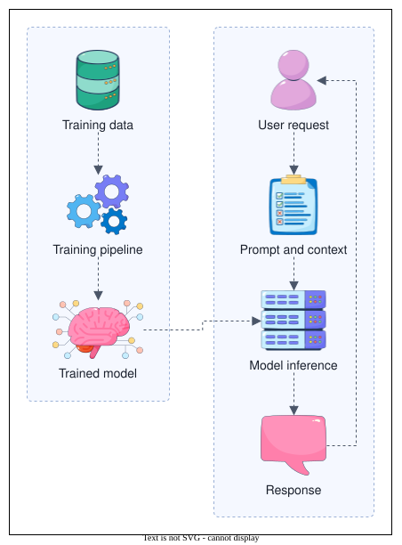

# What_Generative_AI_System_Design_Interviews_Evaluate

Source: https://www.educative.io/courses/generative-ai-system-design/what-the-genai-design-interview-tests

---

[Home](https://www.educative.io/)

[Courses](https://www.educative.io/search?tab=courses)

[Grokking the Generative AI System Design Interview](https://www.educative.io/courses/generative-ai-system-design)

# What the GenAI Design Interview Tests

Explore how Generative AI system design interviews assess your structured thinking, trade-off awareness, and ability to adapt architectures under changing constraints. Learn what interviewers expect regarding model choice, training and inference workflows, and operating complex AI systems effectively.

We'll cover the following...

- [The interview moment where things change](https://www.educative.io/courses/generative-ai-system-design/what-the-genai-design-interview-tests#The-interview-moment-where-things-change)
- [Interviewer’s expectations in the interview](https://www.educative.io/courses/generative-ai-system-design/what-the-genai-design-interview-tests#Interviewers-expectations-in-the-interview)
- [How GenAI System Design interviews are scored](https://www.educative.io/courses/generative-ai-system-design/what-the-genai-design-interview-tests#How-GenAI-System-Design-interviews-are-scored)
- [How to prepare for GenAI System Design interviews using this course](https://www.educative.io/courses/generative-ai-system-design/what-the-genai-design-interview-tests#How-to-prepare-for-GenAI-System-Design-interviews-using-this-course)
- [Typical GenAI System Design interview questions](https://www.educative.io/courses/generative-ai-system-design/what-the-genai-design-interview-tests#Typical-GenAI-System-Design-interview-questions)
- [Common mistakes and pitfalls](https://www.educative.io/courses/generative-ai-system-design/what-the-genai-design-interview-tests#Common-mistakes-and-pitfalls)
- [Conclusion](https://www.educative.io/courses/generative-ai-system-design/what-the-genai-design-interview-tests#Conclusion)

While traditional engineering evaluations grade static infrastructure and deterministic service boundaries, GenAI System Design rounds assess how candidates reason through non-deterministic model behavior, accelerator resource constraints, and operational cost trade-offs under live time pressure.

Interviewers do not expect flawless architectural blueprints. Instead, they grade candidates on structured thinking, trade-off awareness, and the ability to adapt an architecture when operational constraints shift unexpectedly.

## The interview moment where things change[#](https://www.educative.io/courses/generative-ai-system-design/what-the-genai-design-interview-tests#The-interview-moment-where-things-change)

Imagine you’re in a System Design interview. You’ve drawn a clean architecture. The model choice makes sense. The data flow looks solid. Then the interviewer leans in and asks:

- How do you reduce hallucinations without blowing up latency?
- What happens if model costs triple overnight?
- Why does this system need a dynamic contextualizer, and what fails without it?

Suddenly, the problem isn’t about knowing GenAI concepts anymore. This is where most candidates stumble. Not because they don’t understand GenAI, but because they don’t understand how interviewers evaluate System Design thinking for AI-powered systems.

Let’s start with a clear picture of an interviewer's expectations for a GenAI System Design interview.

## Interviewer’s expectations in the interview[#](https://www.educative.io/courses/generative-ai-system-design/what-the-genai-design-interview-tests#Interviewers-expectations-in-the-interview)

Despite the new components, the interviewer’s evaluation framework is familiar. FAANG interviewers expect candidates to apply the same structured thinking used throughout this course:

1. **Start with requirements and constraints:** Clearly identify the requirements, scale expectations, latency targets, cost limits, and quality requirements before proposing any architecture.
2. **Select the GenAI model:** Choose an appropriate GenAI model based on task complexity, accuracy needs, latency tolerance, and cost, and justify why it fits the use case.
3. **Discuss the training infrastructure:** Explain how data collection, training pipelines, compute resources, and evaluation workflows would be designed to support model development and iteration.
4. **Propose the inference pipeline:** Describe how requests flow through prompt construction, retrieval or conditioning, model inference, and post-processing in a scalable and reliable manner.
5. **Incrementally evolve the design:** Refine the system by addressing bottlenecks and constraints, clearly explaining trade-offs between latency, cost, scalability, reliability, and output quality.

An example workflow of the model training and online inference

What changes is where the complexity lives.

You’re expected to demonstrate:

- An understanding of training vs. inference workflows
- The ability to estimate latency, throughput, and cost for each workflow
- Awareness of model variability, hallucinations, and failure modes
- A clear understanding of how GenAI systems differ from deterministic services

**Educative byte:** Strong candidates don’t just draw boxes. They explain why each component exists, how it behaves at scale, and what they would change when assumptions break.

## How GenAI System Design interviews are scored[#](https://www.educative.io/courses/generative-ai-system-design/what-the-genai-design-interview-tests#How-GenAI-System-Design-interviews-are-scored)

Most candidates assume interviewers are grading them on correctness. They aren’t. Interviewers are evaluating:

- Clarity of thinking
- Trade-off awareness
- Ability to adapt when constraints change
- How well you communicate complex systems under time pressure

Two candidates might draw similar diagrams, but the one who clearly explains why the system is designed that way will score significantly higher.

## How to prepare for GenAI System Design interviews using this course[#](https://www.educative.io/courses/generative-ai-system-design/what-the-genai-design-interview-tests#How-to-prepare-for-GenAI-System-Design-interviews-using-this-course)

This course is designed to help you build the mindset needed to succeed in a GenAI system design interview.

To prepare effectively, focus on mastering the core concepts and patterns that recur frequently in real-world GenAI systems. You should develop a strong understanding of:

- Text-to-text systems, such as conversational assistants and search
- Multimodal systems like text-to-image, text-to-audio, text-to-video generation, and image captioning systems

Your preparation should emphasize end-to-end System Design, not isolated components. That means being able to reason clearly about:

- Input processing and request validation
- Embeddings, vectorization, and similarity search
- Model training and evaluation infrastructure
- Prompt construction and dynamic contextualization
- Model inference and scaling strategies
- Output handling, guardrails, and post-processing

Just as importantly, you should be able to explain why each component exists and how design choices impact latency, cost, scalability, reliability, and output quality. Reinforce this understanding by reviewing mock interviews, studying design walkthroughs, and practicing your explanations out loud, just as you would in a real interview.

## Typical GenAI System Design interview questions[#](https://www.educative.io/courses/generative-ai-system-design/what-the-genai-design-interview-tests#Typical-GenAI-System-Design-interview-questions)

GenAI System Design interviews typically ask candidates to architect scalable and reliable GenAI systems while justifying their design choices under changing constraints. The problems are intentionally open-ended. Interviewers want to see how candidates reason about trade-offs involving latency, cost, data handling, and model behavior, especially when assumptions break.

Common questions include:

- How would you design a conversational AI system (ChatGPT-like) at scale?
- What trade-offs exist between latency, cost, and model quality, and how would you navigate them?
- How would you monitor, evaluate, and debug a GenAI system in production?
- How do multimodal generative systems work (text-to-image, text-to-audio, text-to-video)?

Strong candidates don’t just propose architectures. They explain why choices were made, how the system behaves at scale, and what they would change if constraints around cost, traffic, or quality suddenly shift.

That’s the level of thinking this course is designed to help you reach.

## Common mistakes and pitfalls[#](https://www.educative.io/courses/generative-ai-system-design/what-the-genai-design-interview-tests#Common-mistakes-and-pitfalls)

Most candidates don’t fail GenAI System Design interviews because their designs are “wrong.” They fail because their thinking is hard to follow.

Common mistakes include:

- Overengineering early, before clarifying requirements
- Diving into model internals or ML theory
- Skipping trade-offs between latency, cost, quality, and reliability
- Treating GenAI components as magic boxes instead of services with constraints

Strong candidates do the opposite. They keep designs interview-ready, explain decisions clearly, and treat the LLM as one part of a larger, evolving system. They prioritize clarity, structure, and reasoning over completeness.

**Educative byte:**A strong GenAI System Design interview balances breadth and depth: outline the complete system first, then delve deeper into the areas the interviewer is most interested in.

## Conclusion[#](https://www.educative.io/courses/generative-ai-system-design/what-the-genai-design-interview-tests#Conclusion)

GenAI System Design interviews are about demonstrating sound System Design judgment under uncertainty. Interviewers want to see how you reason about scale, cost, latency, and failure in systems powered by probabilistic models. If you can approach GenAI systems with structure, articulate clear trade-offs, and adapt your design when constraints change, you’re already operating at the level these interviews expect.

In the next lesson, we’ll walk through the course structure and roadmap.

Why GenAI System Design Is Its Own Interview

Course Structure and Study Roadmap

Ask

[The interview moment where things change](https://www.educative.io/courses/generative-ai-system-design/what-the-genai-design-interview-tests#The-interview-moment-where-things-change)

[Interviewer’s expectations in the interview](https://www.educative.io/courses/generative-ai-system-design/what-the-genai-design-interview-tests#Interviewers-expectations-in-the-interview)

[How GenAI System Design interviews are scored](https://www.educative.io/courses/generative-ai-system-design/what-the-genai-design-interview-tests#How-GenAI-System-Design-interviews-are-scored)

[How to prepare for GenAI System Design interviews using this course](https://www.educative.io/courses/generative-ai-system-design/what-the-genai-design-interview-tests#How-to-prepare-for-GenAI-System-Design-interviews-using-this-course)

[Typical GenAI System Design interview questions](https://www.educative.io/courses/generative-ai-system-design/what-the-genai-design-interview-tests#Typical-GenAI-System-Design-interview-questions)

[Common mistakes and pitfalls](https://www.educative.io/courses/generative-ai-system-design/what-the-genai-design-interview-tests#Common-mistakes-and-pitfalls)

[Conclusion](https://www.educative.io/courses/generative-ai-system-design/what-the-genai-design-interview-tests#Conclusion)