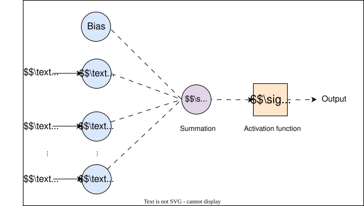
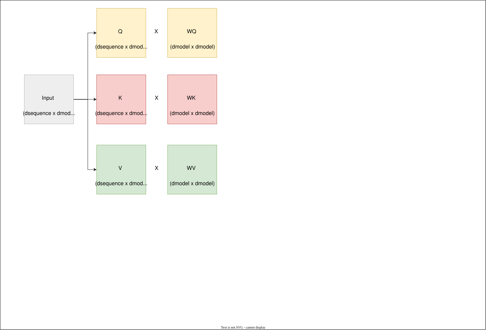
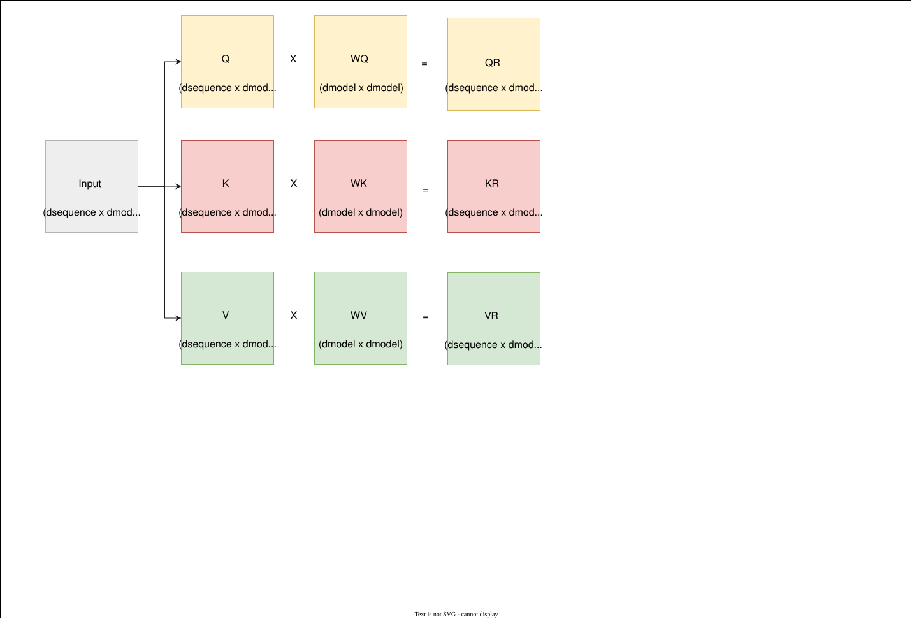
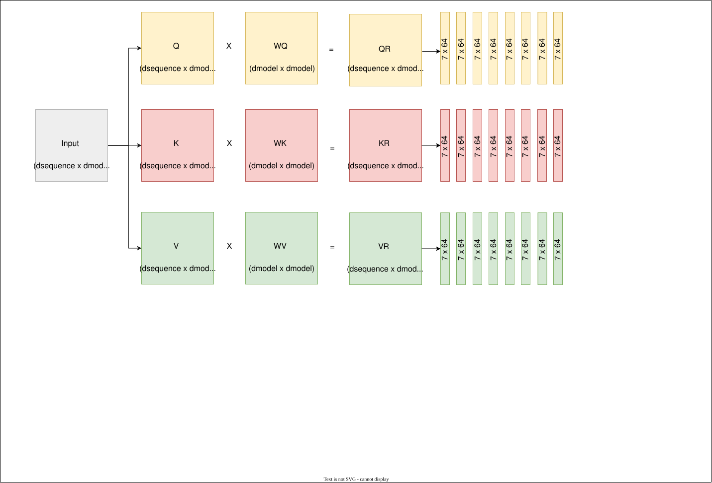
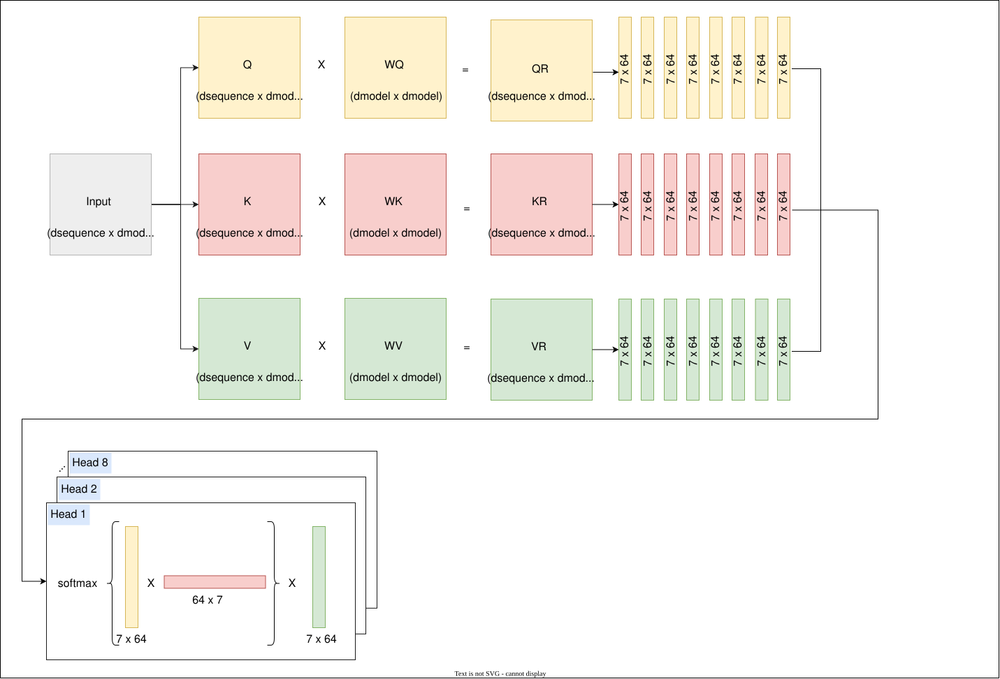
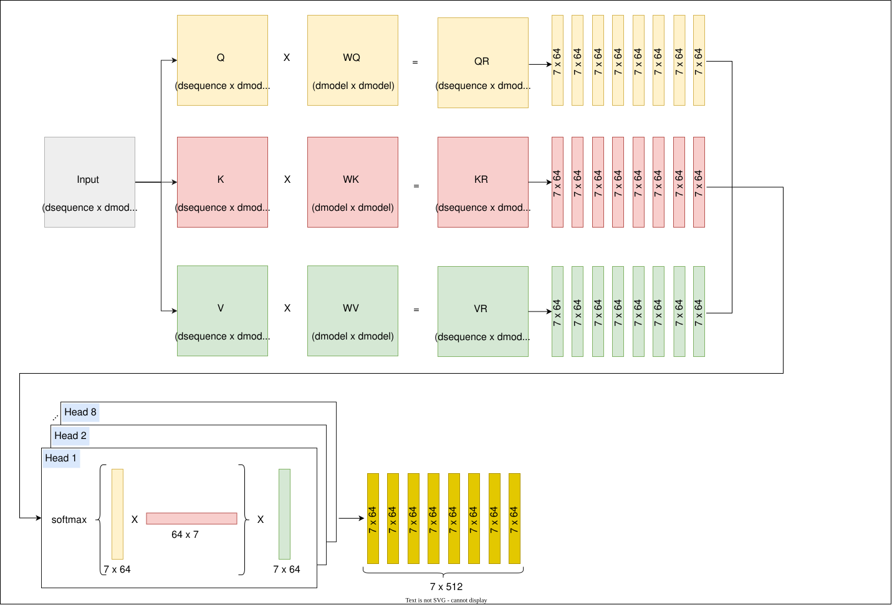

# Foundational_Machine_Learning_Concepts_for_Generative_AI_System_Design

Source: https://www.educative.io/courses/generative-ai-system-design/preliminary-machine-learning-concepts

---

[Home](https://www.educative.io/)

[Courses](https://www.educative.io/search?tab=courses)

[Grokking the Generative AI System Design Interview](https://www.educative.io/courses/generative-ai-system-design)

# Preliminary Machine Learning Concepts

Explore foundational machine learning concepts including neural networks, convolutional and recurrent networks, transformers, and attention mechanisms. Learn how these models work and interact to support large-scale generative AI applications in text, image, speech, and video generation, preparing you to design and optimize complex GenAI systems.

We'll cover the following...

- [Neural network architecture](https://www.educative.io/courses/generative-ai-system-design/preliminary-machine-learning-concepts#Neural-network-architecture)
  - [Components of neural network](https://www.educative.io/courses/generative-ai-system-design/preliminary-machine-learning-concepts#Components-of-neural-network)
- [Convolutional neural networks](https://www.educative.io/courses/generative-ai-system-design/preliminary-machine-learning-concepts#Convolutional-neural-networks)
  - [Key components of CNNs](https://www.educative.io/courses/generative-ai-system-design/preliminary-machine-learning-concepts#Key-components-of-CNNs)
- [Recurrent neural network](https://www.educative.io/courses/generative-ai-system-design/preliminary-machine-learning-concepts#Recurrent-neural-network)
- [Transformer network](https://www.educative.io/courses/generative-ai-system-design/preliminary-machine-learning-concepts#Transformer-network)
  - [Tokenization and input encoding](https://www.educative.io/courses/generative-ai-system-design/preliminary-machine-learning-concepts#Tokenization-and-input-encoding)
  - [Positional encoding](https://www.educative.io/courses/generative-ai-system-design/preliminary-machine-learning-concepts#Positional-encoding)
  - [The attention mechanism](https://www.educative.io/courses/generative-ai-system-design/preliminary-machine-learning-concepts#The-attention-mechanism)
    - [Self-attention](https://www.educative.io/courses/generative-ai-system-design/preliminary-machine-learning-concepts#Self-attention)
    - [Multi-head attention](https://www.educative.io/courses/generative-ai-system-design/preliminary-machine-learning-concepts#Multi-head-attention)
    - [Cross-attention](https://www.educative.io/courses/generative-ai-system-design/preliminary-machine-learning-concepts#Cross-attention)
- [Conclusion](https://www.educative.io/courses/generative-ai-system-design/preliminary-machine-learning-concepts#Conclusion)

Mastering the core principles of neural networks and their variants is crucial for designing large-scale GenAI systems capable of tasks like text, image, speech, and video generation. In this lesson, we will explore the following foundational concepts:

- Neural networks
- Convolutional neural networks (CNNs)
- Recurrent neural networks (RNNs)
- Transformers network
- Attention mechanisms

These machine-learning concepts are the backbone of modern GenAI systems, which allow machines to learn patterns, generate creative outputs, and scale efficiently. By understanding these concepts, we can better design and optimize the complex System Designs required for real-world GenAI applications.

Let’s describe each of the above concepts, starting with neural networks.

## Neural network architecture[#](https://www.educative.io/courses/generative-ai-system-design/preliminary-machine-learning-concepts#Neural-network-architecture)

**Neural networks** are computational models inspired by the human brain. They are designed to recognize patterns and make predictions by processing data through interconnected layers (discussed below) of nodes (also known as neurons). **Neural network architecture** refers to the structure and organization of a neural network, including the arrangement of its layers, nodes (neurons), and connections. It defines how the data flows through the network, learns, and makes predictions or decisions.

Let’s discuss the essential components of a neural network.

### Components of neural network[#](https://www.educative.io/courses/generative-ai-system-design/preliminary-machine-learning-concepts#Components-of-neural-network)

Here are the key components of neural network architecture, though we will focus on only a few in this discussion:

- **Neurons:** The basic processing unit of a neural network is a neuron or a node. Each neuron takes a feature vector such as (x1,x2, . . . ,xm)(\text{x}\_{1}, \text{x}\_{2},\text{ . . . } ,\text{x}\_{\text{m}})(x1​,x2​, . . . ,xm​), multiplies it with corresponding weights such as (w1,w2,...,wm)(\text{w}\_{1}, \text{w}\_{2},..., \text{w}\_{\text{m}})(w1​,w2​,...,wm​), adds a bias, and sums all of them, and the result is passed through an activation function (σ\sigmaσ) to produce nonlinearity. The mathematical formulation is as follows:

output=σ(Bias+∑i=1mxiwi)=σ(Bias+x1w1+x2w2+...+xmwm)\text{output}= \sigma(\text{Bias}+\sum\_{\text{i}=1}^{
\text{m}} \text{x}\_{i}\text{w}\_{i})= \sigma( \text{Bias}+\text{x}\_{1}\text{w}\_{1}+\text{x}\_{2}\text{w}\_{2}+. . .+\text{x}\_{\text{m}}\text{w}\_{\text{m}})output=σ(Bias+i=1∑m​xi​wi​)=σ(Bias+x1​w1​+x2​w2​+...+xm​wm​)

Where:

- **Activation functions** (σ\sigmaσ): An activation function is a mathematical function applied to the output of a neural network node to introduce nonlinearity into the network, enabling it to learn complex patterns. Common activation functions are sigmoid, ReLU (Rectified Linear Unit), and softmax.
- **Weights and bias:** A weight represents the strength of the connection between two neurons. On the other hand, biasallows the model to shift the activation function, improving its ability to fit the data.

The architecture of a simple neural network is provided below:

The architecture of a simple neural network

- **Layers:** A layer is a collection of interconnected neurons that process information together at the same computation stage. Neurons in a neural network are organized into layers (input, hidden, output) to process and transform data. The input layer receives the raw data or features(x1,x2, . . . ,xm)(\text{x}\_{1}, \text{x}\_{2},\text{ . . . } ,\text{x}\_{\text{m}})(x1​,x2​, . . . ,xm​). The number of neurons in the input layer depends on the number of features in the data. Several hidden layers perform computations using weights and activation functions to extract meaningful features. The number of hidden layers varies depending on the complexity of the architecture. Similarly, the output layer produces the network’s final output, such as predictions or classification.

Neural network architecture, describing neurons, layers, connections

**Note:** Neural networks are the foundation of all modern, complex AI systems, and every advanced architecture, from deep learning to transformers, evolves from these fundamental concepts. Their ability to learn, adapt, and generate patterns powers today’s most cutting-edge GenAI technologies.

Let’s discuss an advanced neural network architecture called a convolutional neural network, which is tailored for processing structured or image data.

## Convolutional neural networks [#](https://www.educative.io/courses/generative-ai-system-design/preliminary-machine-learning-concepts#Convolutional-neural-networks)

**Convolutional neural networks (CNNs)** are specialized neural networks designed for processing structured data, particularly images. They are used in tasks like video analysis, speech recognition, and natural language processing, which we will discuss in further lessons. Their architecture is inspired by the visual processing system of the human brain, enabling them to extract features from raw data automatically.

### Key components of CNNs[#](https://www.educative.io/courses/generative-ai-system-design/preliminary-machine-learning-concepts#Key-components-of-CNNs)

- **Convolutional layer:** The core building block of CNNs. It applies filters (or kernels) to the input data, performing convolutional operations to extract local features.
- **Pooling layer:** This layer reduces the spatial dimensions of the data, decreasing computations and preventing overfitting. It makes the model invariant to small changes in the input (e.g., rotation or translation). The common pooling methods involve max pooling, which retains the maximum value in a region, and average pooling,which computes the average of values in a region.
- **Fully connected layer:** This layer is typically located near the network’s end. It connects every neuron in one layer to every neuron in the next layer, combining extracted features to make predictions. Output is often passed through activation functions like Softmax (for classification) or linear functions (for regression).

Stages of a CNN: From input data through convolutional and pooling layers to fully connected layers for final predictions

**Educative byte:** CNNs mimic how the human visual system processes images, where the brain identifies edges and textures first before understanding the whole picture. This biologically inspired design is why CNNs can generate photorealistic images or create entirely new artistic styles, bridging the gap between human creativity and GenAI.

## Recurrent neural network[#](https://www.educative.io/courses/generative-ai-system-design/preliminary-machine-learning-concepts#Recurrent-neural-network)

A **recurrent neural network (RNN)** is a class of artificial neural networks that contain loops within its hidden layers and allow information to persist within the network over time. RNNs are designed to process sequential data by maintaining a memory of previous inputs, making them particularly effective for tasks involving temporal or contextual dependencies.

Recurrent neural network contains loops within the hidden layers

RNN is widely used in applications such as natural language processing (e.g., text sequencing in conversational AI), generating descriptive text in text-to-image models, and handling time series data in various predictive systems.

Unlike traditional neural networks, which utilize a simple feedforward flow, recurrent neural networks contain a looping mechanism that computes an internal state update with each time step. This allows an RNN to retain information about preceding elements in a data series.

1.

How do RNN loops enable sequential data handling, and why are they widely used in language models, speech processing, and time series analysis?

Show Answer

Did you find this helpful?

While RNNs are effective for sequential data, their limitations in handling long-term dependencies and parallel processing have led to the development of more advanced architectures, such as transformer networks, which revolutionize sequence modeling with attention mechanisms.

Recurrent architectures, particularly [LSTMs](https://how.dev/answers/what-are-lstm-models) and [GRUs](https://how.dev/answers/what-is-a-gated-recurrent-unit-gru), were the foundational for early sequence modeling and remain useful in constrained settings. However, their limited parallelism and difficulty modeling very long-range dependencies motivated architectures that rely on attention rather than recurrence. Transformer networks overcame these bottlenecks by enabling global context modeling and efficient parallel training, and they now underpin most state-of-the-art generative models. In the next section, we introduce the transformer architecture and its attention mechanism.

## Transformer network[#](https://www.educative.io/courses/generative-ai-system-design/preliminary-machine-learning-concepts#Transformer-network)

Transformers are a deep learning model that handles sequential data, such as text. They use a self-attention mechanism to capture the relationship between words in a sequence. They are the backbone of many NLP models. The transformer network (model), introduced in the paper “*Attention Is All You Need**,*” was presented in 2017. The following figure demonstrates its architecture.

Transformer model from “Attention is All You Need”

Let's evaluate your understanding with an AI-based quiz below.

AI Powered

Saved

12 attempts left

Reset

Using an RNN over a Transformer

Hi! I’m Ed. I’ll help you practice System Design interview questions from Grokking the Generative AI System Design.

Would you prefer to be mentored with hints and explanations or evaluated on your answers?

You have 12 attempts to answer.

The transformer model mainly consists of the following different steps:

### Tokenization and input encoding[#](https://www.educative.io/courses/generative-ai-system-design/preliminary-machine-learning-concepts#Tokenization-and-input-encoding)

This step converts each word, called a **token**, into a vector of fixed length—for instance, 512. Like text-to-text models, it dissects input words into smaller units through tokenization. Each token is then translated into initial embeddings, providing a numerical representation for every input fragment. This step is crucial for enabling the model to work with the intricacies of language.

Consider the sentence, “Mysterious footsteps echoed in the silent forest,” which has a *dimension* of 7 (words). In the given sentence, each word is considered a token. Also, each word is converted to a fixed-length vector, i.e., 512.

 each word into a vector of dimension 512")

Encoding (embedding) each word into a vector of dimension 512

**Disclaimer:** All the numbers in this lesson are randomly generated for illustration purposes. However, these numbers can be generated using predefined encoders for actual model training.

### Positional encoding[#](https://www.educative.io/courses/generative-ai-system-design/preliminary-machine-learning-concepts#Positional-encoding)

**Positional encoding** recognizes the significance of word order and captures the spatial information of each word in a sentence. Without positional encoding, the GenAI system might consider different permutations of the same words as equivalent, leading to potential confusion. For example, *“*The sun sets behind the mountain*”* and *“*The mountain sets behind the sun*”* would have the same representation without positional encoding.

Positional encoding ensures that the GenAI systems comprehend the semantics of words and their positions within the input sequence, preserving the temporal shades of language.

The positional encoding of each word is also a vector of size 512, which is added to the corresponding embedding vectors of each token, as illustrated below:

Positional encoding of each token is added to the embeddings

After adding the embedding and position encoding vectors, the result is provided as input to the attention module.

### The attention mechanism [#](https://www.educative.io/courses/generative-ai-system-design/preliminary-machine-learning-concepts#The-attention-mechanism)

The **attention mechanism** in the transformer model captures long-range dependencies and generates a context-aware representation for each token in the sequence based on its relationships with other tokens. It emphasizes the importance of each token to the others.

For example, consider the following two sentences:

- “She poured milk from the jug into the glass until it was full.”
- “She poured milk from the jug into the glass until it was empty.”

We can easily understand that “it” refers to the glass in the first sentence and the jug in the second. However, machine learning models identify this relationship of words using the attention mechanism.

The transformer model used a multi-head attention mechanism. However, to understand it, we first need to have an in-depth understanding of the self-attention mechanism.

#### Self-attention[#](https://www.educative.io/courses/generative-ai-system-design/preliminary-machine-learning-concepts#Self-attention)

The **self-attention mechanism** computes the importance of different words in a single sequence with each other.

We assume our previous example, where dsequence=7d\_{sequence}=7dsequence​=7 and dmodel=512d\_{model}=512dmodel​=512. Self-attention is computed using the following formulation:

Attention(Q,K,V)=softmax(QKTdmodel)×VAttention(Q, K, V)= softmax({ {Q}{K^T} \over \sqrt d\_{model}})\times VAttention(Q,K,V)=softmax(d​model​QKT​)×V

The result of self-attention is a dsequence×dmodeld\_{sequence}\times d\_{model}dsequence​×dmodel​ matrix that represents how much attention each position in a sequence gives to other positions.

**Terminology alert:**

**Terminology alert:** The attention mechanism operates queries consolidated into a matrix QQQ.The keys and values are also grouped into matrices KKK and VVV, respectively. The dimension of each of these matrices is dsequence×dmodeld\_{sequence} \times d\_{model}dsequence​×dmodel​, where dsequence=7d\_{sequence}=7dsequence​=7 and dmodel=512d\_{model}=512dmodel​=512 for the input sentence “Mysterious footsteps echoed in the silent forest.” To understand how these matrices are initially created, refer to this Educative answer about [the intuition behind the dot product attention](https://www.educative.io/answers/what-is-the-intuition-behind-the-dot-product-attention).

The softmax function generates similarity scores of each word with other words within the range of 0 to 1 (probability values), as depicted below:

Output of the softmax function

#### Multi-head attention[#](https://www.educative.io/courses/generative-ai-system-design/preliminary-machine-learning-concepts#Multi-head-attention)

**Multi-head attention** enables the model to capture different aspects or patterns in the relationships between words, enhancing its ability to learn diverse and complex dependencies. It extends self-attention by running it in parallel multiple times.

The inputs (QQQ, KKK, and VVV) are linearly transformed into multiple subsets. Each input is processed independently through several self-attention blocks called heads. For example, if we consider eight heads (hhh), the input dimension to each head would be dmodelh=5128=64{d\_{model} \over h}={512 \over 8} =64hdmodel​​=8512​=64. Let’s denote this value by dkd\_{k}dk​.

Let’s understand the working of multi-head attention in different steps:

- The matrices QQQ, KKK, and VVV are multiplied with their respective weight matrices WQW^QWQ, WKW^KWK, and WVW^VWV.
- Let’s call the resultant matrices QRQ^RQR, KRK^RKR, and VRV^RVR. The dimension of each of these matrices is dsequence×dmodeld\_{sequence} \times d\_{model}dsequence​×dmodel​. In our case, it is 7×5127\times 5127×512.
- There are eight attention heads; therefore, each is converted into eight subsets of size 7×647\times647×64.
- Each subset is passed through the softmax function and is multiplied with its respective subset of the VRV^RVR matrix according to the following formulation:

Headi(QR,KR,VR)=softmax(QiR(KiR)Tdk)×ViRHead\_i(Q^R, K^R, V^R)= softmax({ {Q\_{i}^R}({K\_{i}^R)^T} \over \sqrt d\_{k}})\times V\_{i}^RHeadi​(QR,KR,VR)=softmax(d​k​QiR​(KiR​)T​)×ViR​

Here, iii represents a subset of each matrix bearing the dimension 7×647\times 647×64 .

- The result from each head is combined into a matrix named CCC, with a dimension of 7×5127\times5127×512. Each attention head captures a unique aspect of the relationships between tokens (e.g., positional relationship, syntactic dependencies, or semantic relevance).
- The matrix CCC is multiplied with a weight matrix WCW^CWC. This completes the single multi-head attention block process in the transformer model. The combined matrix CCC represents a rich, multifaceted embedding for each token in the sequence, integrating information from all attention heads. This matrix is essentially the updated representation of the input sequence, where each token now has context-aware features derived from the entire sequence.

The process is illustrated below:

1 / 8

Q, K, and V matrices are generated and multiplied from the input with their respective weight matrices

1 / 8

The resultant matrices are computed

1 / 8

The resultant matrices are divided into eight submatrices due to the eight attention heads

1 / 8

Each submatrix is passed to each attention head

1 / 8

Each attention head produces a single submatrix capturing each token's contextual embedding

The purpose of the multi-head attention mechanism in conversational and other models (as discussed in this course) is to enhance the model’s capacity to capture diverse patterns, relationships, and context within the input sequence. Instead of depending on a single attention mechanism, multi-head attention enables the model to focus on various parts of the input sequence by utilizing multiple sets of attention weights, each focusing on different aspects.

Let’s suppose we’re using two-head attention for the following sentence:

*“*She poured milk from the jug into the glass until it was empty.”

We might expect the following visualization of the output. For the query word “*it*,” the first head (colored blue) focuses on the words “the jug,” while the second head (colored brown) focuses on the words “was empty.” Therefore, the ultimate context representation will center around the words “the,” “jug,” and “empty,” making it a more advanced representation than the conventional approach.

Visualization of the output of multi-head attention using two heads

The attention mechanism is like a guiding light that helps it understand and respond coherently in conversations like ChatGPT. This technology turns language complexities into something smart algorithms can handle.

#### Cross-attention[#](https://www.educative.io/courses/generative-ai-system-design/preliminary-machine-learning-concepts#Cross-attention)

Cross-attention is a mechanism that allows one set of data (query) to focus on and relate to another set of data (key-value pair). It’s like highlighting the parts of one conversation most relevant to the other, ensuring the two sides make sense together.

Where:

- **Query (Q):** The current focus or what you want in the other dataset
- **Key (K):** A tag or representation of the information in the other set that helps determine the relevance
- **Value (V):** The information we want to extract once relevance is determined

Self-attention operates within a single sequence, helping each token understand its relationship with the others. In comparison, cross-attention connects two sequences, namely, query and key-value pairs. For example, when translating the sentence “She poured milk into the glass” into French as “Elle a versé du lait dans le verre.”

Self-attention operates on a single sequence, while cross-attention operates on two sequences.

First, the encoder processes the source sentence and generates the embeddings that capture the contextual meaning of each word. As the decoder generates the target sentence, it uses cross-attention to focus on relevant parts of the source sentence at each step. For instance, when generating “Elle,” the attention focussed on “She” in the source, identifying the subject. Similarly, for “a versé,” the attention shifts to “poured,” ensuring the correct verb conjugation is used in French. When producing “du lait,” the model focuses on “milk,” mapping the object accurately. Finally, “dans le verre” aligns with “into the glass.” translating the prepositional phrase fluently.

**The feedforward network:** In conversational and other models discussed in this course, the feedforward network refines information from the attention mechanism. It processes each input position independently with linear transformations, followed by ReLU activation and layer normalization for stability. This helps the model capture complex relationships and adapt to diverse patterns. This ability enhances contextual understanding and response generation, improving the relevance and coherence of outputs. Whether in natural language conversations, image creation, or video generation.

## Conclusion[#](https://www.educative.io/courses/generative-ai-system-design/preliminary-machine-learning-concepts#Conclusion)

Neural network architecture forms the foundation of modern AI systems, enabling them to process complex data and make intelligent predictions. Transformers are pivotal in the System Design of conversational, text-to-video, and text-to-speech AI models, driving advancements in natural language understanding, multimedia processing, and response generation.

Course Structure and Study Roadmap

Key Concepts in Designing GenAI Systems

Ask

[Neural network architecture](https://www.educative.io/courses/generative-ai-system-design/preliminary-machine-learning-concepts#Neural-network-architecture)

[Components of neural network](https://www.educative.io/courses/generative-ai-system-design/preliminary-machine-learning-concepts#Components-of-neural-network)

[Convolutional neural networks](https://www.educative.io/courses/generative-ai-system-design/preliminary-machine-learning-concepts#Convolutional-neural-networks)

[Key components of CNNs](https://www.educative.io/courses/generative-ai-system-design/preliminary-machine-learning-concepts#Key-components-of-CNNs)

[Recurrent neural network](https://www.educative.io/courses/generative-ai-system-design/preliminary-machine-learning-concepts#Recurrent-neural-network)

[Transformer network](https://www.educative.io/courses/generative-ai-system-design/preliminary-machine-learning-concepts#Transformer-network)

[Tokenization and input encoding](https://www.educative.io/courses/generative-ai-system-design/preliminary-machine-learning-concepts#Tokenization-and-input-encoding)

[Positional encoding](https://www.educative.io/courses/generative-ai-system-design/preliminary-machine-learning-concepts#Positional-encoding)

[The attention mechanism](https://www.educative.io/courses/generative-ai-system-design/preliminary-machine-learning-concepts#The-attention-mechanism)

[Self-attention](https://www.educative.io/courses/generative-ai-system-design/preliminary-machine-learning-concepts#Self-attention)

[Multi-head attention](https://www.educative.io/courses/generative-ai-system-design/preliminary-machine-learning-concepts#Multi-head-attention)

[Cross-attention](https://www.educative.io/courses/generative-ai-system-design/preliminary-machine-learning-concepts#Cross-attention)

[Conclusion](https://www.educative.io/courses/generative-ai-system-design/preliminary-machine-learning-concepts#Conclusion)