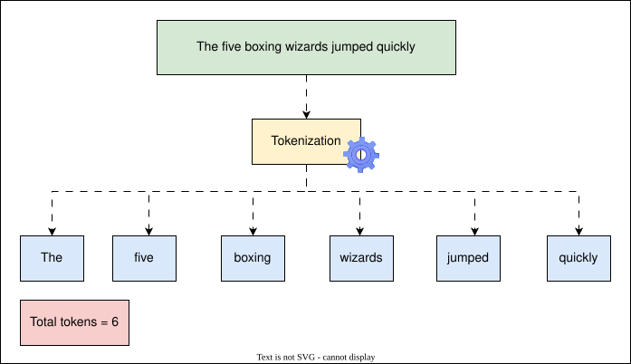

# Key_Concepts_for_Designing_Effective_Generative_AI_Systems

Source: https://www.educative.io/courses/generative-ai-system-design/key-concepts-in-designing-genai-systems

---

[Home](https://www.educative.io/)

[Courses](https://www.educative.io/search?tab=courses)

[Grokking the Generative AI System Design Interview](https://www.educative.io/courses/generative-ai-system-design)

# Key Concepts in Designing GenAI Systems

Explore foundational concepts crucial for designing generative AI systems, including tokenization methods, embedding techniques, image resolution enhancements, and phoneme conversion. Understand how these elements transform raw data into meaningful outputs across text, speech, image, and video generation to build effective AI solutions.

We'll cover the following...

- [Tokenization](https://www.educative.io/courses/generative-ai-system-design/key-concepts-in-designing-genai-systems#Tokenization)
  - [Tokenization techniques](https://www.educative.io/courses/generative-ai-system-design/key-concepts-in-designing-genai-systems#Tokenization-techniques)
- [Embedding](https://www.educative.io/courses/generative-ai-system-design/key-concepts-in-designing-genai-systems#Embedding)
  - [Embedding techniques](https://www.educative.io/courses/generative-ai-system-design/key-concepts-in-designing-genai-systems#Embedding-techniques)
- [Image resolution enhancement techniques](https://www.educative.io/courses/generative-ai-system-design/key-concepts-in-designing-genai-systems#Image-resolution-enhancement-techniques)
- [Text-to-phoneme conversion](https://www.educative.io/courses/generative-ai-system-design/key-concepts-in-designing-genai-systems#Text-to-phoneme-conversion)
- [Acoustic model in text-to-speech systems](https://www.educative.io/courses/generative-ai-system-design/key-concepts-in-designing-genai-systems#Acoustic-model-in-text-to-speech-systems)
- [Concepts extractions from prompts](https://www.educative.io/courses/generative-ai-system-design/key-concepts-in-designing-genai-systems#Concepts-extractions-from-prompts)
- [Scene graph generation](https://www.educative.io/courses/generative-ai-system-design/key-concepts-in-designing-genai-systems#Scene-graph-generation)
  - [How is a scene graph generated?](https://www.educative.io/courses/generative-ai-system-design/key-concepts-in-designing-genai-systems#How-is-a-scene-graph-generated)
- [Conclusion](https://www.educative.io/courses/generative-ai-system-design/key-concepts-in-designing-genai-systems#Conclusion)

In the ever-evolving domain of GenAI, generating meaningful and high-quality outputs from various systems, whether text, audio, image, or video, relies on various concepts and techniques. These concepts will help us to design systems that understand, process, and generate data in ways that mimic human perception and creativity. This lesson describes the key techniques across diverse domains, from tokenization and embedding methods in natural language processing to phoneme conversion and acoustic models in audio generation and some basic concepts in video generation systems. Each concept is critical in connecting the gap between raw data and sophisticated, contextually rich outputs, forming the backbone of modern AI systems. We will discuss the following concepts as shown in the table below:

## Lesson Structure

|  |  |
| --- | --- |
| **Concept** | **Description** |
| Tokenization | Splits text into smaller units (tokens) to enable processing by language models in text-to-text, text-to-image, text-to-speech, and text-to-video generation systems. |
| Embedding | Converts tokens (words, phrases, etc.) into dense vector representations to capture semantic meanings and relationships in all generative systems. |
| Image resolution enhancement techniques | Improves the quality and detail of generated images by increasing their resolution, particularly in text-to-image or text-to-video generation systems. |
| Text-to-phoneme conversion | Converts written text into phonetic representations to generate accurate and natural-sounding speech in text-to-speech (TTS) systems. |
| Acoustic model | Models the relationship between phonetic units and their corresponding acoustic signals, enabling the generation of natural-sounding speech in TTS systems. |
| Concepts extractions | Extracts key ideas or instructions from textual prompts to guide the generation of relevant visuals (i.e., text-to-image or text-to-video generation) systems. |
| Scene graph generation | Creates structured representations of objects, their relationships, and attributes in images, used for generating more complex and context-aware visuals (images or videos) |

Let’s dive deep into each of the above concepts.

## Tokenization[#](https://www.educative.io/courses/generative-ai-system-design/key-concepts-in-designing-genai-systems#Tokenization)

**Tokenization** is breaking down text (prompt) into smaller units called **tokens**. These tokens can be words, phrases, sentences, or even characters. Tokenization is used to split text into individual words or subwords that are easier for machines to process and analyze. For example, if the input is “The five boxing wizards jumped quickly,” the tokenized output (word level) would be: [“The,” “five,” “boxing,” “wizards,” “jumped,” “quickly”]. For languages with complex scripts like Chinese or in specialized applications like text-to-speech systems, tokenization may operate at a finer granularity, such as individual characters or phonemes.

A demonstration of text tokenization

### Tokenization techniques[#](https://www.educative.io/courses/generative-ai-system-design/key-concepts-in-designing-genai-systems#Tokenization-techniques)

There are several techniques to perform tokenization. Let’s explore some of the common ones:

- **Word-level tokenization:** This technique splits text at word boundaries, producing tokens corresponding to whole words. While simple and intuitive, it struggles with languages that lack clear word delimiters and large vocabularies.
- **Subword tokenization:**  This technique breaks down words into smaller units like prefixes, suffixes, and stems. Popular approaches include Byte Pair Encoding (BPE) and SentencePiece,  which handle rare or unknown words more efficiently by decomposing them into reusable subword tokens. For example, “unbelievable” may be split into [“un,” “believ,” and “able”].
- **Character-level tokenization:** This method treats each character as a token. While highly granular, it often results in long token sequences, making it computationally expensive and requiring more sophisticated models to capture context.
- **Tokenization for speech:** This method converts text into phonemes (basic sound units) to prepare for text-to-speech systems. This technique involves linguistic rules to ensure accurate pronunciation and intonation.
- **Multimodal tokenization:** This technique combines textual and non-textual data, such as text with images or audio, into unified token representations. For example, [CLIP models](https://www.educative.io/collection/page/10370001/5567964407791616/5559581239803904#CLIP-score) tokenize text and image embeddings for cross-modal understanding.

AI Powered

Saved

1 attempt left

Reset

Importance of tokenization

Why is tokenization a crucial first step in any GenAI pipeline, and how would using word-, subword-, or character-level tokenization change the final model’s behavior?

This is your last attempt.

## Embedding[#](https://www.educative.io/courses/generative-ai-system-design/key-concepts-in-designing-genai-systems#Embedding)

In NLP, **embedding** is the process of transforming discrete data, such as words or tokens, into continuous vectors in a high-dimensional space. The vector representations for each token encapsulate meaningful semantic and contextual information, enabling AI models to analyze data efficiently and accurately. It transforms data into a format suitable for mathematical operations. It preserves relationships between words and sentences. For example, the words “cool” and “cold” may have embeddings close to each other in the vector space due to their related meanings. These embeddings are often stored in a vector database to avoid recomputation and enable fast retrieval and search.

Transforming text, documents, and images into vectors using embedding

### Embedding techniques[#](https://www.educative.io/courses/generative-ai-system-design/key-concepts-in-designing-genai-systems#Embedding-techniques)

Some well-known embedding techniques are:

- **Word2Vec:** Word2Vec uses neural networks to learn vector representations of words based on their contexts (continuous bag of words) or their ability to predict context (skip-gram).
- **GloVe (Global vectors):** It's a count-based model that creates embeddings by analyzing word co-occurrence statistics in a corpus.
- **FastText:** This technique extends Word2Vec by incorporating subword information, allowing it to handle out-of-vocabulary (OOV) words more effectively.
- **Universal Sentence Encoder (USE):** Using transformer architectures, this technique encodes entire sentences or paragraphs into fixed-size embeddings.
- **InferSent:** It is a pretrained model optimized for creating embeddings useful for sentence-level understanding and comparison.
- **BERT embeddings:** It generates contextual embeddings using transformer models like BERT, which capture meanings of words in different contexts.

Embeddings are the cornerstone of modern NLP, enabling models to understand subtle relationships between words and concepts. Similar meanings (or words) are positioned closer in the vector space.

Let’s discuss the image resolution enhancement techniques next.

## Image resolution enhancement techniques[#](https://www.educative.io/courses/generative-ai-system-design/key-concepts-in-designing-genai-systems#Image-resolution-enhancement-techniques)

Image resolution plays a crucial role in the quality and clarity of images generated by text-to-image models. Modern models use different techniques to enhance resolution, ensuring generated images are visually detailed and aligned with textual prompts. These techniques often balance computational efficiency with high-quality outputs, allowing the models to generate images that meet user needs.

Different image/video resolutions

Some of the advanced image resolution enhancement techniques are discussed below:

- **Super-resolution GANs (SR-GANs):** These are generative adversarial networks (GANs) designed for super-resolution that use a generator-discriminator architecture to intelligently upscale images. The generator predicts high-resolution details by learning from extensive training data, while the discriminator evaluates the realism of generated images. These networks don’t just interpolate pixels but reconstruct textures, edges, and semantic details, enabling significant resolution improvements. Advanced SR-GAN models like ESRGAN can transform low-resolution images into photorealistic high-resolution versions by understanding complex image structures and generating contextually appropriate details.
- **Perceptual loss functions:** Some resolution enhancement techniques use perceptual loss functions that go beyond pixel-wise comparisons. These loss functions, often based on pretrained deep neural networks like VGG (Visual Geometry Group), evaluate image quality using perceptual and semantic similarities. These techniques can generate more visually smooth and naturally detailed high-resolution images by focusing on feature-level differences rather than exact pixel matches.
- [**Transformer-based techniques:**](https://www.educative.io/collection/page/10370001/5567964407791616/5404043000545280#Transformer-network)Transformers-based techniques apply [self-attention mechanisms](https://www.educative.io/collection/page/10370001/5567964407791616/5404043000545280#Self-attention) to understand global image context to improve image resolution. These models divide the image into small patches, analyze their relationships, and intelligently predict high-resolution details. These models generate semantically smoother and more natural images than traditional interpolation techniques by treating image upscaling as a sequence prediction problem.

Let’s move on to the text-to-phoneme conversion in the text-to-speech generation system as follows:

## Text-to-phoneme conversion[#](https://www.educative.io/courses/generative-ai-system-design/key-concepts-in-designing-genai-systems#Text-to-phoneme-conversion)

**Phonemes** are the distinct units of sound in a language. Text-to-phoneme conversion is an essential step in text-to-speech generation systems. The conversion ensures accurate pronunciation by mapping written text into a sequence of phonemes. For example, in the sentence “The wind will wind the clock,” the word “wind” is used twice, but both have different pronunciations. Such words that are spelled the same but pronounced differently are known as **homographs**. The correct pronunciation of the first “wind” is `/wɪnd/` (noun), and the second “wind” is `/waɪnd/` (verb) based on context.

The phoneme conversion process

GenAI models use sophisticated algorithms to perform phoneme conversion with high accuracy, which enables natural and expressive speech generation. Some GenAI models that can be used for phoneme conversions are:

- **Sequence-to-sequences (Seq2Seq)** models use encoder-decoder architectures to map input text sequences to corresponding phoneme sequences. These models are particularly effective for handling variable-length inputs and outputs.
- **Attention** mechanisms enhance Seq2Seq models by focusing on relevant parts of the input text during each decoding step. This helps clarify homographs and handle long or complex sentences.
- **Transformer-based models** like BERT, GPT, or T5 are increasingly used for phoneme conversion because they can understand the context and capture complex language patterns.

## Acoustic model in text-to-speech systems[#](https://www.educative.io/courses/generative-ai-system-design/key-concepts-in-designing-genai-systems#Acoustic-model-in-text-to-speech-systems)

An **acoustic model** in a text-to-speech (TTS) system generates intermediate acoustic features, such as mel-spectrograms, from processed text input. These features capture the key properties of speech, such as pitch, duration, intensity, and frequency parameters, which are then converted into audible speech by a vocoder. Acoustic models rely on advanced neural architectures trained on large datasets of paired text and speech to learn the subtle relationships between linguistic inputs and their corresponding acoustic properties.

Some GenAI-based acoustic models, such as Tacotron 2, FastSpeech 2, and Fish-Speech models, include powerful models simultaneously performing multiple text-to-speech conversion tasks.

Next, we discuss concept extractions from prompts in text-to-image generation systems.

## Concepts extractions from prompts[#](https://www.educative.io/courses/generative-ai-system-design/key-concepts-in-designing-genai-systems#Concepts-extractions-from-prompts)

**Concept extraction** in text-to-image and video generation systems transforms a user’s prompt into a meaningful, structured representation that guides the GenAI image or video creation models. This process begins with natural language understanding (NLU) techniques that parse the prompt into discrete elements. A technique called CLIP embeddings plays an important role in concept extractions. The system identifies the key entities, attributes, spatial relationships, actions, and contextual details in the extraction process. For example, consider a prompt like “A Siberian husky dog sitting on a red chair in a cool living room.” The system breaks this down into the following elements (categories), such as:

- The primary subject:

  - **Entity:** Dog
  - **Subject type:** Siberian husky
  - **Action:** Sitting
- Object interaction:

  - **Object:** Chair
  - **Color**: Red
- Environment context:

  - **Location**: Living room
  - **Atmosphere or temperature:** Cool
- Grammatical and semantic attributes:

  - **Definite article:** “A”
  - **Spatial relationship**: On (dog on a chair)
  - **Descriptive modifiers:** Specific breed, color, environmental atmosphere
- Semantic roles:

  - **Agent:** Siberian husky dog
  - **Location:** Living room
  - **Object:** Red chair

The above elements (categories) are transformed into a structured representation that guides the image or frame generation process.

## Scene graph generation [#](https://www.educative.io/courses/generative-ai-system-design/key-concepts-in-designing-genai-systems#Scene-graph-generation)

A **scene graph** is a data structure representing the relationships and attributes of objects in a scene. It provides a structured scene representation where nodes represent objects or entities, and edges represent their relationships or interactions. Scene graphs are useful for understanding a scene’s spatial layout, context, and interactions.

### How is a scene graph generated?[#](https://www.educative.io/courses/generative-ai-system-design/key-concepts-in-designing-genai-systems#How-is-a-scene-graph-generated)

Scene graph generation transforms the extracted concepts into a structured, relational representation that explicitly maps the semantic connections between different elements in the scene. Using advanced semantic parsing and knowledge graph techniques, the scene graph creates a network of nodes (representing entities) and edges (representing relationships), where each node and edge is annotated with attributes and semantic characteristics derived from the concept extraction process.

The scene graph involves a hierarchical and interconnected structure that captures the individual elements and their precise relationships and interactions. In the example of the prompt “A Siberian husky dog sitting on a red chair in a cool living room,” the scene graph generator would transform the extracted concepts into nodes like “Dog,” “Chair,” and “Living room,” with edges that define their interactions such as “Performs action,” “Positioned on,” and “Located in,” as shown in the illustration below. The edges are important as they provide context and spatial understanding beyond simple object identification. The scene graph allows the GenAI models to understand the compositional and relational semantics of the scene.

An example of a scene graph for a prompt “A Siberian husky dog is sitting on a red chair”

The above steps result in a graph in which the nodes represent the objects, such as the dog and chair, and the edges represent the relationships between them, such as “sitting on.” Attributes like color, “red,” can be attached to nodes or edges to further describe the scene. This structured representation enables a deeper understanding of the scene, which can be used for image or video generation applications.

Concept extraction identifies the puzzle pieces, while scene graph generation arranges them to show how they fit together.

## Conclusion[#](https://www.educative.io/courses/generative-ai-system-design/key-concepts-in-designing-genai-systems#Conclusion)

In the domain of GenAI, transforming raw data into meaningful output involves some complex steps, from breaking the text into tokens and creating embeddings to covering linguist inputs into visual or auditory representations. This lesson introduces a few fundamental concepts, though many more are worth exploring. Ultimately, these techniques enable AI systems to understand and generate the desired content, whether text-to-text, image, video, or speech. All such techniques used for transforming text into a machine-understandable input bridge the gap between what a user wants and the outputs of the AI system.

Preliminary Machine Learning Concepts

Post-Training, RLHF, and Reasoning Models

Ask

[Tokenization](https://www.educative.io/courses/generative-ai-system-design/key-concepts-in-designing-genai-systems#Tokenization)

[Tokenization techniques](https://www.educative.io/courses/generative-ai-system-design/key-concepts-in-designing-genai-systems#Tokenization-techniques)

[Embedding](https://www.educative.io/courses/generative-ai-system-design/key-concepts-in-designing-genai-systems#Embedding)

[Embedding techniques](https://www.educative.io/courses/generative-ai-system-design/key-concepts-in-designing-genai-systems#Embedding-techniques)

[Image resolution enhancement techniques](https://www.educative.io/courses/generative-ai-system-design/key-concepts-in-designing-genai-systems#Image-resolution-enhancement-techniques)

[Text-to-phoneme conversion](https://www.educative.io/courses/generative-ai-system-design/key-concepts-in-designing-genai-systems#Text-to-phoneme-conversion)

[Acoustic model in text-to-speech systems](https://www.educative.io/courses/generative-ai-system-design/key-concepts-in-designing-genai-systems#Acoustic-model-in-text-to-speech-systems)

[Concepts extractions from prompts](https://www.educative.io/courses/generative-ai-system-design/key-concepts-in-designing-genai-systems#Concepts-extractions-from-prompts)

[Scene graph generation](https://www.educative.io/courses/generative-ai-system-design/key-concepts-in-designing-genai-systems#Scene-graph-generation)

[How is a scene graph generated?](https://www.educative.io/courses/generative-ai-system-design/key-concepts-in-designing-genai-systems#How-is-a-scene-graph-generated)

[Conclusion](https://www.educative.io/courses/generative-ai-system-design/key-concepts-in-designing-genai-systems#Conclusion)