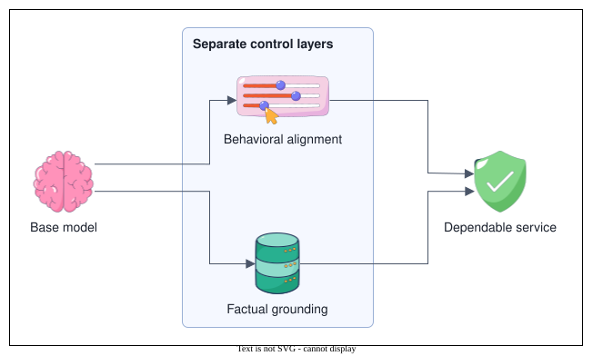
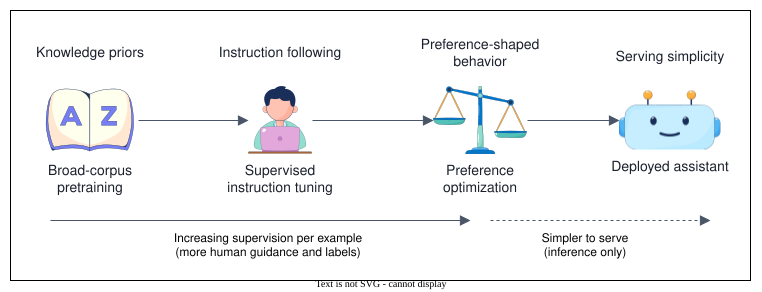

# Post-Training_Techniques_RLHF_and_Reasoning_Models_in_GenAI

Source: https://www.educative.io/courses/generative-ai-system-design/post-training-rlhf-and-reasoning-models

---

[Home](https://www.educative.io/)

[Courses](https://www.educative.io/search?tab=courses)

[Grokking the Generative AI System Design Interview](https://www.educative.io/courses/generative-ai-system-design)

# Post-Training, RLHF, and Reasoning Models

Explore how post-training methods like supervised fine-tuning and reinforcement learning from human feedback shape language model behavior. Understand how reasoning models enhance inference for complex tasks by using extra compute to improve accuracy while managing latency and cost trade-offs. This lesson helps you design GenAI systems with better alignment and dynamic inference strategies.

We'll cover the following...

- [From base model to aligned assistant](https://www.educative.io/courses/generative-ai-system-design/post-training-rlhf-and-reasoning-models#From-base-model-to-aligned-assistant)
  - [What the tuning data changes](https://www.educative.io/courses/generative-ai-system-design/post-training-rlhf-and-reasoning-models#What-the-tuning-data-changes)
- [RLHF and preference optimization](https://www.educative.io/courses/generative-ai-system-design/post-training-rlhf-and-reasoning-models#RLHF-and-preference-optimization)
  - [How the preference loop works](https://www.educative.io/courses/generative-ai-system-design/post-training-rlhf-and-reasoning-models#How-the-preference-loop-works)
  - [RLHF and DPO in practice](https://www.educative.io/courses/generative-ai-system-design/post-training-rlhf-and-reasoning-models#RLHF-and-DPO-in-practice)
- [Reasoning models and test-time compute](https://www.educative.io/courses/generative-ai-system-design/post-training-rlhf-and-reasoning-models#Reasoning-models-and-test-time-compute)
  - [Mechanics of test-time compute](https://www.educative.io/courses/generative-ai-system-design/post-training-rlhf-and-reasoning-models#Mechanics-of-test-time-compute)
  - [Operational trade-offs in reasoning workflows](https://www.educative.io/courses/generative-ai-system-design/post-training-rlhf-and-reasoning-models#Operational-trade-offs-in-reasoning-workflows)
- [Serving and product implications](https://www.educative.io/courses/generative-ai-system-design/post-training-rlhf-and-reasoning-models#Serving-and-product-implications)
  - [Capacity and latency planning](https://www.educative.io/courses/generative-ai-system-design/post-training-rlhf-and-reasoning-models#Capacity-and-latency-planning)
- [Choosing and routing models](https://www.educative.io/courses/generative-ai-system-design/post-training-rlhf-and-reasoning-models#Choosing-and-routing-models)
- [Conclusion](https://www.educative.io/courses/generative-ai-system-design/post-training-rlhf-and-reasoning-models#Conclusion)

When you select a foundation model for an application, raw text completion is only the starting point. Out of the box, a base model knows how to predict words, but it does not know how to act like a specific product, follow interface contracts, or protect user safety.

Post-training techniques and runtime reasoning controls bridge that gap, transforming general capabilities into a dependable service. However, sounding helpful is not the same as being accurate. A customer service bot might write an empathetic message approving an expired refund simply because it was trained to sound pleasant rather than verify company policy.

Post-training and runtime controls improve production behavior

**Note:** In System Design discussions, treat behavioral alignment and factual grounding as separate control layers. Alignment guides communication style and structure, while external retrieval improves factual correctness.

In this lesson, you will learn how Supervised Fine-Tuning and Reinforcement Learning from Human Feedback (RLHF) shape model behavior, why alignment differs from factual truth, and how to manage the latency and cost of reasoning models. Instruction tuning is a primary form of SFT and serves as the foundational post-training phase in production deployments.

## From base model to aligned assistant[#](https://www.educative.io/courses/generative-ai-system-design/post-training-rlhf-and-reasoning-models#From-base-model-to-aligned-assistant)

Instruction tuning is the simplest way to make a pretrained model usable in a request pipeline. During training, the training pipeline feeds instruction–response pairs to the model, and the model updates its weights to produce that style of answer directly at inference time.

Alignment pipeline overview

### What the tuning data changes[#](https://www.educative.io/courses/generative-ai-system-design/post-training-rlhf-and-reasoning-models#What-the-tuning-data-changes)

A plain-language way to think about it is this. The base model has seen a lot of text, but it has not been specialized to act like your assistant. Instruction tuning shows repeated examples of how your product wants the conversation to proceed.

The training set usually teaches several stable behaviors.

- **Role following:** The model learns that a system or developer instruction should control the answer instead of being treated like ordinary text.
- **Format adherence:** The model learns to emit markdown, bullet summaries, or machine-readable fields consistently enough for downstream parsing.
- **Response style:** The model learns whether the product wants concise answers, detailed walk-throughs, or standard refusal phrasing.
- **Task completion:** The model learns to finish extraction, classification, rewrite, or summarization tasks instead of drifting into generic continuation.

Suppose a support platform needs the model to summarize tickets into JSON for a routing service. The tuned model is more likely to return the exact schema, fill required slots, and preserve short explanations for agents.

That does not mean the model knows more facts. It means the request life cycle is easier to control. Fewer malformed outputs reach the validator, fewer retries occur, and latency becomes more stable because the application performs less cleanup.

**Practical tip:** Teams often start with instruction tuning because the training loop and evaluation set are much simpler than full reinforcement-based alignment.

Instruction tuning solves the first layer of usability, but it still struggles when several valid responses differ mainly in human preference, which leads to preference optimization next. Before that transition, it helps to visualize where this stage sits in the larger life cycle.

## RLHF and preference optimization[#](https://www.educative.io/courses/generative-ai-system-design/post-training-rlhf-and-reasoning-models#RLHF-and-preference-optimization)

When two answers are both acceptable, users still usually prefer one. One might be clearer, safer, less toxic, or better calibrated about uncertainty. Instruction tuning alone does not model that ranking very well, so teams add preference optimization.

### How the preference loop works[#](https://www.educative.io/courses/generative-ai-system-design/post-training-rlhf-and-reasoning-models#How-the-preference-loop-works)

The data pipeline starts by sampling multiple candidate answers for the same prompt. Human annotators compare them and record which one they prefer. That comparison data trains a reward model. The assistant is then optimized toward higher-scoring responses while a drift-control term keeps it from moving too far from the original model behavior.

### RLHF and DPO in practice[#](https://www.educative.io/courses/generative-ai-system-design/post-training-rlhf-and-reasoning-models#RLHF-and-DPO-in-practice)

**RLHF** is the classic approach. It updates the model using reinforcement learning to maximize scores assigned by a separately trained reward model. **Direct Preference Optimization (DPO)** is a simpler alternative. It optimizes the model directly on chosen-versus-rejected response pairs, eliminating the need to train a separate reward model or maintain an online reinforcement learning loop.

The following diagram visualizes the main flow for these two techniques.

RLHF vs DPO

This stage typically shifts behavior in predictable ways.

- **Helpfulness selection:** The model chooses better among multiple valid answers instead of merely producing a valid one.
- **Safety shaping:** The model learns safer refusals and lower-risk wording for sensitive cases.
- **Tone control:** The model maintains more consistent politeness, caution, and confidence calibration.
- **Toxicity reduction:** The model is less likely to produce harmful or offensive outputs under pressure.

**Note:** Reward models can be gamed. A model may learn to sound safe and polished while still being evasive, overrefusing, or quietly wrong.

For many products, the System Design answer is pragmatic. Use pretraining plus instruction tuning as the default path, then add DPO or RLHF only when user-facing behavior and safety justify the extra data and training overhead.

Aligned behavior improves usability, but difficult multistep tasks often need a separate serving decision at inference time, which brings us to reasoning models.

## Reasoning models and test-time compute[#](https://www.educative.io/courses/generative-ai-system-design/post-training-rlhf-and-reasoning-models#Reasoning-models-and-test-time-compute)

A reasoning model dynamically expends additional computation during inference before delivering its final answer. While a standard model immediately begins generating its visible response by running one forward pass per token, a reasoning model first generates a sequence of hidden “thinking” tokens. It utilizes this internal scratchpad to formulate intermediate plans, verify sub-calculations, and explore alternative solution paths before emitting the final answer.

### Mechanics of test-time compute[#](https://www.educative.io/courses/generative-ai-system-design/post-training-rlhf-and-reasoning-models#Mechanics-of-test-time-compute)

In traditional inference, compute scales directly with the number of generated output tokens returned to the client. With reasoning models, test-time compute functions as a configurable architectural dial.

The serving layer can expose this capability as a discrete reasoning effort tier (such as low, medium, or high) or as an explicit upper token budget. High-difficulty tasks benefit significantly from extended test-time compute, including multi-table SQL query generation, distributed systems debugging, and algorithmic math. Conversely, transactional operations like sentiment classification or basic text extraction show little or no measurable accuracy improvement when allocated additional thinking budgets.

### Operational trade-offs in reasoning workflows[#](https://www.educative.io/courses/generative-ai-system-design/post-training-rlhf-and-reasoning-models#Operational-trade-offs-in-reasoning-workflows)

Allocating compute during inference introduces nonlinear cost and performance curves that impact production systems.

- **Diminishing returns:** Beyond a certain token threshold, additional intermediate reflection cycles yield negligible quality improvements while increasing execution cost.
- **Overthinking traps:** Excessive reasoning chains occasionally cause the model to reconsider correct initial deductions, introducing circular reasoning or ungrounded assumptions that degrade the final output.
- **Latency variance:** Complex queries may trigger thousands of hidden reasoning tokens, causing p99 latency to spike dramatically compared to the median p50 baseline.

The diagram below compares how a standard model processes queries versus a reasoning model allocating test-time compute.

Standard model inference vs. reasoning model inference

## Serving and product implications[#](https://www.educative.io/courses/generative-ai-system-design/post-training-rlhf-and-reasoning-models#Serving-and-product-implications)

Reasoning changes serving behavior more than most benchmark charts reveal. The request lives longer on the worker, output-token billing rises, and the KV cache stays resident longer, which reduces effective concurrency under load.

### Capacity and latency planning[#](https://www.educative.io/courses/generative-ai-system-design/post-training-rlhf-and-reasoning-models#Capacity-and-latency-planning)

Average latency is not the planning metric that saves systems during peak traffic. p95 and p99 matter because a minority of deep-thinking requests can dominate queues and exhaust worker slots.

The infrastructure team usually adds explicit controls.

- **Reasoning caps:** The service enforces maximum reasoning tokens per route so a single request cannot grow without bound.
- **Deadlines:** The orchestrator cuts off slow generations and returns a fallback or partial answer when the timeout budget expires.
- **Circuit breakers:** The platform disables expensive reasoning paths during load spikes to preserve core availability.
- **Routing policies:** A small classifier or policy model sends easy prompts to a standard model and reserves the reasoning path for hard prompts.

User experience also shifts. First-token latency and final-answer latency can diverge if the system streams a progress message early but delays the complete answer until verification ends.

**Practical tip:** For interactive products, expose progress states such as "analyzing" or offer a fast draft first, then allow refinement on demand.

The product layer still needs a concrete model-selection rule, so the next section turns these constraints into routing guidance. Before moving on, a workload-by-workload comparison helps anchor the policy choices.

|  |  |  |  |  |  |
| --- | --- | --- | --- | --- | --- |
| **Workload type** | **Standard model fit** | **Reasoning model fit** | **Expected latency profile** | **Token cost profile** | **Recommended routing policy** |
| Casual chat | High | Low–Medium | Lowest | Lowest | Default to standard; escalate only for multi-step or ambiguous asks |
| Customer support | High | Medium | Low | Low | Use standard for frontline SLA; route complex policy or edge cases to reasoning |
| SQL generation | Medium | High | Medium | Medium–High | Start with standard for simple queries; use reasoning for joins, debugging, or schema ambiguity |
| Code debugging | Medium | High | Medium–High | Medium–High | Route to reasoning when logs, stack traces, or root-cause analysis are needed |
| Math tutoring | Low–Medium | High | Medium–High | High | Prefer reasoning for accuracy and stepwise explanations; standard only for basic drills |
| Offline research summarization | High | Medium–High | High acceptable | Medium | Use standard for draft summaries; use reasoning when synthesis or cross-source reconciliation matters |

## Choosing and routing models[#](https://www.educative.io/courses/generative-ai-system-design/post-training-rlhf-and-reasoning-models#Choosing-and-routing-models)

Model choice is a routing problem, not a one-time platform decision. The gateway receives a request, evaluates workload shape, and selects the cheapest path that still meets answer quality and latency targets.

A practical policy often starts with these signals.

- **Task cues:** Explicit math, code debugging, planning, and multi-document synthesis usually trigger a reasoning path.
- **Uncertainty signals:** A smaller gate model can estimate task complexity and escalate only ambiguous requests.
- **Interaction mode:** Online chat favors lower latency, while offline batch pipelines can tolerate slower, deeper reasoning.
- **Cost envelope:** Some workloads are better served by a larger standard model than by a smaller reasoning model with a large thinking budget.
- **UX contract:** Products can offer a fast answer first, deeper analysis on click, or a user-selectable effort mode.

**Attention:** A common launch failure is enabling high reasoning effort globally, then discovering that simple requests silently multiplied token spend without measurable quality gain.

The routing layer should also define timeout and streaming behavior per route. Consumer chat may prefer immediate partial output. A code debugger may wait longer for a more reliable final patch explanation.

That completes the model-selection side of the system. The remaining question, which the next lesson tackles directly, is whether those answers are actually high quality and grounded rather than merely aligned.

AI Powered

Saved

1 attempt left

Reset

Managing inference latency and model routing

An engineering team deploys a high-compute reasoning model as the platform-wide default for an enterprise support assistant. Shortly after launch, basic lookup queries experience severe latency spikes and GPU memory saturation. According to production routing principles, what architectural change should the team implement?

This is your last attempt.

## Conclusion[#](https://www.educative.io/courses/generative-ai-system-design/post-training-rlhf-and-reasoning-models#Conclusion)

Pretraining gives the model broad capability, but post-training decides whether that capability shows up as a usable assistant. Instruction tuning improves instruction following and output structure. Preference optimization pushes the model toward the answer users actually want among many valid possibilities.

Reasoning models add another lever at serving time. They can improve hard multistep tasks by spending more test-time compute, but they also increase token cost and make latency less predictable. In interviews and production designs, discuss model choice together with routing, SLOs, budgets, and UX, because those decisions travel together.

Key Concepts in Designing GenAI Systems

Quality, Groundedness, and Hallucination Rate

Ask

[From base model to aligned assistant](https://www.educative.io/courses/generative-ai-system-design/post-training-rlhf-and-reasoning-models#From-base-model-to-aligned-assistant)

[What the tuning data changes](https://www.educative.io/courses/generative-ai-system-design/post-training-rlhf-and-reasoning-models#What-the-tuning-data-changes)

[RLHF and preference optimization](https://www.educative.io/courses/generative-ai-system-design/post-training-rlhf-and-reasoning-models#RLHF-and-preference-optimization)

[How the preference loop works](https://www.educative.io/courses/generative-ai-system-design/post-training-rlhf-and-reasoning-models#How-the-preference-loop-works)

[RLHF and DPO in practice](https://www.educative.io/courses/generative-ai-system-design/post-training-rlhf-and-reasoning-models#RLHF-and-DPO-in-practice)

[Reasoning models and test-time compute](https://www.educative.io/courses/generative-ai-system-design/post-training-rlhf-and-reasoning-models#Reasoning-models-and-test-time-compute)

[Mechanics of test-time compute](https://www.educative.io/courses/generative-ai-system-design/post-training-rlhf-and-reasoning-models#Mechanics-of-test-time-compute)

[Operational trade-offs in reasoning workflows](https://www.educative.io/courses/generative-ai-system-design/post-training-rlhf-and-reasoning-models#Operational-trade-offs-in-reasoning-workflows)

[Serving and product implications](https://www.educative.io/courses/generative-ai-system-design/post-training-rlhf-and-reasoning-models#Serving-and-product-implications)

[Capacity and latency planning](https://www.educative.io/courses/generative-ai-system-design/post-training-rlhf-and-reasoning-models#Capacity-and-latency-planning)

[Choosing and routing models](https://www.educative.io/courses/generative-ai-system-design/post-training-rlhf-and-reasoning-models#Choosing-and-routing-models)

[Conclusion](https://www.educative.io/courses/generative-ai-system-design/post-training-rlhf-and-reasoning-models#Conclusion)