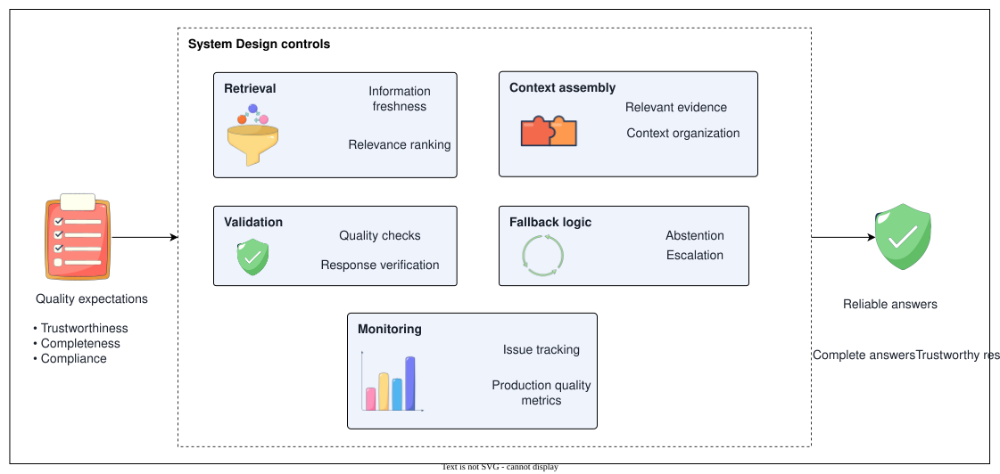

# Ensuring_Quality_and_Minimizing_Hallucination_in_GenAI_Systems

Source: https://www.educative.io/courses/generative-ai-system-design/quality-groundedness-and-hallucination-rate

---

[Home](https://www.educative.io/)

[Courses](https://www.educative.io/search?tab=courses)

[Grokking the Generative AI System Design Interview](https://www.educative.io/courses/generative-ai-system-design)

# Quality, Groundedness, and Hallucination Rate

Explore how to evaluate quality as a nonfunctional requirement in Generative AI systems. Learn to define measurable metrics for correctness, groundedness, completeness, and hallucination, and use these metrics to shape system architecture with retrieval, validation, and abstention mechanisms. Understand how to trade quality against latency and cost while meeting service-level expectations.

We'll cover the following...

- [Quality as a design requirement](https://www.educative.io/courses/generative-ai-system-design/quality-groundedness-and-hallucination-rate#Quality-as-a-design-requirement)
- [What quality means in GenAI](https://www.educative.io/courses/generative-ai-system-design/quality-groundedness-and-hallucination-rate#What-quality-means-in-GenAI)
- [Hallucination and how teams measure it](https://www.educative.io/courses/generative-ai-system-design/quality-groundedness-and-hallucination-rate#Hallucination-and-how-teams-measure-it)
- [Writing measurable quality targets](https://www.educative.io/courses/generative-ai-system-design/quality-groundedness-and-hallucination-rate#Writing-measurable-quality-targets)
- [How quality targets shape architecture](https://www.educative.io/courses/generative-ai-system-design/quality-groundedness-and-hallucination-rate#How-quality-targets-shape-architecture)
  - [Architectural responses to quality targets](https://www.educative.io/courses/generative-ai-system-design/quality-groundedness-and-hallucination-rate#Architectural-responses-to-quality-targets)
  - [Hallucination control paths](https://www.educative.io/courses/generative-ai-system-design/quality-groundedness-and-hallucination-rate#Hallucination-control-paths)
- [Trading quality against latency and cost](https://www.educative.io/courses/generative-ai-system-design/quality-groundedness-and-hallucination-rate#Trading-quality-against-latency-and-cost)
- [Conclusion](https://www.educative.io/courses/generative-ai-system-design/quality-groundedness-and-hallucination-rate#Conclusion)

In GenAI systems, quality is a nonfunctional requirement that must be enforced across the entire architecture rather than through prompt engineering alone. Because probabilistic generation means a fluent model can still fail, trustworthiness, completeness, and compliance depend on retrieval freshness, context assembly, and output validation working together. Treating quality like availability or latency changes the design flow: you start by turning target behaviors into measurable expectations that drive retrieval depth, citation rules, abstention paths, and monitoring.

Quality is enforced across the system, not by the prompt alone

This lesson moves from capability to trustworthy behavior. First define quality, then attach metrics, then let those metrics shape architecture. The next lesson will extend that same flow into latency, throughput, and cost.

## Quality as a design requirement[#](https://www.educative.io/courses/generative-ai-system-design/quality-groundedness-and-hallucination-rate#Quality-as-a-design-requirement)

A GenAI request path looks simple from the outside. The user submits a question, the system retrieves context, the model generates an answer, and the client renders it. In practice, every stage can lower answer quality even when the model itself is strong.

Think of quality like a contract for the response pipeline. If the contract says answers must stay grounded in approved documents, then retrieval, chunking, reranking, prompting, and output validation all need to enforce that boundary. If the contract says answers may speculate creatively, the same pipeline can be lighter.

**Note:** In interviews, “accurate enough” is not a design requirement. It is a missing requirement.

A useful split is functional vs. nonfunctional. Functional requirements describe system behavior. Nonfunctional requirements describe how well that behavior must hold under real traffic. For GenAI, quality sits beside availability, security, and cost as a primary design axis. Candidates often describe what the assistant can do before describing how safely it should do it. Reverse that order.

- **Capability:** The system answers user questions using enterprise documents.
- **Behavior:** The system must answer only from approved sources, cite them correctly, and abstain when evidence is weak.

That framing gives the rest of the architecture direction. Next, we need dimensions that make "quality" concrete.

## What quality means in GenAI[#](https://www.educative.io/courses/generative-ai-system-design/quality-groundedness-and-hallucination-rate#What-quality-means-in-GenAI)

Quality is not one score. The same response can be relevant but incomplete, correct but ungrounded, or well formatted but factually wrong. In a design interview, state the dimensions explicitly before discussing evaluation.

The common dimensions are best treated as separate scorecards around one response.

- **Correctness:** The claims match reality or approved reference answers.
- **Groundedness:** The claims are supported by allowed evidence returned to the model.
- **Relevance:** The answer addresses the user's intent without drifting.
- **Completeness:** The answer covers required parts of the question.
- **Format adherence:** The output follows the required schema, citation style, or structure.
- **Tone:** The wording matches the product requirement, such as professional or empathetic.

Groundedness deserves special care. A claim can be true in the world and still fail the system if the claim is not supported by the permitted context. In enterprise RAG, that distinction is operational, not academic.

**Practical tip:** Say which two or three dimensions dominate for the domain before listing the rest.

Different applications weight these axes differently. Customer support often prioritizes groundedness, relevance, and tone. Legal or medical systems push correctness and completeness much higher. Creative writing systems may relax groundedness but still require format adherence.

The following visual should make the multidimensional view explicit.

Quality has many axes

Once quality is decomposed, hallucination becomes easier to define and measure.

## Hallucination and how teams measure it[#](https://www.educative.io/courses/generative-ai-system-design/quality-groundedness-and-hallucination-rate#Hallucination-and-how-teams-measure-it)

In system terms, hallucination means the answer contains unsupported, fabricated, or instruction-violating content. The failure can happen even when the text sounds polished. That is why teams measure it separately instead of assuming fluency implies quality.

Three failure patterns appear often in production.

- **Factual hallucination:** The model invents facts, dates, policies, or outcomes.
- **Citation hallucination:** The answer cites a source that does not exist or attributes the claim to the wrong document.
- **Instruction-following hallucination:** The model violates constraints such as “answer only from policy docs” or “return JSON only.”

1.

Can reducing hallucinations make a system less helpful?

Show Answer

Did you find this helpful?

Weak retrieval often starts the chain. A stale index, poor chunk boundaries, missing metadata filters, or a partial retriever outage can leave the model with thin evidence. The generator then fills gaps. Prompt ambiguity and missing abstention logic increase the chance that it will guess instead of decline. Teams usually track both response-level and claim-level metrics.

- **Response-level view**: A response is marked hallucinated if any critical unsupported content appears. This is simple for dashboards and trend monitoring.
- **Claim-level view:** The answer is decomposed into factual claims, and each claim is checked against allowed evidence. The unsupported-claim ratio can be written as r=ucr = \frac{u}{c}r=cu​, where uuu is unsupported claims, and ccc is total claims

At scale, claim decomposition and checking are typically handled by automated evaluators, such as LLM-as-a-judge pipelines or specialized Natural Language Inference (NLI) models, combined with human spot-checks. Overall measurement relies on representative golden sets, automated evaluators, human review rubrics, sampled production traffic, and trap questions designed to expose hidden failure modes. Average scores can hide dangerous slices, so high-risk intents should be evaluated separately.

After you can define and measure failure, you can write targets that actually guide implementation.

## Writing measurable quality targets[#](https://www.educative.io/courses/generative-ai-system-design/quality-groundedness-and-hallucination-rate#Writing-measurable-quality-targets)

Interview answers get stronger when vague goals become thresholds with scope. "Be accurate" does not change architecture. A target with a metric, dataset, threshold, cadence, and remediation trigger does.

A compact target statement usually includes these pieces.

- **Metric:** The exact quantity being tracked, such as groundedness or citation accuracy.
- **Dataset or traffic slice:** The evaluation set, such as policy questions, sampled support tickets, or high-risk intents.
- **Threshold:** The minimum acceptable score or maximum acceptable failure rate.
- **Cadence:** How often the team measures it, such as per release or weekly in production.
- **Remediation trigger:** The action when the target is missed, such as rollback, retriever retraining, or adding human review.

For example, you might require groundedness above 90% on a 200-query golden set, citation accuracy above 95% for policy answers, and hallucination rate below 5% on sampled customer tickets. The golden set must include common cases, hard cases, and edge cases. A library analogy fits here. If you test only the books nearest the entrance, you learn nothing about whether the catalog works for rare titles.

The table below should be reusable during interviews.

## Quality Dimensions and Sample Evaluation Targets

|  |  |  |  |
| --- | --- | --- | --- |
| **Quality dimension** | **Example metric** | **Sample target** | **Typical evaluation method** |
| Correctness | Factual error rate | 0 major errors per answer | SME review against source facts |
| Groundedness | Unsupported claims count | ≤1 unsupported claim | Source-to-answer trace check |
| Citation accuracy | Citation match rate | ≥ 95% citations support linked claim | Manual citation verification |
| Relevance | Off-topic content ratio | <10% off-topic content | Query-response rubric scoring |
| Completeness | Required points covered | 4/4 key points included | Checklist against prompt needs |
| Format adherence | Instruction compliance rate | 100% required format followed | Rule-based output check |
| Tone | Tone alignment score | Matches “professional and concise” | Human rubric review |

With targets in place, the architecture can now be justified rather than guessed.

## How quality targets shape architecture[#](https://www.educative.io/courses/generative-ai-system-design/quality-groundedness-and-hallucination-rate#How-quality-targets-shape-architecture)

Quality targets directly influence the architecture of a GenAI system. For example, if answers must be grounded in reliable evidence, the system needs more than a capable language model. It needs a pipeline that retrieves relevant information, verifies its relevance, and controls how the model uses it.

A typical grounded generation pipeline follows these steps:

1. **Retrieval:** Fetch relevant documents based on the user query.
2. **Reranking:** Reorder retrieved documents to prioritize the most relevant results.
3. **Context assembly:** Select relevant chunks and metadata to provide the model with sufficient evidence.
4. **Generation:** Generate an answer based on the assembled context.
5. **Validation and routing:** Check the output and decide whether to return the answer, abstain, or escalate it for review.

The following diagram illustrates this pipeline.

Grounded generation pipeline

1.

Why should retrieval freshness be monitored?

Show Answer

Did you find this helpful?

### Architectural responses to quality targets[#](https://www.educative.io/courses/generative-ai-system-design/quality-groundedness-and-hallucination-rate#Architectural-responses-to-quality-targets)

Different quality targets require different architectural controls.

|  |  |
| --- | --- |
| **Quality target** | **Architectural response** |
| Groundedness | Use retrieval, reranking, metadata filters, and evidence-bound prompting to improve the relevance and reliability of answers. |
| Verifiability | Include source-linked citations so users can trace claims back to supporting evidence. |
| Hallucination control | Use confidence gates and verification checks to identify answers with insufficient evidence. |
| Safe handling of uncertainty | Introduce abstention paths to prevent the system from generating unsupported answers. |
| High-risk output handling | Route uncertain or regulated responses to human reviewers before release. |
| Completeness | Expand context assembly to include sufficient relevant information without exceeding context limits. |
| Format adherence | Use structured output schemas and validators to ensure responses follow the required format. |

### Hallucination control paths[#](https://www.educative.io/courses/generative-ai-system-design/quality-groundedness-and-hallucination-rate#Hallucination-control-paths)

When hallucination targets are strict, the system needs explicit paths for handling answers that cannot be reliably generated.

- **Abstention:** The system declines to answer when the available evidence is insufficient, or the risk of an incorrect response is high.
- **Human review:** Uncertain or regulated outputs are routed to a human reviewer before they are delivered to the user.

These controls help align system behavior with the required quality standards. However, stronger retrieval, additional validation, and human review can increase latency and operational cost. Larger context windows can also increase token usage.

## Trading quality against latency and cost[#](https://www.educative.io/courses/generative-ai-system-design/quality-groundedness-and-hallucination-rate#Trading-quality-against-latency-and-cost)

Quality improvements usually add work to the request path. Deeper retrieval increases backend calls. Reranking adds model inference. Larger contexts raise token cost. Stronger generators improve answers but lengthen latency. Human review provides the safest fallback and the slowest one.

A practical design balances these with tiered serving. Low-risk questions can use lightweight retrieval and a smaller task-specific fine-tuned model. High-risk intents can trigger richer retrieval, stricter validation, and selective escalation. Frequently asked grounded answers can be cached, provided the cache key includes source version so stale policy text is not replayed.

**Practical tip:** State the quality target first, then ask what latency budget and per-request cost the business accepts to meet it.

This framing keeps trade-offs honest. If the requirement says citation accuracy must exceed 95% for enterprise support policy answers, extra validation is not optional overhead. It is part of the service contract.

Test your knowledge!

Say “Hi” to Ed in the widget below to explore quality trade-offs in GenAI system design.

AI Powered

Saved

12 attempts left

Reset

Balancing Quality, Latency, and Cost

You have 12 attempts to answer.

## Conclusion[#](https://www.educative.io/courses/generative-ai-system-design/quality-groundedness-and-hallucination-rate#Conclusion)

In GenAI system design, quality is a measurable nonfunctional requirement, not a soft aspiration. Separate correctness, groundedness, and hallucination rate, then bind each one to thresholds on representative datasets and production slices. Once those targets are stated, the architecture becomes easier to defend. Retrieval, citation validation, abstention, and human review stop looking like optional features and start looking like direct responses to service-level expectations.

The next lesson extends this exact reasoning into operational economics, where you will price these quality choices in latency, throughput, and cost.

Post-Training, RLHF, and Reasoning Models

Latency, Throughput, and Cost

Ask

[Quality as a design requirement](https://www.educative.io/courses/generative-ai-system-design/quality-groundedness-and-hallucination-rate#Quality-as-a-design-requirement)

[What quality means in GenAI](https://www.educative.io/courses/generative-ai-system-design/quality-groundedness-and-hallucination-rate#What-quality-means-in-GenAI)

[Hallucination and how teams measure it](https://www.educative.io/courses/generative-ai-system-design/quality-groundedness-and-hallucination-rate#Hallucination-and-how-teams-measure-it)

[Writing measurable quality targets](https://www.educative.io/courses/generative-ai-system-design/quality-groundedness-and-hallucination-rate#Writing-measurable-quality-targets)

[How quality targets shape architecture](https://www.educative.io/courses/generative-ai-system-design/quality-groundedness-and-hallucination-rate#How-quality-targets-shape-architecture)

[Architectural responses to quality targets](https://www.educative.io/courses/generative-ai-system-design/quality-groundedness-and-hallucination-rate#Architectural-responses-to-quality-targets)

[Hallucination control paths](https://www.educative.io/courses/generative-ai-system-design/quality-groundedness-and-hallucination-rate#Hallucination-control-paths)

[Trading quality against latency and cost](https://www.educative.io/courses/generative-ai-system-design/quality-groundedness-and-hallucination-rate#Trading-quality-against-latency-and-cost)

[Conclusion](https://www.educative.io/courses/generative-ai-system-design/quality-groundedness-and-hallucination-rate#Conclusion)