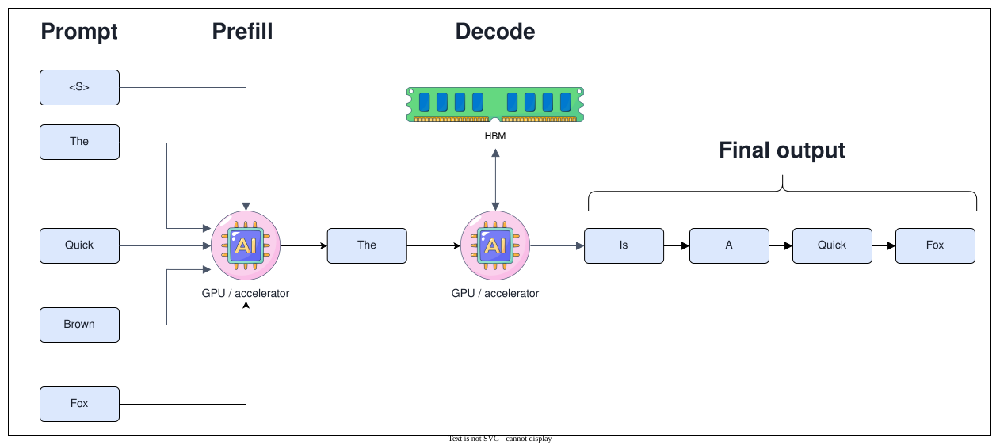

# Balancing_Latency_Throughput_and_Cost_in_Generative_AI_Systems

Source: https://www.educative.io/courses/generative-ai-system-design/latency-throughput-and-cost

---

[Home](https://www.educative.io/)

[Courses](https://www.educative.io/search?tab=courses)

[Grokking the Generative AI System Design Interview](https://www.educative.io/courses/generative-ai-system-design)

# Latency, Throughput, and Cost

Explore how to balance latency, throughput, and cost in generative AI systems by understanding time to first token, time per output token, and trade-offs involving batch size and GPU utilization. Learn to define clear performance targets and implement strategies like streaming and caching to optimize system responsiveness and operational costs.

We'll cover the following...

- [Decomposing latency across generative workloads](https://www.educative.io/courses/generative-ai-system-design/latency-throughput-and-cost#Decomposing-latency-across-generative-workloads)
  - [Time to First Token](https://www.educative.io/courses/generative-ai-system-design/latency-throughput-and-cost#Time-to-First-Token)
  - [Time Per Output Token](https://www.educative.io/courses/generative-ai-system-design/latency-throughput-and-cost#Time-Per-Output-Token)
  - [Formulating end-to-end latency](https://www.educative.io/courses/generative-ai-system-design/latency-throughput-and-cost#Formulating-end-to-end-latency)
- [Primary drivers of generative latency](https://www.educative.io/courses/generative-ai-system-design/latency-throughput-and-cost#Primary-drivers-of-generative-latency)
  - [Prompt sequence length](https://www.educative.io/courses/generative-ai-system-design/latency-throughput-and-cost#Prompt-sequence-length)
  - [Output generation length](https://www.educative.io/courses/generative-ai-system-design/latency-throughput-and-cost#Output-generation-length)
  - [Model parameter scale and precision](https://www.educative.io/courses/generative-ai-system-design/latency-throughput-and-cost#Model-parameter-scale-and-precision)
  - [Batch size and scheduling contention](https://www.educative.io/courses/generative-ai-system-design/latency-throughput-and-cost#Batch-size-and-scheduling-contention)
  - [Test-time compute and reasoning effort](https://www.educative.io/courses/generative-ai-system-design/latency-throughput-and-cost#Test-time-compute-and-reasoning-effort)
- [Node throughput, concurrency, and the efficiency trade-off](https://www.educative.io/courses/generative-ai-system-design/latency-throughput-and-cost#Node-throughput-concurrency-and-the-efficiency-trade-off)
- [Perceived latency versus actual latency and the role of streaming](https://www.educative.io/courses/generative-ai-system-design/latency-throughput-and-cost#Perceived-latency-versus-actual-latency-and-the-role-of-streaming)
  - [Human perception thresholds and streaming protocols](https://www.educative.io/courses/generative-ai-system-design/latency-throughput-and-cost#Human-perception-thresholds-and-streaming-protocols)
  - [When streaming does not help](https://www.educative.io/courses/generative-ai-system-design/latency-throughput-and-cost#When-streaming-does-not-help)
- [Unit economics](https://www.educative.io/courses/generative-ai-system-design/latency-throughput-and-cost#Unit-economics)
  - [Why output tokens cost more than input tokens](https://www.educative.io/courses/generative-ai-system-design/latency-throughput-and-cost#Why-output-tokens-cost-more-than-input-tokens)
  - [Formulating cost per request](https://www.educative.io/courses/generative-ai-system-design/latency-throughput-and-cost#Formulating-cost-per-request)
- [Balancing latency, throughput, and cost](https://www.educative.io/courses/generative-ai-system-design/latency-throughput-and-cost#Balancing-latency-throughput-and-cost)
- [Formulating latency and cost targets in a design interview](https://www.educative.io/courses/generative-ai-system-design/latency-throughput-and-cost#Formulating-latency-and-cost-targets-in-a-design-interview)
  - [Recommended interview pacing framework](https://www.educative.io/courses/generative-ai-system-design/latency-throughput-and-cost#Recommended-interview-pacing-framework)
- [Conclusion](https://www.educative.io/courses/generative-ai-system-design/latency-throughput-and-cost#Conclusion)

In the last lesson, we explored quality as a nonfunctional requirement in GenAI systems, covering how to measure it and how it shapes architecture. However, improving quality often adds processing overhead, affecting response time and cost.

In this lesson, we will explore latency, throughput, and cost, including Time to First Token (TTFT), Time Per Output Token (TPOT), request concurrency, and GPU utilization. You will learn how to balance these constraints and define measurable performance requirements for GenAI systems.

## Decomposing latency across generative workloads[#](https://www.educative.io/courses/generative-ai-system-design/latency-throughput-and-cost#Decomposing-latency-across-generative-workloads)

In traditional distributed systems, latency measures round-trip network and compute time as a single scalar duration. In generative workloads, measuring end-to-end latency alone conceals how users perceive system responsiveness. Because generative models produce text sequentially, system designers break latency into two distinct operational phases.

### Time to First Token[#](https://www.educative.io/courses/generative-ai-system-design/latency-throughput-and-cost#Time-to-First-Token)

TTFT represents the elapsed duration from the moment a user submits a query until the inference runtime emits the initial generated token.

This phase corresponds to the prompt ingestion or prefill stage. During prefill, the Graphics Processing Unit (GPU) ingests the entire prompt sequence in parallel. The accelerator saturates its matrix calculation tensor cores, computing projected Key-Value representations for all input tokens simultaneously. TTFT is dominated by prompt length, retrieval latency, network hops, and queueing delays when the GPU cluster operates near peak capacity.

### Time Per Output Token[#](https://www.educative.io/courses/generative-ai-system-design/latency-throughput-and-cost#Time-Per-Output-Token)

TPOT, also known as inter-token latency, measures the average duration required to generate each subsequent token during the decoding phase.

During decode, generation is sequential and autoregressive. To produce one additional token, the GPU must stream all model weight parameters and past Key-Value cache entries from High-Bandwidth Memory (HBM) into active compute registers. Because each forward pass generates only a single token per sequence, compute cores sit idle while waiting on memory transfers, making decoding memory-bandwidth bound. A TPOT of about 75 ms or less keeps generation ahead of a fast reader at roughly 10 words per second, creating the perception of fluid interaction.

### Formulating end-to-end latency[#](https://www.educative.io/courses/generative-ai-system-design/latency-throughput-and-cost#Formulating-end-to-end-latency)

Total turnaround time represents the cumulative duration needed to complete the entire generation.

Ttotal=TTFT+(Nout−1)×TPOTT\_{\text{total}} = \text{TTFT} + (N\_{\text{out}} - 1) \times \text{TPOT}Ttotal​=TTFT+(Nout​−1)×TPOT

In this formulation, NoutN\_{\text{out}}Nout​ represents the total count of emitted completion tokens. While TTFT governs user-perceived responsiveness in interactive applications, total latency governs downstream programmatic consumers, such as structured JSON parsers or database write pipelines, which cannot execute until the final stop token is reached.

The diagram below illustrates how an inference request divides across these latency stages.

Prefill and decode stages of inference latency

1.

Why can two requests with identical total latency feel completely different to an end user?

Show Answer

Did you find this helpful?

Several factors determine how long each of these latency stages takes.

## Primary drivers of generative latency[#](https://www.educative.io/courses/generative-ai-system-design/latency-throughput-and-cost#Primary-drivers-of-generative-latency)

Generative latency is governed by physical hardware constraints and request characteristics. Platform architects analyze five structural variables when tuning response times.

### Prompt sequence length[#](https://www.educative.io/courses/generative-ai-system-design/latency-throughput-and-cost#Prompt-sequence-length)

Prompt length directly dictates prefill compute overhead. While self-attention projections process prompt tokens in parallel, computational complexity scales quadratically O(S2)O(S^2)O(S2) with input sequence length SSS. Injecting multi-thousand-token documents from RAG pipelines increases TTFT substantially and consumes large allocations of accelerator memory before generation begins.

### Output generation length[#](https://www.educative.io/courses/generative-ai-system-design/latency-throughput-and-cost#Output-generation-length)

Completion length is the primary determinant of total end-to-end latency. Because each output token requires an independent forward pass through all transformer layers, generating 1,000 tokens takes roughly 10 times longer than generating 100 tokens. Setting unconstrained output ceilings invites high latency variance and queue congestion.

### Model parameter scale and precision[#](https://www.educative.io/courses/generative-ai-system-design/latency-throughput-and-cost#Model-parameter-scale-and-precision)

Larger models contain more parameters that must be loaded from memory during every decoding step. Serving a 70B parameter model requires streaming roughly 140 GB of data through GPU memory buses for every single generated token at **16-bit** precision. Quantizing model weights to 8-bit or 4-bit representations cuts memory transfer volume in half, accelerating TPOT at the cost of slight precision degradation.

### Batch size and scheduling contention[#](https://www.educative.io/courses/generative-ai-system-design/latency-throughput-and-cost#Batch-size-and-scheduling-contention)

Processing multiple requests concurrently increases hardware utilization but introduces scheduling contention. In naive static batching systems, all requests in a batch run at the speed of the slowest, most verbose completion. Modern iteration-level schedulers inject new requests dynamically at each token step, but high concurrency still creates memory bandwidth saturation that slows TPOT for all active streams.

### Test-time compute and reasoning effort[#](https://www.educative.io/courses/generative-ai-system-design/latency-throughput-and-cost#Test-time-compute-and-reasoning-effort)

Reasoning models allocate extra computation during inference by generating hidden chains of thought before outputting a visible response. These intermediate reasoning scratchpads can easily generate **2,000 to 5,000** invisible tokens. Even if the visible response is brief, total generation time increases by several seconds because every hidden reasoning token incurs sequential decoding overhead.

Understanding these individual drivers allows engineers to evaluate how single-request latency interacts with multi-user throughput.

## Node throughput, concurrency, and the efficiency trade-off[#](https://www.educative.io/courses/generative-ai-system-design/latency-throughput-and-cost#Node-throughput-concurrency-and-the-efficiency-trade-off)

Throughput measures tokens processed per second per hardware accelerator, while concurrency represents simultaneous requests.

In systems engineering, a Pareto trade-off occurs along an optimal efficiency frontier where improving one metric strictly degrades the other. Below this frontier, architectural fixes can improve both throughput and latency together. Once hardware limits are reached, however, gains become zero-sum.

Generative inference directly follows this rule. When serving an isolated request, compute cores sit idle waiting for memory transfers. Grouping concurrent requests into batches amortizes parameter loading across multiple sequences, driving the engine toward the Pareto frontier. Up to the knee of the curve, expanding batch size raises throughput while latency rises gradually. Past the knee, memory bus contention and Key-Value cache growth reduce throughput and increase latency at the same time, so the trade-off is no longer zero-sum.

> **Example:** Consider an enterprise serving node generating completions for a 70B parameter model. (Because of memory constraints, this model spans multiple GPUs acting as a single node.)
>
> - **Point A (batch 1):** A single request runs with dedicated access to memory bandwidth. The model achieves an ultra-low TPOT of 25 ms/token, but total node throughput is only 40 tokens per second. Over 80% of tensor compute capacity sits idle.
> - **Point B (batch 8):** 8 requests run concurrently. Weight parameters are loaded once per step and shared across all 8 sequences. TPOT increases slightly to 30 ms/token, while aggregate node throughput jumps sixfold to 266 tokens per second.
> - **Point C (batch 32):** Concurrency reaches 32 streams. Memory bandwidth reaches high utilization. TPOT increases to 42 ms/token, about 24 tokens (roughly 18 words) per second, well above typical reading speed, while aggregate node throughput scales to 760 tokens per second.
> - **Point D (batch 64):** Key-Value cache allocations consume nearly all available accelerator RAM. Memory bus congestion and queue scheduling delays push TPOT to 85 ms/token, close to the limit of a fast reader, and aggregate node throughput falls to about 750 tokens per second, below point C.

The conceptual curve below illustrates how increasing batch size pushes system performance along the Pareto frontier, balancing total throughput against individual request latency.

Throughput vs. latency Pareto Frontier (70B parameter model)

Because high throughput inevitably adds latency variance, systems rely on streaming to maintain user responsiveness.

## Perceived latency versus actual latency and the role of streaming[#](https://www.educative.io/courses/generative-ai-system-design/latency-throughput-and-cost#Perceived-latency-versus-actual-latency-and-the-role-of-streaming)

In interactive applications, human psychology dictates how we should engineer latency. When users stare at a static loading spinner, every second feels amplified. When text begins rendering immediately, perceived latency drops dramatically even if the total completion time remains unchanged.

### Human perception thresholds and streaming protocols[#](https://www.educative.io/courses/generative-ai-system-design/latency-throughput-and-cost#Human-perception-thresholds-and-streaming-protocols)

People read about 5 to 10 words per second, which corresponds to roughly 75 to 150 ms per token. Serving platforms deliver tokens incrementally using streaming protocols such as Server-Sent Events (SSE) or WebSockets.

Streaming changes the primary performance bottleneck. As long as TTFT remains below 500 ms and TPOT stays at or below about 75 ms, the total generation duration becomes irrelevant to the user experience because the reader consumes tokens at the same pace they are emitted.

### When streaming does not help[#](https://www.educative.io/courses/generative-ai-system-design/latency-throughput-and-cost#When-streaming-does-not-help)

Streaming only works for humans reading text. It offers no benefit to automated systems that need the full message before taking action.

- **Structured data pipelines:** Downstream tools that parse JSON must wait for the final bracket before validating and saving data.
- **Safety moderation filters:** While many modern applications preserve responsiveness by moderating streamed output in chunks, high-stakes guardrails checking for severe policy violations sometimes require inspecting the full text before releasing it to customers.
- **Multi-agent workflows:** An orchestrator cannot pass an answer to a worker agent until the full thought is complete.

For machine integrations, total latency TtotalT\_{\text{total}}Ttotal​ is the only metric that matters, requiring strict caps on sequence lengths and batch sizes. Let's compare client experiences between streamed text and buffered payloads through the illustration below.

Streaming versus buffered response delivery

## Unit economics[#](https://www.educative.io/courses/generative-ai-system-design/latency-throughput-and-cost#Unit-economics)

Financial expenditure in generative systems is not a fixed hosting overhead. Cost scales dynamically with recurring token volume across every transaction.

### Why output tokens cost more than input tokens[#](https://www.educative.io/courses/generative-ai-system-design/latency-throughput-and-cost#Why-output-tokens-cost-more-than-input-tokens)

Commercial cloud API providers typically price output tokens 3 to 5 times higher than input tokens. This pricing disparity directly reflects the underlying hardware physics of generative inference.

Input tokens are processed during the prefill phase, where thousands of tokens are ingested in parallel. Matrix multiplications run with high computational efficiency, maximizing tensor core utilization per unit of electrical power.

Output tokens must be generated autoregressively one by one during decode. For every single output token, the accelerator must reload billions of model weight parameters from memory buses while compute registers sit mostly idle. Because generating output tokens consumes significantly more accelerator time and memory bandwidth per token, providers price them at a substantial premium.

### Formulating cost per request[#](https://www.educative.io/courses/generative-ai-system-design/latency-throughput-and-cost#Formulating-cost-per-request)

System designers model the financial footprint of a single inference request using four distinct cost streams.

Creq=Cinput+Coutput+Ccache+CoverheadC\_{\text{req}} = C\_{\text{input}} + C\_{\text{output}} + C\_{\text{cache}} + C\_{\text{overhead}}Creq​=Cinput​+Coutput​+Ccache​+Coverhead​

- **Uncached prompt tokens (**CinputC\_{\text{input}}Cinput​**):** Standard input token rates applied to dynamic queries and unshared context.
- **Generated completion tokens (**CoutputC\_{\text{output}}Coutput​**):** Premium output token rates applied to all emitted tokens, including hidden reasoning steps.
- **Cached prompt prefixes (**CcacheC\_{\text{cache}}Ccache​**):** Heavily discounted input rates applied to reusable system prompts and static documentation blocks.
- **Auxiliary operational overhead (**CoverheadC\_{\text{overhead}}Coverhead​**):** Upstream embedding generation, vector store retrieval, and guardrail classification passes.

Treating cost as a binding non-functional requirement forces engineers to justify every token added to the prompt envelope.

## Balancing latency, throughput, and cost[#](https://www.educative.io/courses/generative-ai-system-design/latency-throughput-and-cost#Balancing-latency-throughput-and-cost)

Engineering trade-offs in generative systems arise because latency, throughput, and cost are coupled. Attempting to optimize one constraint in isolation invariably degrades the remaining two. Decreasing latency by shrinking batch sizes underutilizes hardware compute, which crushes token throughput and drives up per-request hosting costs.

Increasing throughput by maximizing batch sizes saturates memory buses and introduces queueing delay, which spikes p95 latency and degrades interactive responsiveness. Lowering cost by routing requests to compact quantized models reduces financial spend and speeds up inference, but risks answer correctness and complex reasoning accuracy.

1.

How does prompt prefix caching improve both latency and cost simultaneously without breaking the trilemma?

Show Answer

Did you find this helpful?

Balancing these coupled variables requires presenting clear, defensible targets during technical evaluations.

## Formulating latency and cost targets in a design interview[#](https://www.educative.io/courses/generative-ai-system-design/latency-throughput-and-cost#Formulating-latency-and-cost-targets-in-a-design-interview)

In a System Design interview, stating that a platform should be fast and inexpensive signals junior performance. Senior candidates formulate structured performance contracts that define explicit percentiles, concurrency envelopes, and financial boundaries.

A comprehensive non-functional requirements specification addresses six core parameters.

- **Target user mode:** Clarify whether the primary client is an interactive human user or an asynchronous programmatic pipeline.
- **Responsiveness threshold (TTFT):** Define acceptable p95 and p99 TTFT targets (such as under 500 ms for chat).
- **Streaming pacing (TPOT):** Establish inter-token generation targets that match human reading speeds, such as 75 ms or less per token, which keeps pace with a fast reader.
- **Total turnaround ceiling:** Set end-to-end deadlines for programmatic operations and automated tool invocations (such as under 3 seconds total).
- **Concurrency capacity:** Estimate peak simultaneous requests and active user volumes to size accelerator clusters and continuous batching buffers.
- **Unit economic budget:** Define the maximum acceptable financial cost per request or per active monthly user based on product revenue models.

### Recommended interview pacing framework[#](https://www.educative.io/courses/generative-ai-system-design/latency-throughput-and-cost#Recommended-interview-pacing-framework)

When presenting these targets, follow a four-step communication structure.

1. Establish user perception boundaries upfront. Clarify whether streaming mitigates total duration or whether downstream JSON schema requirements demand hard total turnaround limits.
2. Connect token assumptions directly to hardware physics. Show the interviewer that you understand why output tokens cost more and take longer than input tokens due to memory-bandwidth constraints.
3. Quantify trade-offs explicitly. When proposing larger batch sizes to meet budget constraints, immediately acknowledge the resulting tail latency impact on p95 TTFT and explain how you mitigate it using continuous iteration-level scheduling.
4. Propose architectural levers to balance the trilemma. Introduce prefix caching, dynamic model routing, and speculative decoding to reconcile competing cost and responsiveness requirements.

AI Powered

Saved

1 attempt left

Reset

Accelerating sequential generation under heavy document context

A streaming assistant's TPOT averages 80 milliseconds, at the upper end of normal reading speed. How can the team speed up token generation without lowering output quality?

This is your last attempt.

## Conclusion[#](https://www.educative.io/courses/generative-ai-system-design/latency-throughput-and-cost#Conclusion)

Latency, throughput, and cost are coupled physical constraints that define the operational envelope of Generative Artificial Intelligence systems. Evaluating these dimensions requires moving beyond generic web performance metrics.

Latency must be decomposed into compute-bound prefill (TTFT) and memory-bandwidth-bound decode (TPOT). Maximizing cluster throughput requires batching requests to amortize parameter loading, creating an operational trade-off against individual request latency. Because output tokens require sequential autoregressive forward passes, they cost more and generate more slowly than input tokens. Resilient architectures reconcile these tensions through continuous batching, prompt prefix caching, streaming protocols, and dynamic model tiering.

With performance mechanics, throughput dynamics, and unit economics established, the next lesson explores where the model fits and where determinism wins, examining how to separate probabilistic language generation from deterministic business logic, arithmetic, and security enforcement.

Quality, Groundedness, and Hallucination Rate

Where the LLM Fits and Where Determinism Wins

Ask

[Decomposing latency across generative workloads](https://www.educative.io/courses/generative-ai-system-design/latency-throughput-and-cost#Decomposing-latency-across-generative-workloads)

[Time to First Token](https://www.educative.io/courses/generative-ai-system-design/latency-throughput-and-cost#Time-to-First-Token)

[Time Per Output Token](https://www.educative.io/courses/generative-ai-system-design/latency-throughput-and-cost#Time-Per-Output-Token)

[Formulating end-to-end latency](https://www.educative.io/courses/generative-ai-system-design/latency-throughput-and-cost#Formulating-end-to-end-latency)

[Primary drivers of generative latency](https://www.educative.io/courses/generative-ai-system-design/latency-throughput-and-cost#Primary-drivers-of-generative-latency)

[Prompt sequence length](https://www.educative.io/courses/generative-ai-system-design/latency-throughput-and-cost#Prompt-sequence-length)

[Output generation length](https://www.educative.io/courses/generative-ai-system-design/latency-throughput-and-cost#Output-generation-length)

[Model parameter scale and precision](https://www.educative.io/courses/generative-ai-system-design/latency-throughput-and-cost#Model-parameter-scale-and-precision)

[Batch size and scheduling contention](https://www.educative.io/courses/generative-ai-system-design/latency-throughput-and-cost#Batch-size-and-scheduling-contention)

[Test-time compute and reasoning effort](https://www.educative.io/courses/generative-ai-system-design/latency-throughput-and-cost#Test-time-compute-and-reasoning-effort)

[Node throughput, concurrency, and the efficiency trade-off](https://www.educative.io/courses/generative-ai-system-design/latency-throughput-and-cost#Node-throughput-concurrency-and-the-efficiency-trade-off)

[Perceived latency versus actual latency and the role of streaming](https://www.educative.io/courses/generative-ai-system-design/latency-throughput-and-cost#Perceived-latency-versus-actual-latency-and-the-role-of-streaming)

[Human perception thresholds and streaming protocols](https://www.educative.io/courses/generative-ai-system-design/latency-throughput-and-cost#Human-perception-thresholds-and-streaming-protocols)

[When streaming does not help](https://www.educative.io/courses/generative-ai-system-design/latency-throughput-and-cost#When-streaming-does-not-help)

[Unit economics](https://www.educative.io/courses/generative-ai-system-design/latency-throughput-and-cost#Unit-economics)

[Why output tokens cost more than input tokens](https://www.educative.io/courses/generative-ai-system-design/latency-throughput-and-cost#Why-output-tokens-cost-more-than-input-tokens)

[Formulating cost per request](https://www.educative.io/courses/generative-ai-system-design/latency-throughput-and-cost#Formulating-cost-per-request)

[Balancing latency, throughput, and cost](https://www.educative.io/courses/generative-ai-system-design/latency-throughput-and-cost#Balancing-latency-throughput-and-cost)

[Formulating latency and cost targets in a design interview](https://www.educative.io/courses/generative-ai-system-design/latency-throughput-and-cost#Formulating-latency-and-cost-targets-in-a-design-interview)

[Recommended interview pacing framework](https://www.educative.io/courses/generative-ai-system-design/latency-throughput-and-cost#Recommended-interview-pacing-framework)

[Conclusion](https://www.educative.io/courses/generative-ai-system-design/latency-throughput-and-cost#Conclusion)