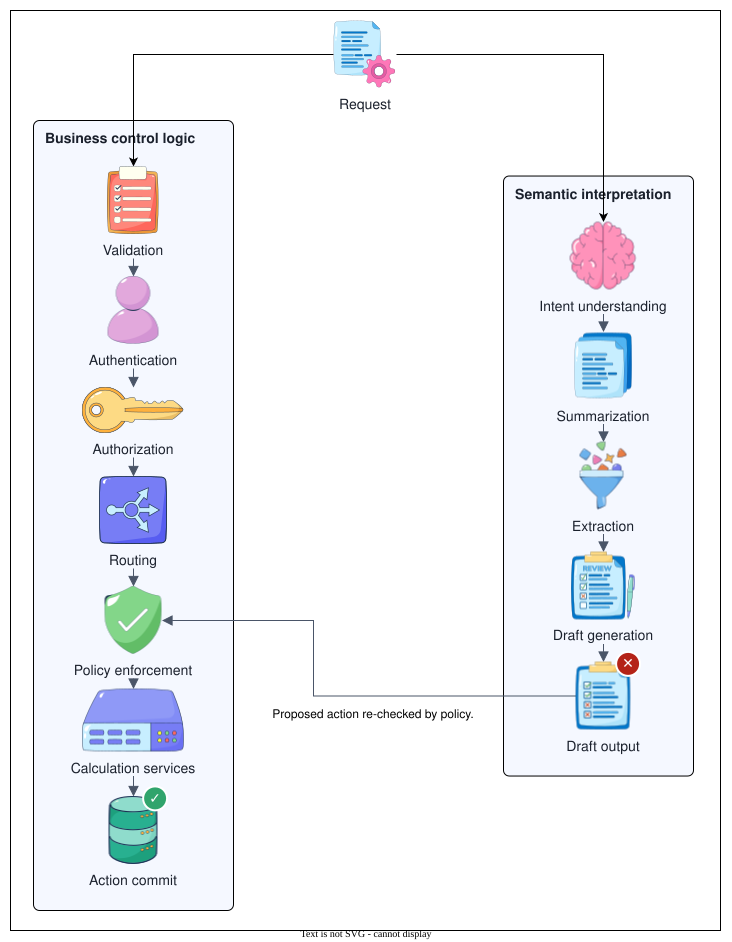

# Integrating_LLMs_and_Deterministic_Logic_in_GenAI_Systems

Source: https://www.educative.io/courses/generative-ai-system-design/where-the-llm-fits-and-where-determinism-wins

---

[Home](https://www.educative.io/)

[Courses](https://www.educative.io/search?tab=courses)

[Grokking the Generative AI System Design Interview](https://www.educative.io/courses/generative-ai-system-design)

# Where the LLM Fits and Where Determinism Wins

Explore how to effectively position large language models within GenAI system architectures, focusing on balancing probabilistic interpretation and deterministic control for reliable outcomes. Understand criteria for workload partitioning, hybrid routing patterns, and operational controls. Learn to apply these concepts in real-world workflows, ensuring LLMs handle semantic interpretation while deterministic services enforce policy, validation, and business logic.

We'll cover the following...

- [Where the model adds real value](https://www.educative.io/courses/generative-ai-system-design/where-the-llm-fits-and-where-determinism-wins#Where-the-model-adds-real-value)
- [When deterministic logic must dominate](https://www.educative.io/courses/generative-ai-system-design/where-the-llm-fits-and-where-determinism-wins#When-deterministic-logic-must-dominate)
  - [Money, access, and compliance decisions need exactness](https://www.educative.io/courses/generative-ai-system-design/where-the-llm-fits-and-where-determinism-wins#Money-access-and-compliance-decisions-need-exactness)
- [Hybrid patterns for production systems](https://www.educative.io/courses/generative-ai-system-design/where-the-llm-fits-and-where-determinism-wins#Hybrid-patterns-for-production-systems)
  - [Operational control knobs](https://www.educative.io/courses/generative-ai-system-design/where-the-llm-fits-and-where-determinism-wins#Operational-control-knobs)
  - [Observability signals](https://www.educative.io/courses/generative-ai-system-design/where-the-llm-fits-and-where-determinism-wins#Observability-signals)
- [A decision framework you can defend](https://www.educative.io/courses/generative-ai-system-design/where-the-llm-fits-and-where-determinism-wins#A-decision-framework-you-can-defend)
- [Worked example: A billing-support workflow](https://www.educative.io/courses/generative-ai-system-design/where-the-llm-fits-and-where-determinism-wins#Worked-example-A-billing-support-workflow)
- [Conclusion](https://www.educative.io/courses/generative-ai-system-design/where-the-llm-fits-and-where-determinism-wins#Conclusion)

In GenAI System Design, introducing an LLM into every stage of a request pipeline is an architectural anti-pattern. While language models excel at interpreting ambiguous natural language, assigning probabilistic generation to deterministic control logic introduces latency variance, uncontrolled token costs, and non-repeatable business outcomes.

In this lesson, you will learn how to partition a production system between probabilistic model stages and deterministic services. We establish key decision criteria to evaluate workload boundaries, explore hybrid routing patterns, and examine a billing-support workflow to demonstrate how to isolate model inference to the semantic edges of your architecture.

## Where the model adds real value[#](https://www.educative.io/courses/generative-ai-system-design/where-the-llm-fits-and-where-determinism-wins#Where-the-model-adds-real-value)

Keep the first rule simple. Use an LLM when the request contains language that does not map cleanly to a stable rule set.

In a production pipeline, the model usually sits at the semantic edge of the system. It receives messy human input, long documents, or fragmented conversation state and converts that into something downstream services can use. That is different from enforcing policy. Semantic interpretation asks what the user likely means. Policy enforcement decides what the business is allowed to do.

The model adds value in a few recurring places.

- **Summarization:** The system compresses long support threads, knowledge articles, and prior actions into a shorter state representation that an agent or downstream service can consume quickly.
- **Intent understanding:** The model resolves semantic ambiguity, such as “my payment failed again” meaning billing, account lock, or fraud concern.
- **Structured extraction from messy text:** The system turns free-form complaints into normalized fields such as product, urgency, suspected issue, and customer sentiment.
- **Response drafting:** The model generates customer-facing explanations or escalation notes tailored to the conversation history.

A rigid rule tree struggles here because linguistic variation is huge. Users paraphrase, omit facts, and mix multiple intents into one message. The next step is drawing the boundary where that flexibility must stop.

The contrast becomes clearer in the architecture view below.

Decision boundary in practice

That boundary matters even more when production constraints start to dominate.

## When deterministic logic must dominate[#](https://www.educative.io/courses/generative-ai-system-design/where-the-llm-fits-and-where-determinism-wins#When-deterministic-logic-must-dominate)

An LLM call is not just another function invocation. It introduces external latency, token-metered cost, nondeterminism, provider dependencies, and failure modes that standard services usually do not have.

At small scale, these costs hide inside a prototype. At scale, they shape the architecture.

- **Latency variance:** A model path often meets p50 targets but misses p99 badly because queuing, long contexts, and provider-side contention stretch tail latency.
- **Monetary cost:** The bill scales with tokens, retries, and context growth. A support workflow with multiple model calls can turn one user message into several paid inference steps.
- **Nondeterminism:** Even with low sampling, the output can drift because of provider-side model revisions, batching differences, or floating-point variation.
- **New failure modes:** The system must handle hallucinated facts, malformed JSON, timeout bursts, and guardrail violations.

Some candidates say they will set temperature to 0 and treat the model as deterministic. That is not a safe assumption.

### Money, access, and compliance decisions need exactness[#](https://www.educative.io/courses/generative-ai-system-design/where-the-llm-fits-and-where-determinism-wins#Money-access-and-compliance-decisions-need-exactness)

Anything that controls money movement, access, or compliance should remain outside the model. Think of the LLM as a talented interpreter, not the final signing authority on a bank transfer.

A repeatable prompt does not guarantee a repeatable system. Infrastructure drift can still change outputs.

The tasks below belong to conventional code, rule engines, or tightly scoped classifiers.

- **Validation:** The service checks required fields, data formats, and schema conformance before any expensive semantic step runs.
- **Authorization:** The system enforces role-based access control.
- **Calculations:** Shipping prices, refund amounts, taxes, and SLA timers should come from code that is easy to test and reproduce.
- **Compliance gates:** PII redaction enforcement, export restrictions, and regulated policy checks must emit exact reasons and logs.
- **Clear routing guarantees:** If platinum accounts must be escalated within 15 minutes, the scheduler should derive that from policy data, not generated reasoning.

With the hard boundary defined, the practical design choice becomes a hybrid one.

## Hybrid patterns for production systems[#](https://www.educative.io/courses/generative-ai-system-design/where-the-llm-fits-and-where-determinism-wins#Hybrid-patterns-for-production-systems)

Most strong GenAI systems do not choose between “all rules” and “all LLM.” They route work according to ambiguity and risk. The following are three common routing patterns:

- **Front-end intent triage (classifier before LLM):** A lightweight classifier or rule engine inspects incoming traffic upfront. Low-ambiguity queries follow deterministic paths directly, while only complex or ambiguous inputs are routed to an LLM.
- **Output validation and guardrails (rules around LLM output):** The model generates a draft, label, or action proposal, but deterministic services enforce schema checks, policy rules, and safety filters before committing any result or taking action.
- **Exception-handling fallback (LLM as specialist fallback):** A deterministic rule engine executes the primary workflow step. If the rules hit an unhandled edge case, missing data, or low-confidence state, the system invokes the LLM as a fallback to resolve the bottleneck.

### Operational control knobs[#](https://www.educative.io/courses/generative-ai-system-design/where-the-llm-fits-and-where-determinism-wins#Operational-control-knobs)

These architectures need explicit thresholds. Set a confidence cutoff for routing, a timeout budget for model calls, and a fallback policy when the model is slow or fails validation. Those knobs turn product policy into runtime behavior.

### Observability signals[#](https://www.educative.io/courses/generative-ai-system-design/where-the-llm-fits-and-where-determinism-wins#Observability-signals)

You should monitor p50 and p99 latency, cost per resolved ticket, fallback rate, guardrail violation rate, and the fraction of traffic that reaches the model. In mature systems, a large majority of requests stay on deterministic or cheaper paths by design.

**Practical tip:** Track model-route percentage as a primary metric. If it rises silently, cost and tail latency usually rise with it.

The mapping below makes these assignments interview-ready.

## System Components and Architectural Fit

|  |  |  |  |
| --- | --- | --- | --- |
| **System component** | **Best fit** | **Reason** | **Failure if misassigned** |
| Intent understanding | LLM | Handles semantic ambiguity, varied phrasing, and implicit user goals better than rigid rules | Rules can become brittle and misclassify nuanced requests, causing incorrect flows |
| Response drafting | LLM | Best for natural language generation, tone control, and adapting to incomplete or ambiguous context | Deterministic systems produce rigid replies; weak prompting can also cause hallucination |
| Authorization | Rules engine / auth service | Requires deterministic enforcement, clear permissions, and verifiable access control | An LLM-based approach can create audit gaps or unsafe permission decisions |
| Refund policy check | Rules engine | Policy validation depends on explicit criteria, thresholds, and exception handling that must be enforced consistently | Using an LLM alone may yield hallucinated policy interpretations and inconsistent outcomes |
| Price calculation | Deterministic pricing service | Needs exact arithmetic, stable logic, and repeatable outputs rather than semantic interpretation | LLM handling can introduce calculation errors, latency, and inconsistent totals |
| Compliance screening | Rules engine + specialist models | Combines deterministic enforcement with traceable checks, while some detection may require pattern recognition | If left mainly to an LLM, audit gaps and non-repeatable compliance decisions can occur |
| Ticket routing | Hybrid: rules + LLM | Semantic ambiguity in customer issues benefits from LLM classification, while fixed queues and priorities need deterministic routing | Pure rules become brittle; pure LLM routing can increase latency and inconsistent assignment |
| Customer summary generation | LLM | Summarization is language-heavy and benefits from abstraction across long, messy interactions | Rule-based methods create shallow summaries; weak controls may allow hallucinated details |

Once you can describe patterns, you need a defensible way to choose one under interview pressure.

## A decision framework you can defend[#](https://www.educative.io/courses/generative-ai-system-design/where-the-llm-fits-and-where-determinism-wins#A-decision-framework-you-can-defend)

Use a checklist and apply it subsystem by subsystem. Start with the functional requirement, then ask how much ambiguity the input contains. Next, define the correctness tolerance, latency SLA, scale, and cost sensitivity. After that, evaluate auditability, failure impact, and fallback behavior.

A senior answer sounds concrete. You say that LLMs belong at semantic edges, where flexible interpretation or generation materially improves outcomes. Deterministic components own control logic, contractual guarantees, and exact policy enforcement. Then you state the optimization rule in plain terms: choose the cheapest component that reliably meets the requirement.

This framework also tells you how to draw the diagram. Semantic intake, summarization, and draft generation can sit behind model-serving infrastructure. Authorization, calculations, and compliance checks stay in ordinary services or rule engines. Testing follows the same split. Model components get quality evaluation, schema validation, and fallback tests. Deterministic components get unit, integration, and audit-log verification.

Let’s apply the framework to a realistic workflow where semantic interpretation and strict business controls must coexist.

## Worked example: A billing-support workflow[#](https://www.educative.io/courses/generative-ai-system-design/where-the-llm-fits-and-where-determinism-wins#Worked-example-A-billing-support-workflow)

Take a billing-support request that says, "I was charged twice, my account is locked, and I need this fixed before travel." The request enters an API layer that authenticates the user, validates required identifiers, loads account tier, and checks entitlements. Refund windows, fraud holds, and compliance restrictions are enforced by deterministic services before any action is considered.

The semantic path begins after those checks. A classifier triages obvious intents first. If confidence is low, the LLM interprets the messy description, separates likely billing and access issues, and writes a concise case summary. It may also draft a customer response for agent review.

Then the glue logic takes over. Any refund suggestion is compared against policy rules. Any account recovery step is checked against authorization policy. If the model times out, returns malformed output, or shows low confidence, the system asks for clarification or escalates to a human queue.

**Note:** A good interview line is, "I keep policy and money movement deterministic, and I use the LLM for understanding and communication tasks."

Test your knowledge!

1.

A billing-support system uses an LLM to interpret customer messages and draft responses. A customer asks for a refund. Which architecture is the strongest production design?

A.

Let the LLM determine whether the refund is allowed and execute the refund through the payments API.

B.

Use deterministic rules to validate the refund policy and authorization, then let the LLM draft the customer-facing response.

C.

Remove all deterministic logic and use a larger model with temperature set to 0.

D.

Send every request through the LLM first, then use rules only when the model fails.

---

1 / 3

## Conclusion[#](https://www.educative.io/courses/generative-ai-system-design/where-the-llm-fits-and-where-determinism-wins#Conclusion)

Strong GenAI systems do not maximize model usage. They isolate model usage to the points where ambiguity, nuance, and language flexibility change the outcome.

Deterministic components should own validation, calculations, routing guarantees, authorization, and compliance. Production systems usually start with rules or classifiers, escalate only the hard tail to an LLM, and wrap model outputs with deterministic guardrails. That judgment is the foundation for the next step, where model placement turns into compute sizing and cost estimation.

Latency, Throughput, and Cost

Estimating Training Compute and Cost

Ask

[Where the model adds real value](https://www.educative.io/courses/generative-ai-system-design/where-the-llm-fits-and-where-determinism-wins#Where-the-model-adds-real-value)

[When deterministic logic must dominate](https://www.educative.io/courses/generative-ai-system-design/where-the-llm-fits-and-where-determinism-wins#When-deterministic-logic-must-dominate)

[Money, access, and compliance decisions need exactness](https://www.educative.io/courses/generative-ai-system-design/where-the-llm-fits-and-where-determinism-wins#Money-access-and-compliance-decisions-need-exactness)

[Hybrid patterns for production systems](https://www.educative.io/courses/generative-ai-system-design/where-the-llm-fits-and-where-determinism-wins#Hybrid-patterns-for-production-systems)

[Operational control knobs](https://www.educative.io/courses/generative-ai-system-design/where-the-llm-fits-and-where-determinism-wins#Operational-control-knobs)

[Observability signals](https://www.educative.io/courses/generative-ai-system-design/where-the-llm-fits-and-where-determinism-wins#Observability-signals)

[A decision framework you can defend](https://www.educative.io/courses/generative-ai-system-design/where-the-llm-fits-and-where-determinism-wins#A-decision-framework-you-can-defend)

[Worked example: A billing-support workflow](https://www.educative.io/courses/generative-ai-system-design/where-the-llm-fits-and-where-determinism-wins#Worked-example-A-billing-support-workflow)

[Conclusion](https://www.educative.io/courses/generative-ai-system-design/where-the-llm-fits-and-where-determinism-wins#Conclusion)