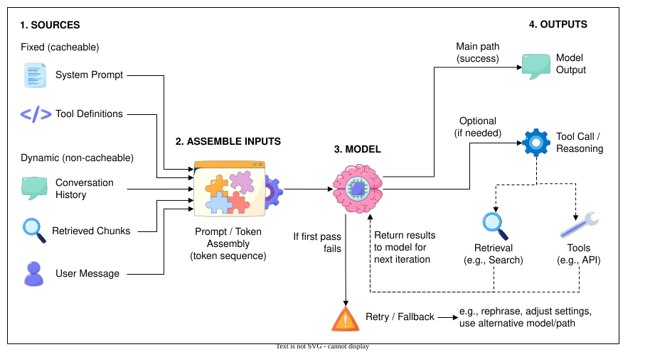

# Token_Math_and_Unit_Economics_for_Efficient_LLM_System_Design

Source: https://www.educative.io/courses/generative-ai-system-design/token-math-and-unit-economics

---

[Home](https://www.educative.io/)

[Courses](https://www.educative.io/search?tab=courses)

[Grokking the Generative AI System Design Interview](https://www.educative.io/courses/generative-ai-system-design)

# Token Math and Unit Economics

Explore how to apply token math and unit economics to estimate and optimize the cost of inference requests and active user spending in LLM systems. Understand how to balance quality, latency, and cost through caching, model tiering, and context management strategies for sustainable AI deployment.

We'll cover the following...

- [Why token economics matters](https://www.educative.io/courses/generative-ai-system-design/token-math-and-unit-economics#Why-token-economics-matters)
- [Cost per request](https://www.educative.io/courses/generative-ai-system-design/token-math-and-unit-economics#Cost-per-request)
  - [A canonical BOTEC formula](https://www.educative.io/courses/generative-ai-system-design/token-math-and-unit-economics#A-canonical-BOTEC-formula)
    - [Hosted API view](https://www.educative.io/courses/generative-ai-system-design/token-math-and-unit-economics#Hosted-API-view)
    - [Self-hosted view](https://www.educative.io/courses/generative-ai-system-design/token-math-and-unit-economics#Self-hosted-view)
- [From request cost to user cost](https://www.educative.io/courses/generative-ai-system-design/token-math-and-unit-economics#From-request-cost-to-user-cost)
  - [Retrieval infrastructure economics](https://www.educative.io/courses/generative-ai-system-design/token-math-and-unit-economics#Retrieval-infrastructure-economics)
- [Reducing unit cost](https://www.educative.io/courses/generative-ai-system-design/token-math-and-unit-economics#Reducing-unit-cost)
  - [Common optimization levers](https://www.educative.io/courses/generative-ai-system-design/token-math-and-unit-economics#Common-optimization-levers)
  - [Prompt prefix caching](https://www.educative.io/courses/generative-ai-system-design/token-math-and-unit-economics#Prompt-prefix-caching)
  - [Semantic caching](https://www.educative.io/courses/generative-ai-system-design/token-math-and-unit-economics#Semantic-caching)
  - [Model tiering and dynamic routing](https://www.educative.io/courses/generative-ai-system-design/token-math-and-unit-economics#Model-tiering-and-dynamic-routing)
  - [Context window management and conversational compression](https://www.educative.io/courses/generative-ai-system-design/token-math-and-unit-economics#Context-window-management-and-conversational-compression)
- [End-to-end chat assistant estimation walk-through](https://www.educative.io/courses/generative-ai-system-design/token-math-and-unit-economics#End-to-end-chat-assistant-estimation-walk-through)
  - [Uncached single-request baseline calculation](https://www.educative.io/courses/generative-ai-system-design/token-math-and-unit-economics#Uncached-single-request-baseline-calculation)
  - [Optimized request calculation with prefix caching](https://www.educative.io/courses/generative-ai-system-design/token-math-and-unit-economics#Optimized-request-calculation-with-prefix-caching)
  - [Monthly active user cost projection](https://www.educative.io/courses/generative-ai-system-design/token-math-and-unit-economics#Monthly-active-user-cost-projection)
- [Presenting economics in an interview](https://www.educative.io/courses/generative-ai-system-design/token-math-and-unit-economics#Presenting-economics-in-an-interview)
- [Conclusion](https://www.educative.io/courses/generative-ai-system-design/token-math-and-unit-economics#Conclusion)

Two AI assistants can produce nearly identical answers, yet one can quietly cost 3 times as much to run. In a System Design interview, that cost difference can turn a recommended rollout into an architectural failure.

Token math connects system architecture with financial sustainability. By estimating token volume across prompts, retrieved documents, and outputs, engineers calculate the cost of a single request or an active monthly user. The objective is not billing-level perfection, but a practical BOTEC that balances answer quality, latency, and infrastructure cost.

In this lesson, we build on the performance mechanics established in the *Latency, Throughput, and Cost* lesson to price individual requests, project monthly user expenses, and apply optimization levers like prefix caching and dynamic routing to keep production systems affordable.

## Why token economics matters[#](https://www.educative.io/courses/generative-ai-system-design/token-math-and-unit-economics#Why-token-economics-matters)

In inference workloads, compute expenditure recurs on every transaction. While model training represents an upfront capital expenditure, prompt length, context expansion, and completion verbosity scale linearly with production traffic. A minor inefficiency across millions of requests compounds into substantial infrastructure expenditure.

In System Design interviews, candidates evaluate unit economics across four granularities.

- **Cost per request:** Captures the full financial footprint of a single invocation, including input tokens, completion tokens, retry overhead, and guardrail verification passes.
- **Cost per session:** Aggregates multiple conversational turns, accounting for context expansion as chat histories accumulate.
- **Cost per active user per month:** Projects aggregate monthly consumption per user, enabling direct comparison against subscription pricing and operational budgets.
- **Gross margin contribution:** Evaluates infrastructure serving expenses against per-user revenue or platform business value.

A production request pipeline contains multiple token sources that must be accounted for systematically.

- **System instructions:** Developer instructions that establish model persona, output constraints, and safety guidelines.
- **Retrieved reference context:** External chunks retrieved by semantic search and injected into the prompt window.
- **Conversational history:** Prior conversational turns carried forward to maintain multi-turn dialogue state.
- **User query and model completion:** The incoming user prompt and the resulting text generated by the model.
- **Operational overhead tokens:** Hidden tokens consumed by chain-of-thought reasoning scratchpads, function-calling payloads, retry attempts, and content moderation passes.

**Note:** Effective back-of-the-envelope calculations require explicit assumptions. Hidden or unstated assumptions give an illusion of precision while masking fundamental architectural flaws.

The conceptual diagram below illustrates how different token streams converge into the model context window during a single request.

Request token flow

## Cost per request[#](https://www.educative.io/courses/generative-ai-system-design/token-math-and-unit-economics#Cost-per-request)

A simple way to think about cost per request is to price every token the system sends or receives, then add side calls. In plain English, hosted cost equals uncached input tokens times the input rate, plus output tokens times the output rate, plus cached input tokens times the cached rate, plus extra request paths such as moderation, retries, or fallback models.

### A canonical BOTEC formula[#](https://www.educative.io/courses/generative-ai-system-design/token-math-and-unit-economics#A-canonical-BOTEC-formula)

To maintain consistency across lessons, the financial footprint of an individual inference request uses the standardized cost breakdown:

Creq=Cinput+Coutput+Ccache+CoverheadC\_{\text{req}} = C\_{\text{input}} + C\_{\text{output}} + C\_{\text{cache}} + C\_{\text{overhead}}Creq​=Cinput​+Coutput​+Ccache​+Coverhead​

In this formulation, CinputC\_{\text{input}}Cinput​ represents uncached prompt tokens, CoutputC\_{\text{output}}Coutput​ represents generated completion tokens, CcacheC\_{\text{cache}}Ccache​ represents discounted prompt tokens processed via prefix caching, and CoverheadC\_{\text{overhead}}Coverhead​ encompasses safety guardrails, retry overhead, and upstream embedding calls.

#### Hosted API view[#](https://www.educative.io/courses/generative-ai-system-design/token-math-and-unit-economics#Hosted-API-view)

Cloud AI providers charge separate rates for input tokens and output tokens. Output tokens typically cost more than input tokens because decoding is autoregressive, generating output one token at a time. Each output token requires an independent forward pass that reloads model parameters from High-Bandwidth Memory (HBM), making decoding memory-bandwidth bound and computationally expensive.

Prefix caching offers a substantial discount on static input text. When multiple requests share identical prompt prefixes (such as system instructions or retrieved documentation), providers charge a reduced rate for cache hits. However, total savings depend directly on the system's cache hit rate, cache eviction TTL windows (typically 5 to 10 minutes of inactivity), and provider-specific cache write fees for the initial request.

> **Example:** Consider a customer support chatbot using a hosted API with the following pricing:
>
> - **Uncached input:** $1 per million tokens\text{\$1 per million tokens}$1 per million tokens
> - **Cached input:** $0.10 per million tokens\text {\$0.10 per million tokens}$0.10 per million tokens
> - **Output:** $4 per million tokens\text{\$4\ per\ million\ tokens}$4 per million tokens
>
> A request contains 2,000 input tokens, including system instructions, tool schemas, and conversation history, and generates 500 output tokens.
>
> - **Initial request (uncached prompt):**
>
> Creq=(2,0001,000,000×$1.00)+(5001,000,000×$4.00)=$0.002+$0.002=$0.004C\_{\text{req}} = \left(\frac{2,000}{1,000,000} \times \$1.00\right) + \left(\frac{500}{1,000,000} \times \$4.00\right) = \$0.002 + \$0.002 = \$0.004Creq​=(1,000,0002,000​×$1.00)+(1,000,000500​×$4.00)=$0.002+$0.002=$0.004
>
> - **Subsequent request (1,500 cached prefix tokens, 500 uncached input tokens):**
>
> Creq=(5001,000,000×$1.00)+(1,5001,000,000×$0.10)+(5001,000,000×$4.00)=$0.00265C\_{\text{req}} = \left(\frac{500}{1,000,000} \times \$1.00\right) + \left(\frac{1,500}{1,000,000} \times \$0.10\right) + \left(\frac{500}{1,000,000} \times \$4.00\right) = \$0.00265Creq​=(1,000,000500​×$1.00)+(1,000,0001,500​×$0.10)+(1,000,000500​×$4.00)=$0.00265
>
> **Note:** Assuming a high cache hit rate, the repeat request costs roughly 34% less due to prefix reuse.

#### Self-hosted view[#](https://www.educative.io/courses/generative-ai-system-design/token-math-and-unit-economics#Self-hosted-view)

When self-hosting models on dedicated GPU hardware, pricing is derived from implied token cost by amortizing monthly server rental, power, networking, and operational overhead across actual processed token volume.

Implied token cost=Monthly GPU cluster cost+Operational overheadTotal monthly processed tokens\text{Implied token cost} = \frac{\text{Monthly GPU cluster cost} + \text{Operational overhead}}{\text{Total monthly processed tokens}}Implied token cost=Total monthly processed tokensMonthly GPU cluster cost+Operational overhead​

This price depends heavily on how busy the servers stay. An idle GPU cluster costs full rental fees every hour even if nobody is using it, which makes each processed token much more expensive. While grouping multiple requests together through batching helps keep the hardware busy, making batches too large causes users to wait in line, risking latency SLOs. In addition, saving long chat histories in the key-value cache fills up valuable GPU memory, which limits how many people can use the system at the same time.

> **Example:** Suppose a company self-hosts an LLM on 8 GPUs, each costing $2.50 per hour, and spends an additional $3,600 per month on storage, networking, and operations.
>
> - **GPU cost:** 8×$2.50×24×30=$14,4008 \times \$2.50 \times 24 \times 30 = \$14,4008×$2.50×24×30=$14,400
> - **Other infrastructure costs**: $3,600\$3,600$3,600
> - **Total monthly cost:** $14,400+$3,600=$18,000\$14,400 + \$3,600 = \$18,000$14,400+$3,600=$18,000
>
> Assuming the 8-GPU cluster processes 12,000 million tokens per month:
>
> Ctoken=$18,00012,000  million tokensC\_{\text{token}} = \frac{\$18,000}{\text{12,000 \ million\ tokens}}Ctoken​=12,000  million tokens$18,000​ === $1.50 per million tokens\text{\$1.50 per million tokens}$1.50 per million tokens
>
> For a request containing 2,000 input tokens and 500 output tokens, the estimated cost is:
>
> Creq=2500106×$1.50C\_{\text{req}} = \frac{2500}{10^6} \times \$1.50Creq​=1062500​×$1.50 === $0.00375\$0.00375$0.00375
>
> **Note:** This estimate assumes a blended cost across input and output tokens and does not account for differences in their compute requirements.

The same formula still applies after pricing changes. Only the rates differ. Next, we extend request cost into user and feature economics.

## From request cost to user cost[#](https://www.educative.io/courses/generative-ai-system-design/token-math-and-unit-economics#From-request-cost-to-user-cost)

To calculate what an individual user costs each month, multiply their average request count by the average cost per request, then add their share of storage fees.

Cuser, month=Cˉreq×Rmonth+CsharedC\_{\text{user, month}} = \bar{C}\_{\text{req}} \times R\_{\text{month}} + C\_{\text{shared}}Cuser, month​=Cˉreq​×Rmonth​+Cshared​

In this formula, Cˉreq\bar{C}\_{\text{req}}Cˉreq​ is the average cost of a request, RmonthR\_{\text{month}}Rmonth​ is how many requests a user makes each month, and CsharedC\_{\text{shared}}Cshared​ is the shared cost of storing and indexing documents for that user.

Not all requests cost the same amount. An instant FAQ check on a small model costs fractions of a cent, while a multi-turn troubleshooting chat or a deep reasoning task costs significantly more. Sorting traffic into simple, medium, and complex tiers prevents hidden cost spikes.

1.

Why does unmanaged chat history cause quadratic total cost growth across a multi-turn session?

Show Answer

Did you find this helpful?

### Retrieval infrastructure economics[#](https://www.educative.io/courses/generative-ai-system-design/token-math-and-unit-economics#Retrieval-infrastructure-economics)

Fetching internal documents adds extra expenses alongside model tokens.

- **Creating embeddings:** When saving reference material to a knowledge base, text is converted into numerical vectors. Generating vectors once is inexpensive, but frequent document updates and user query lookups add steady recurring fees.
- **Vector database storage:** Vector databases store these numerical lists in fast server memory for quick similarity lookups. Storage bills grow with the total number of document chunks, vector dimensions, and system backup copies.

Internal document retrieval adds cost beyond model tokens

Architectures typically choose between a shared database index and dedicated per-customer indexes. A shared index saves money by pooling everyone on common hardware with metadata filters, while dedicated indexes ensure complete tenant privacy at a higher base cost. This concept is illustrated below.

Shared indexes vs dedicated indexes

The table below outlines key cost drivers across the serving stack alongside their respective scaling characteristics and architectural mitigations.

|  |  |  |  |  |
| --- | --- | --- | --- | --- |
| **System component** | **Billing basis** | **Primary scaling driver** | **Common estimation error** | **Production optimization lever** |
| Hosted input tokens | Per million input tokens | Prompt length multiplied by request volume | Omitting system instructions and retrieved context from input calculations | Context trimming, document reranking, prompt compression |
| Hosted output tokens | Per million output tokens | Completion length multiplied by request volume | Assuming completions remain brief across open-ended agentic workflows | Max token constraints, concise prompting schemas, early stopping |
| Cached prompt prefixes | Discounted rate per million tokens | Repetition of stable prompt prefixes across sessions | Assuming dynamic prompts qualify for caching despite shifting parameters | Prefix standardization, static prompt templating |
| Vector embeddings | Per million embedded tokens | Ingestion volume, query volume, and re-indexing frequency | Over-chunking text and re-embedding static documents unnecessarily | Incremental re-indexing, semantic deduplication, optimal chunk sizing |
| Vector database storage | Per gigabyte per month or vector count | Vector count multiplied by dimensions and replication factor | Neglecting metadata memory overhead and index replica overhead | Vector quantization, metadata compression, stale index pruning |
| Retries and fallbacks | Additional inference token consumption | Network error rates, model timeouts, and schema validation failures | Assuming a zero-failure environment in production sizing models | Exponential backoff caps, circuit breakers, fallback model tiering |
| Self-hosted GPU capacity | Hourly accelerator rental plus networking | Model parameter size, peak concurrency, and cluster utilization | Equating hourly GPU cost to hosted API costs without factoring in idle capacity | Dynamic continuous batching, autoscaling, tensor quantization |
| Guardrail evaluation | Per request or auxiliary inference charges | Moderation inspection rate, guardrail model parameter count | Overlooking the token overhead of input and output inspection passes | Tiered guardrail classification, asynchronous inspection pipelines |

## Reducing unit cost[#](https://www.educative.io/courses/generative-ai-system-design/token-math-and-unit-economics#Reducing-unit-cost)

Once the expensive parts are visible, we tune the architecture rather than guessing. The main levers are caching, tiering, context control, and retrieval control. Each lever changes both cost and system behavior, so the design answer should name the trade-off.

### Common optimization levers[#](https://www.educative.io/courses/generative-ai-system-design/token-math-and-unit-economics#Common-optimization-levers)

Once cost drivers are identified, engineers apply architectural patterns to optimize unit economics while preserving answer quality and system responsiveness.

### Prompt prefix caching[#](https://www.educative.io/courses/generative-ai-system-design/token-math-and-unit-economics#Prompt-prefix-caching)

Prompt caching significantly lowers the financial cost of input tokens by preserving the attention Key-Value (KV) cache for static prefixes across requests. Systems achieve high cache hit rates by ordering prompt elements systematically, placing static system instructions and immutable tool definitions at the very beginning of the context window.

Cache miss vs. cache hit

### Semantic caching[#](https://www.educative.io/courses/generative-ai-system-design/token-math-and-unit-economics#Semantic-caching)

Semantic caching stores previously generated responses alongside their query embeddings in a low-latency cache. When an incoming query exhibits high cosine similarity to a cached entry, the gateway serves the stored completion directly, bypassing downstream model inference entirely. However, semantic caching introduces risks of factual staleness and incorrect responses for nuanced queries, requiring strict Time to Live (TTL) expirations and document version pinning.

Semantic cache in action

### Model tiering and dynamic routing[#](https://www.educative.io/courses/generative-ai-system-design/token-math-and-unit-economics#Model-tiering-and-dynamic-routing)

Rather than directing all traffic to a large foundation model, an intelligent routing layer evaluates incoming request complexity and dispatches work to the most cost-effective model capable of meeting quality requirements.

- **Complexity classifiers:** A fast, compact model evaluates query intent. Straightforward informational queries route to lightweight models, whereas complex analytical requests route to high-capacity foundation models.
- **Confidence-based escalation:** The system attempts initial generation using an inexpensive model. If confidence scores fall below defined thresholds or deterministic schema validation fails, the orchestrator escalates the request to a frontier model.
- **Customer tier segmentation:** Requests are routed according to customer entitlement tiers, reserving computationally expensive reasoning models for enterprise users with strict quality guarantees.

Intelligent model routing

### Context window management and conversational compression[#](https://www.educative.io/courses/generative-ai-system-design/token-math-and-unit-economics#Context-window-management-and-conversational-compression)

Without explicit context management, per-turn input token counts grow linearly with each dialogue turn, causing total cumulative session cost to scale quadratically with conversation length. Production architectures mitigate context inflation through three techniques.

- **Sliding window truncation:** Retains only the most recent conversation turns, dropping older dialogue context to enforce a fixed token ceiling.
- **Contextual summarization:** Invokes an asynchronous, lightweight model to summarize prior conversational history into a compact state representation.
- **Selective retrieval filtering:** Employs cross-encoder rerankers to filter retrieved document chunks, discarding redundant or low-relevance passages before prompt injection.

## End-to-end chat assistant estimation walk-through[#](https://www.educative.io/courses/generative-ai-system-design/token-math-and-unit-economics#End-to-end-chat-assistant-estimation-walk-through)

To demonstrate how unit economic principles apply in production, consider an enterprise customer support assistant handling internal IT inquiries. Define baseline workload parameters:

- **System prompt:** 500 static tokens specifying tone, persona, and output constraints.
- **Retrieved context:** 1,000 tokens of knowledge base documentation.
- **Conversational history:** 400 tokens representing prior turns.
- **User query:** 50 tokens representing the active question.
- **Generated completion:** 150 tokens of output guidance.

Pricing assumptions:

- **Standard input tokens:** $4.00 per million tokens
- **Generated output tokens:** $20.00 per million tokens
- **Cached prompt prefix tokens:** $0.40 per million tokens

### Uncached single-request baseline calculation[#](https://www.educative.io/courses/generative-ai-system-design/token-math-and-unit-economics#Uncached-single-request-baseline-calculation)

Total input prompt tokens per request sum to 1,950 tokens:

Input tokens=500+1000+400+50=1950 tokens\text{Input tokens} = 500 + 1000 + 400 + 50 = 1950 \text{ tokens}Input tokens=500+1000+400+50=1950 tokens

Input cost=19501000000×$4.00=$0.00780\text{Input cost} = \frac{1950}{1000000} \times \$4.00 = \$0.00780Input cost=10000001950​×$4.00=$0.00780

Completion cost for 150 generated tokens equals:

Output cost=1501000000×$20.00=$0.003\text{Output cost} = \frac{150}{1000000} \times \$20.00 = \$0.003Output cost=1000000150​×$20.00=$0.003

Total uncached request cost=$0.00780+$0.003=$0.01080\text{Total uncached request cost} = \$0.00780 + \$0.003 = \$0.01080Total uncached request cost=$0.00780+$0.003=$0.01080

### Optimized request calculation with prefix caching[#](https://www.educative.io/courses/generative-ai-system-design/token-math-and-unit-economics#Optimized-request-calculation-with-prefix-caching)

In this architecture, the system prompt and retrieved knowledge base context remain stable across conversational turns, totaling 1,500 tokens eligible for prefix caching:

Cached prefix cost=15001000000×$0.40=$0.00060\text{Cached prefix cost} = \frac{1500}{1000000} \times \$0.40 = \$0.00060Cached prefix cost=10000001500​×$0.40=$0.00060

The remaining 450 tokens, comprising conversational history and the active user query, incur standard uncached input rates:

Uncached input cost=4501000000×$4.00=$0.00180\text{Uncached input cost} = \frac{450}{1000000} \times \$4.00 = \$0.00180Uncached input cost=1000000450​×$4.00=$0.00180

Adding the unchanged output completion cost yields the optimized request expense:

Total optimized request cost=$0.00060+$0.00180+$0.00300=$0.00540\text{Total optimized request cost} = \$0.00060 + \$0.00180 + \$0.00300 = \$0.00540Total optimized request cost=$0.00060+$0.00180+$0.00300=$0.00540

Implementing prompt prefix caching reduces single-request expenses by exactly 50%.

### Monthly active user cost projection[#](https://www.educative.io/courses/generative-ai-system-design/token-math-and-unit-economics#Monthly-active-user-cost-projection)

Assuming an active user averages 100 requests per month, monthly inference expenditure per user totals:

Monthly user inference cost=100×$0.00540=$0.54\text{Monthly user inference cost} = 100 \times \$0.00540 = \$0.54Monthly user inference cost=100×$0.00540=$0.54

Adding shared vector storage, query embedding generation, and network egress ($0.02 to $0.05 per user per month) results in a total unit cost of roughly $0.58 per active monthly user.

## Presenting economics in an interview[#](https://www.educative.io/courses/generative-ai-system-design/token-math-and-unit-economics#Presenting-economics-in-an-interview)

In a System Design interview, presenting the cost estimates clearly shows that the candidate understands production realities. The solution could be broken down into four simple steps.

- **State numbers upfront:** Clarify prompt size, retrieved context, chat history length, and expected response size before doing any math.
- **Calculate single request cost:** Separate reusable cached text from live user text, then find the cost of a single message.
- **Scale to total monthly traffic:** Multiply that single request cost by the peak traffic and active monthly user count.
- **Propose smart cost savings:** Suggest practical fixes like prompt caching, model routing, or summarizing old chat history, and explain the trade-offs on answer quality and speed.

Comparing an expensive frontier model pipeline with a cached, tiered architecture shows an interviewer that one can keep systems affordable without sacrificing performance. Now let's test what you have learned so far with an AI assessment.

AI Powered

Saved

1 attempt left

Reset

Evaluating self-hosted GPU economics

An engineering team decides to self-host an open-source model on rented GPU instances to lower unit costs compared to a hosted API. At the end of the month, their actual cost per processed token is four times higher than expected, even though the GPUs were running around the clock. What is the most likely operational reason for this outcome?

This is your last attempt.

## Conclusion[#](https://www.educative.io/courses/generative-ai-system-design/token-math-and-unit-economics#Conclusion)

The repeatable method is simple. Count every token source, map each one to hosted or self-hosted pricing, compute request cost, and then scale that estimate to users or traffic. After that, evaluate levers such as caching, tiering, and context control without hiding the quality and latency trade-offs.

Most candidates do the arithmetic. Better candidates show complete accounting.

In the next lesson, that discipline carries over to the building-block approach, where retrieval, memory, routing, and serving are compared not just by capability, but by cost signature too.

Estimating Inference Capacity and Fleet Size

The Building-Block Approach to GenAI Design

Ask

[Why token economics matters](https://www.educative.io/courses/generative-ai-system-design/token-math-and-unit-economics#Why-token-economics-matters)

[Cost per request](https://www.educative.io/courses/generative-ai-system-design/token-math-and-unit-economics#Cost-per-request)

[A canonical BOTEC formula](https://www.educative.io/courses/generative-ai-system-design/token-math-and-unit-economics#A-canonical-BOTEC-formula)

[Hosted API view](https://www.educative.io/courses/generative-ai-system-design/token-math-and-unit-economics#Hosted-API-view)

[Self-hosted view](https://www.educative.io/courses/generative-ai-system-design/token-math-and-unit-economics#Self-hosted-view)

[From request cost to user cost](https://www.educative.io/courses/generative-ai-system-design/token-math-and-unit-economics#From-request-cost-to-user-cost)

[Retrieval infrastructure economics](https://www.educative.io/courses/generative-ai-system-design/token-math-and-unit-economics#Retrieval-infrastructure-economics)

[Reducing unit cost](https://www.educative.io/courses/generative-ai-system-design/token-math-and-unit-economics#Reducing-unit-cost)

[Common optimization levers](https://www.educative.io/courses/generative-ai-system-design/token-math-and-unit-economics#Common-optimization-levers)

[Prompt prefix caching](https://www.educative.io/courses/generative-ai-system-design/token-math-and-unit-economics#Prompt-prefix-caching)

[Semantic caching](https://www.educative.io/courses/generative-ai-system-design/token-math-and-unit-economics#Semantic-caching)

[Model tiering and dynamic routing](https://www.educative.io/courses/generative-ai-system-design/token-math-and-unit-economics#Model-tiering-and-dynamic-routing)

[Context window management and conversational compression](https://www.educative.io/courses/generative-ai-system-design/token-math-and-unit-economics#Context-window-management-and-conversational-compression)

[End-to-end chat assistant estimation walk-through](https://www.educative.io/courses/generative-ai-system-design/token-math-and-unit-economics#End-to-end-chat-assistant-estimation-walk-through)

[Uncached single-request baseline calculation](https://www.educative.io/courses/generative-ai-system-design/token-math-and-unit-economics#Uncached-single-request-baseline-calculation)

[Optimized request calculation with prefix caching](https://www.educative.io/courses/generative-ai-system-design/token-math-and-unit-economics#Optimized-request-calculation-with-prefix-caching)

[Monthly active user cost projection](https://www.educative.io/courses/generative-ai-system-design/token-math-and-unit-economics#Monthly-active-user-cost-projection)

[Presenting economics in an interview](https://www.educative.io/courses/generative-ai-system-design/token-math-and-unit-economics#Presenting-economics-in-an-interview)

[Conclusion](https://www.educative.io/courses/generative-ai-system-design/token-math-and-unit-economics#Conclusion)