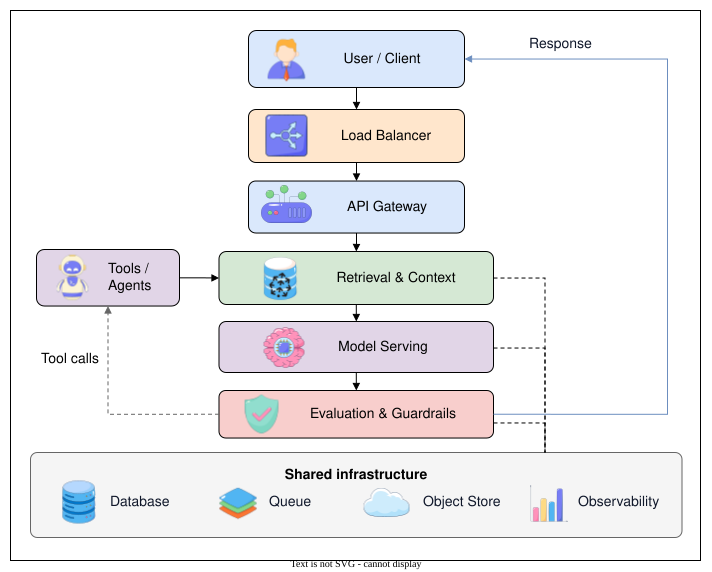

# Core_Building_Blocks_of_Generative_AI_System_Design

Source: https://www.educative.io/courses/generative-ai-system-design/the-building-block-approach-to-genai-design

---

[Home](https://www.educative.io/)

[Courses](https://www.educative.io/search?tab=courses)

[Grokking the Generative AI System Design Interview](https://www.educative.io/courses/generative-ai-system-design)

# The Building-Block Approach to GenAI Design

Explore how to break down generative AI systems into four reusable building blocks: retrieval and context, model serving, evaluation and guardrails, and agentic orchestration. Understand how these components interact with traditional infrastructure like caches and load balancers, and learn to design scalable, secure AI systems that meet latency, freshness, and privacy constraints.

We'll cover the following...

- [The full block map](https://www.educative.io/courses/generative-ai-system-design/the-building-block-approach-to-genai-design#The-full-block-map)
- [How retrieval fits the stack](https://www.educative.io/courses/generative-ai-system-design/the-building-block-approach-to-genai-design#How-retrieval-fits-the-stack)
  - [Retrieval finds candidates](https://www.educative.io/courses/generative-ai-system-design/the-building-block-approach-to-genai-design#Retrieval-finds-candidates)
    - [Common retrieval modes](https://www.educative.io/courses/generative-ai-system-design/the-building-block-approach-to-genai-design#Common-retrieval-modes)
  - [Context shapes model input](https://www.educative.io/courses/generative-ai-system-design/the-building-block-approach-to-genai-design#Context-shapes-model-input)
    - [Failure modes in this layer](https://www.educative.io/courses/generative-ai-system-design/the-building-block-approach-to-genai-design#Failure-modes-in-this-layer)
- [GenAI blocks and classic blocks](https://www.educative.io/courses/generative-ai-system-design/the-building-block-approach-to-genai-design#GenAI-blocks-and-classic-blocks)
- [A reference request flow](https://www.educative.io/courses/generative-ai-system-design/the-building-block-approach-to-genai-design#A-reference-request-flow)
  - [Online serving path](https://www.educative.io/courses/generative-ai-system-design/the-building-block-approach-to-genai-design#Online-serving-path)
  - [Offline ingestion path](https://www.educative.io/courses/generative-ai-system-design/the-building-block-approach-to-genai-design#Offline-ingestion-path)
  - [Offline evaluation and background processing](https://www.educative.io/courses/generative-ai-system-design/the-building-block-approach-to-genai-design#Offline-evaluation-and-background-processing)
  - [What to measure](https://www.educative.io/courses/generative-ai-system-design/the-building-block-approach-to-genai-design#What-to-measure)
- [How later problems reuse blocks](https://www.educative.io/courses/generative-ai-system-design/the-building-block-approach-to-genai-design#How-later-problems-reuse-blocks)
- [Using blocks in the interview](https://www.educative.io/courses/generative-ai-system-design/the-building-block-approach-to-genai-design#Using-blocks-in-the-interview)
- [Conclusion](https://www.educative.io/courses/generative-ai-system-design/the-building-block-approach-to-genai-design#Conclusion)

A common interview problem statement sounds simple until the constraints arrive. Design an enterprise assistant that answers employee questions over private documents, cites sources, stays under a tight p95 latency target, and never leaks data across teams. In the first two minutes, strong candidates stop thinking in terms of one giant AI system and start decomposing the architecture into reusable parts.

That is the building-block approach. We treat a GenAI system as a small set of modules that recur across products, then place them in the request path and reason about their trade-offs. This course uses that approach as its backbone because the same blocks reappear in internal knowledge assistants, support copilots, research agents, and multimodal workflows.

At a high level, GenAI system design can be organized into four building-block families, supported by traditional infrastructure components.

- **Retrieval and context:** Find relevant information and prepare it for the model.
- **Model serving:** Run the model, manage inference, and return generated output.
- **Evaluation and guardrails:** Check output quality, safety, and policy compliance.
- **Agentic orchestration:** Plan multistep tasks and coordinate tool calls.

Traditional infrastructure, such as caches, databases, queues, and load balancers, supports these families across the system.

## The full block map[#](https://www.educative.io/courses/generative-ai-system-design/the-building-block-approach-to-genai-design#The-full-block-map)

The full architecture map shows the four GenAI building-block families alongside the traditional infrastructure that supports them. The four families handle GenAI-specific responsibilities, while infrastructure components provide shared capabilities such as caching, security, observability, and traffic management.

A useful high-level map includes the following components:

- **Retrieval and context layer:** This layer locates candidate knowledge, filters it, reranks it, and assembles prompt-ready context.
- **Model serving layer:** This layer routes requests through a model gateway, selects models, manages inference, handles retries and failover, and tracks token and latency budgets.
- **Evaluation and guardrails plane:** This layer checks output quality, enforces safety policies, and supports offline evaluation and audits.
- **Agentic orchestration and tools layer:** This layer plans multistep tasks, invokes external systems, and maintains intermediate state when needed.
- **Cross-cutting infrastructure:** This includes observability, security, cost controls, caching, and latency management across all layers.

A control plane often spans several blocks. The diagram below should become a default reference shape for interview answers.

GenAI building blocks map

With the full map in place, the next step is to zoom in on the chapter's main family.

## How retrieval fits the stack[#](https://www.educative.io/courses/generative-ai-system-design/the-building-block-approach-to-genai-design#How-retrieval-fits-the-stack)

Retrieval is the part that goes out and finds relevant knowledge. Context building is the part that decides what slice of that knowledge the model should see and in what format. That separation matters because answer quality often fails before the model starts generating.

### Retrieval finds candidates[#](https://www.educative.io/courses/generative-ai-system-design/the-building-block-approach-to-genai-design#Retrieval-finds-candidates)

A simple way to think about retrieval is that it works like a library search desk. It does not write the answer. It pulls a candidate set from large stores quickly enough that the rest of the pipeline can continue.

#### Common retrieval modes[#](https://www.educative.io/courses/generative-ai-system-design/the-building-block-approach-to-genai-design#Common-retrieval-modes)

The online retrieval path usually combines a few approaches.

- **Dense retrieval:** This uses embeddings to find semantically similar content in a vector store.
- **Sparse retrieval:** This uses keyword-style matching such as BM25 and often performs well on exact terms, IDs, and rare words.
- **Hybrid retrieval:** This merges dense and sparse candidates so the system can capture both semantic similarity and exact term matches.

### Context shapes model input[#](https://www.educative.io/courses/generative-ai-system-design/the-building-block-approach-to-genai-design#Context-shapes-model-input)

Once candidates arrive, context building trims, orders, formats, and packages them into the prompt under a token budget. This is where chunk selection, citation metadata, conversation history, and redundancy removal enter the request path.

#### Failure modes in this layer[#](https://www.educative.io/courses/generative-ai-system-design/the-building-block-approach-to-genai-design#Failure-modes-in-this-layer)

The most common problems are architectural, not mysterious.

- **Low recall:** The retriever misses relevant material, so the model starts from incomplete evidence.
- **Stale indexes:** Documents changed upstream, but the index has not caught up.
- **Irrelevant context:** Poor ranking fills the prompt with noise, which amplifies inference errors.
- **Token overflow:** The assembled prompt exceeds limits, so useful context gets dropped.
- **Private data leakage:** Missing permission filters expose content before or during context assembly.

**Note:** Retrieval discovers candidates from data stores, while context building assembles model input under relevance, token, and safety constraints.

## GenAI blocks and classic blocks[#](https://www.educative.io/courses/generative-ai-system-design/the-building-block-approach-to-genai-design#GenAI-blocks-and-classic-blocks)

GenAI-specific modules sit on top of familiar distributed systems components rather than replacing them. The gateway still authenticates and rate-limits. The load balancer still spreads traffic. Caches, queues, databases, and object storage still determine availability, freshness, and tail behavior.

A practical interview rule is to sketch the classic backbone first, then overlay the GenAI layers.

- **Load balancer:** This distributes traffic across stateless edge or serving nodes and can become a hotspot if long-running inference requests exhaust connections.
- **Cache:** This stores embeddings, retrieval results, or full responses, but stale cache entries can silently damage freshness.
- **Queue:** This decouples slow offline work such as ingestion, re-embedding, index rebuilds, and evaluation jobs, though backlog growth can delay freshness.
- **Database:** This holds metadata for permissions, tenancy, and document state, and it remains the source of truth for transactional updates.
- **Object store:** This keeps raw documents, images, and large artifacts for ingestion and replay, but access latency is higher than hot storage.
- **Vector store:** This accelerates semantic retrieval, yet it does not replace relational storage for consistency-sensitive metadata.
- **Observability stack:** This records latency, token counts, failures, and quality signals, though verbose logging can raise cost and privacy risk.

From this backbone, we can now walk an interviewer through a concrete request.

## A reference request flow[#](https://www.educative.io/courses/generative-ai-system-design/the-building-block-approach-to-genai-design#A-reference-request-flow)

The canonical online path starts at the edge. The client sends a request, the gateway authenticates it, applies tenant scoping, and may classify the query to decide whether the request needs retrieval, tool use, or a simpler direct-generation path.

### Online serving path[#](https://www.educative.io/courses/generative-ai-system-design/the-building-block-approach-to-genai-design#Online-serving-path)

The online path usually unfolds in a stable order.

- **Gateway and classification:** The system verifies identity, applies rate limits, and labels the request so downstream services know which pipeline to run.
- **Retrieval and filtering:** The retriever pulls candidates from keyword and vector indexes, then applies permissions and metadata filters before expensive reranking.
- **Reranking and context assembly:** A reranker narrows the set, and the context builder formats the final prompt.
- **Model serving and output checks:** The model generates the draft answer, then output guardrails scan for policy, privacy, or formatting violations before release.

1.

Why is context assembly considered separate from retrieval?

Show Answer

Did you find this helpful?

### Offline ingestion path[#](https://www.educative.io/courses/generative-ai-system-design/the-building-block-approach-to-genai-design#Offline-ingestion-path)

Before documents can be retrieved, they must be processed and indexed. This offline pipeline runs independently of the online request path.

**Stage breakdown**

- **Document ingestion:** Collects documents from source systems and stores the raw files in object storage.
- **Parsing and chunking:** Extracts text and metadata, then splits documents into searchable chunks.
- **Embedding:** Converts chunks into vector representations using an embedding model.
- **Indexing:** Writes vectors to the vector store and searchable text and metadata to the relevant indexes.
- **Refresh and deletion:** Processes document updates and deletions so indexes remain current and removed content is no longer retrievable.

Queues and background workers can coordinate these jobs. The pipeline should preserve document permissions and metadata throughout processing.

### Offline evaluation and background processing[#](https://www.educative.io/courses/generative-ai-system-design/the-building-block-approach-to-genai-design#Offline-evaluation-and-background-processing)

Not every task needs to block the user response. Request logs and feedback can be processed asynchronously, while evaluation jobs analyze sampled interactions and measure system quality. Offline evaluation results can inform prompt changes, model selection, and guardrail improvements. These tasks run separately from online inference and document ingestion.

### What to measure[#](https://www.educative.io/courses/generative-ai-system-design/the-building-block-approach-to-genai-design#What-to-measure)

To understand how well the system performs, track metrics across request processing, retrieval, and offline evaluation.

- **P95 latency:** Measures tail latency across retrieval, reranking, and inference.
- **Cost per request:** Tracks model usage and other processing costs for each request.
- **Retrieval recall:** Measures whether retrieval finds the relevant evidence available in the evaluation dataset.
- **Prompt token count:** Tracks context size and helps detect token-budget and cost increases.
- **Groundedness or hallucination rate:** Measures how often generated claims are unsupported by the available evidence, using a defined evaluation method.
- **Index freshness:** Measures the delay between a source document changing and that change becoming searchable.
- **Offline evaluation quality:** Tracks performance on a fixed evaluation dataset, including correctness, relevance, and policy compliance.

**Attention:** Low retrieval confidence should trigger fallbacks such as cached answers, no-context responses with caveats, or escalation to a human workflow.

The following visual should make the sequence and side paths explicit.

Reference request flow

Once the reference flow is clear, the same map can be reused across very different products.

## How later problems reuse blocks[#](https://www.educative.io/courses/generative-ai-system-design/the-building-block-approach-to-genai-design#How-later-problems-reuse-blocks)

Most later interview problems are not new architectures. They are new compositions of the same blocks. A knowledge assistant centers retrieval and citations. A support copilot adds low-latency serving and conversation state. A research agent emphasizes orchestration, tool use, and intermediate memory. A multimodal workflow adds modality-specific ingestion and serving, while still preserving the same backbone.

**Practical tip:** If an interviewer asks for agents early, ground the answer in retrieval, serving, guardrails, and observability first. Agents often fail because of problems in these lower layers.

A good speaking pattern stays stable across all of them.

- **Product goal:** State what the system must do for the user and which constraints dominate.
- **Common blocks:** Draw the shared modules before discussing special cases.
- **Primary bottleneck:** Name the block most likely to fail first under the stated requirements.
- **Deep dive choice:** Drill into that block and discuss latency, freshness, safety, or cost trade-offs.

1.

Why do multi-step agents fail more often in infrastructure layers than in prompt planning?

Show Answer

Did you find this helpful?

## Using blocks in the interview[#](https://www.educative.io/courses/generative-ai-system-design/the-building-block-approach-to-genai-design#Using-blocks-in-the-interview)

The block vocabulary turns ambiguity into a clear design path. Start by asking about data freshness, privacy boundaries, grounding requirements, latency SLOs, and whether tool use is required. Those answers determine whether retrieval is central, whether serving must be highly optimized, and whether guardrails must be strict enough for regulated data.

Most candidates overprepare in the wrong way.

They jump into model internals before drawing the architecture. A better sequence keeps online and offline paths separate, identifies the hottest block, and then dives deep where risk is concentrated. Enterprise QA usually pushes the candidate into retrieval and permissions. Low-latency copilots shift attention toward serving and caching. Regulated applications force early discussion of guardrails, audit logs, and policy enforcement.

**Note:** Offline ingestion and online serving should almost never be mixed on the same whiteboard path. The separation clarifies consistency expectations and bottlenecks.

Treat the blocks as shared vocabulary with the interviewer. Once both the interviewer and the candidate agree on the map, the rest of the conversation becomes a series of trade-offs instead of a search for structure.

## Conclusion[#](https://www.educative.io/courses/generative-ai-system-design/the-building-block-approach-to-genai-design#Conclusion)

GenAI system design becomes easier when problems are broken into four reusable building-block families: retrieval and context, model serving, evaluation and guardrails, and agentic orchestration. Traditional infrastructure supports these families across the system.

Keep this distinction clear: the four families describe GenAI-specific responsibilities, while infrastructure components provide shared capabilities. Retrieval finds information, context building prepares the model's input, and model serving handles inference.

Token Math and Unit Economics

Embedding Service and Vector Store Design

Ask

[The full block map](https://www.educative.io/courses/generative-ai-system-design/the-building-block-approach-to-genai-design#The-full-block-map)

[How retrieval fits the stack](https://www.educative.io/courses/generative-ai-system-design/the-building-block-approach-to-genai-design#How-retrieval-fits-the-stack)

[Retrieval finds candidates](https://www.educative.io/courses/generative-ai-system-design/the-building-block-approach-to-genai-design#Retrieval-finds-candidates)

[Common retrieval modes](https://www.educative.io/courses/generative-ai-system-design/the-building-block-approach-to-genai-design#Common-retrieval-modes)

[Context shapes model input](https://www.educative.io/courses/generative-ai-system-design/the-building-block-approach-to-genai-design#Context-shapes-model-input)

[Failure modes in this layer](https://www.educative.io/courses/generative-ai-system-design/the-building-block-approach-to-genai-design#Failure-modes-in-this-layer)

[GenAI blocks and classic blocks](https://www.educative.io/courses/generative-ai-system-design/the-building-block-approach-to-genai-design#GenAI-blocks-and-classic-blocks)

[A reference request flow](https://www.educative.io/courses/generative-ai-system-design/the-building-block-approach-to-genai-design#A-reference-request-flow)

[Online serving path](https://www.educative.io/courses/generative-ai-system-design/the-building-block-approach-to-genai-design#Online-serving-path)

[Offline ingestion path](https://www.educative.io/courses/generative-ai-system-design/the-building-block-approach-to-genai-design#Offline-ingestion-path)

[Offline evaluation and background processing](https://www.educative.io/courses/generative-ai-system-design/the-building-block-approach-to-genai-design#Offline-evaluation-and-background-processing)

[What to measure](https://www.educative.io/courses/generative-ai-system-design/the-building-block-approach-to-genai-design#What-to-measure)

[How later problems reuse blocks](https://www.educative.io/courses/generative-ai-system-design/the-building-block-approach-to-genai-design#How-later-problems-reuse-blocks)

[Using blocks in the interview](https://www.educative.io/courses/generative-ai-system-design/the-building-block-approach-to-genai-design#Using-blocks-in-the-interview)

[Conclusion](https://www.educative.io/courses/generative-ai-system-design/the-building-block-approach-to-genai-design#Conclusion)