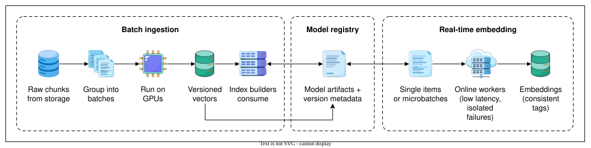

# Designing_Embedding_Services_and_Vector_Stores_for_Scalable_Retrieval

Source: https://www.educative.io/courses/generative-ai-system-design/embedding-service-and-vector-store-design

---

[Home](https://www.educative.io/)

[Courses](https://www.educative.io/search?tab=courses)

[Grokking the Generative AI System Design Interview](https://www.educative.io/courses/generative-ai-system-design)

# Embedding Service and Vector Store Design

Explore the design of embedding services and vector stores crucial for scaling retrieval in generative AI. Understand batch and real-time embedding paths, approximate nearest neighbor index choices, filtered search strategies, and scaling vector storage across machines. Learn about index versioning, migration strategies, and how to maintain freshness in large-scale vector systems to optimize latency and accuracy for production environments.

We'll cover the following...

- [Embedding service design](https://www.educative.io/courses/generative-ai-system-design/embedding-service-and-vector-store-design#Embedding-service-design)
  - [Batch and real-time paths](https://www.educative.io/courses/generative-ai-system-design/embedding-service-and-vector-store-design#Batch-and-real-time-paths)
    - [Throughput tuning](https://www.educative.io/courses/generative-ai-system-design/embedding-service-and-vector-store-design#Throughput-tuning)
    - [Versioning and migrations](https://www.educative.io/courses/generative-ai-system-design/embedding-service-and-vector-store-design#Versioning-and-migrations)
- [Vector store fundamentals](https://www.educative.io/courses/generative-ai-system-design/embedding-service-and-vector-store-design#Vector-store-fundamentals)
- [Index choices and filtered retrieval](https://www.educative.io/courses/generative-ai-system-design/embedding-service-and-vector-store-design#Index-choices-and-filtered-retrieval)
  - [Comparing index families](https://www.educative.io/courses/generative-ai-system-design/embedding-service-and-vector-store-design#Comparing-index-families)
  - [Filtering in the query path](https://www.educative.io/courses/generative-ai-system-design/embedding-service-and-vector-store-design#Filtering-in-the-query-path)
    - [Pre-filtering](https://www.educative.io/courses/generative-ai-system-design/embedding-service-and-vector-store-design#Pre-filtering)
    - [Post-filtering](https://www.educative.io/courses/generative-ai-system-design/embedding-service-and-vector-store-design#Post-filtering)
    - [In-index filtering](https://www.educative.io/courses/generative-ai-system-design/embedding-service-and-vector-store-design#In-index-filtering)
- [Scaling the store across machines](https://www.educative.io/courses/generative-ai-system-design/embedding-service-and-vector-store-design#Scaling-the-store-across-machines)
  - [Sharding and routing](https://www.educative.io/courses/generative-ai-system-design/embedding-service-and-vector-store-design#Sharding-and-routing)
    - [Fan-out and merge](https://www.educative.io/courses/generative-ai-system-design/embedding-service-and-vector-store-design#Fan-out-and-merge)
    - [Replication and churn](https://www.educative.io/courses/generative-ai-system-design/embedding-service-and-vector-store-design#Replication-and-churn)
- [Keeping indexes fresh over time](https://www.educative.io/courses/generative-ai-system-design/embedding-service-and-vector-store-design#Keeping-indexes-fresh-over-time)
- [Conclusion](https://www.educative.io/courses/generative-ai-system-design/embedding-service-and-vector-store-design#Conclusion)

A RAG prototype works well with thousands of chunks, but scaling to millions creates immediate bottlenecks in latency, memory cost, and index updates. In production, these challenges center on the vector tier, the subsystem connecting chunk ingestion to semantic retrieval.

This tier generates embeddings, stores vectors with metadata, executes nearest neighbor search, and applies tenant and permission filters under millisecond latency budgets. In this lesson, you will learn how to design an embedding service, choose the right approximate nearest neighbor index, scale vector storage across machines, and manage index freshness over time.

## Embedding service design[#](https://www.educative.io/courses/generative-ai-system-design/embedding-service-and-vector-store-design#Embedding-service-design)

The embedding service is not a helper function. In production, it is a distributed subsystem with separate traffic paths, separate SLOs, and separate failure modes.

One path handles bulk ingestion for large corpora. The other handles low-latency embedding for user queries and fast-changing content. Keeping both on one fleet usually causes trouble, because the batch side wants large accelerator batches while the online side wants quick turnarounds and predictable tails.

### Batch and real-time paths[#](https://www.educative.io/courses/generative-ai-system-design/embedding-service-and-vector-store-design#Batch-and-real-time-paths)

The system usually splits the request flow into the following paths.

- **Batch ingestion:** Workers pull raw chunks from durable storage, group them into larger batches, run them on GPUs, and write versioned vectors into staging storage before index builders consume them.
- **Real-time embedding:** Online workers accept single items or microbatches, respect stricter latency budgets, and isolate failures so a backlog in ingestion does not stall user-facing requests.
- **Shared model registry:** Both paths read model artifacts and model version metadata from the same registry so every emitted vector is tagged consistently.

Batch ingestion and real-time embedding pipelines share a model registry to ensure consistent vector versioning

That separation leads to cleaner scaling decisions in the serving tier.

#### Throughput tuning[#](https://www.educative.io/courses/generative-ai-system-design/embedding-service-and-vector-store-design#Throughput-tuning)

Batching improves accelerator utilization because matrix operations run more efficiently on larger groups. The cost is that waiting to fill a batch adds queueing delay, which pushes up tail latency.

#### Versioning and migrations[#](https://www.educative.io/courses/generative-ai-system-design/embedding-service-and-vector-store-design#Versioning-and-migrations)

Embedding model versioning must be treated as a schema decision, not an afterthought. Store raw chunks separately, tag every vector with its model version, and keep migrations isolated through namespaces or parallel indexes.

A namespace gives you a clean cutover boundary. That versioning choice directly affects ANN design, because ingestion rate, dimensionality, and update frequency determine whether the index can absorb online writes or needs periodic rebuilds.

Before moving to index structures, it helps to separate write-heavy and read-heavy mechanics more explicitly.

## Vector store fundamentals[#](https://www.educative.io/courses/generative-ai-system-design/embedding-service-and-vector-store-design#Vector-store-fundamentals)

Once vectors are produced, the next system has to answer nearest-neighbor queries quickly. Exact search sounds simple. For each query, compare it with every stored vector. At scale, that breaks.

If there are NNN vectors of dimension ddd, brute-force search does work proportional to O(N⋅d)O(N \cdot d)O(N⋅d) per query. Memory also grows linearly with corpus size. At tens or hundreds of millions of vectors, even reading candidate data becomes a bottleneck.

**Practical tip:** In interviews, say early that exact search is still valid for small corpora or evaluation baselines. It simply stops being economical at production scale.

The practical answer is approximate nearest neighbor (ANN). Production systems judge ANN by several metrics at once.

- **Recall at k:** This measures how many true top-k neighbors the system returns.
- **p95 and p99 latency:** These show whether tail behavior stays within user-facing SLOs.
- **Memory footprint:** This includes vectors, index structures, and metadata overhead.
- **Write and delete performance:** This determines whether fresh content can enter the system without damaging serving.
- **Filtered search quality:** This captures how well retrieval still works when metadata constraints narrow the candidate set.

Averages are not enough. With many shards, one slow shard can dominate p99 even when p50 looks excellent. That sets up the real design problem, which is choosing an index family under multiple constraints rather than picking a winner from a benchmark chart.

To make the data flow concrete, the next visual ties the embedding path to the storage and query path.

Vector tier data flow

## Index choices and filtered retrieval[#](https://www.educative.io/courses/generative-ai-system-design/embedding-service-and-vector-store-design#Index-choices-and-filtered-retrieval)

Now the design gets more specific. Different ANN families shape the request path in different ways, especially once you add filters, tenants, and updates.

### Comparing index families[#](https://www.educative.io/courses/generative-ai-system-design/embedding-service-and-vector-store-design#Comparing-index-families)

The common families behave as follows.

- **Graph-based indexes:** Hierarchical Navigable Small World (HNSW) and related structures traverse a neighborhood graph in memory and often achieve strong recall-latency trade-offs, but they consume more RAM and can degrade under heavy churn.
- **Cluster-based indexes:** IVF and similar methods partition the space, search only selected partitions, and scale more naturally across large corpora, but recall depends on partition quality and probe count.
- **Quantized indexes:** PQ or scalar quantization compress vectors to reduce memory and improve cache behavior, often followed by reranking with higher-precision vectors.
- **Hybrid indexes:** Real systems often combine partitioning and compression, or keep compressed vectors for coarse search and full-precision vectors for final reranking.

1.

Why do graph-based indexes like HNSW consume significantly more memory than raw vectors alone?

Show Answer

Did you find this helpful?

### Filtering in the query path[#](https://www.educative.io/courses/generative-ai-system-design/embedding-service-and-vector-store-design#Filtering-in-the-query-path)

Vector search almost never runs on semantic similarity alone. The query often carries tenant, region, timestamp, document type, or permission filters. Those constraints must participate in the retrieval path, not just be added after it.

#### Pre-filtering[#](https://www.educative.io/courses/generative-ai-system-design/embedding-service-and-vector-store-design#Pre-filtering)

The system first narrows candidates using metadata, then runs ANN on that subset. This works best when filters are highly selective, and the filtered subset remains searchable efficiently.

#### Post-filtering[#](https://www.educative.io/courses/generative-ai-system-design/embedding-service-and-vector-store-design#Post-filtering)

The system retrieves ANN candidates first, removes items that fail metadata checks, and may refill until it finds enough valid results. This works when filters are broad, but refill loops can hurt latency.

#### In-index filtering[#](https://www.educative.io/courses/generative-ai-system-design/embedding-service-and-vector-store-design#In-index-filtering)

The index stores payload-aware routing or filter support during candidate traversal. This tends to work better for moderate selectivity and enterprise workloads with frequent permission checks.

**Attention:** Permission filters are not optional metadata in enterprise retrieval. They are part of correctness, just like top-k quality.

Selective filters can change which retrieval strategy works best. Reranking with full-precision vectors is commonly paired with compression to reduce memory costs while preserving ranking quality. The practical rule is simple: choose the index based on corpus size, update rate, RAM budget, and filter complexity, rather than benchmark headlines.

The comparison below turns those trade-offs into an interview-ready summary.

|  |  |  |  |  |
| --- | --- | --- | --- | --- |
| **Index type** | **Recall** | **Latency** | **Memory overhead** | **Best-fit workload** |
| Graph-based | High; strong nearest-neighbor quality | Low; fast interactive search | High; links add RAM cost | Enterprise document QA; high-accuracy semantic retrieval |
| Cluster-based | Medium to high; depends on centroid quality | Low to medium; fast with good partitioning | Medium; compact compared with graph indexes | Large news archive search; broad corpus with filterable content |
| Quantized | Medium; some accuracy loss from compression | Very low; optimized for large-scale retrieval | Low; compressed vectors save memory | Recommendation retrieval; massive candidate sets under tight memory budgets |
| Hybrid | High; balances compression and precision | Low; reranking adds small extra cost | Medium; lower than pure graph, higher than pure quantized | Mixed production search; combines scale, filters, and strong quality |

To make these trade-offs more tangible, the next interactive sizing tool lets learners vary the corpus and architecture knobs.

## Scaling the store across machines[#](https://www.educative.io/courses/generative-ai-system-design/embedding-service-and-vector-store-design#Scaling-the-store-across-machines)

One machine stops being enough when the corpus no longer fits comfortably in RAM, query volume rises, or write activity starts contending with read latency. At that point, the design shifts from a local ANN problem to a distributed retrieval problem.

### Sharding and routing[#](https://www.educative.io/courses/generative-ai-system-design/embedding-service-and-vector-store-design#Sharding-and-routing)

The system can distribute vectors in a few common ways.

- **Hash-based sharding:** This balances storage and writes well, keeps placement simple, and usually requires broadcasting each query to all shards before globally merging top-k results.
- **Semantic sharding:** This routes vectors and queries by coarse centroid or semantic region, which can cut search cost, but it risks boundary misses and makes routing logic more complex.
- **Tenant-aware sharding:** This isolates heavy tenants or regulated data sets, which can simplify filtering and access control, but may create skew if some tenants are much larger than others.

#### Fan-out and merge[#](https://www.educative.io/courses/generative-ai-system-design/embedding-service-and-vector-store-design#Fan-out-and-merge)

A coordinator sends the query to relevant shards, each shard returns local top-k, and the coordinator computes the global top-k. More shards reduce per-shard data size but increase network fan-out and widen tail latency.

#### Replication and churn[#](https://www.educative.io/courses/generative-ai-system-design/embedding-service-and-vector-store-design#Replication-and-churn)

Replicas improve availability and read throughput. The trade-off is update propagation and possible divergence, especially in graph indexes where insert order can influence structure. Many systems use lazy deletes, background compaction, segment merging, and periodic rebuilds to recover quality after churn.

**Note:** Compaction removes deleted entries that no longer need to be retained and merges small index segments into larger ones. This reclaims storage, reduces indexing overhead, and helps maintain efficient search performance as data changes over time.

There is also a platform decision. A dedicated vector database usually offers stronger ANN specialization, while vector search inside an existing database can simplify transactions, metadata joins, and operational tooling. The better answer depends on workload shape, platform constraints, and team expertise.

## Keeping indexes fresh over time[#](https://www.educative.io/courses/generative-ai-system-design/embedding-service-and-vector-store-design#Keeping-indexes-fresh-over-time)

Vector systems age quickly unless freshness is designed into the life cycle. Source corpora change, metadata changes, and embedding models improve. The serving path must keep absorbing those changes without corrupting similarity behavior.

A full re-embedding pass is the cleanest migration, but it is often expensive. Gradual methods are common.

- **Dual-write migration:** While moving from an old embedding model to a new one, the system embeds incoming content with both models and writes the resulting vectors to separate indexes. This keeps both indexes updated until the system is ready to switch over.
- **Lazy re-embedding:** The system gradually re-embeds existing content, prioritizing frequently accessed or recently updated items. During migration, queries must be embedded with both the old and new models and searched against their respective indexes. Because similarity scores from different embedding spaces are not directly comparable, results require a calibrated ranking strategy or must remain separate until the migration is complete.
- **Shadow rebuild:** The system builds a complete parallel index using the new embedding model while the existing index continues serving queries. It validates the new index's recall and latency against the existing one before switching traffic to the new index.

**Practical tip:** Retaining raw chunks and version tags gives you a rollback path when a new embedding model underperforms on real queries.

1.

What causes index fragmentation in vector databases that handle high update volume?

Show Answer

Did you find this helpful?

Freshness pipelines also need to process inserts, updates, and deletes with measurable lag. Monitor recall, query latency, ingestion backlog, and rebuild progress together. That closes the vector-tier story and sets up the next lesson, where retrieval quality depends on chunk formation, lexical fusion, and reranking logic above this infrastructure.

AI Powered

Saved

1 attempt left

Reset

Addressing vector memory exhaustion

An enterprise knowledge platform indexes fifty million technical articles using a graph-based Hierarchical Navigable Small World (HNSW) index. Server memory usage exceeds planned budgets, and monthly hardware rental costs are unsustainable. Recall requirements are moderate, and the team needs to cut memory consumption by more than half without replacing server hardware. What architectural change should the team make?

This is your last attempt.

## Conclusion[#](https://www.educative.io/courses/generative-ai-system-design/embedding-service-and-vector-store-design#Conclusion)

The vector tier is the retrieval backbone of a GenAI system. Strong designs connect embedding throughput, ANN behavior, metadata-aware retrieval, sharding, and rebuild strategy into one serving path.

For interviews, keep four points ready. Exact search fails at large scale, index families fit different workloads, filtering must be designed into the ANN path, and versioning plus re-indexing should be planned from day one. In the next lesson, we move up the stack and look at chunking, hybrid retrieval, and reranking, where retrieval quality starts to depend on how this vector infrastructure is actually used.

The Building-Block Approach to GenAI Design

Chunking, Hybrid Retrieval, and Reranking

Ask

[Embedding service design](https://www.educative.io/courses/generative-ai-system-design/embedding-service-and-vector-store-design#Embedding-service-design)

[Batch and real-time paths](https://www.educative.io/courses/generative-ai-system-design/embedding-service-and-vector-store-design#Batch-and-real-time-paths)

[Throughput tuning](https://www.educative.io/courses/generative-ai-system-design/embedding-service-and-vector-store-design#Throughput-tuning)

[Versioning and migrations](https://www.educative.io/courses/generative-ai-system-design/embedding-service-and-vector-store-design#Versioning-and-migrations)

[Vector store fundamentals](https://www.educative.io/courses/generative-ai-system-design/embedding-service-and-vector-store-design#Vector-store-fundamentals)

[Index choices and filtered retrieval](https://www.educative.io/courses/generative-ai-system-design/embedding-service-and-vector-store-design#Index-choices-and-filtered-retrieval)

[Comparing index families](https://www.educative.io/courses/generative-ai-system-design/embedding-service-and-vector-store-design#Comparing-index-families)

[Filtering in the query path](https://www.educative.io/courses/generative-ai-system-design/embedding-service-and-vector-store-design#Filtering-in-the-query-path)

[Pre-filtering](https://www.educative.io/courses/generative-ai-system-design/embedding-service-and-vector-store-design#Pre-filtering)

[Post-filtering](https://www.educative.io/courses/generative-ai-system-design/embedding-service-and-vector-store-design#Post-filtering)

[In-index filtering](https://www.educative.io/courses/generative-ai-system-design/embedding-service-and-vector-store-design#In-index-filtering)

[Scaling the store across machines](https://www.educative.io/courses/generative-ai-system-design/embedding-service-and-vector-store-design#Scaling-the-store-across-machines)

[Sharding and routing](https://www.educative.io/courses/generative-ai-system-design/embedding-service-and-vector-store-design#Sharding-and-routing)

[Fan-out and merge](https://www.educative.io/courses/generative-ai-system-design/embedding-service-and-vector-store-design#Fan-out-and-merge)

[Replication and churn](https://www.educative.io/courses/generative-ai-system-design/embedding-service-and-vector-store-design#Replication-and-churn)

[Keeping indexes fresh over time](https://www.educative.io/courses/generative-ai-system-design/embedding-service-and-vector-store-design#Keeping-indexes-fresh-over-time)

[Conclusion](https://www.educative.io/courses/generative-ai-system-design/embedding-service-and-vector-store-design#Conclusion)