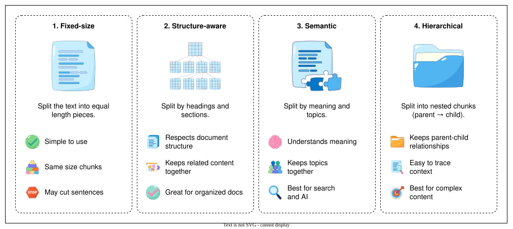

# Chunking_hybrid_retrieval_and_reranking_in_GenAI_system_design

Source: https://www.educative.io/courses/generative-ai-system-design/chunking-hybrid-retrieval-and-reranking

---

[Home](https://www.educative.io/)

[Courses](https://www.educative.io/search?tab=courses)

[Grokking the Generative AI System Design Interview](https://www.educative.io/courses/generative-ai-system-design)

# Chunking, Hybrid Retrieval, and Reranking

Explore how to design effective retrieval pipelines for generative AI by applying chunking techniques, combining sparse and dense retrieval, and using rerankers to optimize candidate quality. Understand the trade-offs in chunk size and overlap, and how to balance recall, precision, latency, and prompt budget to improve grounded answer generation.

We'll cover the following...

- [Why retrieval choices dominate RAG quality](https://www.educative.io/courses/generative-ai-system-design/chunking-hybrid-retrieval-and-reranking#Why-retrieval-choices-dominate-RAG-quality)
- [Chunking strategies for evidence retrieval](https://www.educative.io/courses/generative-ai-system-design/chunking-hybrid-retrieval-and-reranking#Chunking-strategies-for-evidence-retrieval)
- [Chunk size and overlap trade-offs](https://www.educative.io/courses/generative-ai-system-design/chunking-hybrid-retrieval-and-reranking#Chunk-size-and-overlap-trade-offs)
  - [How the trade-off shows up in the request path](https://www.educative.io/courses/generative-ai-system-design/chunking-hybrid-retrieval-and-reranking#How-the-trade-off-shows-up-in-the-request-path)
- [Dense, keyword, and hybrid retrieval](https://www.educative.io/courses/generative-ai-system-design/chunking-hybrid-retrieval-and-reranking#Dense-keyword-and-hybrid-retrieval)
  - [Failure modes and fusion choices](https://www.educative.io/courses/generative-ai-system-design/chunking-hybrid-retrieval-and-reranking#Failure-modes-and-fusion-choices)
- [Rerankers and passing results to the model](https://www.educative.io/courses/generative-ai-system-design/chunking-hybrid-retrieval-and-reranking#Rerankers-and-passing-results-to-the-model)
  - [Where rerankers fit in the pipeline](https://www.educative.io/courses/generative-ai-system-design/chunking-hybrid-retrieval-and-reranking#Where-rerankers-fit-in-the-pipeline)
    - [What rerankers can fix](https://www.educative.io/courses/generative-ai-system-design/chunking-hybrid-retrieval-and-reranking#What-rerankers-can-fix)
    - [What rerankers cannot fix](https://www.educative.io/courses/generative-ai-system-design/chunking-hybrid-retrieval-and-reranking#What-rerankers-cannot-fix)
- [Conclusion](https://www.educative.io/courses/generative-ai-system-design/chunking-hybrid-retrieval-and-reranking#Conclusion)

A support assistant can run on a strong LLM and still fail a simple question such as “Which firmware version introduced this error code?” when the retrieval layer surfaces a marketing summary instead of the release note and troubleshooting step that contain the answer.

That is the normal RAG failure mode. The generator is capable, but the evidence path is weak. In system design interviews, the bottleneck is usually not token generation. It is candidate recall, ranking quality, latency, and how much prompt budget you spend on weak context.

## Why retrieval choices dominate RAG quality[#](https://www.educative.io/courses/generative-ai-system-design/chunking-hybrid-retrieval-and-reranking#Why-retrieval-choices-dominate-RAG-quality)

A retrieval pipeline behaves like the control plane for grounded generation. The request enters the system as a user query, passes through chunk indexes and ranking stages, and only then reaches the model. If the right evidence is absent or buried, the model either answers vaguely or fills gaps with plausible text.

A useful way to defend design choices is to track four budgets throughout the request life cycle.

- **Recall:** The system must place the right evidence somewhere in the candidate set.
- **Precision:** The top results must contain mostly relevant text rather than semantically nearby noise.
- **Latency:** Each extra branch, expansion, and ranking pass adds work before generation starts.
- **Prompt budget:** Retrieved text consumes context window space that could otherwise hold instructions, memory, or output tokens.

**Note:** In production, retrieval tuning often produces larger quality gains than switching to a larger LLM.

Retrieval design improves answer grounding by controlling how documents are split, how candidates are generated, and how final context is packed. Access control becomes meaningful only after the system can reliably find the right content. The next lesson extends this same pipeline with authorization and tenant boundaries. First, the retrieval path itself must become dependable.

## Chunking strategies for evidence retrieval[#](https://www.educative.io/courses/generative-ai-system-design/chunking-hybrid-retrieval-and-reranking#Chunking-strategies-for-evidence-retrieval)

Chunking is not a preprocessing footnote. It is an indexing architecture decision that determines what the retriever can ever return. A poor split is like filing a library book by tearing pages at random.

Teams usually begin with recursive, structure-aware splitting because it preserves document logic without adding heavy ingest cost. The chunk should carry metadata such as section title, source document ID, and hierarchy path because those fields improve ranking, provenance, and debugging later in the pipeline.

The main strategies differ in how they cut the same source document.

- **Fixed-size chunks:** The ingest service splits every document at a constant token or character count, often with overlap. This fits predictable pipelines and mixed corpora, but it can cut clauses, tables, or answer spans in half.
- **Structure-aware chunks:** The splitter follows headings, paragraphs, bullet lists, or sentence boundaries until size limits are met. This works well for manuals, contracts, and policies, but unstructured transcripts may still break awkwardly.
- **Semantic chunks:** The system detects topic shifts by using sentence similarity and groups related text into coherent units. This helps with reports and transcripts, but ingest gets slower and boundary detection can be unstable.
- **Hierarchical parent-child chunks:** The index stores small child chunks for retrieval and larger parent sections for context recovery. This supports precise retrieval with broader generation context, but storage and maintenance complexity rise.

The visual below contrasts these cuts on one source document so the indexing trade-off becomes concrete.

Chunking strategy comparison

Once chunk boundaries are chosen, the next tuning step controls how much context each chunk carries and how much duplication the index must absorb.

## Chunk size and overlap trade-offs[#](https://www.educative.io/courses/generative-ai-system-design/chunking-hybrid-retrieval-and-reranking#Chunk-size-and-overlap-trade-offs)

Chunk size changes what the retriever can match, and overlap changes how often boundary errors are avoided. In practice, many teams start around 256 to 512 tokens with roughly 10 to 15 percent overlap, then tune against evaluation data.

Small chunks increase context diversity because more independent units fit in the prompt. The trade-off is fragmentation. A troubleshooting answer may require the error code, prerequisite state, and recovery step, but each piece can land in a different chunk. Large chunks do the opposite. They preserve local context, yet irrelevant text dilutes ranking and consumes prompt budget.

### How the trade-off shows up in the request path[#](https://www.educative.io/courses/generative-ai-system-design/chunking-hybrid-retrieval-and-reranking#How-the-trade-off-shows-up-in-the-request-path)

The system first embeds or indexes each chunk. Larger chunks reduce index cardinality, while overlap inflates it. At query time, overlap also increases duplicate hits, reranker load, and repeated prompt text.

- **When chunks are too small:** The retriever may find the right sentence but miss nearby qualifiers, causing the generator to produce incomplete advice.
- **When chunks are too large:** The retriever returns broad sections that match loosely, pushing out narrower but better evidence.

**Attention:** Overlap improves boundary safety, but it also increases storage, query fan-out, and repeated evidence inside the final prompt.

With chunk geometry in place, the system still needs a retrieval method that can find the right candidates under real query language.

## Dense, keyword, and hybrid retrieval[#](https://www.educative.io/courses/generative-ai-system-design/chunking-hybrid-retrieval-and-reranking#Dense-keyword-and-hybrid-retrieval)

First-stage retrieval generates the candidate pool. In most production systems, that stage combines two different search behaviors rather than trusting one. A sparse retriever acts like a literal filing clerk, and a dense retriever acts more like a librarian who recognizes paraphrases.

Sparse retrieval methods such as Best Matching 25 (BM25) are strongest when queries contain exact terms, identifiers, clause numbers, product names, or wording close to the source corpus. Dense retrieval uses embeddings to compare meaning rather than exact wording, so it performs better on natural-language questions, synonymy, and paraphrases.

At a high level, BM25 compares the terms in the query to the terms in a document

### Failure modes and fusion choices[#](https://www.educative.io/courses/generative-ai-system-design/chunking-hybrid-retrieval-and-reranking#Failure-modes-and-fusion-choices)

Both branches fail in predictable ways, so hybrid retrieval often becomes the safest architecture.

- **Sparse retrieval:** Sparse search can miss semantically correct passages when the query vocabulary differs from the document vocabulary. Acronyms, synonyms, and conversational phrasing often expose this gap.
- **Dense retrieval:** Dense search can return text that feels related but is operationally wrong, such as a general release summary instead of the exact policy clause or error-specific fix.

A common production solution runs both branches, unions the candidates, and then fuses them. Reciprocal rank fusion is often easier to defend than direct score blending because sparse and dense scores live on different scales.

Query rewriting and expansion operate before retrieval. The system can expand acronyms, add synonyms, or rewrite vague conversational questions into searchable forms. That improves recall, but fan-out, latency, and false positives can rise quickly.

**Practical tip:** Keep expansion targeted to high-value query classes such as acronyms, product aliases, and conversational follow-ups rather than applying broad synonym expansion everywhere.

The table below gives a compact interview defense for each retrieval family.

|  |  |  |  |  |
| --- | --- | --- | --- | --- |
| **Strategy** | **Best for** | **Common failure** | **Latency and cost profile** | **Interview defense** |
| Sparse retrieval | Policy lookup, exact terms, compliance docs, product codes | Misses relevant content when wording differs or synonyms are used | Lowest latency and cost; simple indexing and cheap queries | Strong baseline when terminology is stable and precision on exact matches matters |
| Dense retrieval | Support troubleshooting, semantic search, natural language questions | Can retrieve topically similar but incorrect passages; weaker on exact identifiers | Moderate latency and cost; requires embedding pipeline and vector index | Best when users phrase the same issue many ways and semantic similarity is critical |
| Hybrid retrieval | Long-form knowledge bases, mixed enterprise search, broad QA systems | Added system complexity; fusion/reranking can be hard to tune | Higher latency and cost than either alone; multiple retrieval steps | Most defensible when you need both exact keyword match and semantic recall across varied content |

After candidate generation, the system still needs to decide which few chunks deserve the expensive prompt space.

## Rerankers and passing results to the model[#](https://www.educative.io/courses/generative-ai-system-design/chunking-hybrid-retrieval-and-reranking#Rerankers-and-passing-results-to-the-model)

A reranker is a second-stage ranker that evaluates a candidate pool produced by first-stage retrieval. The plain-English view is simple. Retrieval casts a wide net, and reranking decides which results are actually worth sending to the model.

Most rerankers in RAG are cross-encoders. Because they compare query and passage directly, they usually order results better than approximate vector similarity or sparse ranking alone.

1.

Why are cross-encoder rerankers significantly more accurate than standard vector search, and why can’t they be used for first-stage candidate retrieval over millions of records?

Show Answer

Did you find this helpful?

### Where rerankers fit in the pipeline[#](https://www.educative.io/courses/generative-ai-system-design/chunking-hybrid-retrieval-and-reranking#Where-rerankers-fit-in-the-pipeline)

A practical pipeline retrieves the top 20 to 50 candidates from sparse, dense, or hybrid search, reranks that pool, and then sends only the top 3 to 8 chunks to the generator. This works well when first-stage retrieval already has decent recall but noisy ordering.

#### What rerankers can fix[#](https://www.educative.io/courses/generative-ai-system-design/chunking-hybrid-retrieval-and-reranking#What-rerankers-can-fix)

They can push exact troubleshooting steps above summary pages or promote the right policy clause among many near duplicates.

#### What rerankers cannot fix[#](https://www.educative.io/courses/generative-ai-system-design/chunking-hybrid-retrieval-and-reranking#What-rerankers-cannot-fix)

They cannot recover evidence that never entered the candidate set. If recall is poor, spend effort on chunking and retrieval before adding another stage.

Latency becomes the limiting factor at high query volume because the reranker scores many query-document pairs per request. The final context size should depend on answer complexity, model context window, chunk redundancy, and whether the task needs breadth across sources or depth within one source.

**Note:** More context is not automatically better. Repetitive or conflicting chunks can lower answer quality even when all of them are relevant.

Use rerankers when queries are high value, documents are near duplicates, or the domain demands precision, such as legal, enterprise search, or support diagnostics. The architecture diagram below ties these stages together in one request path.

Production retrieval pipeline

Let's test whether you can defend these choices under pressure.

AI Powered

Saved

1 attempt left

Reset

Solving the retrieval vs. generation dilemma

How does parent-child indexing reconcile the competing requirements of precise vector retrieval and comprehensive model context?

This is your last attempt.

## Conclusion[#](https://www.educative.io/courses/generative-ai-system-design/chunking-hybrid-retrieval-and-reranking#Conclusion)

RAG quality is determined by a chain of retrieval decisions, not one model decision. The system ingests documents into chunks, generates candidates through sparse or dense search, improves ordering with fusion and possibly reranking, and then packs a small set of evidence into the prompt.

A practical recipe works well in interviews and real systems. Match chunking to document structure, start with moderate chunk sizes and modest overlap, combine sparse and dense retrieval when user language diverges from corpus language, add query rewriting carefully, and introduce rerankers only after confirming that first-stage retrieval already finds the right evidence.

The generator needs a compact, high-quality evidence set, not the largest possible context. In the next lesson, that same pipeline becomes permission-aware so retrieval quality and authorization both hold in multitenant systems.

Embedding Service and Vector Store Design

Permission-Aware and Multi-Tenant Retrieval

Ask

[Why retrieval choices dominate RAG quality](https://www.educative.io/courses/generative-ai-system-design/chunking-hybrid-retrieval-and-reranking#Why-retrieval-choices-dominate-RAG-quality)

[Chunking strategies for evidence retrieval](https://www.educative.io/courses/generative-ai-system-design/chunking-hybrid-retrieval-and-reranking#Chunking-strategies-for-evidence-retrieval)

[Chunk size and overlap trade-offs](https://www.educative.io/courses/generative-ai-system-design/chunking-hybrid-retrieval-and-reranking#Chunk-size-and-overlap-trade-offs)

[How the trade-off shows up in the request path](https://www.educative.io/courses/generative-ai-system-design/chunking-hybrid-retrieval-and-reranking#How-the-trade-off-shows-up-in-the-request-path)

[Dense, keyword, and hybrid retrieval](https://www.educative.io/courses/generative-ai-system-design/chunking-hybrid-retrieval-and-reranking#Dense-keyword-and-hybrid-retrieval)

[Failure modes and fusion choices](https://www.educative.io/courses/generative-ai-system-design/chunking-hybrid-retrieval-and-reranking#Failure-modes-and-fusion-choices)

[Rerankers and passing results to the model](https://www.educative.io/courses/generative-ai-system-design/chunking-hybrid-retrieval-and-reranking#Rerankers-and-passing-results-to-the-model)

[Where rerankers fit in the pipeline](https://www.educative.io/courses/generative-ai-system-design/chunking-hybrid-retrieval-and-reranking#Where-rerankers-fit-in-the-pipeline)

[What rerankers can fix](https://www.educative.io/courses/generative-ai-system-design/chunking-hybrid-retrieval-and-reranking#What-rerankers-can-fix)

[What rerankers cannot fix](https://www.educative.io/courses/generative-ai-system-design/chunking-hybrid-retrieval-and-reranking#What-rerankers-cannot-fix)

[Conclusion](https://www.educative.io/courses/generative-ai-system-design/chunking-hybrid-retrieval-and-reranking#Conclusion)