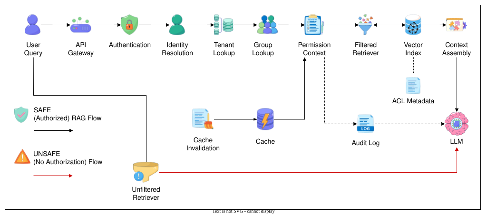

# Permission-Aware_Multi-Tenant_Retrieval_for_Secure_GenAI_Systems

Source: https://www.educative.io/courses/generative-ai-system-design/permission-aware-and-multi-tenant-retrieval

---

[Home](https://www.educative.io/)

[Courses](https://www.educative.io/search?tab=courses)

[Grokking the Generative AI System Design Interview](https://www.educative.io/courses/generative-ai-system-design)

# Permission-Aware and Multi-Tenant Retrieval

Explore how to design secure permission-aware multi-tenant retrieval systems in Generative AI. Understand access control models, query-time filtering strategies, and tenant isolation techniques to prevent unauthorized data access. Learn methods for permission synchronization, revocation handling, and auditing to maintain data confidentiality and compliance in enterprise retrieval scenarios.

We'll cover the following...

- [Why retrieval leaks are catastrophic](https://www.educative.io/courses/generative-ai-system-design/permission-aware-and-multi-tenant-retrieval#Why-retrieval-leaks-are-catastrophic)
- [Access control models in retrieval](https://www.educative.io/courses/generative-ai-system-design/permission-aware-and-multi-tenant-retrieval#Access-control-models-in-retrieval)
  - [Request identity inputs](https://www.educative.io/courses/generative-ai-system-design/permission-aware-and-multi-tenant-retrieval#Request-identity-inputs)
- [Filtering strategies and trade-offs](https://www.educative.io/courses/generative-ai-system-design/permission-aware-and-multi-tenant-retrieval#Filtering-strategies-and-trade-offs)
  - [Query-time enforcement paths](https://www.educative.io/courses/generative-ai-system-design/permission-aware-and-multi-tenant-retrieval#Query-time-enforcement-paths)
  - [Practical mitigations](https://www.educative.io/courses/generative-ai-system-design/permission-aware-and-multi-tenant-retrieval#Practical-mitigations)
- [Permission sync and revocation handling](https://www.educative.io/courses/generative-ai-system-design/permission-aware-and-multi-tenant-retrieval#Permission-sync-and-revocation-handling)
  - [Update pipeline mechanics](https://www.educative.io/courses/generative-ai-system-design/permission-aware-and-multi-tenant-retrieval#Update-pipeline-mechanics)
- [Multi-tenant isolation beyond the index](https://www.educative.io/courses/generative-ai-system-design/permission-aware-and-multi-tenant-retrieval#Multi-tenant-isolation-beyond-the-index)
  - [Shared vs. dedicated index layouts](https://www.educative.io/courses/generative-ai-system-design/permission-aware-and-multi-tenant-retrieval#Shared-vs-dedicated-index-layouts)
  - [Supporting-system isolation](https://www.educative.io/courses/generative-ai-system-design/permission-aware-and-multi-tenant-retrieval#Supporting-system-isolation)
- [Auditing and leak testing](https://www.educative.io/courses/generative-ai-system-design/permission-aware-and-multi-tenant-retrieval#Auditing-and-leak-testing)
- [Conclusion](https://www.educative.io/courses/generative-ai-system-design/permission-aware-and-multi-tenant-retrieval#Conclusion)

In enterprise RAG, retrieval operates directly on the authorization boundary. If an unapproved document chunk enters the candidate set, downstream prompt instructions cannot prevent a security breach because the model has already processed confidential text.

Securing the retrieval pipeline requires evaluating user identity, tenant scope, and document permissions before candidates reach the prompt. This lesson examines access control models, query-time filtering mechanisms, permission synchronization pipelines, tenant isolation strategies, and audit verification techniques in production System Design.

## Why retrieval leaks are catastrophic[#](https://www.educative.io/courses/generative-ai-system-design/permission-aware-and-multi-tenant-retrieval#Why-retrieval-leaks-are-catastrophic)

A permission leak is unauthorized retrieval. It is not merely a bad answer. If the retriever returns one forbidden sentence, the system has already failed confidentiality.

In the request path, the leak usually appears before any visible symptom. Identity resolves incorrectly, stale metadata survives in the index, or a shared cache serves results across tenants. Distributed systems make these bugs hard to trace because the retriever, metadata store, cache, and source connector can all be individually "healthy" while the combined behavior is unsafe.

The consequences are operationally concrete.

- **Regulatory exposure:** GDPR, HIPAA, and industry controls treat unauthorized disclosure as a reportable event.
- **Contractual breach:** B2B SaaS contracts often require tenant isolation as an explicit control.
- **Trust failure:** A single leaked snippet can end a deployment even if the rest of the architecture works.

1.

Why can prompt guardrails never repair an unauthorized retrieval leak?

Show Answer

Did you find this helpful?

**Attention:** Relevance bugs and confidentiality bugs are different classes. Returning a mediocre document hurts quality. Returning a forbidden one breaks the system boundary.

The retrieval path therefore needs to enforce tenant and user constraints before content enters the candidate set whenever the index supports it. That requirement leads directly into the request architecture.

The secure request path is easier to reason about when you can see the safe and unsafe branches side by side.

Secure retrieval path

That architecture depends on what permission data exists and how the retriever evaluates it at query time.

## Access control models in retrieval[#](https://www.educative.io/courses/generative-ai-system-design/permission-aware-and-multi-tenant-retrieval#Access-control-models-in-retrieval)

Enterprise retrieval usually starts from a plain rule. Every chunk must carry enough metadata for the query path to decide whether that user may see it.

The main models differ in what metadata they attach and where policy truth lives.

- **Document access control lists (ACLs):** An ACL is a list that names allowed users, groups, or roles for a document or chunk. This fits departmental knowledge bases and collaboration data with explicit sharing.
- **Attribute-based access control (ABAC):** Evaluates attributes of the user, resource, and request, such as department, region, clearance level, or time of access. It fits environments where permissions depend on dynamic conditions.
- **Role-based access control (RBAC):** Grants access based on assigned roles, such as HR manager, engineer, or administrator. It works well when permissions map cleanly to organizational responsibilities.
- **Source-system permissions:** The source application remains the authority, and ingestion mirrors its effective sharing state into retrieval metadata. This is common for SharePoint, Google Drive, or ticketing connectors.

Chunking complicates all four. If one document contains mixed visibility, document-level permissions are too coarse. The ingestion pipeline then needs inherited ACL metadata per chunk or pre-redacted chunk variants.

Identity resolution also has to be concrete.

### Request identity inputs[#](https://www.educative.io/courses/generative-ai-system-design/permission-aware-and-multi-tenant-retrieval#Request-identity-inputs)

The query path typically resolves these inputs before search begins.

- **User ID:** The stable principal identifier ties audit, revocation, and caching together.
- **Tenant ID:** The tenant scope narrows search space and acts as the first isolation predicate.
- **Groups and roles:** Group expansion captures inherited permissions, but large group memberships can create oversized query filters and increase latency.
- **Dynamic attributes:** Region, device posture, or legal-hold labels may affect access at request time.

The model comparison is easier to scan in tabular form before we evaluate enforcement costs.

|  |  |  |  |  |
| --- | --- | --- | --- | --- |
| **Model** | **Enforcement unit** | **Best use case** | **Strengths** | **Operational challenges** |
| Document ACLs | Per document or object | Fine-grained access control on discrete content items | Precise permissions, clear auditability, strong fit for document-centric systems | Metadata bloat at scale, inheritance complexity, higher update overhead |
| ABAC or RBAC filters | Per query, user role, or attribute set | Dynamic access decisions across large indexed datasets | Flexible policy expression, scalable for broad datasets, centralized policy management | Dynamic policy evaluation cost, harder debugging, risk of inconsistent attribute quality |
| Source-system mirrored permissions | Mirrored from upstream source records or groups | Environments where source systems are the authority for access | Consistent with system of record, reduced policy duplication, easier alignment with existing controls | Revocation lag, sync reliability issues, dependency on source permission quality |

Whichever model you choose, the next design question is where filtering happens inside approximate search.

## Filtering strategies and trade-offs[#](https://www.educative.io/courses/generative-ai-system-design/permission-aware-and-multi-tenant-retrieval#Filtering-strategies-and-trade-offs)

The retrieval engine has three broad enforcement positions. It can filter before search, after search, or during index traversal. The choice changes both correctness and latency.

### Query-time enforcement paths[#](https://www.educative.io/courses/generative-ai-system-design/permission-aware-and-multi-tenant-retrieval#Query-time-enforcement-paths)

Here is the simple version. Pre-filtering keeps forbidden content out of the candidate pool. Post-filtering lets it enter and removes it later. Filter-aware traversal tries to keep search efficient while respecting predicates during navigation.

- **Pre-filtering:** The system resolves tenant and permission predicates first, then restricts ANN or exact search to eligible items. This gives the strongest authorization behavior because unauthorized nodes never become candidates. The downside appears when filters are highly selective. In HNSW, removing most nodes can hurt traversal efficiency or recall unless the engine supports native predicate filtering well.
- **Post-filtering:** The retriever first gathers top results without full authorization constraints, then removes forbidden items. This is easy to bolt on, but it can underfill results. If the top 20 are forbidden and the first authorized match sits at rank 200, the user sees too few results even though relevant authorized content exists
- **Filter-aware traversal:** The index evaluates filter predicates during candidate traversal, steering retrieval toward eligible items while searching. This can improve efficiency for selective filters, but its effectiveness depends on the index structure and filtering implementation. The system must still guarantee that unauthorized items never reach the prompt.

1.

Why does post-filtering often return empty result sets in heavily restricted environments?

Show Answer

Did you find this helpful?

### Practical mitigations[#](https://www.educative.io/courses/generative-ai-system-design/permission-aware-and-multi-tenant-retrieval#Practical-mitigations)

Production systems usually combine strategies rather than picking one universally.

- **Over-retrieval:** The engine fetches more than kkk candidates so post-filtering has a better chance of returning kkk authorized chunks.
- **Exact-search fallback:** Highly selective filters can route to brute-force or partition-local exact search when ANN connectivity becomes unreliable.
- **Hybrid planning:** A query planner estimates filter selectivity and switches between pre-filter, predicate-aware ANN, and fallback modes.
- **Tenant partitioning:** Partitioning by tenant improves locality and reduces the filter burden for shared infrastructure.

**Practical tip:** In interviews, state the principle explicitly. Authorization correctness wins over convenience, and any quality optimization must preserve that boundary.

Once query-time enforcement is set, the design still fails if permission metadata drifts behind the source of truth.

## Permission sync and revocation handling[#](https://www.educative.io/courses/generative-ai-system-design/permission-aware-and-multi-tenant-retrieval#Permission-sync-and-revocation-handling)

The ingestion path does more than embed text. It fetches content, chunks it, attaches tenant and permission metadata, and writes vectors plus filterable attributes into the index. If the document came from an external system, the connector also records the source permission version used during indexing.

Revocation turns this into a distributed consistency problem. A user loses access in the source system, but old permission state can linger in group resolvers, index metadata, retrieval caches, session memory, and analytics sinks. The system needs bounded delay and evidence of convergence.

### Update pipeline mechanics[#](https://www.educative.io/courses/generative-ai-system-design/permission-aware-and-multi-tenant-retrieval#Update-pipeline-mechanics)

A safe design usually includes these moving parts.

- **Change capture:** The connector consumes permission deltas from event streams or polling checkpoints.
- **Versioned metadata:** Each indexed item stores an ACL version or timestamp so late events can be detected and ignored.
- **Identity expansion:** Group membership updates run through an idempotency aware resolver.
- **Invalidation fan-out:** Retrieval caches, embedding caches, precomputed context stores, and conversation memory receive targeted eviction signals.

**Note:** Revocation is not complete when the vector index updates. It is complete when every downstream store that could surface old text has been invalidated or expired.

For sensitive corpora, teams often target near-real-time revocation with a measurable lag SLO. Lower-risk corpora may tolerate eventual consistency, but that choice must be explicit.

The life cycle is easier to defend when the propagation path is visible end to end.

Revocation update lifecycle

After sync and revocation, the remaining question is how far tenant isolation should extend beyond the vector index itself.

## Multi-tenant isolation beyond the index[#](https://www.educative.io/courses/generative-ai-system-design/permission-aware-and-multi-tenant-retrieval#Multi-tenant-isolation-beyond-the-index)

Multi-tenant retrieval starts with index layout, but it does not end there. A correct vector search can still be undermined by a shared cache key, a trace payload, or an analytics export.

### Shared vs. dedicated index layouts[#](https://www.educative.io/courses/generative-ai-system-design/permission-aware-and-multi-tenant-retrieval#Shared-vs-dedicated-index-layouts)

There are two common layouts, plus a hybrid middle ground.

- **Shared index**: A shared index stores many tenants together and relies on strict tenant and permission filters at query time. This is efficient for storage, onboarding, and fleet management. It also improves utilization when many tenants are small. The cost is operational sharpness. Every retrieval, cache, and observability path must preserve tenant scoping perfectly.
- **Per-tenant index**: A per-tenant index gives stronger blast-radius control and clearer deletion semantics. Revocation and export boundaries are easier to reason about. The cost appears in index sprawl, small-index inefficiency, shard imbalance, and operational overhead when thousands of tenants exist.

### Supporting-system isolation[#](https://www.educative.io/courses/generative-ai-system-design/permission-aware-and-multi-tenant-retrieval#Supporting-system-isolation)

The same design choice must propagate into adjacent systems.

- **Caches:** Use tenant-scoped keys and principal-aware result caching so one tenant never reuses another tenant's candidate set.
- **Logs and traces:** Redact retrieved text where possible and partition audit streams by tenant with access-controlled observability.
- **Analytics tables:** Store retrieval metrics in tenant-partitioned datasets or apply strict row-level controls.
- **Background jobs:** Reindexing, compaction, and export pipelines must carry tenant context through every worker hop.

Before moving to auditing, the mind map below ties together the secure request path, access control models, and filtering trade-offs covered so far.

Mind map of the secure retrieval path, permission models, and filtering trade-offs in enterprise RAG.

The final control layer does not prevent leaks directly. It proves whether the retrieval boundary actually held during real traffic.

## Auditing and leak testing[#](https://www.educative.io/courses/generative-ai-system-design/permission-aware-and-multi-tenant-retrieval#Auditing-and-leak-testing)

Auditing closes the loop between architecture and evidence. For each retrieval request, the service should log the authenticated principal, tenant, resolved groups or attributes, applied filter, candidate counts before and after filtering, returned document IDs, and policy version. That record lets you reconstruct why a passage was or was not eligible.

The test strategy must include negative cases, not just happy paths.

- **Sentinel documents:** Plant canary content in one tenant and verify that foreign principals never retrieve it.
- **Cross-tenant probes:** Run synthetic requests in CI, staging, and production-like environments to catch regressions in filters and caches.
- **Revocation checks:** After a permission removal, continuously probe until old content disappears from retrieval and all downstream stores.
- **Metrics:** Track revocation lag, unauthorized hit attempts, empty-result rate after filtering, and cache invalidation success.

**Warning:** Customers and auditors often ask for proof, not architecture diagrams. If your design cannot explain what was filtered for a given request, it is incomplete.

Test your knowledge!

1.

An enterprise HR assistant mistakenly retrieves an executive severance agreement when a junior employee asks about standard termination notice periods. The developer prompt instructs the model to ignore confidential documents, but the model summarizes the executive package anyway. What core architectural principle explains this failure?

A.

Context window truncation dropping negative instructions

B.

Placement of security boundaries after context injection

C.

Insufficient parameter capacity in the foundation model

D.

Absence of temperature calibration during decoding

---

1 / 3

## Conclusion[#](https://www.educative.io/courses/generative-ai-system-design/permission-aware-and-multi-tenant-retrieval#Conclusion)

Retrieval is part of the authorization boundary, so secure RAG starts before prompt construction. Pick an explicit permission model, enforce tenant and user constraints during retrieval whenever possible, treat revocation as a distributed consistency problem, and extend tenant isolation into caches, logs, and observability. If you can also show audit evidence and negative leak tests, your design moves from plausible to defensible.

The next lesson picks up from this boundary. Once retrieval is safe, the system still has to assemble the authorized passages into efficient, high-signal model context without wasting tokens or weakening control.

Chunking, Hybrid Retrieval, and Reranking

Context Assembly and Prompt Management

Ask

[Why retrieval leaks are catastrophic](https://www.educative.io/courses/generative-ai-system-design/permission-aware-and-multi-tenant-retrieval#Why-retrieval-leaks-are-catastrophic)

[Access control models in retrieval](https://www.educative.io/courses/generative-ai-system-design/permission-aware-and-multi-tenant-retrieval#Access-control-models-in-retrieval)

[Request identity inputs](https://www.educative.io/courses/generative-ai-system-design/permission-aware-and-multi-tenant-retrieval#Request-identity-inputs)

[Filtering strategies and trade-offs](https://www.educative.io/courses/generative-ai-system-design/permission-aware-and-multi-tenant-retrieval#Filtering-strategies-and-trade-offs)

[Query-time enforcement paths](https://www.educative.io/courses/generative-ai-system-design/permission-aware-and-multi-tenant-retrieval#Query-time-enforcement-paths)

[Practical mitigations](https://www.educative.io/courses/generative-ai-system-design/permission-aware-and-multi-tenant-retrieval#Practical-mitigations)

[Permission sync and revocation handling](https://www.educative.io/courses/generative-ai-system-design/permission-aware-and-multi-tenant-retrieval#Permission-sync-and-revocation-handling)

[Update pipeline mechanics](https://www.educative.io/courses/generative-ai-system-design/permission-aware-and-multi-tenant-retrieval#Update-pipeline-mechanics)

[Multi-tenant isolation beyond the index](https://www.educative.io/courses/generative-ai-system-design/permission-aware-and-multi-tenant-retrieval#Multi-tenant-isolation-beyond-the-index)

[Shared vs. dedicated index layouts](https://www.educative.io/courses/generative-ai-system-design/permission-aware-and-multi-tenant-retrieval#Shared-vs-dedicated-index-layouts)

[Supporting-system isolation](https://www.educative.io/courses/generative-ai-system-design/permission-aware-and-multi-tenant-retrieval#Supporting-system-isolation)

[Auditing and leak testing](https://www.educative.io/courses/generative-ai-system-design/permission-aware-and-multi-tenant-retrieval#Auditing-and-leak-testing)

[Conclusion](https://www.educative.io/courses/generative-ai-system-design/permission-aware-and-multi-tenant-retrieval#Conclusion)