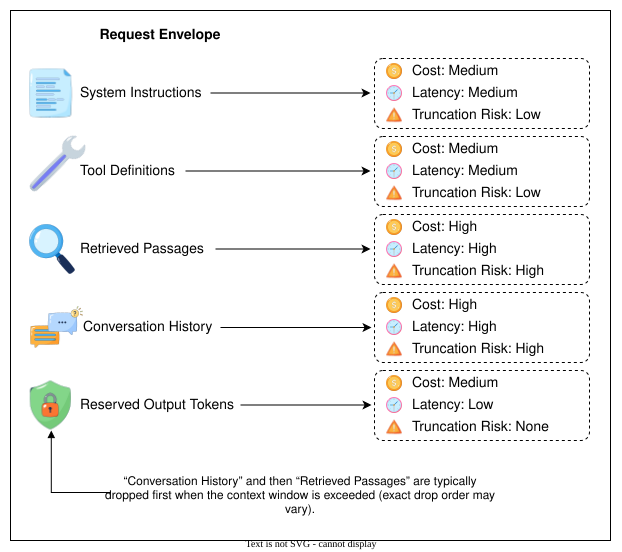

# Context_Assembly_and_Prompt_Management_in_Generative_AI_Design

Source: https://www.educative.io/courses/generative-ai-system-design/context-assembly-and-prompt-management

---

[Home](https://www.educative.io/)

[Courses](https://www.educative.io/search?tab=courses)

[Grokking the Generative AI System Design Interview](https://www.educative.io/courses/generative-ai-system-design)

# Context Assembly and Prompt Management

Explore how to build and manage context for generative AI requests within strict token limits. Learn techniques for prompt versioning, token allocation, ordering, compression, long-session memory management, and structured output validation. This lesson helps you design reliable, versioned prompt workflows that ensure consistent, safe AI responses and supports production-grade deployments.

We'll cover the following...

- [The context budget](https://www.educative.io/courses/generative-ai-system-design/context-assembly-and-prompt-management#The-context-budget)
- [Ordering and compression](https://www.educative.io/courses/generative-ai-system-design/context-assembly-and-prompt-management#Ordering-and-compression)
  - [Long-session handling](https://www.educative.io/courses/generative-ai-system-design/context-assembly-and-prompt-management#Long-session-handling)
    - [Common memory choices](https://www.educative.io/courses/generative-ai-system-design/context-assembly-and-prompt-management#Common-memory-choices)
- [Prompt templates and registries](https://www.educative.io/courses/generative-ai-system-design/context-assembly-and-prompt-management#Prompt-templates-and-registries)
  - [What the registry must support](https://www.educative.io/courses/generative-ai-system-design/context-assembly-and-prompt-management#What-the-registry-must-support)
- [Versioning and rollout](https://www.educative.io/courses/generative-ai-system-design/context-assembly-and-prompt-management#Versioning-and-rollout)
  - [Promotion path](https://www.educative.io/courses/generative-ai-system-design/context-assembly-and-prompt-management#Promotion-path)
    - [Release checks](https://www.educative.io/courses/generative-ai-system-design/context-assembly-and-prompt-management#Release-checks)
- [Structured outputs and validation](https://www.educative.io/courses/generative-ai-system-design/context-assembly-and-prompt-management#Structured-outputs-and-validation)
  - [Reliability loop](https://www.educative.io/courses/generative-ai-system-design/context-assembly-and-prompt-management#Reliability-loop)
- [Putting it together in a request path](https://www.educative.io/courses/generative-ai-system-design/context-assembly-and-prompt-management#Putting-it-together-in-a-request-path)
- [Conclusion](https://www.educative.io/courses/generative-ai-system-design/context-assembly-and-prompt-management#Conclusion)

In enterprise System Design, context assembly is the process that packages developer instructions, external knowledge, dialogue history, and structured output constraints into a single request under a strict token budget. Prompt management provides the operational release discipline around those artifacts, ensuring every change is versioned, evaluated, and safely deployable.

A prompt regression in production is rarely a wording defect. It is usually a request construction failure where expanding context displaces critical safety rules or truncates output tokens. This lesson examines how to partition the context window, prevent attention loss, manage conversational memory, enforce structured schemas, and govern prompt releases as versioned software artifacts.

## The context budget[#](https://www.educative.io/courses/generative-ai-system-design/context-assembly-and-prompt-management#The-context-budget)

The model context window is finite, so every request starts with a packing plan. A simple way to think about it is as a suitcase with reserved compartments. If one compartment grows, another must shrink.

A production request usually splits tokens across instructions, tool or schema definitions, retrieved knowledge, conversation history, and a reserved output buffer. That last partition is not optional. If the system uses all tokens on input, the model cannot finish its answer, and the response truncates mid-thought or mid-JSON.

Typical assistants often begin with these working ranges.

- **Instructions:** These usually consume 10 to 15 percent and hold policy, role, and task framing.
- **Tools and schemas:** These often take 15 to 20 percent when function definitions or structured output contracts are attached.
- **Retrieval:** This commonly takes 30 to 40 percent because external knowledge often drives correctness.
- **History:** This often uses 20 to 30 percent for recent turns and memory.
- **Output reserve:** This should keep 10 to 15 percent so answers can complete safely.

Agentic systems often shift more budget toward tool definitions. Compliance assistants may spend more on policy and schema. Short-turn bots can cut history sharply. Overallocating retrieval can starve instructions, while retaining too much history causes prompt drift. The next step is deciding which tokens deserve the strongest positions.

1.

Why must the request assembler always reserve ten to fifteen percent of the context budget for output tokens?

Show Answer

Did you find this helpful?

The budget picture becomes clearer when you can see the request envelope as a partitioned system artifact.

Request budget envelope

## Ordering and compression[#](https://www.educative.io/courses/generative-ai-system-design/context-assembly-and-prompt-management#Ordering-and-compression)

After budgeting, the assembler decides placement. This matters because models do not treat all positions equally. The lost-in-the-middle effect means the same facts can work better or worse depending on location.

A reliable request builder follows a few ordering rules.

- **Core instructions:** These stay first so policy and task framing are visible before any noisy context arrives.
- **Recent user turns:** These stay near the end because recency often influences the final generation strongly.
- **High-value retrieved facts:** These are placed near the beginning or end when possible instead of being buried inside long document blocks.

Compression then resolves overflow. Truncation works for low-priority verbose text. Summarization works when information must survive but can be compressed. Selective dropping works when some context classes are optional.

**Practical tip:** Summaries should preserve constraints, named entities, unresolved tasks, and prior commitments, not just topic keywords.

### Long-session handling[#](https://www.educative.io/courses/generative-ai-system-design/context-assembly-and-prompt-management#Long-session-handling)

Long sessions need a memory policy, not just a longer window. The system usually maintains a rolling summary, a pinned fact set, and a recent-turn window. Think of it like meeting notes plus sticky notes for commitments.

#### Common memory choices[#](https://www.educative.io/courses/generative-ai-system-design/context-assembly-and-prompt-management#Common-memory-choices)

- **Full replay:** This keeps every turn, which preserves detail but increases cost and latency roughly linearly with session length.
- **Sliding window:** This keeps only recent turns, which is cheap but forgets durable facts.
- **Episodic summaries:** This compresses old turns into milestones, which saves tokens but can accumulate abstraction error.
- **Fact stores:** This extracts stable preferences and unresolved tasks into separate records that survive paraphrasing.

Summary drift, omitted commitments, and stale memory contamination can all corrupt later turns. Those risks lead directly to the need for explicit template control.

## Prompt templates and registries[#](https://www.educative.io/courses/generative-ai-system-design/context-assembly-and-prompt-management#Prompt-templates-and-registries)

In production, prompts should not live as copied strings inside handlers. They behave more like release artifacts with inputs, owners, and dependencies. A support bot in English and a legal assistant in German may share the same template structure while varying locale, tone, retrieval slots, and policy snippets.

A good template is parameterized and assembled at request time. Variables fill role framing, audience, safety clauses, retrieval inserts, and schema instructions. This avoids silent divergence across duplicated prompt files.

The coordinating service usually reads these artifacts from a prompt registry. Think of the registry as a package repository for request behavior. It stores immutable versions plus metadata such as owner, version, target model, decoding settings, linked schema, and release state.

### What the registry must support[#](https://www.educative.io/courses/generative-ai-system-design/context-assembly-and-prompt-management#What-the-registry-must-support)

The registry should provide a few operational guarantees.

- **Immutable versions:** A released prompt bundle must never be edited in place because rollback requires byte-for-byte reproducibility.
- **Release labels:** Labels such as stable and candidate let the serving tier switch traffic safely without changing application code.
- **Fast rollback:** The serving path should recover a previous known-good bundle quickly when regressions appear.
- **Consistent distribution:** Replicas should observe prompt updates predictably, which brings familiar distributed-systems issues such as cache invalidation and stale reads.

Prompts should also be bundled with tool definitions, retrieval configuration, and output schemas. Behavior depends on the full envelope, not one instruction string. That bundling sets up the release process.

The artifact relationships are easier to reason about when they are compared side by side.

## Versioned LLM Application Artifacts

|  |  |  |  |
| --- | --- | --- | --- |
| **Artifact** | **Why version it** | **Common metadata** | **Failure if unmanaged** |
| Prompt template | Tracks instruction changes that affect behavior, tone, and task performance | Template ID, version, author, change notes, effective date | Silent output shifts after prompt edits cause inconsistent responses or regressions |
| Model identifier | Captures the exact model used for reproducibility and evaluation | Provider, model name, release tag, context window, deprecation status | Model swap changes latency, style, or capabilities and breaks previously validated behavior |
| Decoding parameters | Preserves generation behavior across runs and environments | Temperature, top\_p, max tokens, stop sequences, seed | Different sampling settings produce unstable outputs and make debugging harder |
| Tool definitions | Ensures the callable interface matches what the model expects | Tool name, version, argument schema, permissions, endpoint | Renamed fields or changed arguments cause invalid tool calls or execution failures |
| Retrieval configuration | Locks answer grounding to a known retrieval setup | Index version, embedding model, chunk size, top\_k, filters, reranker | Retrieval config drift changes retrieved evidence, leading to different or poorly grounded answers |
| Output schema | Guarantees structured outputs remain parseable by downstream systems | Schema version, field types, required fields, validator, serialization format | Stale schema causes parse errors, missing fields, or ingestion failures in downstream services |

## Versioning and rollout[#](https://www.educative.io/courses/generative-ai-system-design/context-assembly-and-prompt-management#Versioning-and-rollout)

A prompt change is an application change, so the release path should look like software delivery rather than prompt tweaking. Teams usually version a bundle containing prompt text, system and user framing, model version, temperature, max tokens, tool definitions, output schema, and retrieval settings.

**Note:** Semantic versions are useful for humans, but immutable artifact IDs or Git SHAs are better for exact replay and audit.

### Promotion path[#](https://www.educative.io/courses/generative-ai-system-design/context-assembly-and-prompt-management#Promotion-path)

The bundle usually moves through development, staging, and production with evaluation gates in between.

#### Release checks[#](https://www.educative.io/courses/generative-ai-system-design/context-assembly-and-prompt-management#Release-checks)

Before promotion, the system runs a fixed evaluation set.

- **Golden examples:** These verify common cases where expected behavior is already known.
- **Edge cases:** These stress ambiguity, long context, conflicting retrieval, and policy-heavy inputs.
- **Negative tests:** These confirm the system refuses unsafe or unsupported requests correctly.
- **Operational checks:** These measure token cost, latency, retry rate, and truncation risk.

Shadow evaluation lets a candidate bundle process mirrored traffic without affecting users. **Canary rollouts** send a small percentage of live traffic to the candidate to monitor its behavior before wider deployment. **A/B testing** splits live traffic between two versions to compare outcomes such as task success, refusal quality, and downstream breakage. Prompt lookup itself can become a dependency, so registries are commonly cached in the serving tier for availability. Once the team can release safely, the next concern is making outputs machine-consumable.

For a deeper look at using shadow deployments, canary rollouts, and A/B testing to evaluate system behavior in production, see the lesson “*Online Evaluation, Experiment Design, and Drift*.”

## Structured outputs and validation[#](https://www.educative.io/courses/generative-ai-system-design/context-assembly-and-prompt-management#Structured-outputs-and-validation)

Many production systems do not want free-form prose. They want objects that downstream services can parse. A scheduler may need fields for date, attendees, and confidence. A legal workflow may need citation arrays and risk labels. This is where **structured outputs** enter, using JSON schemas, constrained decoding, and post-generation validation.

The control loop is straightforward. The request assembler attaches a schema, the model generates against that contract, a validator checks the result, and the orchestrator retries on failure within a fixed budget. If validation still fails, the system escalates, falls back, or fails closed depending on the application.

Common failures repeat across systems.

- **Omitted optional-looking fields:** The model drops fields that the business logic actually requires.
- **Enum violations:** The model invents values outside the allowed label set.
- **Hallucinated keys:** The response contains extra fields unknown to downstream consumers.
- **Malformed structure:** The response breaks JSON syntax or nesting rules.

**Attention:** Schemas also need versioning. A prompt can pass while the consumer breaks because field contracts changed.

### Reliability loop[#](https://www.educative.io/courses/generative-ai-system-design/context-assembly-and-prompt-management#Reliability-loop)

Constrained decoding improves parseability by limiting what the model can emit, but tighter constraints can reduce expressive flexibility. Teams choose a point between deterministic parsing and richer language based on downstream needs. The loop also needs telemetry for schema version, validator errors, retry count, and final status. That telemetry feeds back into rollout decisions and incident response.

The life cycle becomes clearer when the validation loop is drawn as part of the serving path.

Validation control loop

1.

What is the trade-off between constrained decoding and post-generation schema validation?

Show Answer

Did you find this helpful?

## Putting it together in a request path[#](https://www.educative.io/courses/generative-ai-system-design/context-assembly-and-prompt-management#Putting-it-together-in-a-request-path)

A production request path starts by fetching the active prompt bundle from the registry or a local cache. The orchestrator then loads recent conversation turns, pinned memory, and any durable facts. After that, the retrieval layer returns candidate passages, and the assembler ranks, compresses, and orders them under the token budget.

Next, the system attaches tool definitions and the output schema, computes reserved output capacity, and submits the final envelope to the model. When the response returns, the validator checks structure and policy conditions. If validation fails, the orchestrator retries within bounds or routes to a fallback. Finally, the system logs every artifact version used in that request.

The observability record should include prompt version, model version, token counts by segment, retrieval document IDs, schema version, retry count, latency, and final outcome. That log gives traceability when regressions appear and supports audit, rollback, and cost analysis.

This logic usually sits above the inference engine but below the product handler, often inside a request-orchestration layer. The inference engine in the next lesson must execute these assembled envelopes with predictable latency and consistency. Prompt quality alone is not enough. The serving stack must operationalize the plan exactly.

AI Powered

Saved

1 attempt left

Reset

Preventing output truncation via context budget reservation

An enterprise travel assistant is designed to return a structured JSON itinerary. During high-season queries with extensive retrieved flight listings, the model frequently emits truncated JSON that fails downstream parser validation. Log inspection shows that input tokens consumed ninety-eight percent of the context window. What request construction adjustment resolves this failure?

This is your last attempt.

## Conclusion[#](https://www.educative.io/courses/generative-ai-system-design/context-assembly-and-prompt-management#Conclusion)

Prompts and context should be treated as versioned production artifacts, not ad hoc strings. Strong systems allocate token budgets deliberately, place critical instructions and recent state where the model can use them, compress older material carefully, and enforce structured outputs with validation and bounded retries.

Teams that ship reliably bundle prompt text with model choices, tools, schemas, and retrieval settings, then evaluate those bundles before promotion. That discipline sets up the next layer of the stack. In the next lesson, we will examine how the inference engine executes these request-building decisions with predictable latency, observability, and reliability.

Permission-Aware and Multi-Tenant Retrieval

Requirements for an Inference Engine

Ask

[The context budget](https://www.educative.io/courses/generative-ai-system-design/context-assembly-and-prompt-management#The-context-budget)

[Ordering and compression](https://www.educative.io/courses/generative-ai-system-design/context-assembly-and-prompt-management#Ordering-and-compression)

[Long-session handling](https://www.educative.io/courses/generative-ai-system-design/context-assembly-and-prompt-management#Long-session-handling)

[Common memory choices](https://www.educative.io/courses/generative-ai-system-design/context-assembly-and-prompt-management#Common-memory-choices)

[Prompt templates and registries](https://www.educative.io/courses/generative-ai-system-design/context-assembly-and-prompt-management#Prompt-templates-and-registries)

[What the registry must support](https://www.educative.io/courses/generative-ai-system-design/context-assembly-and-prompt-management#What-the-registry-must-support)

[Versioning and rollout](https://www.educative.io/courses/generative-ai-system-design/context-assembly-and-prompt-management#Versioning-and-rollout)

[Promotion path](https://www.educative.io/courses/generative-ai-system-design/context-assembly-and-prompt-management#Promotion-path)

[Release checks](https://www.educative.io/courses/generative-ai-system-design/context-assembly-and-prompt-management#Release-checks)

[Structured outputs and validation](https://www.educative.io/courses/generative-ai-system-design/context-assembly-and-prompt-management#Structured-outputs-and-validation)

[Reliability loop](https://www.educative.io/courses/generative-ai-system-design/context-assembly-and-prompt-management#Reliability-loop)

[Putting it together in a request path](https://www.educative.io/courses/generative-ai-system-design/context-assembly-and-prompt-management#Putting-it-together-in-a-request-path)

[Conclusion](https://www.educative.io/courses/generative-ai-system-design/context-assembly-and-prompt-management#Conclusion)