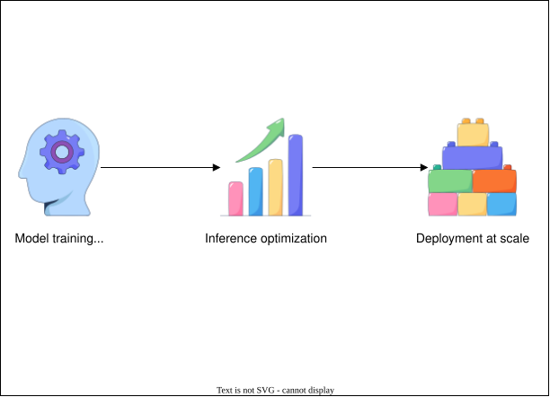

# Inference_Optimization_Techniques_for_Efficient_GenAI_Systems

Source: https://www.educative.io/courses/generative-ai-system-design/inference-optimization-in-genai-systems

---

[Home](https://www.educative.io/)

[Courses](https://www.educative.io/search?tab=courses)

[Grokking the Generative AI System Design Interview](https://www.educative.io/courses/generative-ai-system-design)

# Inference Optimization in GenAI Systems

Learn key inference optimization techniques, such as quantization, pruning, and batching, to build scalable and efficient generative AI systems for real-world applications.

We'll cover the following...

- [What and why of inference optimization](https://www.educative.io/courses/generative-ai-system-design/inference-optimization-in-genai-systems#What-and-why-of-inference-optimization)
- [Inference optimization methods](https://www.educative.io/courses/generative-ai-system-design/inference-optimization-in-genai-systems#Inference-optimization-methods)
  - [Quantization](https://www.educative.io/courses/generative-ai-system-design/inference-optimization-in-genai-systems#Quantization)
  - [Pruning](https://www.educative.io/courses/generative-ai-system-design/inference-optimization-in-genai-systems#Pruning)
  - [Knowledge distillation (KD)](https://www.educative.io/courses/generative-ai-system-design/inference-optimization-in-genai-systems#Knowledge-distillation-KD)
  - [Caching strategies](https://www.educative.io/courses/generative-ai-system-design/inference-optimization-in-genai-systems#Caching-strategies)
  - [Batching](https://www.educative.io/courses/generative-ai-system-design/inference-optimization-in-genai-systems#Batching)
- [Conclusion](https://www.educative.io/courses/generative-ai-system-design/inference-optimization-in-genai-systems#Conclusion)

The previous lesson covered the functional and nonfunctional requirements of an inference engine, including streaming generation, latency targets, throughput, availability, and cost efficiency. Meeting these requirements depends on how efficiently the engine processes requests and generates tokens.

Inference optimization improves this efficiency through techniques such as quantization, caching, batching, request scheduling, and speculative decoding. The right choices depend on the system's bottlenecks, workload, and SLOs. This lesson explores these techniques and the trade-offs involved in applying them.

## What and why of inference optimization[#](https://www.educative.io/courses/generative-ai-system-design/inference-optimization-in-genai-systems#What-and-why-of-inference-optimization)

**Inference optimization** reduces the compute, memory, or time needed to generate model outputs while maintaining acceptable quality, i.e., improving latency, throughput, or cost. This is necessary in building services for production environments to handle large user traffic, especially during peak hours.

1 / 2

Inference optimization in the big picture

1 / 2

Why do we need inference optimization?

Now that we understand that inference optimization is necessary for powering real-time generative AI applications, let’s understand the approaches typically used to optimize inference.

## Inference optimization methods[#](https://www.educative.io/courses/generative-ai-system-design/inference-optimization-in-genai-systems#Inference-optimization-methods)

Let’s look at the common methods to optimize inference, starting with model quantization.

### Quantization[#](https://www.educative.io/courses/generative-ai-system-design/inference-optimization-in-genai-systems#Quantization)

**Quantization** is reducing the detail represented in the numbers used by a model. ML models use high-precision numbers to make accurate predictions. Using quantization, numbers are rounded off to maintain enough detail but reduce size. For example, a value of 2.311 is rounded off to 2.3 or 2, maintaining good data originality.

In the model quantization process, the precision of the numbers used to represent model parameters (like weights and activations) is reduced. Typically, numbers are reduced from 32-bit floating point to 8-bit integers. This results in a smaller model size, requiring less memory and faster inference speed.

Quantization reduces running inference’s overall computational, power, and memory costs. Quantized models can also run on resource-constrained devices such as embedded systems.

Inference optimization: Before and after quantization

**Key highlight:** Larger models often tolerate quantization better, while smaller models may experience greater accuracy loss, especially at lower bit widths.

### Pruning[#](https://www.educative.io/courses/generative-ai-system-design/inference-optimization-in-genai-systems#Pruning)

**Pruning** is the process of eliminating unnecessary parameters to reduce the model’s size. Parameters typically include removing connections between neurons, neuron weights, or neurons altogether. Pruning eliminates unnecessary model complexity, leaving a faster, computationally and memory-efficient model.

Pruning, if not done carefully, can also degrade model inference performance. Typically, models are pruned after training to identify expendable parts.

While pruning and quantization offer similar advantages, pruning can be much more effective because it removes parts of the network that don’t add much to the model’s accuracy. Quantization is a blunt eradication of precision from model weights. Thus, model pruning is flexible and effective.

Inference optimization: Before and after pruning

### Knowledge distillation (KD)[#](https://www.educative.io/courses/generative-ai-system-design/inference-optimization-in-genai-systems#Knowledge-distillation-KD)

Knowledge distillation (KD) is a technique for transferring the knowledge of a larger model to a smaller, compact model while maintaining validity. The larger model is usually called the **teacher**, while the smaller one is called the **student.** After knowledge transfer, the student model *mimics* the teacher model to maintain a similar accuracy level.

While larger models have a much higher knowledge capacity, only a limited portion may be fully utilized. On the other hand, larger models require resource-intensive machines. In a practical world, models must be fast, inexpensive, and efficient to become useful. This is where knowledge distillation comes into play. The newer distilled models are compact, rendering them usable on resource-constrained devices. For example, a team can distill a large language model into a smaller student model optimized for on-device tasks, reducing inference costs and reliance on network connectivity.

The concept of KD dates back two decades, and many fields, especially large language models (LLMs), have enjoyed its benefits. There are [various ways to perform knowledge distillation](https://www.educative.io/answers/what-is-knowledge-distillation-in-deep-learning).

**Tip**: Knowledge distillation can combine multiple teacher models to create an ensemble-powered student model.

The process of knowledge distillation

AI Powered

Saved

1 attempt left

Reset

Choosing an inference optimization strategy

A company runs an LLM-powered customer support chatbot. As traffic increases, GPU costs rise and response times become inconsistent. The team wants to improve throughput without significantly increasing infrastructure costs. Which inference optimization techniques should the team consider, and what trade-offs should it evaluate?

This is your last attempt.

### Caching strategies[#](https://www.educative.io/courses/generative-ai-system-design/inference-optimization-in-genai-systems#Caching-strategies)

Caching is commonly used across all computational devices to improve performance and reduce latency. In GenAI systems, it’s an important technique for storing and reusing previously computed results to reduce inference latency and computational overhead. GenAI systems need caching to reduce response time and make the service more useful for end users.

Caching has benefits where the system has to handle repeated/frequent queries, overlapping prompts, or simply improve efficiency by avoiding redundant computations. Let’s look at the key caching techniques used for inference optimization in GenAI systems:

- **Semantic cache:** Semantic caching relies on similarity rather than exactness. This contrasts with typical caching, which requires an exact match. Semantic caching is useful for queries that have similar meanings. For example, “What is 1 + 1?” and “What is one plus one?” will yield the same result for a semantic cache. Semantic caches will return the same response based on a similarity threshold. Using this method, similar queries receive the same response if the score is within a certain range.
- **Prompt cache:** This type stores responses for identical prompts to reduce the model’s recomputation burden. Many prompts have sections of overlapping text that can be heuristically matched. Prompt caches leverage this fact to reduce recomputations by the LLM. Prompt caches precompute and store prompt modules in memory. New prompts are compared against these prompt modules and retrieve matching results.
- **Key-value (KV) cache:** KV cache enables models to generate new tokens quickly by storing context from earlier tokens. Thus, models do not need to recompute already processed data. KV caching is valuable in autoregressive (generative) models because they generate tokens sequentially based on past tokens. While KV caches help reduce inference latency, they typically require much memory to store the context.
- **Exact cache:** A more generic type of cache is the exact cache that stores frequently processed items for reuse. Systems like Redis and Memcached are typically used to develop exact caches to achieve low latency and high scalability. An important choice in implementing an exact cache is the eviction policy, such as LRU, FIFO, etc. Exact caches are useful in chain-of-thought reasoning or time-consuming actions like web searches because they return stored responses without running inference again.

1.

What techniques are effective when executing large models like GPT on hand-held devices?

Show Answer

Did you find this helpful?

A summary of the comparison between each caching strategy is provided below:

|  |  |  |  |  |
| --- | --- | --- | --- | --- |
| **Criteria** | **Semantic Cache** | **Prompt Cache** | **KV Cache** | **Exact Cache** |
| Scope | Similar queries | Across prompts | Single prompt | Identical queries |
| Complexity | High | Medium | Low | Low |
| Memory Demand | High | High | Medium | Varies |
| Latency Benefit | Medium to high | Very high | High | High |
| Best Use Case | Fuzzy matching in search or chat | Structured repeated queries | Fast retrieval for token reuse | FAQ-like systems |
| Scalability | Resource-intensive, but clustering helps | Limited by memory and diversity | Highly scalable with low overhead | Effective with deduplication |

**Food for thought:** Caching may be one of the most underrated techniques for improving the performance of GenAI applications. While these caching techniques can be used in tandem, at the end of the day, caching isn’t just about speed; it’s about efficiency. By reusing what’s already computed, you save both time and resources.

### Batching[#](https://www.educative.io/courses/generative-ai-system-design/inference-optimization-in-genai-systems#Batching)

Batching involves combining multiple requests and processing them all at once. The concept of batching is well-known and has established its footprint in machine learning (ML) for a while. Inference optimization is achieved by grouping multiple requests/data points and processing them as a single unit (batch). Batching results in improved throughput because it efficiently utilizes the underlying hardware. As modern GPUs and TPUs have good parallel processing capabilities, batching proves to be a useful technique for Inference optimization.

**Note:** Batching can increase per-request latency, especially when requests must wait for a batch to form. However, it can improve throughput and reduce the cost per request by using GPU resources more efficiently.

The following table summarizes the key aspects of the Inference optimization techniques discussed above:

|  |  |  |  |  |
| --- | --- | --- | --- | --- |
| **Optimization Technique** | **Scope** | **Effectiveness** | **Trade-Offs** | **Key Applications** |
| Quantization | Model size and inference speed | High memory and latency reduction | Potential accuracy loss for complex tasks | Deploying models on edge devices or low-resource systems |
| Pruning | Model structure and parameter reduction | Reduces computational cost and memory use | It may require retraining to maintain accuracy | Lightweight models for mobile/edge devices |
| Caching Techniques | Query and response optimization | Improves latency and throughput | Requires memory trade-offs and storage costs | Real-time applications, conversational systems, and APIs |
| Batching | Input data handling during inference | Maximizes hardware utilization and throughput | Increased latency for low-volume requests | High-throughput systems like recommendation engines or LLM inference |

## Conclusion[#](https://www.educative.io/courses/generative-ai-system-design/inference-optimization-in-genai-systems#Conclusion)

In this lesson, we have covered some of the most common and effective inference optimization techniques. These techniques have widespread applicability and impact. While model training, testing, and deployment for end-users are significant, inference optimization techniques make it possible to architect large-scale, efficient, and performant systems.

Other techniques include model compression, pipeline parallelism, and hardware-specific acceleration. These techniques are the foundational blocks for designing long-lasting systems.

Requirements for an Inference Engine

Parallelism in GenAI Models

Ask

[What and why of inference optimization](https://www.educative.io/courses/generative-ai-system-design/inference-optimization-in-genai-systems#What-and-why-of-inference-optimization)

[Inference optimization methods](https://www.educative.io/courses/generative-ai-system-design/inference-optimization-in-genai-systems#Inference-optimization-methods)

[Quantization](https://www.educative.io/courses/generative-ai-system-design/inference-optimization-in-genai-systems#Quantization)

[Pruning](https://www.educative.io/courses/generative-ai-system-design/inference-optimization-in-genai-systems#Pruning)

[Knowledge distillation (KD)](https://www.educative.io/courses/generative-ai-system-design/inference-optimization-in-genai-systems#Knowledge-distillation-KD)

[Caching strategies](https://www.educative.io/courses/generative-ai-system-design/inference-optimization-in-genai-systems#Caching-strategies)

[Batching](https://www.educative.io/courses/generative-ai-system-design/inference-optimization-in-genai-systems#Batching)

[Conclusion](https://www.educative.io/courses/generative-ai-system-design/inference-optimization-in-genai-systems#Conclusion)