# Parallelism_Techniques_for_Optimizing_GenAI_Model_Performance

Source: https://www.educative.io/courses/generative-ai-system-design/parallelism-in-genai-models

---

[Home](https://www.educative.io/)

[Courses](https://www.educative.io/search?tab=courses)

[Grokking the Generative AI System Design Interview](https://www.educative.io/courses/generative-ai-system-design)

# Parallelism in GenAI Models

Learn how distributed computing techniques help serve large GenAI models efficiently by improving inference throughput and managing GPU memory.

We'll cover the following...

- [Data parallelism](https://www.educative.io/courses/generative-ai-system-design/parallelism-in-genai-models#Data-parallelism)
  - [Parameter server](https://www.educative.io/courses/generative-ai-system-design/parallelism-in-genai-models#Parameter-server)
  - [Peer-to-peer synchronization](https://www.educative.io/courses/generative-ai-system-design/parallelism-in-genai-models#Peer-to-peer-synchronization)
- [Model parallelism](https://www.educative.io/courses/generative-ai-system-design/parallelism-in-genai-models#Model-parallelism)
- [Hybrid parallelism](https://www.educative.io/courses/generative-ai-system-design/parallelism-in-genai-models#Hybrid-parallelism)
- [Challenges in parallelizing GenAI models](https://www.educative.io/courses/generative-ai-system-design/parallelism-in-genai-models#Challenges-in-parallelizing-GenAI-models)
  - [Fault tolerance](https://www.educative.io/courses/generative-ai-system-design/parallelism-in-genai-models#Fault-tolerance)
  - [Hardware heterogeneity](https://www.educative.io/courses/generative-ai-system-design/parallelism-in-genai-models#Hardware-heterogeneity)
  - [Load imbalance](https://www.educative.io/courses/generative-ai-system-design/parallelism-in-genai-models#Load-imbalance)
  - [Communication overhead](https://www.educative.io/courses/generative-ai-system-design/parallelism-in-genai-models#Communication-overhead)
- [Parallelism during training](https://www.educative.io/courses/generative-ai-system-design/parallelism-in-genai-models#Parallelism-during-training)
- [Conclusion](https://www.educative.io/courses/generative-ai-system-design/parallelism-in-genai-models#Conclusion)

The rapid growth in data volume and the increasing complexity of machine learning models have made distributed machine learning essential. Traditional single-node training often fails to handle large-scale datasets and massive models.

**Fun fact:** Training LLMs like GPT-3, with its 175 billion parameters, would take over 350 years on a single NVIDIA V100 GPU.

Large GenAI models require substantial computational resources to generate responses. A model may not fit into a single GPU's memory, or a single GPU may not handle incoming requests efficiently. **Distributed machine learning (DML)** allows multiple GPUs or machines to work together, distributing requests or model computations to improve inference performance. This introduces challenges such as communication overhead, synchronization, fault tolerance, and load balancing.

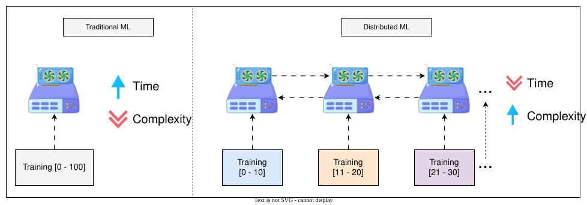

A snapshot of traditional machine learning on a single node vs. distributed machine learning

DML includes techniques like dataand model parallelism that are crucial in optimizing different aspects of the training process. Let’s look at them in detail.

## Data parallelism[#](https://www.educative.io/courses/generative-ai-system-design/parallelism-in-genai-models#Data-parallelism)

In **data parallelism**, each GPU holds a full copy of the model. For inference, requests are spread across these replicas, which helps when a model fits on a single GPU but one instance can’t handle the request volume. Because requests vary in input length and generation time, though, some replicas can become overloaded while others sit underutilized. For training, the dataset is split across the GPUs, each GPU processes its own subset, and the gradients are synchronized to keep the replicas consistent, which cuts training time significantly.

Sharded data parallelism, used in techniques such as Fully Sharded Data Parallel (FSDP) and ZeRO, avoids keeping a full replica on each GPU. Instead, it splits parameters, gradients, and optimizer states across GPUs, which reduces memory usage and makes it possible to train larger models on limited GPU memory. These techniques are mainly used for training, but they can also support memory-efficient inference.

Using parallelism techniques, the GPT-3 model can be trained in just 34 days using 1,024 NVIDIA A100 GPUs, compared to over 350 years using a single V100 GPU.

The dataset splitting is quite simple:

- We can split the data equally if all nodes are computationally equal (homogenous cluster).
- If nodes are computationally different, i.e., some are more powerful than others (heterogenous cluster), we can split the data using some bias.

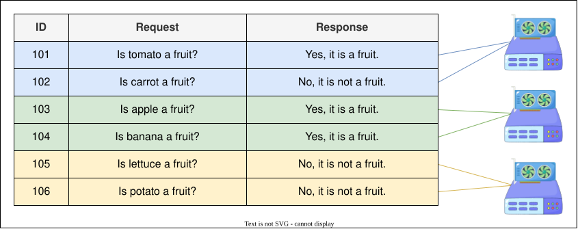

1 / 2

Data splitting in a homogenous cluster

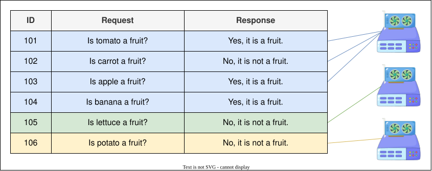

1 / 2

Data splitting in a heterogenous cluster

There are various model synchronization techniques, each with pros and cons.

### Parameter server[#](https://www.educative.io/courses/generative-ai-system-design/parallelism-in-genai-models#Parameter-server)

This technique uses a separate server to manage the model’s weights. The server aggregates and updates the model weights by pulling individual gradients from each training server. We can call this approach centralized due to a central point of truth. However, this solution presents the classic System Design problem: a single point of failure.

Centralized approach for model synchronization

### Peer-to-peer synchronization[#](https://www.educative.io/courses/generative-ai-system-design/parallelism-in-genai-models#Peer-to-peer-synchronization)

**Peer-to-peer (P2P)** synchronization is a decentralized approach where servers (nodes) work collaboratively to synchronize the model. Each server communicates with its peers to gather and share updates, ensuring everyone stays on the same page. There are many sub-types of P2P model synchronization, including:

- **AllReduce:** The simplest approach in P2P data parallelism is where every node contributes its local gradients to its peers, and a global average is calculated. This guarantees that all workers operate on identical updated gradients after synchronization. This is efficient for small clusters and eliminates the single point of failure, but its communication and complexity overhead quickly adds up.

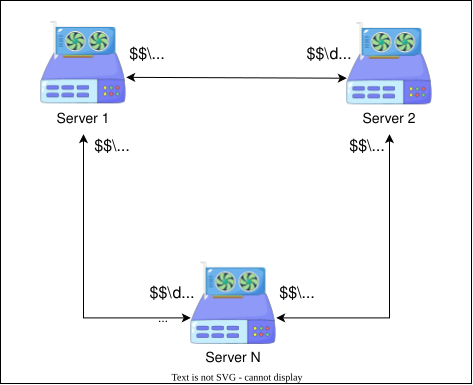

1 / 3

The gradients are sent to each server to perform AllReduce

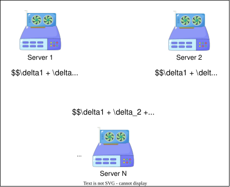

1 / 3

The gradients are aggregated at each server

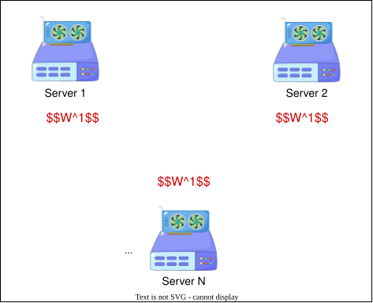

1 / 3

The weights are then calculated using the All-Reduce aggregated gradients

- **Ring AllReduce:** This is a specialized implementation of AllReduce, which organizes workers in a virtual ring topology to reduce communication overhead. Each worker communicates only with its two neighbors, passing gradients sequentially. This scales efficiently with more training servers and has lower bandwidth requirements than basic AllReduce. However, this sequential information passing can sometimes be slower, especially if one server lags.

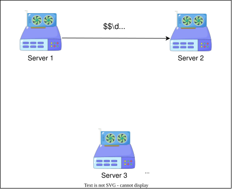

1 / 4

Server 1 sends its gradients to server 2

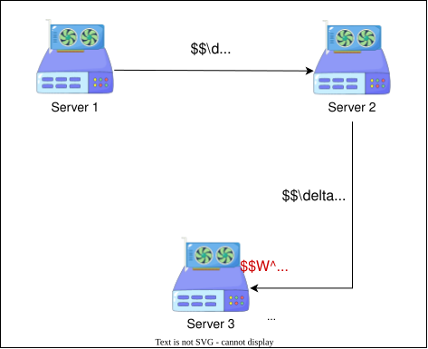

1 / 4

Server 2 aggregates it with its gradient and sends this to server 3

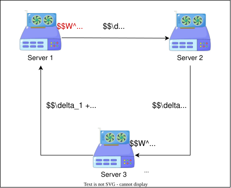

1 / 4

Server 3 aggregates this gradient with its own and sends the result back to server 1. Now, server 1 and server 3 have all the gradients, so we just need to update server 2 with them.

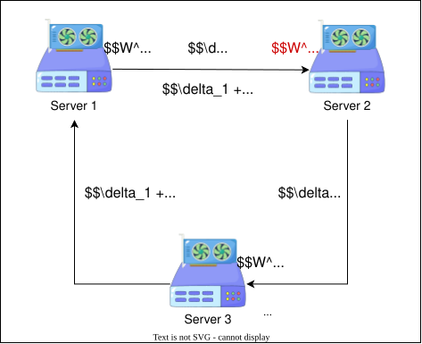

1 / 4

Server 1 sends the aggregated gradients to server 2

- **Hierarchical AllReduce:** When scaling to thousands of GPUs, the communication demands of basic AllReduce or ring AllReduce become overwhelming. Hierarchical AllReduce introduces intermediate aggregation steps by grouping workers into smaller subgroups.  
  Hierarchical AllReduce organizes communication into multiple levels:

  - **Cluster coordinators:** The GPUs are divided into smaller groups, each managed by a coordinator. Think of these coordinators as team leaders.
  - **Within-cluster aggregation:** A simpler method like AllReduce or ring AllReduce combines updates inside each cluster. It’s easier to manage things within smaller teams.
  - **Coordinator communication:** The coordinators then use AllReduce to communicate and combine the aggregated updates from each group, creating a streamlined flow of information.

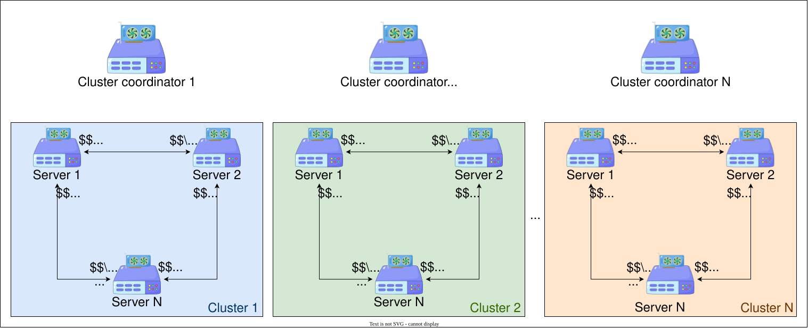

1 / 6

The training servers communicate gradients intra-cluster

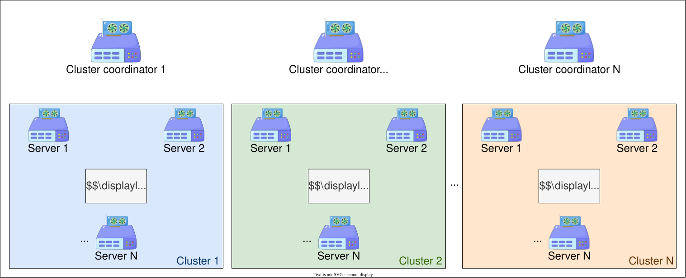

1 / 6

These gradients are aggregated

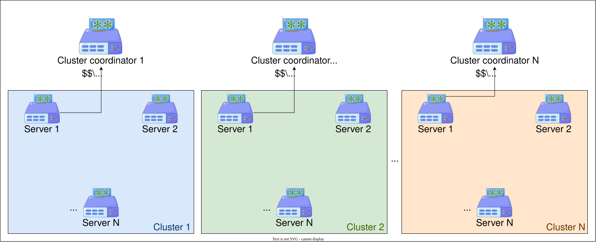

1 / 6

One of the servers from each cluster then communicates this aggregate to their cluster coordinator

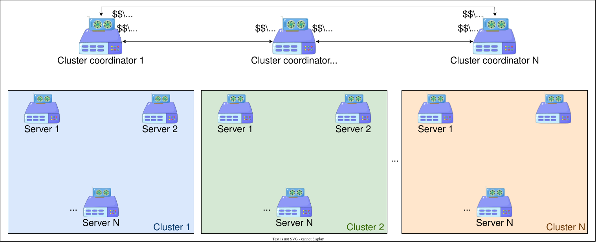

1 / 6

The coordinators then communicate these aggregated weights among themselves

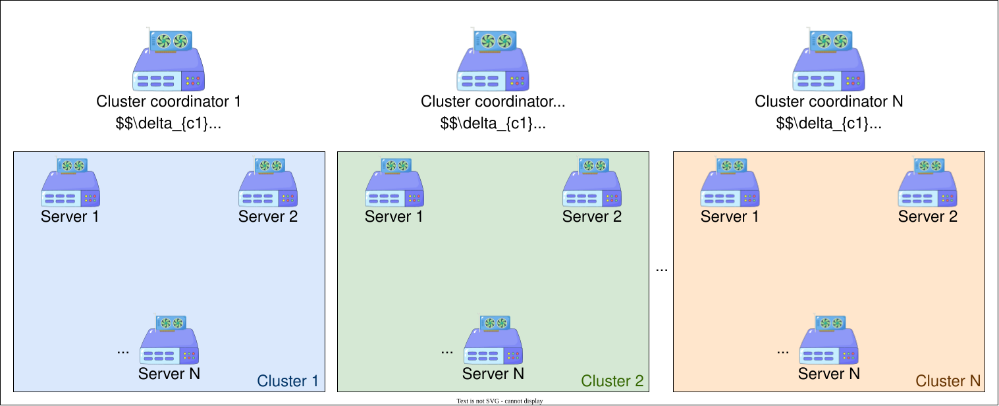

1 / 6

The coordinators calculate the aggregate of these gradients

Note that after the aggregation within the cluster is wrapped up, each server in the cluster possesses that information. So, even if one fails, this information can be communicated to the coordinators. Due to the redundancy in each step, we can scale this architecture to thousands of servers, but the same is its con: We are calculating the same information multiple times, increasing the complexity.

Here’s a summary of the different architectural concepts we discussed in data parallelism:

|  |  |  |
| --- | --- | --- |
| **Aspect** | **Centralized Parameter Servers** | **Peer-to-Peer (P2P)(Decentralized)** |
| Architecture | Uses a central parameter server to aggregate model updates and distribute parameters. | Peer-to-peer communication (no central coordinator). |
| Communication Pattern | One-to-many (workers to server and vice versa). | Many-to-many (workers communicate with neighbors). |
| Scalability | Limited by the central server’s capacity (network, CPU, memory). | Highly scalable; no central bottleneck. |
| Fault Tolerance | The centralized server is a single point of failure. | More resilient to individual node failures; no single point of failure. |
| Synchronization | Easier to implement synchronous or asynchronous updates through the server. | Challenging to synchronize without global coordination. |
| Implementation Complexity | Low | High |

## Model parallelism[#](https://www.educative.io/courses/generative-ai-system-design/parallelism-in-genai-models#Model-parallelism)

Model parallelism splits a model across multiple GPUs or machines. During inference, its primary purpose is to run models that do not fit in a single GPU's memory. It can also reduce computation time when operations are distributed across devices, as in tensor parallelism. However, layer-wise partitioning, also called pipeline parallelism, primarily distributes computation across stages and does not necessarily reduce the latency of an individual request. Communication overhead can further offset performance gains.

Two common approaches are:

- **Tensor parallelism:** Splits individual layer computations across GPUs. The devices exchange intermediate results during execution, allowing a layer's weights and computation to be distributed. This communication adds overhead, so fast interconnects are important.
- **Pipeline parallelism:** Places different groups of model layers on different GPUs. Activations pass between stages as requests move through the model. Pipeline scheduling can improve utilization, although poorly balanced stages or insufficient concurrent work can leave GPUs idle.

## Hybrid parallelism[#](https://www.educative.io/courses/generative-ai-system-design/parallelism-in-genai-models#Hybrid-parallelism)

Hybrid parallelism combines data parallelism with model parallelism to leverage the benefits of both approaches. For example, a large model can be split across multiple GPUs using model parallelism, and multiple replicas of that distributed model can handle incoming requests using data parallelism. This allows the serving system to address both GPU memory constraints and high request volume.

The trade-off is increased infrastructure complexity and communication overhead. The chosen configuration should match the model's memory requirements, expected traffic, and latency and throughput targets.

Hybrid parallelism in machine learning

**Note:** In our design problems, we exclusively use data parallelism due to its convenience and the ability of new GPUs to fit the models we use. We should use model or hybrid parallelism in extremely large models (which do not fit on single GPUs, e.g., GPT) or in inferencing.

## Challenges in parallelizing GenAI models[#](https://www.educative.io/courses/generative-ai-system-design/parallelism-in-genai-models#Challenges-in-parallelizing-GenAI-models)

Parallelizing generative AI models successfully requires careful consideration of various factors. While the potential benefits are significant, there are challenges to address. Let’s explore these challenges and their solutions:

### Fault tolerance[#](https://www.educative.io/courses/generative-ai-system-design/parallelism-in-genai-models#Fault-tolerance)

In large distributed systems, a GPU or machine failure can interrupt requests, particularly when a request depends on multiple devices.

We can alleviate these issues by:

- **Redundancy:** Use backup workers or redundant model replicas to handle failures and maintain availability.
- **Monitoring:** Monitor servers and GPUs so failures can be detected and handled promptly.
- **Retries and timeouts:** Retry eligible failed requests or redirect them to healthy replicas, subject to latency and resource limits.

1.

You’re a machine learning engineer at a startup. You have a limited budget for cloud computing resources. You need to train a large language model quickly and reliably.

**Question:** How would you allocate resources between training servers and replication to achieve the best speed and fault tolerance balance? Consider the following options:

1. **Maximize training servers, minimal replication:** Invest heavily in training servers to parallelize the workload and speed up training. Use minimal replication to handle only the most critical failures.
2. **Balanced approach:** Allocate a moderate number of servers for both training and replication. This provides a balance between speed and fault tolerance.
3. **Prioritize replication, fewer training servers:** Focus on high replication to ensure maximum fault tolerance, even if it means using fewer servers for training and potentially slower training times.

Show Answer

Did you find this helpful?

### Hardware heterogeneity[#](https://www.educative.io/courses/generative-ai-system-design/parallelism-in-genai-models#Hardware-heterogeneity)

Not all GPUs or servers in a distributed setup have the same compute power, memory, or architecture. These differences can cause inefficiencies and bottlenecks during inference.

We can address these issues by:

- **Device-aware placement:** Assign model components and workloads according to each device's computational capabilities and memory.
- **Unified architecture:** Use homogeneous hardware clusters, such as GPUs of the same class, or optimize the software stack to handle hardware differences.

A snapshot of a heterogeneous training setup, where some GPUs can perform computations at 6.4x the rate of others. So, we should assign them 6.4x more work to do.

### Load imbalance[#](https://www.educative.io/courses/generative-ai-system-design/parallelism-in-genai-models#Load-imbalance)

If certain GPUs handle more work than others, this results in idle time for some devices and reduces overall efficiency. This is the phenomenon of load imbalance.

We can balance the load by:

- **Dynamic request allocation:** Distribute requests based on replica availability, workload, and processing capacity.
- **Continuous batching:** Group compatible requests together to improve GPU utilization and throughput.
- **Partition optimization:** For model parallelism, assign model components to devices according to their computational capacity to reduce bottlenecks between stages.

### Communication overhead[#](https://www.educative.io/courses/generative-ai-system-design/parallelism-in-genai-models#Communication-overhead)

When a model is distributed across multiple GPUs, the devices must exchange intermediate results during inference. Frequent communication can increase response latency and offset the benefits of parallel execution.

We can reduce this overhead by choosing an appropriate model partitioning strategy, keeping communication-intensive components close together where possible, and balancing computation against data transfer costs.

## Parallelism during training[#](https://www.educative.io/courses/generative-ai-system-design/parallelism-in-genai-models#Parallelism-during-training)

Parallelism also supports model training, where devices process training examples, compute gradients, and synchronize parameter updates. Data parallelism distributes training examples across model replicas, while model parallelism distributes model computations across devices. Techniques such as parameter servers and AllReduce coordinate model updates across workers.

The main distinction is that training parallelism distributes the work of updating model parameters, while inference parallelism distributes requests or computations used to generate responses with trained parameters. In a model-serving system, inference latency, throughput, and GPU memory usage are the primary concerns.

Use the widget below to solidify your knowledge of parallelism in GenAI.

AI Powered

Saved

15 attempts left

Reset

Say “Hi, Ed” to start.

You have 15 attempts to answer.

## Conclusion[#](https://www.educative.io/courses/generative-ai-system-design/parallelism-in-genai-models#Conclusion)

DML has emerged as a cornerstone of modern AI, enabling researchers and practitioners to scale their models and datasets to unprecedented levels. DML overcomes the limitations of single-node training by leveraging powerful concurrency techniques, such as data, model, and hybrid parallelism. Centralized and decentralized synchronization methods offer flexibility in communication, ensuring compatibility with diverse infrastructure and application requirements.

As AI models grow increasingly complex, the importance of efficient distribution strategies will only intensify. Innovations in DML frameworks and hardware acceleration continue to push the boundaries, making it possible to train very large models more efficiently.

Inference Optimization in GenAI Systems

Evaluation Metrics for GenAI Systems

Ask

[Data parallelism](https://www.educative.io/courses/generative-ai-system-design/parallelism-in-genai-models#Data-parallelism)

[Parameter server](https://www.educative.io/courses/generative-ai-system-design/parallelism-in-genai-models#Parameter-server)

[Peer-to-peer synchronization](https://www.educative.io/courses/generative-ai-system-design/parallelism-in-genai-models#Peer-to-peer-synchronization)

[Model parallelism](https://www.educative.io/courses/generative-ai-system-design/parallelism-in-genai-models#Model-parallelism)

[Hybrid parallelism](https://www.educative.io/courses/generative-ai-system-design/parallelism-in-genai-models#Hybrid-parallelism)

[Challenges in parallelizing GenAI models](https://www.educative.io/courses/generative-ai-system-design/parallelism-in-genai-models#Challenges-in-parallelizing-GenAI-models)

[Fault tolerance](https://www.educative.io/courses/generative-ai-system-design/parallelism-in-genai-models#Fault-tolerance)

[Hardware heterogeneity](https://www.educative.io/courses/generative-ai-system-design/parallelism-in-genai-models#Hardware-heterogeneity)

[Load imbalance](https://www.educative.io/courses/generative-ai-system-design/parallelism-in-genai-models#Load-imbalance)

[Communication overhead](https://www.educative.io/courses/generative-ai-system-design/parallelism-in-genai-models#Communication-overhead)

[Parallelism during training](https://www.educative.io/courses/generative-ai-system-design/parallelism-in-genai-models#Parallelism-during-training)

[Conclusion](https://www.educative.io/courses/generative-ai-system-design/parallelism-in-genai-models#Conclusion)