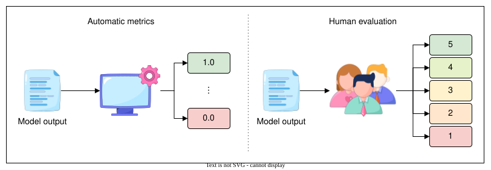
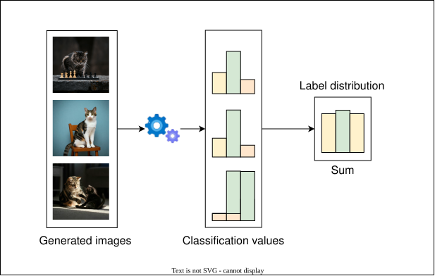
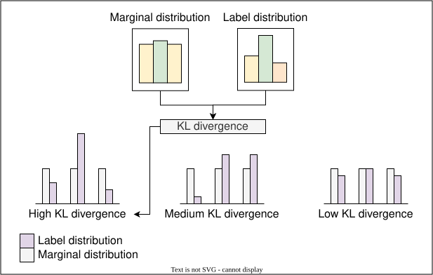
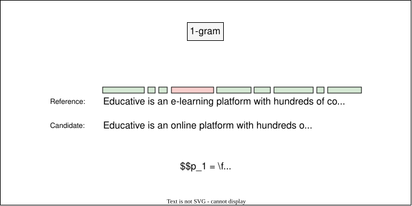
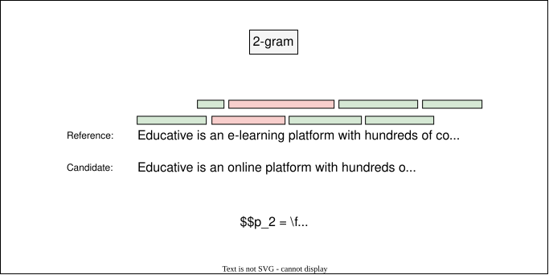
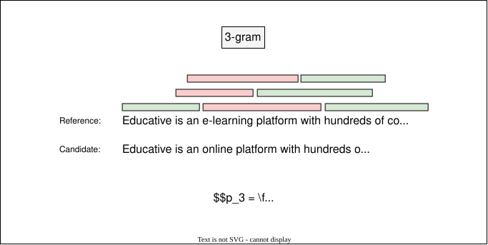

# Evaluation_Metrics_for_Generative_AI_Systems_Performance

Source: https://www.educative.io/courses/generative-ai-system-design/evaluation-metrics-for-genai-systems

---

[Home](https://www.educative.io/)

[Courses](https://www.educative.io/search?tab=courses)

[Grokking the Generative AI System Design Interview](https://www.educative.io/courses/generative-ai-system-design)

# Evaluation Metrics for GenAI Systems

Explore how to evaluate generative AI models using automatic metrics like BLEU, ROUGE, and CLIP scores alongside human evaluation methods. Understand their roles in measuring content quality, diversity, fluency, and relevance to ensure robust and ethical AI output.

We'll cover the following...

- [Automatic metrics](https://www.educative.io/courses/generative-ai-system-design/evaluation-metrics-for-genai-systems#Automatic-metrics)
  - [Inception score](https://www.educative.io/courses/generative-ai-system-design/evaluation-metrics-for-genai-systems#Inception-score)
  - [Fréchet inception distance](https://www.educative.io/courses/generative-ai-system-design/evaluation-metrics-for-genai-systems#Frchet-inception-distance)
  - [BLEU score](https://www.educative.io/courses/generative-ai-system-design/evaluation-metrics-for-genai-systems#BLEU-score)
  - [ROUGE score](https://www.educative.io/courses/generative-ai-system-design/evaluation-metrics-for-genai-systems#ROUGE-score)
  - [Perplexity score](https://www.educative.io/courses/generative-ai-system-design/evaluation-metrics-for-genai-systems#Perplexity-score)
  - [CLIP score](https://www.educative.io/courses/generative-ai-system-design/evaluation-metrics-for-genai-systems#CLIP-score)
- [Human evaluation](https://www.educative.io/courses/generative-ai-system-design/evaluation-metrics-for-genai-systems#Human-evaluation)
  - [Mean opinion score](https://www.educative.io/courses/generative-ai-system-design/evaluation-metrics-for-genai-systems#Mean-opinion-score)
  - [Task-specific quality evaluation](https://www.educative.io/courses/generative-ai-system-design/evaluation-metrics-for-genai-systems#Task-specific-quality-evaluation)
  - [Pairwise comparison](https://www.educative.io/courses/generative-ai-system-design/evaluation-metrics-for-genai-systems#Pairwise-comparison)
- [Conclusion](https://www.educative.io/courses/generative-ai-system-design/evaluation-metrics-for-genai-systems#Conclusion)

Evaluating generative AI models involves assessing their performance and effectiveness in creating new content, such as text, images, audio, or videos. Unlike traditional AI systems that analyze existing (training) data to classify information or predict outcomes, generative models produce novel outputs that should be coherent, creative, and relevant to the input or context.

Generative AI model evaluation is crucial today because:

- Evaluation ensures the generated content is meaningful, accurate, and meets the required standards. For example, the output must be fluent, contextually relevant, and error-free in text generation.
- Evaluation metrics help compare the GenAI system’s effectiveness, guiding developers in choosing or improving models for specific applications.
- Proper evaluation can highlight biases or harmful content in generated outputs, ensuring the ethical deployment of generative systems.

Evaluation is critical in avoiding *mode collapse*, where the model produces repetitive or low-diversity outputs, reducing its practical utility.

Evaluation can be conducted in two ways:

1. **Automatic metrics:** Quantitative measures that do not require human intervention. Usually, the evaluation metric method scores 0 (worst) to 1 (best).
2. **Human evaluation:** Qualitative insights gained by collecting user feedback or expert judgments. Usually, users rate the outputs on a scale of 1 (worst) to 5 (best).

A snapshot of automatic vs. human evaluation

While these evaluation metrics are not exclusive to GenAI models, they are critical in assessing generated content quality. This discussion will explore some of the most commonly used metrics in GenAI model evaluation and their applications.

## Automatic metrics[#](https://www.educative.io/courses/generative-ai-system-design/evaluation-metrics-for-genai-systems#Automatic-metrics)

Automatic metrics rely on computational methods to assess generative AI outputs. They provide fast, consistent, and scalable evaluations without human involvement and are widely used during model training and testing phases. The most common automatic metrics include inception score (IS), Fréchet inception distance (FID), BLEU score, ROUGE score, perplexity, and CLIP score.

### Inception score[#](https://www.educative.io/courses/generative-ai-system-design/evaluation-metrics-for-genai-systems#Inception-score)

The inception score uses a pretrained classifier (e.g., Inception v3) to see how well it can recognize objects in the generated images. The generated images are considered of high quality and diverse if the classifier is confident and finds various objects. A *higher IS* indicates that the images are both diverse and realistic. However, IS assumes that the classifier aligns well with the dataset, which can limit its applicability.

The inception score is calculated using the following steps:

1. Finding the label distribution.
2. Finding the marginal distribution.
3. Calculating the [Kullback–Leibler (KL) divergence](https://www.educative.io/answers/what-is-kl-divergence) between the label and marginal distributions.
4. Taking the exponential of this KL divergence to give us a final score.

Let’s look at all those terms in action:

")

1 / 4

First, we need to classify the output images. We cannot produce a reliable IS if the classifier can not classify the outputs correctly. (Source: AI-generated using Imagen 3)

1 / 4

Now, we can calculate the label distribution for each label.

 distribution.")

1 / 4

Then, we can calculate the data’s marginal (total) distribution.

1 / 4

We will use the marginal and label distributions to calculate the KL divergence. The high KL divergence distribution looks similar to the leftmost distribution. The IS is simply the exponent of this KL divergence score.

**Note:** While the inception score is primarily used for evaluating image generation, there are a few ways to adapt its core ideas for text generation. Instead of using a pretrained image classifier, we can use a pretrained language model. This language model can analyze the generated text and provide probabilities for different categories or topics.

### Fréchet inception distance[#](https://www.educative.io/courses/generative-ai-system-design/evaluation-metrics-for-genai-systems#Frchet-inception-distance)

FID compares the mean and covariance of feature embeddings from real and generated images. We get these embeddings using a pretrained embedding model (e.g., Inception v3). Unlike IS, it is more sensitive to subtle flaws, such as mode collapse, where a model produces outputs with low diversity. Lower FID scores indicate greater similarity between the two distributions, i.e., better images.

FID can be calculated by:

1. Generating embeddings of the real and the generated image using an embedding model.
2. Calculating the mean and the standard deviation of these embedding vectors.
3. Using the distance formula d(X,Y)=(μx−μy)2+(σx−σy)2d(X,Y) = (\mu\_x - \mu\_y)^2 + (\sigma\_x-\sigma\_y)^2d(X,Y)=(μx​−μy​)2+(σx​−σy​)2, we can calculate the FID between the collections of images, as seen in the illustration below:

We will calculate FID for images. Similar methods apply to other mediums of output.

AI Powered

Saved

12 attempts left

Reset

Using FID to calculate text similarity

Hi! I’m Ed. I’ll help you practice System Design interview questions from Grokking the Generative AI System Design.

Would you prefer to be mentored with hints and explanations or evaluated on your answers?

You have 12 attempts to answer.

### BLEU score[#](https://www.educative.io/courses/generative-ai-system-design/evaluation-metrics-for-genai-systems#BLEU-score)

BLEU (bilingual evaluation understudy) measures the similarity between generated and reference texts by comparing n-grams. It is widely used in translation tasks, where precision is critical. However, it struggles with creative tasks because it emphasizes exact matches. The BLEU score should be high (close to 1) if the texts match and low (close to 0) when they don’t.

Let’s look at an example in detail. Our reference sentence is, “Educative is an e-learning platform with hundreds of courses,” and the generated candidate sentence is, “Educative is an online platform with hundreds of courses.” For simplicity, we will calculate only up to three grams.

1 / 3

We can calculate the 1-gram using single words.

1 / 3

We can calculate the 2-gram using the 2-word pairs.

1 / 3

We can calculate the 3-gram using the 3-word combinations.

Let’s calculate the BLEU score for the example above.

We use the following formula:

BLEU(N)=Brevity penalty×Geometric average Precision\text{BLEU(N)} = \text{Brevity penalty} \times \text{Geometric average Precision}BLEU(N)=Brevity penalty×Geometric average Precision

Where N\text{N}N is the precision of grams we have, brevity penalty is a variable that penalizes the score if the generated sentences are too short, and the geometric average precision is the actual score from the matches in n-grams.

Geometric average precision=∏n=1Npnwn\text{Geometric average precision} = \prod\_{n=1}^{N}p\_n^{w\_n}Geometric average precision=n=1∏N​pnwn​​

Where wn=1Nw\_n = \frac{1}{N}wn​=N1​. So, we get:

=(p1)13×(p2)13×(p3)13=(89)13×(68)13×(47)13= (p\_1)^{\frac{1}{3}} \times (p\_2)^{\frac{1}{3}} \times (p\_3)^{\frac{1}{3}} = \left(\frac{8}{9}\right)^{\frac{1}{3}} \times \left(\frac{6}{8}\right)^{\frac{1}{3}} \times \left(\frac{4}{7}\right)^{\frac{1}{3}}=(p1​)31​×(p2​)31​×(p3​)31​=(98​)31​×(86​)31​×(74​)31​

Geometric Average Precision≈0.723\text{Geometric Average Precision} \approx 0.723Geometric Average Precision≈0.723

Brevity penalty={1,if c>re(1−r/c),if c≤r\text{Brevity penalty} = \begin{cases}1, & \text{if } c > r \\e^{(1 - r/c)}, & \text{if } c \leq r\end{cases}Brevity penalty={1,e(1−r/c),​if c>rif c≤r​

Where rrr is the number of words in the reference text, and ccc is the number of words in the candidate (predicted) text. As the predicted length (9) is the same as the reference length (9), the penalty here should be none, i.e., 1 (rc\frac r ccr​= 1 and e1−1=1e^{1-1} = 1e1−1=1).

BLEU(3)=1×0.723=0.723\text{BLEU(3)} = 1 \times 0.723 = 0.723BLEU(3)=1×0.723=0.723

We get a BLEU score close to 1, meaning the sentences are similar.

1.

Why do we penalize generated sentences that are shorter and not ones that are longer when calculating BLEU?

Show Answer

Did you find this helpful?

### ROUGE score[#](https://www.educative.io/courses/generative-ai-system-design/evaluation-metrics-for-genai-systems#ROUGE-score)

ROUGE (Recall-Oriented Understudy for Gisting Evaluation) focuses on recall and evaluates how much of the reference text’s content is captured by the generated text. It is particularly effective for summarization tasks. It calculates how many n-grams, words, or sequences in the reference text are present in the generated text.

The most common type of ROUGE is ROUGE-N, which compares n-grams. There’s also ROUGE-L, which measures the longest common subsequence (LCS) between the candidate text and the reference text, and ROUGE-S, which measures the skip-bigram (bi-gram with at most one intervening word) overlap between the candidate text and the reference text. ROUGE scores range from 0 to 1, where higher values indicate better overlap with the reference text.

Here is an example of a ROUGE-1 score (a variant of ROUGE-N):

The ROUGE-1 score calculation process

Now, to calculate the ROUGE score, all we need is the following formula:

ROUGE (F1-Score)=2×P×RP+R\text{ROUGE (F1-Score)} = 2 \times \frac{P \times R}{P + R}ROUGE (F1-Score)=2×P+RP×R​

Where:

- PPP is the precision metric.

P=NummatchesLengthcandidate P = \frac{Num\_{matches}}{Length\_{candidate}}P=Lengthcandidate​Nummatches​​

- RRR is the recall metric.

R=NummatchesLengthreference R = \frac{Num\_{matches}}{Length\_{reference}}R=Lengthreference​Nummatches​​

**Note:** The LengthLengthLength here is the number of tokens in the split string, e.g., `[The, cat, is, on, the, parrot]` has six words, so its length will be 6.

Let’s calculate these values for our example:

P=57, R=56P = \frac{5}{7}, \ R = \frac{5}{6}P=75​, R=65​

ROUGE=2×57×5657+56=0.77  OR  77%\text{ROUGE} = 2 \times \frac{\frac{5}{7}\times\frac{5}{6}}{\frac{5}{7}+\frac{5}{6}} = 0.77 \ \ \text{OR} \ \ 77\%ROUGE=2×75​+65​75​×65​​=0.77  OR  77%

This indicates that the sentences are quite similar.

Learn more about the F1-score in [this Educative Answer](https://www.educative.io/answers/what-is-the-f1-score).

### Perplexity score[#](https://www.educative.io/courses/generative-ai-system-design/evaluation-metrics-for-genai-systems#Perplexity-score)

Perplexity measures how well a language model predicts a sequence of words. Lower perplexity indicates greater fluency and confidence in generation. It is most effective when paired with qualitative evaluation to assess coherence.

- **Low perplexity (close to 1):** The model is confident that it can accurately create the sequence of words.
- **High perplexity (>20):** The model is unsure.

It works by using the probabilities of generated words. So, for example, if we have a trained model that has the vocabulary `["Hello", "Cat", "my", "Dog", "name", "is","Edward"]`, and we want to figure out the perplexity of generating the string: “My name is Edward,” we need to consider the following information:

- The probability of the first word: P(“My”)P(\text{“My”})P(“My”)
- The probability of the second word given the first word is “My”: P(“name” ∣ “My”)P(\text{“name”} \ | \ \text{“My”})P(“name” ∣ “My”)
- The probability of the third word given the first string is “My name”: P(“is” ∣ “My Name”)P(\text{“is”} \ | \ \text{“My Name”})P(“is” ∣ “My Name”)
- The probability of the fourth word given the first string is “My name is”: P(“Edward” ∣ “My Name is”)P(\text{“Edward”} \ | \ \text{“My Name is”})P(“Edward” ∣ “My Name is”)

Let’s assume those probabilities for now to be 0.3, 0.5, 0.9, and 0.7, respectively.

P(“My name is Edward”)=P(“My”)×P(“name” ∣ “My”)×P(“is” ∣ “My Name”)×P(“Edward” ∣ “My Name is”)P(\text{“My name is Edward”}) = P(\text{“My”}) \times P(\text{“name”} \ | \ \text{“My”}) \times P(\text{“is”} \ | \ \text{“My Name”}) \times P(\text{“Edward”} \ | \ \text{“My Name is”})P(“My name is Edward”)=P(“My”)×P(“name” ∣ “My”)×P(“is” ∣ “My Name”)×P(“Edward” ∣ “My Name is”)

P(“My name is Edward”)=0.3×0.5×0.9×0.7=0.0945P(\text{“My name is Edward”}) = 0.3 \times 0.5 \times 0.9 \times 0.7 = 0.0945P(“My name is Edward”)=0.3×0.5×0.9×0.7=0.0945

The perplexity PPL(x)\text{PPL}(x)PPL(x) here will be 1PNorm(x)\frac{1}{\text{PNorm}(x)}PNorm(x)1​.

Where PNorm(x)\text{PNorm}(x)PNorm(x) is the normalized probability of the sentence xxx having word count nnn, defined as:

PNorm(x)=P(x)1n\text{PNorm}(x) = P(x)^{\frac{1}{n}}PNorm(x)=P(x)n1​

PNorm(“My name is Edward”)=0.094514=0.5549\text{PNorm}(\text{“My name is Edward”}) = 0.0945^{\frac{1}{4}} = 0.5549PNorm(“My name is Edward”)=0.094541​=0.5549

PPL(x)=10.5549=1.80\text{PPL}(x) = \frac{1}{0.5549} = 1.80PPL(x)=0.55491​=1.80

So, the model can very confidently predict the coherence.

### CLIP score[#](https://www.educative.io/courses/generative-ai-system-design/evaluation-metrics-for-genai-systems#CLIP-score)

CLIP (Contrastive Language–Image Pre-training) score evaluates alignment between text and images using embeddings generated by OpenAI’s CLIP model, which is an open-source pretrained model. This model has been trained on image-text pairs.

Higher CLIP scores indicate better semantic matching between the text and the image. CLIP score is ideal for assessing text-to-image or multimodal generation. It works by:

1. **Embedding the text and image:** CLIP uses its pretrained model to encode the text and image into high-dimensional vectors.
2. **Calculate the similarity:** The cosine similarity between the text and image embeddings is computed. A *higher similarity score* indicates better alignment between the text and the image.

The cosine similarity value ranges from −1 (completely opposite) to 1 (completely aligned). We normalize this for the CLIP score:

- **Higher scores (~0.6–1):** There is strong alignment.
- **Lower scores (<0.5):** There is weak alignment or unrelated outputs.

**Note:** CLIP score is primarily used to evaluate image generation models. However, it is also used in other applications, such as text and video generation. We will discuss this later in the course.

Now, let’s look at some subjective ways to evaluate model performance.

")

The CLIP score calculation method (Source: AI-generated using Imagen 3)

## Human evaluation[#](https://www.educative.io/courses/generative-ai-system-design/evaluation-metrics-for-genai-systems#Human-evaluation)

Human evaluation involves subjective assessment by individuals to capture nuanced qualities of generative AI outputs that automated metrics might miss. It is particularly useful for evaluating aspects like creativity, fluency, and user satisfaction in textual and multimodal outputs. The most common metrics include mean opinion scores (MOS), task-specific quality evaluation (TSQE), and pairwise comparison.

### Mean opinion score[#](https://www.educative.io/courses/generative-ai-system-design/evaluation-metrics-for-genai-systems#Mean-opinion-score)

MOS is a widely used metric for evaluating subjective quality. Human evaluators rate outputs on a scale (e.g., 1–5), where higher scores indicate better performance. The mean of all scores provides a quantitative assessment of quality. It is commonly used in speech synthesis, text generation, and image quality evaluation.

Example of an MOS evaluation

### Task-specific quality evaluation[#](https://www.educative.io/courses/generative-ai-system-design/evaluation-metrics-for-genai-systems#Task-specific-quality-evaluation)

In TSQE, human evaluators assess specific dimensions of quality based on the task; for example, in text generation, we may have the following tasks:

- **Fluency:** Determines the grammatical correctness and natural flow of text.
- **Relevance:** Determines how well the generated output aligns with the input prompt or context.
- **Creativity:** Determines the originality and novelty of the content, especially in tasks like story generation or art creation.

For example, let’s say we have a prompt: “Write a brief story about a space explorer.”

- **Model A generates:** “Captain Nova landed on distant planet, marveling at its blue vegetation.”
- **Model B generates:** “The explorer bought a telescope to look at the stars.”

The TSQE may look like the following:

TSQE of two models on text-based tasks

This evaluation also usually ranges from 1–5, based on responses from the human evaluators.

### Pairwise comparison[#](https://www.educative.io/courses/generative-ai-system-design/evaluation-metrics-for-genai-systems#Pairwise-comparison)

Pairwise comparison is a simple yet effective method for evaluating generative AI outputs. It involves directly comparing two outputs for a given input. Evaluators choose the better output based on specific criteria, such as fluency, relevance, or creativity. This method is particularly useful for relative evaluation, helping identify which model or version performs better.

As with all other human evaluation methods, this method requires a large sample size and a large number of evaluators to reduce bias. However, it does allow us to measure metrics that are difficult for computers to understand.

Technical Quiz

1.

A customer support chatbot takes 8 seconds to generate its first token, but streams the remaining response quickly. Users complain that the system feels slow, even though the total response time is acceptable. Which metric should the team prioritize?

A.

Throughput

B.

Time to first token

C.

Time per output token

D.

Cost per request

---

1 / 3

## Conclusion[#](https://www.educative.io/courses/generative-ai-system-design/evaluation-metrics-for-genai-systems#Conclusion)

Evaluating generative AI systems is critical in developing models that produce high-quality, reliable, and contextually appropriate outputs. We explored two primary approaches: automatic metrics and human evaluation. While automatic metrics like BLEU, ROUGE, and CLIP scores provide fast and objective ways to assess performance, they often fail to capture nuances like creativity, coherence, and user satisfaction. On the other hand, human evaluation methods such as MOS and pairwise comparison excel at assessing subjective qualities but can be time-consuming and resource-intensive.

A robust evaluation strategy often combines both approaches, leveraging automatic metrics for scalability and human evaluation for depth and accuracy. This hybrid strategy ensures that generative AI models meet technical benchmarks, align with user expectations, and deliver meaningful, engaging outputs. As generative AI continues to evolve, developing new, task-specific evaluation methods will be crucial in pushing the boundaries of model performance and utility.

Parallelism in GenAI Models

LLM-as-Judge and the Offline Eval Harness

Ask

[Automatic metrics](https://www.educative.io/courses/generative-ai-system-design/evaluation-metrics-for-genai-systems#Automatic-metrics)

[Inception score](https://www.educative.io/courses/generative-ai-system-design/evaluation-metrics-for-genai-systems#Inception-score)

[Fréchet inception distance](https://www.educative.io/courses/generative-ai-system-design/evaluation-metrics-for-genai-systems#Frchet-inception-distance)

[BLEU score](https://www.educative.io/courses/generative-ai-system-design/evaluation-metrics-for-genai-systems#BLEU-score)

[ROUGE score](https://www.educative.io/courses/generative-ai-system-design/evaluation-metrics-for-genai-systems#ROUGE-score)

[Perplexity score](https://www.educative.io/courses/generative-ai-system-design/evaluation-metrics-for-genai-systems#Perplexity-score)

[CLIP score](https://www.educative.io/courses/generative-ai-system-design/evaluation-metrics-for-genai-systems#CLIP-score)

[Human evaluation](https://www.educative.io/courses/generative-ai-system-design/evaluation-metrics-for-genai-systems#Human-evaluation)

[Mean opinion score](https://www.educative.io/courses/generative-ai-system-design/evaluation-metrics-for-genai-systems#Mean-opinion-score)

[Task-specific quality evaluation](https://www.educative.io/courses/generative-ai-system-design/evaluation-metrics-for-genai-systems#Task-specific-quality-evaluation)

[Pairwise comparison](https://www.educative.io/courses/generative-ai-system-design/evaluation-metrics-for-genai-systems#Pairwise-comparison)

[Conclusion](https://www.educative.io/courses/generative-ai-system-design/evaluation-metrics-for-genai-systems#Conclusion)