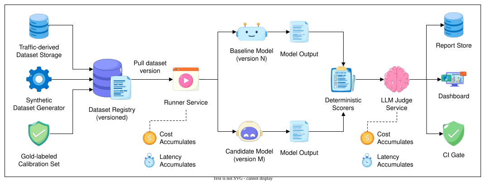

# Using_LLM-as-Judge_and_Offline_Evaluation_Harness_for_GenAI_Quality

Source: https://www.educative.io/courses/generative-ai-system-design/llm-as-judge-and-the-offline-eval-harness

---

[Home](https://www.educative.io/)

[Courses](https://www.educative.io/search?tab=courses)

[Grokking the Generative AI System Design Interview](https://www.educative.io/courses/generative-ai-system-design)

# LLM-as-Judge and the Offline Eval Harness

Explore how an offline evaluation harness uses datasets, runners, deterministic scorers, and LLM-as-judge models to score generative AI outputs. Learn to manage bias, calibrate with human-labeled data, and integrate these tools into CI pipelines for reliable release decisions and improved model performance.

We'll cover the following...

- [Automatic metrics in the harness](https://www.educative.io/courses/generative-ai-system-design/llm-as-judge-and-the-offline-eval-harness#Automatic-metrics-in-the-harness)
- [Datasets and gold labels](https://www.educative.io/courses/generative-ai-system-design/llm-as-judge-and-the-offline-eval-harness#Datasets-and-gold-labels)
  - [Dataset sources in the harness](https://www.educative.io/courses/generative-ai-system-design/llm-as-judge-and-the-offline-eval-harness#Dataset-sources-in-the-harness)
- [Pairwise comparison and pointwise scoring](https://www.educative.io/courses/generative-ai-system-design/llm-as-judge-and-the-offline-eval-harness#Pairwise-comparison-and-pointwise-scoring)
  - [How the runner uses each mode](https://www.educative.io/courses/generative-ai-system-design/llm-as-judge-and-the-offline-eval-harness#How-the-runner-uses-each-mode)
    - [Pointwise for monitoring](https://www.educative.io/courses/generative-ai-system-design/llm-as-judge-and-the-offline-eval-harness#Pointwise-for-monitoring)
    - [Pairwise for promotion decisions](https://www.educative.io/courses/generative-ai-system-design/llm-as-judge-and-the-offline-eval-harness#Pairwise-for-promotion-decisions)
- [Judge failure modes and reliability gaps](https://www.educative.io/courses/generative-ai-system-design/llm-as-judge-and-the-offline-eval-harness#Judge-failure-modes-and-reliability-gaps)
  - [Common failure modes in practice](https://www.educative.io/courses/generative-ai-system-design/llm-as-judge-and-the-offline-eval-harness#Common-failure-modes-in-practice)
  - [Mitigations built into the harness](https://www.educative.io/courses/generative-ai-system-design/llm-as-judge-and-the-offline-eval-harness#Mitigations-built-into-the-harness)
- [Calibration CI and scale economics](https://www.educative.io/courses/generative-ai-system-design/llm-as-judge-and-the-offline-eval-harness#Calibration-CI-and-scale-economics)
  - [End-to-end release flow](https://www.educative.io/courses/generative-ai-system-design/llm-as-judge-and-the-offline-eval-harness#End-to-end-release-flow)
  - [Cost and speed trade-offs](https://www.educative.io/courses/generative-ai-system-design/llm-as-judge-and-the-offline-eval-harness#Cost-and-speed-trade-offs)
- [Reports and interview-ready design choices](https://www.educative.io/courses/generative-ai-system-design/llm-as-judge-and-the-offline-eval-harness#Reports-and-interview-ready-design-choices)
- [Conclusion](https://www.educative.io/courses/generative-ai-system-design/llm-as-judge-and-the-offline-eval-harness#Conclusion)

A prompt tweak can look harmless in code review, the unit tests can stay green, and the new model can be 20 percent cheaper. Two days later, customer support notices that summaries have become longer, less faithful, and oddly confident about facts that were never in the source. Nothing crashed. The system simply performed worse at scale.

An offline eval harness prevents that kind of silent failure before CI promotes a change. In plain terms, it is a release system for quality. It runs representative prompts through baseline and candidate versions, scores outputs, and produces evidence for ship or no-ship decisions.

This lesson stays at the system-design level. The focus is not a single metric but the end-to-end machinery that turns prompt changes, model changes, or routing changes into release signals. We will use four building blocks that interviewers expect candidates to name clearly.

- **Datasets:** These supply representative and adversarial inputs for the evaluation run.
- **Runners:** These execute the application under baseline and candidate configurations and capture outputs with metadata.
- **Scorers:** These apply deterministic checks and judge-based scoring to each output.
- **Reports:** These aggregate slice-level and release-level results into dashboards and CI gates.

## Automatic metrics in the harness[#](https://www.educative.io/courses/generative-ai-system-design/llm-as-judge-and-the-offline-eval-harness#Automatic-metrics-in-the-harness)

Start with the cheapest layer. If the application can fail in a crisp, machine-checkable way, score that first and avoid paying an LLM judge to rediscover an obvious defect.

A **deterministic scorer** is a rule-based evaluator that returns the same result for the same output every time. In the harness, the runner writes outputs to a result store. Deterministic scorers then read them and emit pass or fail flags, numeric metrics, and failure reasons.

These checks commonly include exact match, schema validation, required-field presence, citation presence, banned-phrase detection, and lightweight overlap metrics. They work especially well when the model produces structured JSON, extracted entities, or constrained summaries with explicit requirements.

**Practical tip:** Put deterministic scorers first in the pipeline so malformed or incomplete outputs never reach expensive judge calls.

Their architectural role is similar to static analysis in a software build. They are low-latency, high-throughput gates that catch hard failures early.

They are not enough for helpfulness, tone, nuance, or subtle faithfulness. That gap is where judge models enter the scorer stack, which leads to the next design choice.

Before looking at judge models, it helps to visualize the full harness as a release pipeline.

Baseline vs. candidate model evaluation pipeline

That visual sets up the data side of the system, where most evaluation quality is decided long before any scoring prompt runs.

## Datasets and gold labels[#](https://www.educative.io/courses/generative-ai-system-design/llm-as-judge-and-the-offline-eval-harness#Datasets-and-gold-labels)

LLM judges reduce human review volume, but they do not replace human reference points. The harness stays reliable only when a stable human-labeled subset keeps the scorer calibrated.

A simple way to think about it is this. The judge grades homework, but humans still write the answer key for a small trusted packet.

### Dataset sources in the harness[#](https://www.educative.io/courses/generative-ai-system-design/llm-as-judge-and-the-offline-eval-harness#Dataset-sources-in-the-harness)

The harness usually combines three sources, each entering the dataset registry with version tags and privacy status.

- **Real traffic:** These samples reflect actual user behavior and preserve natural prompt phrasing, but they require privacy filtering, consent-aware logging, and redaction before they can enter an eval store.
- **Synthetic cases:** These samples target edge conditions such as jailbreak attempts, ambiguous instructions, and long-context overload, but they can overrepresent the scenarios engineers already expect.
- **Gold-labeled sets:** These are expert-reviewed examples with reference judgments or preferred outputs, but they are expensive to maintain and usually much smaller than traffic-derived sets.

A fixed **calibration set** is a stable gold subset that should not change every release. The runner reuses it across model swaps, prompt edits, and judge changes to detect drift in the scorer itself.

- **What calibration checks:** The harness measures judge-human agreement using simple agreement rate or Cohen’s kappa, which accounts for chance agreement. A calibration set of around 200-500 human-labeled examples is a practical starting point, with size adjusted based on label distribution and required confidence.
- **What interviews expect:** Interviewers usually want to hear representative sampling, distribution shift, and periodic human audit. Those phrases map directly to how data enters and validates the release pipeline.

With datasets in place, the next design choice is how the judge should compare outputs.

## Pairwise comparison and pointwise scoring[#](https://www.educative.io/courses/generative-ai-system-design/llm-as-judge-and-the-offline-eval-harness#Pairwise-comparison-and-pointwise-scoring)

The judge can score one answer on its own or compare two answers side by side. The chosen mechanism changes cost, interpretability, and release sensitivity.

A **pointwise score** rates a single output against a rubric, often on a fixed scale. A pairwise judge sees baseline and candidate answers for the same prompt and returns candidate win, baseline win, or tie.

### How the runner uses each mode[#](https://www.educative.io/courses/generative-ai-system-design/llm-as-judge-and-the-offline-eval-harness#How-the-runner-uses-each-mode)

When the runner executes a full eval batch, pointwise scoring attaches a scalar quality record to every output. Dashboards can then trend faithfulness or helpfulness over time and set direct thresholds.

Pairwise mode is closer to release decision-making. The runner binds both outputs to the same prompt, randomizes order, submits them to the judge, and records the preference plus rationale.

**Example: An LLM judge prompt**

A judge prompt defines the evaluation criteria, provides the output to assess, and specifies the expected response format. For example, a pointwise judge can evaluate whether a generated summary stays faithful to its source.

**Judge prompt**

`You are evaluating an AI-generated summary.`

**`- Source:`** `"The server experienced an outage for 20 minutes on Tuesday. The team restored service by restarting the database."`

**`- Generated summary:`** `"The server was unavailable for 20 minutes on Tuesday. The team restored service by restarting the database."`

`Evaluate the summary for faithfulness on a scale of 1 to 5, where 1 means largely unsupported and 5 means fully supported by the source.`

**`Return a JSON object with:`**

`- score`

`- rationale`

**Example output**

`{`

`"score": 5,`

`"rationale": "Both statements in the summary are supported by the source, with no added claims."`

`}`

The harness stores this result with the model and judge prompt versions, then aggregates scores across the evaluation dataset. A single judge score is useful for inspecting an example, but release decisions should rely on dataset-level results and calibration against human judgments.

#### Pointwise for monitoring[#](https://www.educative.io/courses/generative-ai-system-design/llm-as-judge-and-the-offline-eval-harness#Pointwise-for-monitoring)

Pointwise scores are easier to aggregate across releases. They support CI rules such as minimum faithfulness or maximum style-violation rate.

#### Pairwise for promotion decisions[#](https://www.educative.io/courses/generative-ai-system-design/llm-as-judge-and-the-offline-eval-harness#Pairwise-for-promotion-decisions)

Pairwise judging usually gives a stronger relative signal when deciding whether a new prompt or model is actually better than the baseline. It often detects subtle improvements that absolute scales flatten.

Reports often combine both. Absolute scores feed dashboards, while pairwise win rate drives release gates. Rubrics should prioritize dimensions in order, such as faithfulness first, then helpfulness, then conciseness, then style.

**Warning:** A rubric without priority ordering makes ties unstable and encourages judges to overvalue surface style over factual quality.

The trade-offs become clearer when we compare all scorer modes side by side.

|  |  |  |  |  |
| --- | --- | --- | --- | --- |
| **Mode** | **Best use case** | **Strengths** | **Failure risks** | **CI role** |
| Deterministic metrics | Hard validation checks and regressions | Cheapest, fastest, and most reliable for hard failures | Can miss nuance and quality differences not captured by rules | Primary gate for strict pass/fail checks |
| Pointwise LLM judging | Dashboards, scorecards, and threshold-based monitoring | Easiest to operationalize for dashboards and thresholds | Score drift, calibration inconsistency, and rubric sensitivity | Secondary quality monitor with alert thresholds |
| Pairwise LLM judging | Version-to-version comparisons and A/B evaluation | Strongest for comparative judgments between outputs | More expensive and more exposed to presentation and ordering effects | Best for release comparisons and model selection |

Once we add an LLM judge, the scorer itself becomes a moving dependency that can fail in patterned ways.

## Judge failure modes and reliability gaps[#](https://www.educative.io/courses/generative-ai-system-design/llm-as-judge-and-the-offline-eval-harness#Judge-failure-modes-and-reliability-gaps)

Judge models are not neutral instruments. They are components with bias, drift, and operational quirks, so the harness must observe the scorer the same way it observes the candidate model.

### Common failure modes in practice[#](https://www.educative.io/courses/generative-ai-system-design/llm-as-judge-and-the-offline-eval-harness#Common-failure-modes-in-practice)

Several patterns show up repeatedly in offline harnesses.

- **Position bias:** The judge favors the first or second answer because of presentation order rather than quality, which can falsely promote a candidate when ordering is fixed.
- **Verbosity bias:** Longer answers receive higher scores even when the extra text adds little value, which inflates dashboards and encourages bloated outputs.
- **Self-preference:** A judge may prefer answers produced by its own model family or stylistic habits, which distorts cross-model comparisons.
- **Rubric drift:** The same judging prompt can be interpreted differently across judge versions or over time, which makes trend lines unstable.
- **Authority bias:** Specific-sounding but incorrect answers may score too well because they appear confident or richly detailed.

### Mitigations built into the harness[#](https://www.educative.io/courses/generative-ai-system-design/llm-as-judge-and-the-offline-eval-harness#Mitigations-built-into-the-harness)

The harness should randomize answer order, score both answer orders on a sample, and treat flips as ties or low-confidence results. It should add explicit conciseness guidance to the rubric, use a different provider for the judge when possible, and version the judge model, judge prompt, and rubric together.

**Note:** The scorer is now another service dependency. If it changes, rerun the calibration set before trusting new numbers.

The report layer should track judge-human agreement, order-flip rate, length-score correlation, and agreement by task slice. Aggregate win rate alone can hide scorer instability.

After reliability controls, the remaining design problem is operationalizing the harness inside CI without making releases too slow or too expensive.

## Calibration CI and scale economics[#](https://www.educative.io/courses/generative-ai-system-design/llm-as-judge-and-the-offline-eval-harness#Calibration-CI-and-scale-economics)

A production harness behaves like a gated build. CI detects a prompt, routing, or model change, selects the relevant eval dataset slices, and dispatches a runner job for both baseline and candidate configurations.

### End-to-end release flow[#](https://www.educative.io/courses/generative-ai-system-design/llm-as-judge-and-the-offline-eval-harness#End-to-end-release-flow)

The execution path usually follows a fixed sequence.

- **Step 1:** The runner samples datasets from traffic-derived, synthetic, and calibration registries and attaches version metadata for reproducibility.
- **Step 2:** It executes baseline and candidate versions, stores outputs, runs deterministic checks first, and sends only surviving cases to pointwise or pairwise judging.
- **Step 3:** The report job computes aggregate scores, confidence intervals, slice breakdowns, and calibration health. CI then applies release rules such as minimum pairwise win rate, minimum faithfulness score, or minimum judge-human agreement. Choose a sample size large enough to detect the expected improvement, and promote a candidate only when the confidence interval indicates a statistically significant gain over the baseline.

### Cost and speed trade-offs[#](https://www.educative.io/courses/generative-ai-system-design/llm-as-judge-and-the-offline-eval-harness#Cost-and-speed-trade-offs)

Pairwise judging becomes expensive as the number of candidates grows because comparisons multiply across samples. Judge calls usually dominate both cost and wall-clock latency, so large evals need batching, concurrency limits, and caching for repeated prompts or reused baseline outputs.

A common pattern uses a smaller judge for coarse filtering and reserves a stronger judge for calibration subsets or borderline cases. Another lever is scoring only changed slices instead of rerunning every historical scenario.

**Practical tip:** Treat evaluation budget like any other production budget. Allocate fast checks for every commit and deeper judge runs for merge or release branches.

The result is a balance among statistical confidence, time to merge, and scoring cost. The final artifact the team sees is not the raw score stream but the report that turns those signals into a release decision.

## Reports and interview-ready design choices[#](https://www.educative.io/courses/generative-ai-system-design/llm-as-judge-and-the-offline-eval-harness#Reports-and-interview-ready-design-choices)

A strong eval report shows aggregate scores, pairwise win rate, confidence intervals, slice breakdowns, representative failures, output-length trends, and judge diagnostics. The dashboard should let a reviewer move from release summary to individual examples with full metadata, including prompt version, model version, and scorer version.

In an interview, present the answer in the same order the system runs. Start with quality dimensions, then choose dataset sources, then explain runner behavior, then justify deterministic checks plus judge mode, and then add bias controls and CI gates.

**Attention:** Vanity metrics without slices are dangerous. A global score can improve while safety, long-context, or ambiguous-query performance gets worse.

AI Powered

Saved

1 attempt left

Reset

Judge reliability

An LLM judge consistently gives higher scores to longer responses, even when they contain unnecessary information. What failure mode is this, and how should the evaluation harness address it?

This is your last attempt.

## Conclusion[#](https://www.educative.io/courses/generative-ai-system-design/llm-as-judge-and-the-offline-eval-harness#Conclusion)

An offline eval harness is the release mechanism that catches generation regressions before they hit production. It combines datasets, runners, scorers, and reports, then turns those components into CI gates instead of ad hoc testing.

Use deterministic checks wherever the task allows them, then add LLM-as-judge scoring for nuanced dimensions such as faithfulness and helpfulness. Pairwise judging often works better for release decisions, while pointwise scoring supports trend dashboards and threshold rules.

Most importantly, judges are not ground truth. Version them, calibrate them against stable human-labeled sets, and monitor them for bias and drift. In the next lesson, we will move from offline harnesses to online evaluation, measuring how the system performs on live production traffic.

Evaluation Metrics for GenAI Systems

Online Evaluation, Experiment Design, and Drift

Ask

[Automatic metrics in the harness](https://www.educative.io/courses/generative-ai-system-design/llm-as-judge-and-the-offline-eval-harness#Automatic-metrics-in-the-harness)

[Datasets and gold labels](https://www.educative.io/courses/generative-ai-system-design/llm-as-judge-and-the-offline-eval-harness#Datasets-and-gold-labels)

[Dataset sources in the harness](https://www.educative.io/courses/generative-ai-system-design/llm-as-judge-and-the-offline-eval-harness#Dataset-sources-in-the-harness)

[Pairwise comparison and pointwise scoring](https://www.educative.io/courses/generative-ai-system-design/llm-as-judge-and-the-offline-eval-harness#Pairwise-comparison-and-pointwise-scoring)

[How the runner uses each mode](https://www.educative.io/courses/generative-ai-system-design/llm-as-judge-and-the-offline-eval-harness#How-the-runner-uses-each-mode)

[Pointwise for monitoring](https://www.educative.io/courses/generative-ai-system-design/llm-as-judge-and-the-offline-eval-harness#Pointwise-for-monitoring)

[Pairwise for promotion decisions](https://www.educative.io/courses/generative-ai-system-design/llm-as-judge-and-the-offline-eval-harness#Pairwise-for-promotion-decisions)

[Judge failure modes and reliability gaps](https://www.educative.io/courses/generative-ai-system-design/llm-as-judge-and-the-offline-eval-harness#Judge-failure-modes-and-reliability-gaps)

[Common failure modes in practice](https://www.educative.io/courses/generative-ai-system-design/llm-as-judge-and-the-offline-eval-harness#Common-failure-modes-in-practice)

[Mitigations built into the harness](https://www.educative.io/courses/generative-ai-system-design/llm-as-judge-and-the-offline-eval-harness#Mitigations-built-into-the-harness)

[Calibration CI and scale economics](https://www.educative.io/courses/generative-ai-system-design/llm-as-judge-and-the-offline-eval-harness#Calibration-CI-and-scale-economics)

[End-to-end release flow](https://www.educative.io/courses/generative-ai-system-design/llm-as-judge-and-the-offline-eval-harness#End-to-end-release-flow)

[Cost and speed trade-offs](https://www.educative.io/courses/generative-ai-system-design/llm-as-judge-and-the-offline-eval-harness#Cost-and-speed-trade-offs)

[Reports and interview-ready design choices](https://www.educative.io/courses/generative-ai-system-design/llm-as-judge-and-the-offline-eval-harness#Reports-and-interview-ready-design-choices)

[Conclusion](https://www.educative.io/courses/generative-ai-system-design/llm-as-judge-and-the-offline-eval-harness#Conclusion)